# Audit landing page Gen-Z

Tanggal: 15 Oktober 2026, Asia/Jakarta. Mode antislop: After, dipilih pengguna untuk sesi ini. Audit, tanpa perubahan implementasi.

## Putusan

**5,5/10 sebagai landing page untuk mengajak calon operator dan investor masuk ke percakapan pilot.** Visual 7/10. Halaman punya aset visual yang menarik, tetapi kejelasan penawaran, bukti produk sendiri, dan penyelesaian conversion jauh tertinggal. Angka ini penilaian reviewer, bukan hasil pengujian pengguna, benchmark industri, atau prediksi conversion rate.

Masalah utamanya: halaman memakai ruang dan interaksi yang besar untuk mengulang konsep aset, hak, bukti, dan pembayaran, tetapi belum memberi satu contoh Gen-Z yang cukup konkret. Pengunjung melihat visi luas, lalu banyak batasan, lalu form yang hanya menghasilkan draft. Rasa kurang muncul dari jarak antara kualitas presentasi dan kedalaman informasi yang dibawa presentasi itu.

Status pre-pilot sendiri bukan cacat. Halaman tidak perlu berpura-pura sudah mempunyai aset, izin, yield, atau mitra. Yang dibutuhkan adalah fokus pilot, contoh yang jujur, penanggung jawab yang dapat dikenali, serta cara menghubungi yang selesai.

## Cakupan dan metode

- Menjalankan Vite lokal, halaman tersedia di http://127.0.0.1:5174/. Server pertama di sandbox tidak dapat diakses, server dengan akses localhost berhasil.
- Menelusuri 11 section utama, navigasi, footer, carousel, modal kategori, stack, lifecycle, evidence, workspace, role selector, disclosure, dan form inquiry.
- Desktop 1440 × 900. Reflow lokal 390 × 844, 320 × 740, dan tablet 768 × 1024. Ini viewport browser, bukan pengujian perangkat fisik.
- Membuka kedua pembanding langsung dalam audit ini. Screenshot lama proyek tidak dipakai sebagai bukti audit baru.
- Membaca DESIGN.md dan brief pre-pilot untuk membedakan implementasi, rencana, dan klaim yang belum mempunyai bukti.
- Menjalankan build produksi. Build berhasil dengan warning directive `use client` dan chunk berukuran besar.
- Seluruh bukti di [folder evidence](evidence-2026-10-15). [Pengukuran DOM](evidence-2026-10-15/measurements.json).
- Ikon mengambang AITOPIA/ChatGPT pada sejumlah screenshot adalah ekstensi browser. Itu tidak dihitung sebagai UI Gen-Z.

## Nilai per aspek

| Aspek | Nilai | Alasan |
| --- | --- | --- |
| Kesan visual | 7/10 | Hero, turbin, ruang putih, dan teal sudah menarik; beberapa gaya section belum terasa satu keluarga. |
| Kejelasan produk | 4,5/10 | Belum cepat menjawab Gen-Z produk apa, untuk siapa, dan apa yang tersedia sekarang. |
| Alur cerita | 4,5/10 | Banyak pengulangan, sasaran pengguna muncul terlambat, stack mendahului alasan memilih produk. |
| Kedalaman informasi | 5/10 | Hak, risiko, pokok, dan income dijelaskan hati-hati; belum ada contoh yang membuat hubungan itu nyata. |
| Identitas dan kekhasan | 4,5/10 | Nama, warna, dan landscape punya arah; workspace dan trust composition terlalu bergantung pada referensi. |
| Kepercayaan | 4,5/10 | Status pre-pilot dan batasan jujur; belum ada orang yang jelas, bukti proses aktual, atau jalur kontak yang selesai. |
| Conversion | 2,5/10 | CTA berujung ke draft lokal. Secara prototype bekerja, secara lead generation belum selesai. |
| Mobile | 7/10 | Reflow cukup baik pada lebar yang diperiksa; teks diagram kecil, target tombol pilot kurang nyaman. |
| Aksesibilitas | 6/10 sementara | Label, fokus, Escape dan state form ada; pemeriksaan screen reader, seluruh kontras, zoom dan reduced motion belum lengkap. |
| Performa produksi | Belum diberi nilai | Build dan ukuran file diperiksa; tidak ada pengukuran baru Core Web Vitals atau Lighthouse dalam audit ini. |

## Pembanding: yang benar-benar dapat dipelajari

**ReFiHub:** Menyebut aktivitas investasi dan distribusi kas sejak hero, lalu memperlihatkan listing bernama dan konteks aset. Navigasi mengarah ke produk, panduan, dan laporan. Pelajaran untuk Gen-Z: cepat menghubungkan proposisi dengan objek yang dapat diperiksa. Komposisi trust mereka menjadi kurang berguna bila disalin tanpa bukti setara. Klaim operasional dan angka mereka tidak diaudit di sini. [Halaman sumber](https://www.refihub.io/).

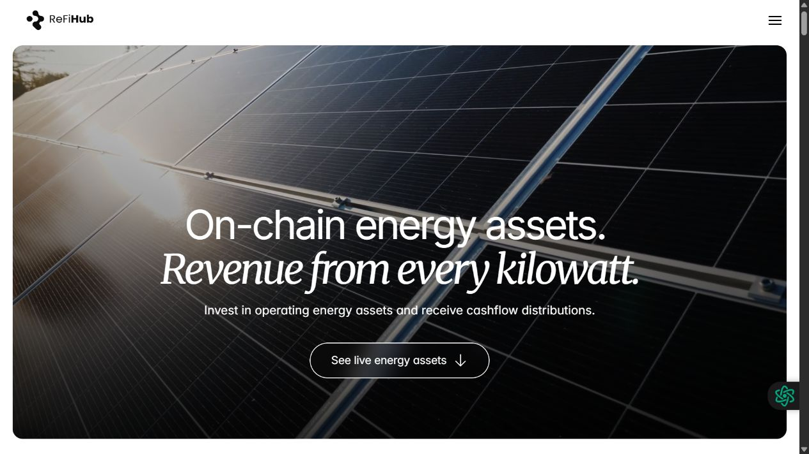

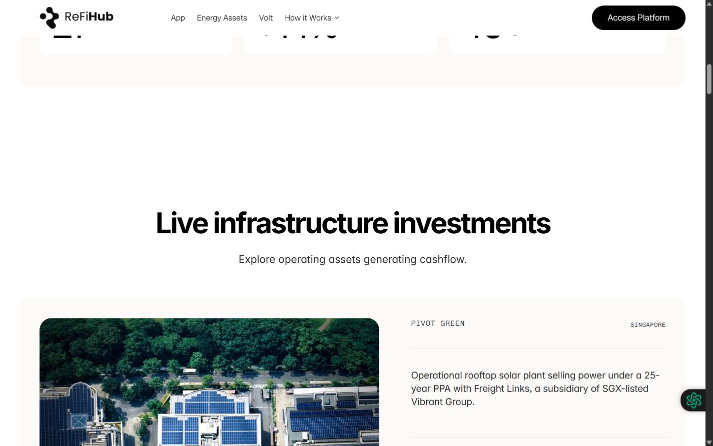

**GE Network:** Lebih tegas menyusun masalah pendanaan, persona, proses, dan fungsi produk bernama. Pelajaran untuk Gen-Z: setiap layer perlu menjelaskan pekerjaan yang dilakukan dan hasilnya. Klaim akses global, verification, yield, dan tidak perlunya audit pihak ketiga bukan bukti hanya karena tampil di halaman. Footer juga memiliki tautan legal ke `#`. Jangan meniru kekurangan itu. [Halaman sumber](https://www.ge.network/).

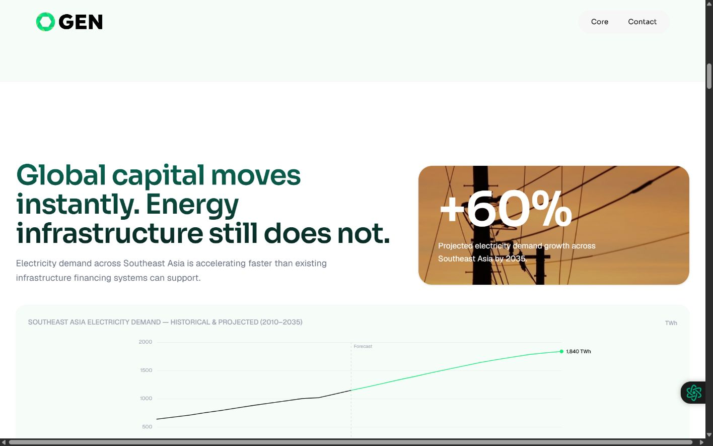

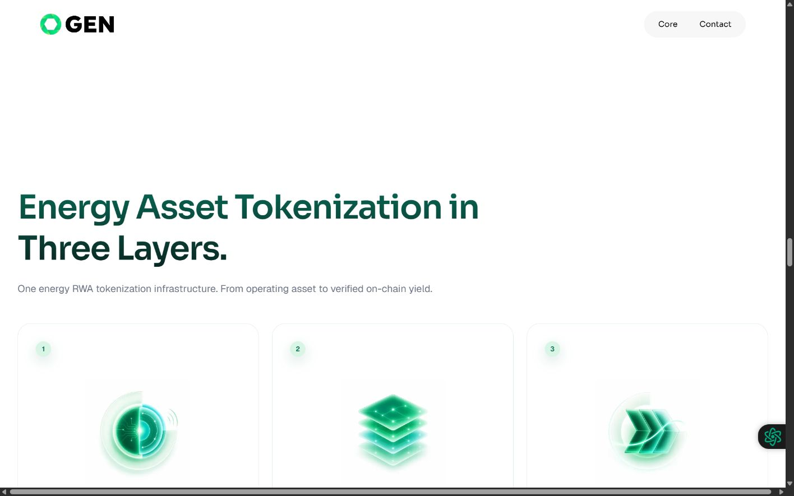

Perbandingan ini tentang komunikasi dan pengalaman halaman. Gen-Z pre-pilot tidak dituntut menampilkan traction atau listing yang belum dimiliki.

## Penilaian setiap langkah dan section

### Langkah 1. Navigasi dan hero: menarik, informasi inti lemah, 6/10

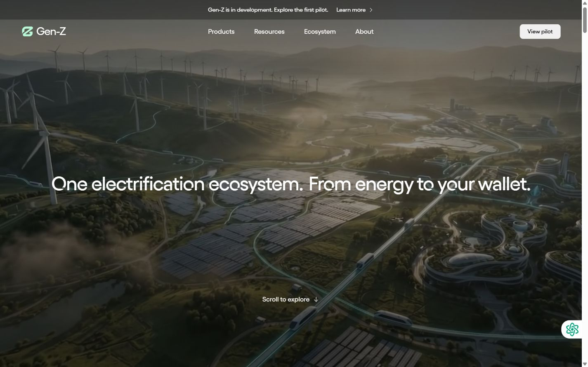

Landscape langsung mengomunikasikan energi dan memberi skala. Logo dan warna dapat dipertahankan. Transisi landscape menjadi kartu pusat cukup khas sebagai pengalaman.

Namun, dua slogan dibaca sebagai satu kalimat panjang di desktop. Kategori produk dan manfaat spesifik belum jelas. `One electrification ecosystem` dapat dipakai banyak bisnis energi; `From energy to your wallet` membuka interpretasi investasi, reward, pembayaran listrik, atau wallet crypto. Penjelasan tambahan baru terlihat setelah scroll. CTA utama di nav terlihat, tetapi `View pilot` belum menjelaskan apa yang akan dilihat.

Menu Products memuat enam pintu masuk untuk satu halaman konsep. Generation dan Infrastructure sama-sama menuju `#assets`, yang berisi turbin dan alur modal, bukan langsung carousel kategori. Kompleksitas menu memberi kesan katalog produk yang lebih matang daripada isi tujuannya, meski menu sudah menyebut in development.

Saran: tetap gunakan slogan sebagai lapisan brand, lalu satu kalimat eksplisit tentang audience, masalah, dan tahap. Rekomendasi copy konseptual, belum untuk diimplementasikan tanpa keputusan berikutnya: `Project finance for Indonesia's energy infrastructure.` Penjelasnya perlu menyebut platform sedang dikembangkan untuk menghubungkan operator dan investor eligible melalui hak proyek, bukti operasi, dan laporan pembayaran. CTA harus sesuai hasil nyata yang tersedia.

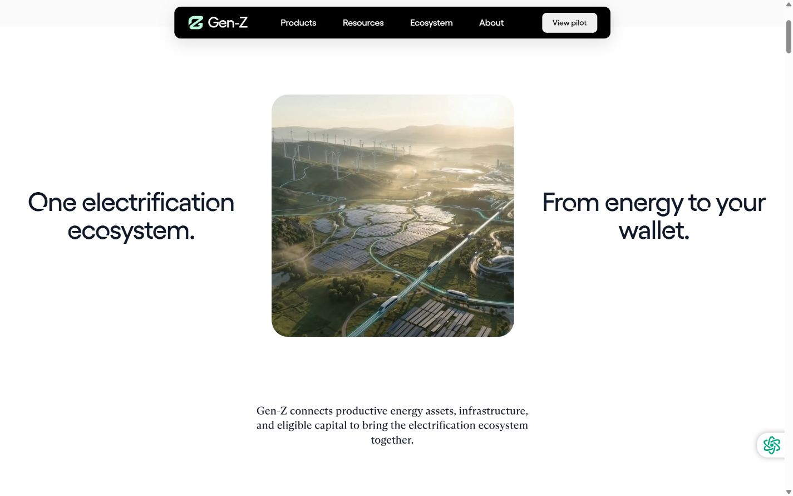

### Langkah 2. Electricity powers progress: rapi, urgensi belum terbentuk, 5,5/10

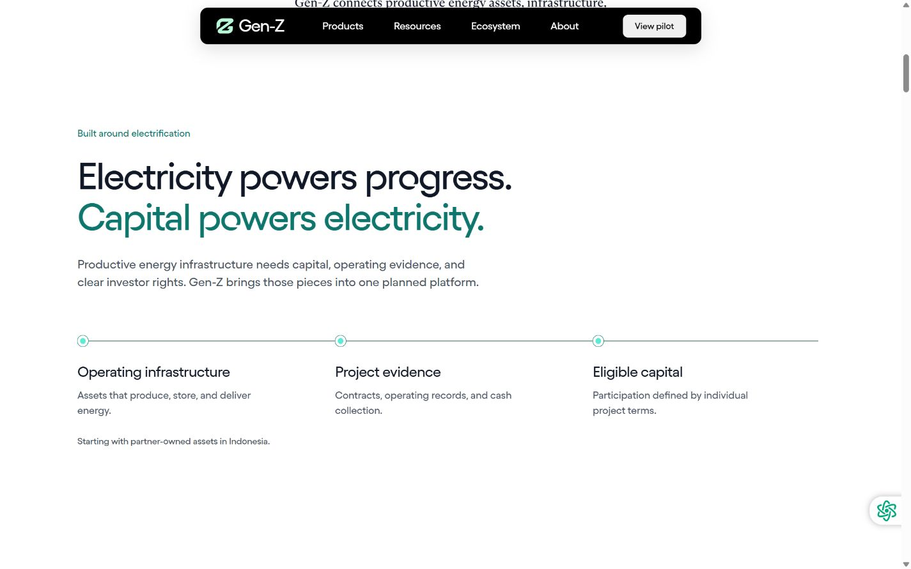

Headline mudah diingat dan tiga konsep saling terhubung. Fokus Indonesia adalah informasi yang berguna.

Tetapi section baru menjelaskan bahwa infrastruktur perlu modal. Belum menjelaskan hambatan siapa yang dialami, apa akibatnya, dan mengapa solusi sekarang belum cukup. `Eligible capital` adalah istilah penyaring, bukan manfaat bagi calon pengguna.

Saran: sebutkan masalah konkret yang sudah didukung discovery. Bila discovery belum ada, tulis sebagai hipotesis yang sedang diuji. Jangan menambah angka ukuran pasar atau klaim demand tanpa sumber. Kaitkan langsung dengan kebutuhan operator dan informasi yang diminta investor.

### Langkah 3. Productive asset to wallet: visual kuat, mekanisme belum terlihat, 6,5/10

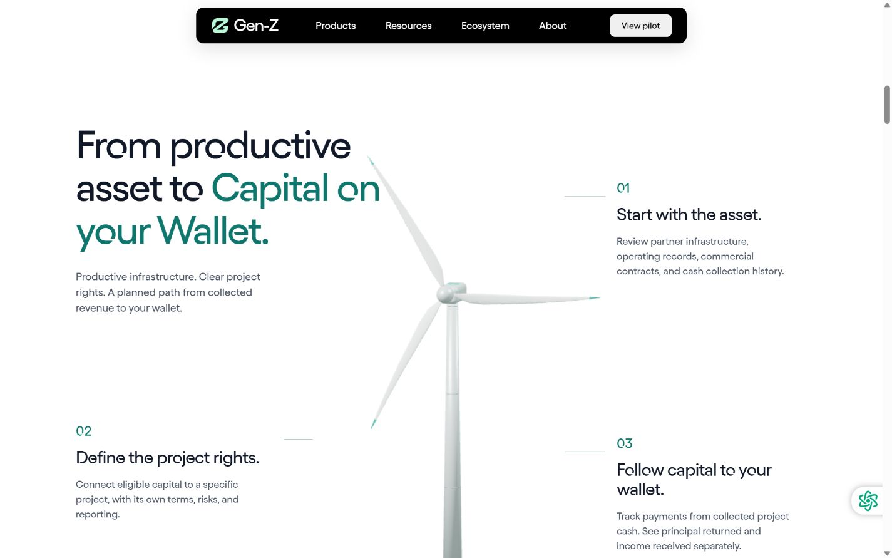

Turbin punya hubungan langsung dengan domain dan menjadi jangkar visual yang bagus. Pemisahan hak proyek dari aset serta pokok dari income adalah kekuatan substansi.

Namun, `Capital on your Wallet` tidak natural dalam bahasa Inggris. Copy menjelaskan langkah review dan terms, sementara judul memberi kesan perpindahan uang. Hubungan kas masih implisit: pelanggan membayar siapa, biaya apa dipotong, siapa yang mengalokasikan kas, dan record apa yang dilihat investor? Motion turbin tidak membantu menjawabnya.

Saran: tunjukkan satu rantai kas yang mudah dibaca, dengan peran operator, pelanggan/offtaker, collected cash, dan pencatatan pembayaran sesuai dokumen proyek. Pakai label ilustrasi. Hindari menambahkan rate, jadwal, atau struktur final yang belum diputuskan.

### Langkah 4. Kategori infrastruktur: mudah dijelajahi, terlalu umum, 6/10

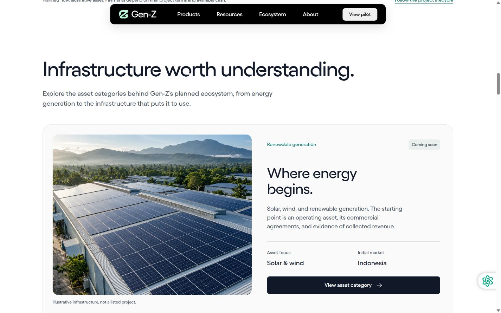

Gambar relevan, informasi Indonesia terlihat, dan label illustrative/coming soon jujur. Carousel berubah dan modal kategori benar-benar terbuka; Escape menutupnya.

Namun, solar/wind, storage, dan electrification memberi kesan scope yang luas. Pengunjung belum tahu kategori mana yang diprioritaskan pilot dan mengapa. Isi modal kembali berupa syarat review umum, belum menjadi informasi yang cukup membedakan masing-masing kategori.

Saran: satu kategori awal atau kriteria seleksi pilot yang eksplisit jika founder sudah memutuskannya. Kategori lain tetap arah jangka panjang. Satu contoh proyek simulated yang detail akan lebih berguna daripada tiga kategori yang sama-sama umum.

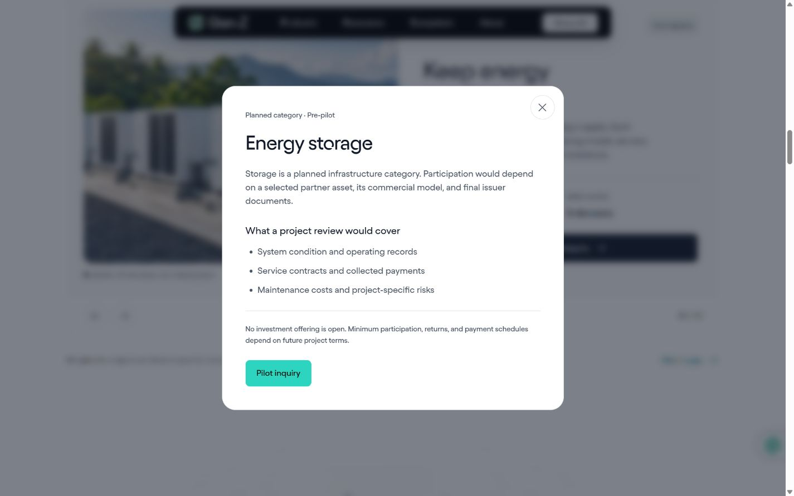

### Langkah 5. Stack: menarik secara grafis, lemah sebagai penjelasan produk, 4/10

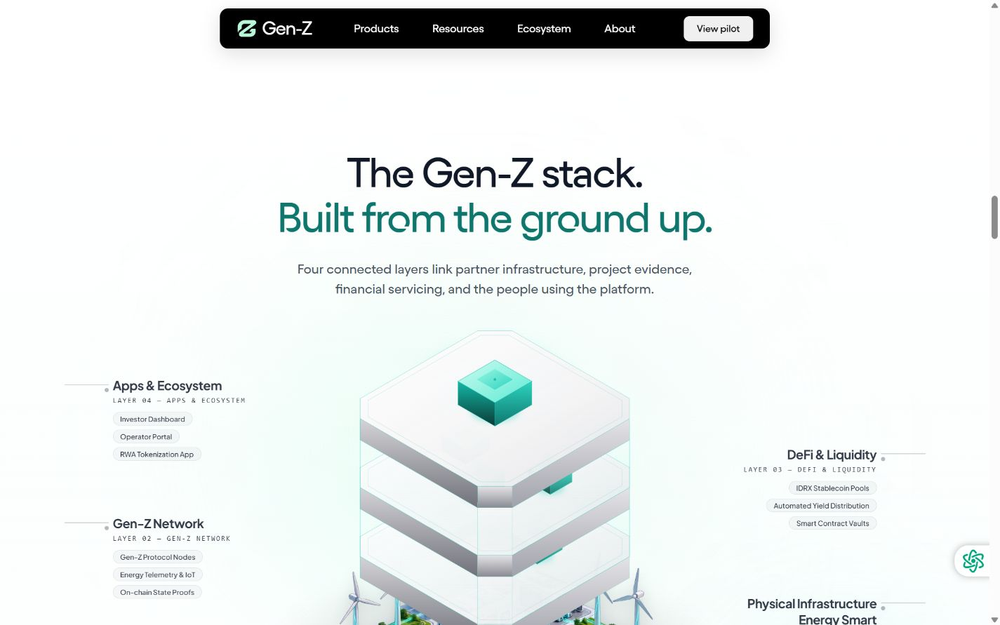

Diagram punya focal point dan reaksi pilihan layer bekerja. Tetapi ia terutama mengubah highlight; memilih layer tidak menampilkan penjelasan manfaat tambahan. Data description ada dalam source, tetapi tidak dirender sebagai detail pada UI yang diuji.

Istilah seperti protocol nodes, on-chain proofs, stablecoin pools, automated yield distribution, dan liquidity muncul tanpa status implementasi di layer masing-masing. Bagian lain menyatakan planned/pre-pilot. Pembaca perlu menebak mana konsep, mana yang sudah dibangun. Kata liquidity juga perlu dibedakan jelas dari kemampuan exit proyek closed-end.

Label `Physical Infrastructure Energy Smart Ecosystem` terlalu panjang. Istilah teknis memakan ruang, sedangkan pertanyaan sederhana seperti siapa memverifikasi bukti dan apa manfaatnya untuk investor belum dijawab.

Saran: pertahankan diagram jika fungsinya penjelas. Setiap layer harus mempunyai input, tugas, output, status, dan satu contoh. Pindahkan detail teknis setelah nilai produk dipahami. Hindari klaim jaringan terdesentralisasi sebagai fakta implementasi sebelum dibuktikan.

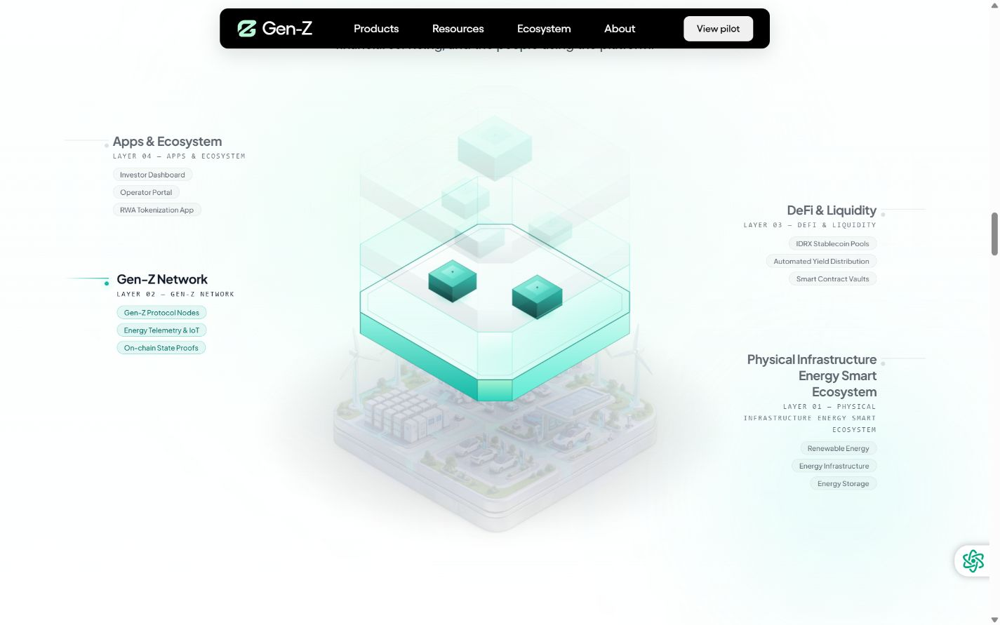

### Langkah 6. Lifecycle: substansi paling berguna, terlalu banyak usaha untuk membacanya, 6,5/10

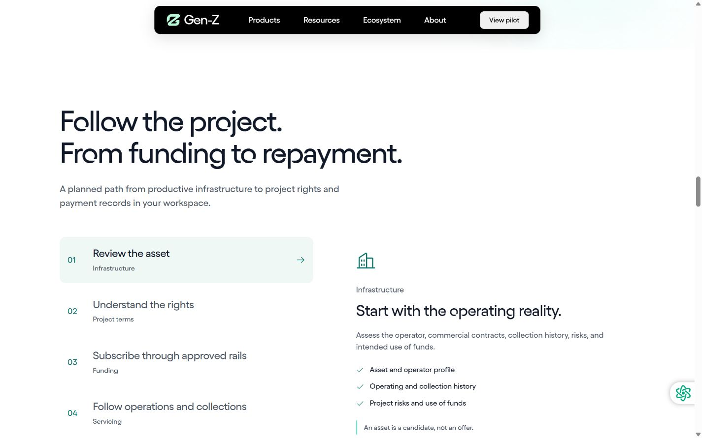

Lima langkah memberikan kerangka review, hak, pendanaan, servicing, serta pokok/income. Panel funding dengan baik membedakan input USDC dari hak proyek berdenominasi IDR. Ini patut dipertahankan.

Namun, pengunjung harus membuka beberapa langkah untuk menemukan isi penting, setelah sudah membaca alur tiga langkah sebelumnya. Tidak ada contoh tunggal yang diikuti sepanjang proses. Istilah approved rails, net allocation, dan settlement menambah beban bagi pembaca awal.

Saran: beri ringkasan seluruh alur yang langsung terbaca, detail tetap opsional. Gabungkan fungsi penjelasan dengan section turbin atau gunakan satu contoh yang konsisten di keduanya. Informasi penting jangan hanya ada pada pilihan keempat atau kelima.

### Langkah 7. Project evidence: hati-hati secara substansi, trust yang dibangun masih abstrak, 5,5/10

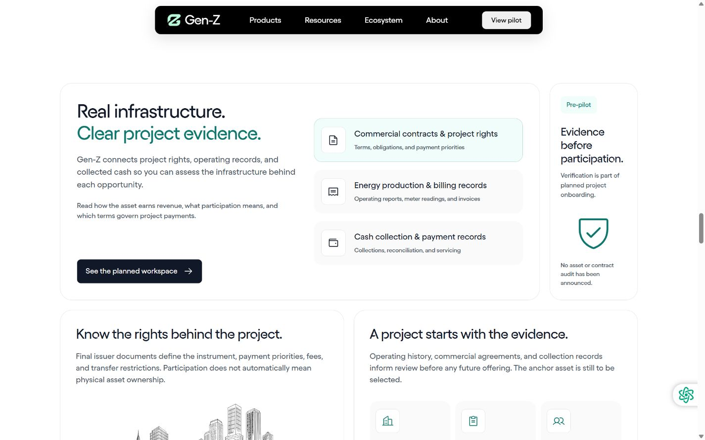

Pembedaan kontrak, invoice, produksi, dan penerimaan kas adalah landasan yang tepat. Teks tidak mengklaim audit selesai. Ini lebih bertanggung jawab daripada menyamakan telemetry dengan bukti uang diterima.

Tetapi tombol dokumen hanya mengubah penjelasan pendek, bukan memperlihatkan bukti atau contoh record. Shield dengan centang terasa seperti sinyal verifikasi yang sudah selesai, sementara teksnya mengatakan belum ada audit diumumkan. Kartu status terlalu sempit untuk muatan copy sehingga judul patah berulang. Komposisinya sangat mirip trust section referensi, dengan isi yang belum mempunyai bobot bukti setara.

Saran: tampilkan checklist readiness dengan tiga kategori status: tersedia, simulasi, belum tersedia. Pakai contoh record yang secara eksplisit sample bila ingin menjelaskan perbedaan produksi, tagihan, dan kas. Lengkapi dengan siapa yang bertanggung jawab atas review, hanya berdasarkan fakta aktual.

### Langkah 8. Workspace: masalah identitas dan bukti produk terbesar, 3/10

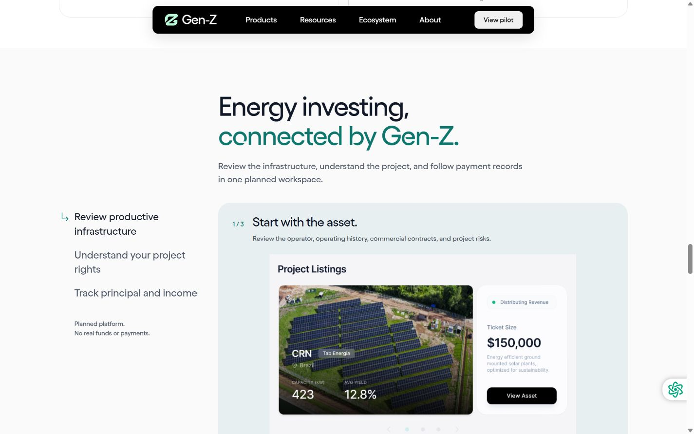

Section ini menampilkan screenshot antarmuka ReFiHub di bawah judul Gen-Z. Label sumber memang ada, tetapi kecil dibanding angka dan UI pada gambar. Besar dan dominannya preview memberi kesan ini produk yang sedang ditawarkan. Angka yield, ticket, saldo, dan pembayaran pada screenshot bukan data Gen-Z.

Preview pembayaran juga menonjolkan yield dan claim, sementara teks Gen-Z menjanjikan pemisahan outstanding principal, principal returned, dan income received. Tampilan tidak membuktikan manfaat spesifik yang disebut copy.

Ini bukan tuduhan bahwa halaman sengaja menipu; caption referensi sudah jujur. Ini masalah hierarchy dan relevansi: bukti visual utama membicarakan produk lain. Pengunjung harus membaca catatan kecil untuk mengoreksi kesan awalnya.

Konsep native Gen-Z justru tersembunyi dalam accordion setelah walkthrough referensi. Konsepnya bisa dipakai, tetapi Assets lebih berupa checklist, Portfolio kosong, dan Rewards membawa topik baru. Native workspace belum menunjukkan satu perjalanan proyek simulated secara utuh.

Saran: jadikan satu konsep Gen-Z sendiri yang berlabel simulasi sebagai demonstrasi utama. Tunjukkan cara memahami proyek dan membedakan kas/pokok/income. Referensi visual tetap berguna sebagai material internal, tetapi jangan menjadi bukti utama produk Gen-Z pada landing publik.

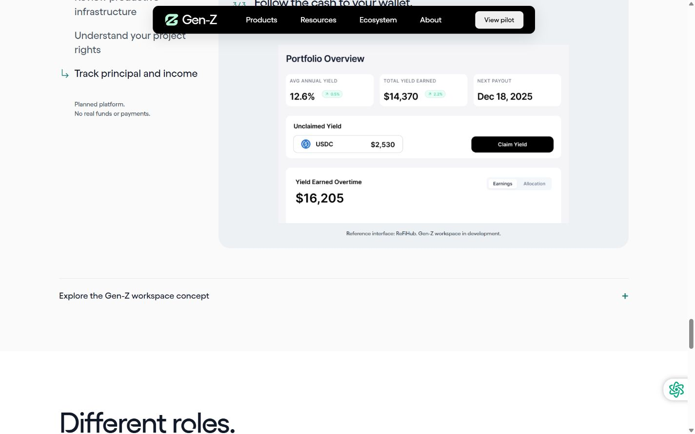

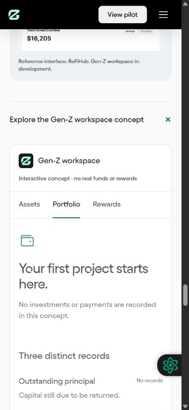

### Langkah 9. Ecosystem roles: segmentasi berguna, posisinya terlambat, 6/10

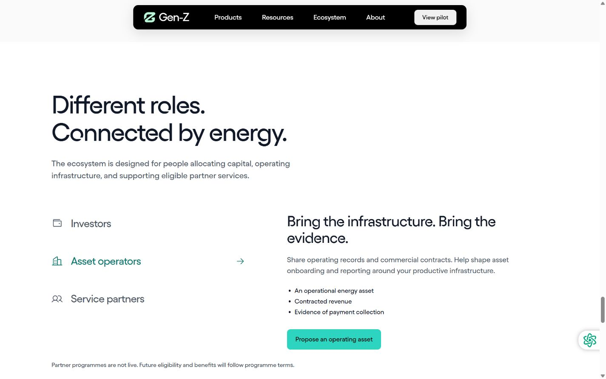

Operator mempunyai kebutuhan dan ajakan yang cukup konkret. Role selector bekerja. Investor memiliki CTA yang sesuai mandat investasi.

Namun, audience baru dijelaskan setelah banyak section. Service partners pada menu ekosistem dijelaskan sebagai verification, custody, dan servicing; panel role malah membahas funded loyalty programmes. Dua jenis partner dengan pekerjaan berbeda memakai nama yang sama. Rewards juga belum dihubungkan secara sederhana dengan cerita pembiayaan proyek utama.

Saran: kenalkan dua audience inti lebih awal, kemudian tampilkan secondary audience hanya jika hubungan nilainya sudah dapat diterangkan. Pisahkan service provider proyek dan partner loyalty dalam bahasa produk bila memang keduanya diperlukan.

### Langkah 10. Participation: pengungkapan cukup baik, kurasi informasi bisa lebih baik, 7/10

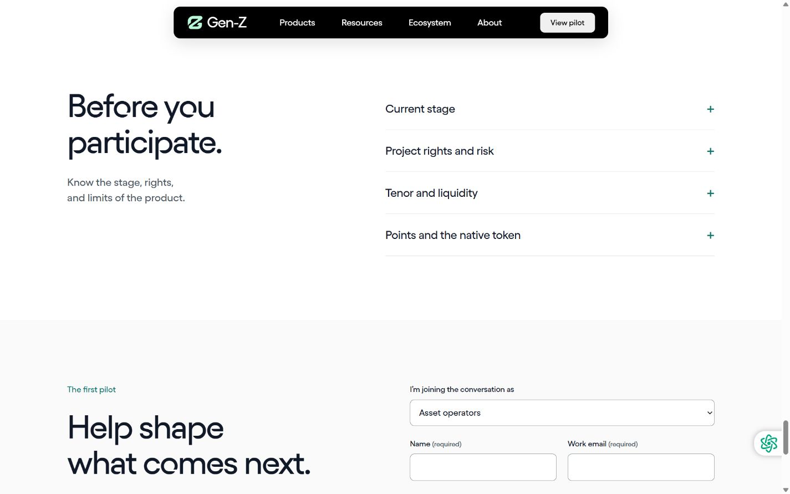

Status, hak, kerugian/delay, closed-end, dan ketiadaan jaminan exit ditulis jelas. Tidak mengaburkan token native sebagai kepemilikan proyek. Accordion terbuka sesuai interaksi.

Yang perlu diperbaiki adalah hierarchy, bukan menghapus batasan. Pertanyaan tahap produk harus terjawab sejak awal. Penjelasan token/points muncul ketika topik itu sendiri belum dibangun dengan baik; ia memperbesar kesan scope yang bercabang.

Saran: satu ringkasan status yang konsisten, lalu detail risiko dekat contoh proyek. Hindari mengulang penyangkalan di hampir setiap blok tanpa menambahkan informasi positif tentang apa yang sedang dikerjakan sekarang.

### Langkah 11. Inquiry dan footer: form berfungsi sebagai prototype, conversion belum selesai, 3/10

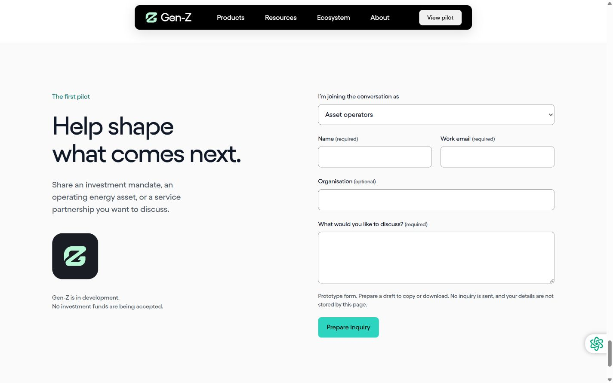

Label di atas input, field wajib, error yang spesifik, dan fokus ke field salah adalah kekuatan. Form kosong menghasilkan validasi. Data contoh menghasilkan draft dan penjelasan bahwa belum ada pesan dikirim.

Namun, setelah pengguna memberi nama, email, dan konteks, ia diminta copy/download. Tidak ada penerima yang jelas atau kanal pengiriman yang terlihat. Halaman belum menangkap inquiry. Ini perilaku prototype yang sengaja dibatasi, bukan tombol mati, tetapi tetap masalah terbesar bila halaman dipakai untuk discovery nyata.

Footer rapi tetapi hanya mengulang anchor. Tidak membantu menjawab siapa di balik Gen-Z, di mana membaca perkembangan aktual, dan bagaimana menghubungi orangnya. Untuk pre-pilot, jejak founder dan jalur percakapan yang nyata bisa jauh lebih berguna daripada katalog produk yang luas.

Saran: satu jalur kontak nyata dan jelas yang disetujui pemilik, dengan confirmation dan penjelasan langkah berikut. Jangan mengarang email, identitas tim, atau target waktu balasan. Bila tetap murni demo, nyatakan tujuan demonstrasinya sejak CTA pertama.

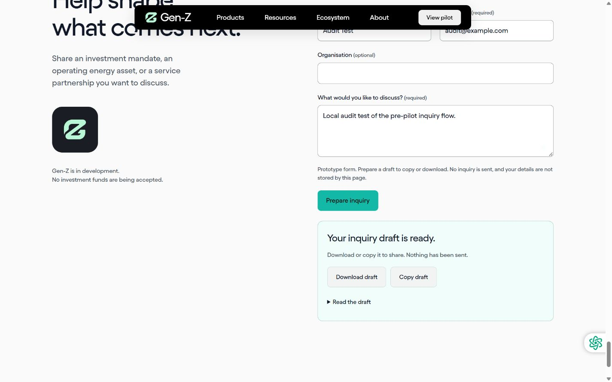

## Temuan bernomor untuk tindak lanjut

Prioritas bisnis berbeda dari tingkat aturan antislop. Contoh: form draft benar-benar bekerja, sehingga bukan pelanggaran tombol mati R-26; tetapi dampaknya terhadap lead generation tetap P1. Tingkat HIGH/MEDIUM/LOW mengikuti kelompok aturan skill, bukan tingkat pentingnya bisnis.

| No. | Temuan dan bukti | Aturan dan tingkat filter | Prioritas bisnis | Rekomendasi |
| --- | --- | --- | --- | --- |
| 1 | Hero mengutamakan slogan, kategori/manfaat produk belum cepat terbaca. Langkah 1. | R-15, R-16, LOW. CTA dan copy kurang spesifik. | P1 | Perjelas produk, audience, tahap, dan hasil CTA. |
| 2 | Turbin, lifecycle, evidence, dan workspace mengulang review, hak, kas. Langkah 2, 3, 6, 7, 8. | R-05, LOW. Urutan belum memaksimalkan informasi baru. | P1 | Beri satu fungsi dan pertanyaan utama untuk setiap section. |
| 3 | Layer memberi kesan kemampuan produk tanpa status implementasi per layer. Langkah 5. | R-38, HIGH. Fitur rencana perlu dibedakan dari kemampuan tersedia. Bukan kesimpulan bahwa seluruh fiturnya fiktif. | P1 | Labeli status dan tampilkan manfaat nyata, input/output, serta batasannya. |
| 4 | Preview utama memakai produk lain; native concept justru disembunyikan. Langkah 8. | R-20, LOW. Identitas produk dan bukti manfaat tidak sejalan. | P1 | Utamakan demonstrasi Gen-Z berlabel simulasi. |
| 5 | CTA inquiry selesai sebagai draft lokal tanpa jalur penerima. Langkah 11. | R-15, LOW. Ajakan menuju hasil yang belum cukup berguna bagi calon peserta pilot. | P1 | Tentukan jalur percakapan yang nyata dan tindak lanjut. |
| 6 | Shield centang memberi sinyal kepastian di samping status belum ada audit. Langkah 7. | R-04, MEDIUM. Makna ikon tidak cocok dengan status proses. | P2 | Gunakan readiness/checklist dengan status yang eksplisit. |
| 7 | Tombol View pilot 100 × 36 px; link brand mobile 26 × 44 px. | R-03, HIGH. Di bawah target 44 × 44 skill. Ini bukan klaim otomatis gagal WCAG 2.2 AA. | P2 | Perbesar area interaksi, pertahankan ukuran visual jika perlu. |
| 8 | Nama service partners menjelaskan provider proyek pada menu, loyalty pada panel. Langkah 9. | R-16, LOW. Istilah belum menyampaikan manfaat/peran secara konsisten. | P2 | Pisahkan makna atau fokuskan scope yang ditampilkan. |
| 9 | Motion cukup dominan; kontrol pause berada di dalam Resources. Langkah 1 dan 8. | R-19, MEDIUM. Penambahan gerak belum selalu sepadan dengan bantuan memahami produk. | P2 | Jadikan gerak membantu alur informasi dan buat kontrol mudah ditemukan. |
| 10 | Capital on your Wallet dan nama layer physical tidak natural/ringkas. Langkah 3 dan 5. | R-16, LOW. Bahasa mempersulit penjelasan nilai. | P2 | Edit istilah dengan bahasa Inggris yang sederhana dan tepat domain. |
| 11 | Layer metadata 9 px, chips 10 px pada mobile. Langkah 5. | R-06, MEDIUM. Hierarchy tipografi mengorbankan keterbacaan. | P2 | Kurangi label, perbesar teks, berikan detail yang berguna saat dipilih. |

Tidak ada source UI yang diubah untuk temuan ini. Nomor dapat dipakai sebagai scope implementasi berikutnya.

## Hal yang dipertahankan

- Palette teal dan netral cocok dengan arah brand yang sudah dipilih.
- Landscape dan turbin relevan dengan domain, tidak perlu dibuang hanya karena halaman belum kuat.
- Layout mempunyai variasi, bukan semua section berupa tiga kartu identik.
- Pemisahan principal/income dan produksi/tagihan/kas adalah pembeda substansi yang layak diperjelas.
- Status pre-pilot, ilustrasi, coming soon, dan ketiadaan jaminan sudah banyak dinyatakan secara jujur.
- Label form, error spesifik, semantic heading, skip link, fokus, dan Escape yang diuji perlu dipertahankan.

## Audit mobile dan aksesibilitas

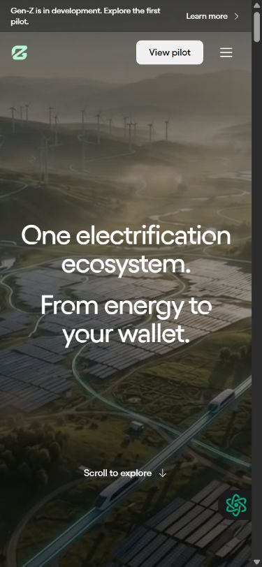

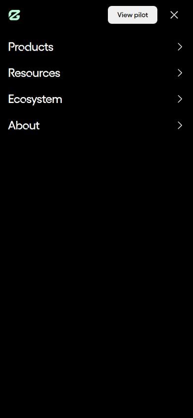

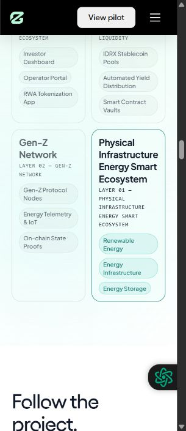

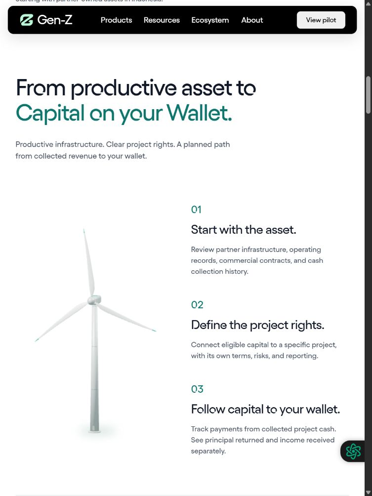

Tidak ditemukan overflow horizontal root pada viewport lokal 320, 390, dan 768 px: scrollWidth sama dengan clientWidth yang tersedia. Itu tidak membuktikan semua elemen aman pada seluruh posisi, zoom, perangkat, dan browser. Reflow kategori, stack, workspace, serta form yang terlihat cukup baik.

Risiko utama mobile adalah informasi yang sangat kecil di stack dan screenshot aplikasi yang menjadi gambar kecil. Secara teknis muat, tetapi informasi pada gambar tidak nyaman dibaca. Memperlihatkan lebih sedikit data yang relevan akan lebih berguna daripada mengecilkan dashboard desktop.

Keyboard yang diuji: Resources dibuka dengan Enter, Escape menutup dan memulihkan fokus; modal kategori ditutup dengan Escape; menu mobile ditutup dengan Escape. Fokus Resources terlihat sebagai outline mint pada hitam. Validasi inquiry memindahkan fokus ke field salah dengan outline yang terlihat. Ini sampling, bukan penelusuran seluruh halaman dengan screen reader.

Video bisa dipause melalui Resources; state video yang dibaca menunjukkan paused=true. Dukungan reduced motion ada dalam source hero, workspace, dan turbin, tetapi preferensi sistem reduce tidak diaktifkan dalam audit ini. Tidak menyatakan runtime reduced motion lulus.

## Catatan teknis, SEO, dan performa

- Build produksi berhasil. Warning `use client` pada bundling Vite bukan bukti runtime rusak. Ada warning chunk besar.
- Output JS minified: entry sekitar 120 kB, navigation/body sekitar 425 kB, scene turbin sekitar 612 kB. Gzip masing-masing sekitar 47, 128, 154 kB. Tidak semua chunk dianggap diunduh pada initial render.
- Video hero aktif berukuran sekitar 5,44 MiB. Tiga gambar kategori sekitar 0,29–0,38 MiB per gambar. Ada poster dan lazy media. Ukuran file adalah risiko bandwidth untuk diprofilkan, bukan bukti skor performa buruk.
- Console tab lokal tidak mencatat error/warning saat diperiksa. Bukan bukti bahwa semua state telah diuji.
- Semua tautan hash yang diperiksa di main/footer mempunyai target DOM. Tidak ditemukan ghost anchor pada subset itu.
- Title dan meta description ada, tetapi positioning pada title masih berupa slogan. Pada index.html yang diperiksa belum ada canonical, Open Graph, atau Twitter card. Persiapkan metadata sosial ketika URL publik dipilih; local audit tidak bisa menilai ranking, indexation, atau metrik search.
- Tidak mengukur Lighthouse baru, LCP/CLS/INP, throttled network, low-end GPU, atau performa produksi di hosting publik. Jangan memakai skor QA lama sebagai hasil audit ini.

## Catatan click-through

| Kontrol | Hasil yang diamati |
| --- | --- |
| Scroll to explore | Hero berpindah ke komposisi kartu dan copy. |
| Products desktop | Menu dengan enam tautan tampil. |
| Resources melalui Enter | Menu tampil dan kontrol film dapat ditemukan. |
| Pause background film | Video paused=true; label berubah menjadi Play. |
| Resources melalui Escape | Menu tutup; fokus kembali ke Resources dengan outline terlihat. |
| Next asset category | Renewable generation berubah ke Energy storage. |
| View asset category | Dialog Energy storage beserta checklist tampil. |
| Escape pada dialog kategori | Dialog tidak lagi terlihat. |
| Stack Gen-Z Network | Layer terpilih berubah; tidak ada detail manfaat tambahan tampil. |
| Stack physical pada mobile | Layer terpilih berubah; label tetap muat pada 320 px. |
| Lifecycle funding | Copy input IDRX/USDC dan denominasi IDR tampil. |
| Evidence cash records | Ringkasan berubah ke collected cash dan principal/income. |
| Workspace Track principal and income | Berpindah ke preview portfolio referensi. |
| Explore Gen-Z workspace concept | Konsep native Assets/Portfolio/Rewards terbuka. |
| Native Portfolio | Empty state dan tiga record terpisah tampil. |
| Native Rewards | Simulasi eligibility tersedia. |
| Tiga checkbox rewards | Pending berubah menjadi eligible for programme review; no points issued. |
| Role Investors | Copy dan CTA berubah ke mandat investor. |
| Disclosure Current stage dan Project rights | Isi terbuka. |
| Prepare inquiry kosong | Error nama/email/discussion dan fokus field salah tampil. |
| Prepare inquiry dengan data dummy | Draft tampil; tidak ada inquiry dikirim. |
| Open navigation mobile | Dialog menu memenuhi layar. |
| Escape menu mobile | Dialog tidak lagi terlihat. |
| View pilot | URL berpindah ke #contact. |
| Back to top | Kembali ke hero. |

Belum diuji satu per satu: setiap item menu, seluruh pilihan kategori/lifecycle/layer, semua accordion, copy/download draft, reset rewards, seluruh navigasi tab dengan panah, dan seluruh state media gagal. Ini tidak disebut full click-through PASS.

## Gate penilaian dan keterbatasan

Audit selesai sebagai laporan temuan, bukan penyerahan desain yang dinyatakan siap terbit. Instruksi pengguna memilih penilaian dahulu, sehingga temuan tidak diperbaiki diam-diam.

| Blok | Status halaman | Bukti / batas pemeriksaan |
| --- | --- | --- |
| Hard Gate | Belum lulus | Target mobile di bawah 44 px (R-03), status feature stack belum cukup eksplisit (R-38). R-02 juga terlihat pada label layer, tetapi tanda baca bukan masalah utama halaman. Kontras seluruh state dan full click-through belum lengkap. |
| Purpose-Gate | Perlu revisi | Shield centang, motion, dan microtypography belum selalu mendukung status serta pemahaman (R-04/R-06/R-19). |
| Liveliness | Sebagian kuat, belum terkunci | Focal point hero/turbin ada. Ruang putih dan aksen teal konsisten. Identitas workspace belum milik Gen-Z. DESIGN.md yang dibaca menetapkan palette; dials visual lengkap belum tercatat di sana. Tidak mengklaim tidak ada keputusan lain di percakapan sebelumnya. |
| Craftsmanship dan Quality Locks | Belum lulus untuk penggunaan publik | R-05 repetisi narasi, R-15 hasil CTA, R-16 istilah, R-20 kekhasan workspace. Bukti pengguna dan conversion aktual belum tersedia. |

Pre-flight taste: diperiksa pada halaman yang berjalan. Palette dan reflow cukup baik; copy specificity, manfaat per section, CTA clarity, ukuran teks diagram, dan preview produk sendiri memerlukan revisi. Reduced motion runtime, kontras menyeluruh, serta Core Web Vitals tetap belum terverifikasi. Tidak ada klaim semua checklist lulus.

## Urutan perbaikan yang disarankan

1. Nomor 1, 2, 3, 8, 10: rapikan positioning, batas scope, istilah, dan urutan cerita terlebih dahulu. Itu menentukan isi visual yang benar.
2. Nomor 4: satu contoh native Gen-Z berlabel simulasi sebagai bukti utama. Tampilkan perjalanan dan record yang sesuai proposisi.
3. Nomor 5: jalur inquiry yang benar-benar menghubungkan pengunjung ke pemilik produk.
4. Nomor 6, 7, 9, 11: selaraskan trust cues, kenyamanan mobile, motion dan keterbacaan.
5. Setelah isi dan alurnya berubah, lakukan pengukuran performa produksi dan pengujian aksesibilitas yang lebih lengkap.

Struktur editorial kandidat untuk dibahas kemudian: hero yang jelas → masalah dan fokus pilot → satu contoh aset/arus kas simulated → peran serta bukti yang dihasilkan Gen-Z → workspace native → kesiapan dan risiko → jalur kontak. Ini rekomendasi audit, belum perubahan IA yang dilaksanakan.
