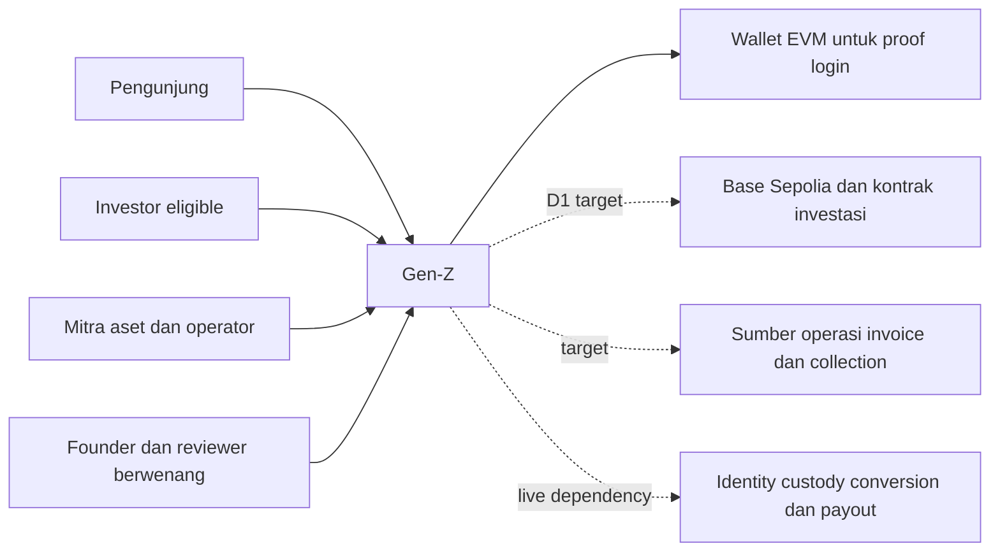
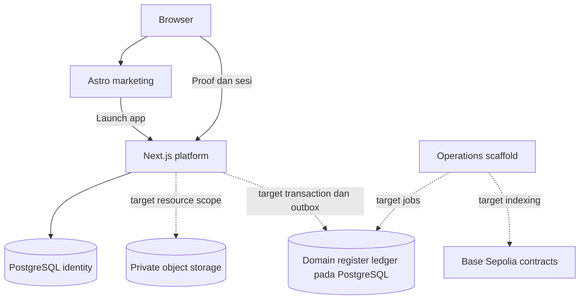
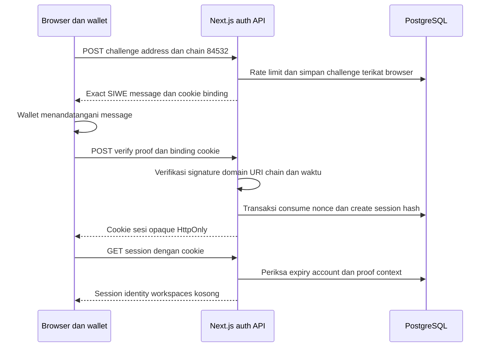

# Architecture Gen-Z

**Baseline:** inspeksi source 18 Oktober 2026. **Scope:** [PRD](PRD.md). Dokumen ini memisahkan struktur yang sudah ada dari rancangan berikutnya. Pilihan dan konsekuensi jangka panjang dicatat di [ADR](adr/README.md).

## 1. Tujuan dan batas sistem

Pisahkan marketing publik dari resource investasi privat; gunakan proof wallet dan sesi server sejak demo pertama; jaga konsistensi data hak/uang serta jejak review. D0 memakai investasi sintetis. D1 menggunakan Base Sepolia setelah review; mainnet/live belum aktif. Quality scenarios dan acceptance ada di [Testing](TESTING.md).

## 2. Konteks

Diagram konteks berikut menunjukkan aktor dan dependency target. Integrasi operator, layanan pendanaan/FX dan kontrak investasi belum tersedia.

## 3. Komponen dan kepemilikan

| Komponen | Tanggung jawab | Status di source |
|---|---|---|
| `apps/marketing` | Astro landing, contact, legal, media/islands; handoff ke auth platform | Ada; inquiry persistence belum ada |
| `apps/platform` | Next.js auth, protected shell, route handlers dan server services | SIWE/sesi ada; resource/investment domain belum ada |
| `packages/domain` | Keys tujuh tab, environment dan tipe domain bersama | Subset awal |
| `packages/content-schema` | Typed blocks dan referensi metric/document/media | Subset; bukan CMS/publication/authorization |
| `packages/design-tokens` | Token visual bersama | Ada; arah di [DESIGN](../DESIGN.md) |
| `workers/operations` | Worker terpisah untuk retry/retensi/ingestion/reconciliation | Entry dan health; belum ada job handlers |
| PostgreSQL + Drizzle/`pg` | Auth persistence; target domain/register/ledger | Empat tabel identity + ledger migrasi; [ERD](ERD.md) |
| Private object storage | Original/investor-copy evidence, version dan akses | Target; provider belum dipilih |
| Kontrak dan chain indexer | Escrow, allocation, funded distribution, finality reconciliation | Rancangan D1; belum diimplementasikan |

Satu root npm workspace dan lockfile; `motion/` memiliki produksi serta lockfile terpisah. Package shared tetap pure, tanpa database/credential/server import.

Garis solid menunjukkan hubungan dasar yang tersedia; garis putus-putus menunjukkan target. Dua kotak database memisahkan tanggung jawab logis dalam PostgreSQL yang sama, bukan mandat database fisik tambahan.

## 4. Runtime yang tersedia: login

Koneksi wallet saja belum membuat sesi. Proof EOA diverifikasi server; contract-account verification memerlukan RPC konfigurasi dan dukungan yang diuji. Runtime auth membatasi Base Sepolia 84532 meskipun schema identity mengizinkan tuple Base mainnet. Akun legacy Solana dipertahankan tanpa automatic merge; sesi/challenge legacy dicabut saat cutover.

## 5. Runtime target

Inquiry: commit inquiry + reference + notification outbox satu transaksi, baru tampilkan sukses. Worker retry notifikasi tanpa membatalkan inquiry; retensi memakai interaksi bermakna, bukan notification retry.

Investasi: scoped offering read → eligibility → quote/consent versioned → input/conversion → net settlement + closing → allocation/register/position. Distribusi: reviewed collection → perhitungan entitlement → approval → verified funding → atomic claim reservation → dispatch → finalized/domain reconciliation → receipt. [Flows](engineering/flows.md) memuat state dan failure paths; [finance](product/finance.md) memuat basis hak/uang.

Arah [lifecycle RWA](engineering/rwa-lifecycle.md) diterima 20 Oktober, belum implementasi: unit partisipasi tetap per offering/series, payout/modal terpisah dan burn menurut penyelesaian hak. State kontrak menegakkan business IDs, reserve, recipient binding dan claimed history; calculation/evidence tetap off-chain berversi. Expiry tidak menghapus accrued unpaid liabilities. [ADR 0004](adr/0004-project-rights-lifecycle.md) menjelaskan pemilihan ini dibanding rebase/NAV vault atau burn native token.

## 6. Data, interface dan trust boundary

Sumber implementasi schema adalah [Drizzle schema](../apps/platform/src/server/db/schema.ts) bersama [migrasi SQL](../apps/platform/db/migrations/). [ERD](ERD.md) merangkum data fisik dan target; [data dictionary](engineering/data-model.md) menyimpan field/invariant target. Editorial/evidence, raw telemetry, reviewed report dan ledger keuangan dipisahkan secara logis.

Route handlers menangani Origin/validasi/cookie/response; service server-only menangani proof/sesi dan database. [Kontrak API MVP](engineering/api.md) memisahkan enam operasi source dari proposed domain; OpenAPI/reference/coverage merinci request, response, akses dan failure. [Routes/API target](engineering/routes-and-api.md) menyimpan ringkasan manifest awal. Semua private reads/downloads/cache memerlukan server authorization pada resource; download target melalui app proxy dengan session-bound access grant. Session-only layout tidak cukup. Detail: [Security](SECURITY.md).

Uang/unit memakai integer minor units atau decimal string dengan precision terkontrol. Simbol token bukan identitas aset. Source financial facts/model/dataset canonical dibagi calculator, tabel dan portfolio; formula bebas/rich text tidak menjadi ledger.

## 7. Deployment dan operasi

Lokal: Astro `4321`, Next.js `3001`, worker `4800`, PostgreSQL melalui Compose root. Environment privat dimiliki tiap service. Setup, database, build, smoke dan troubleshooting ada di [runbook](operations/runbook.md) serta README masing-masing app.

Target: marketing dan platform menjadi deployment terpisah; worker persisten terpisah dari request lifetime. Domain/hosting produksi, storage/queue/RPC dan provider live belum dipilih. Tidak ada deployment produksi baru dari dokumen ini. Health menunjukkan liveness; readiness platform tetap 503 untuk domain yang belum dibuat, walaupun auth dapat ready.

## 8. Risiko arsitektur dan keputusan

Risiko utama: protected shell disalahartikan sebagai resource authorization, schema rencana dianggap tabel nyata, chain confirmation dianggap net bank settlement, atau saldo/dana digunakan dua kali. Gate sebelum implementasi berikutnya ada di [Security](SECURITY.md), [Testing](TESTING.md), dan [risk register](product/risks-and-dependencies.md).

[ADR 0001](adr/0001-application-boundaries.md): Astro/Next.js dalam satu workspace. [ADR 0002](adr/0002-base-wallet-identity.md): cutover Base dan namespace identity. [ADR 0003](adr/0003-postgres-drizzle-migrations.md): Drizzle di atas satu runner SQL. Tidak ada pilihan vendor baru di sini.
