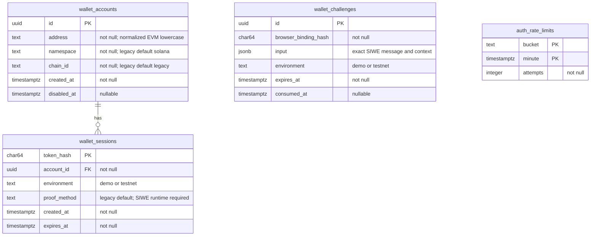
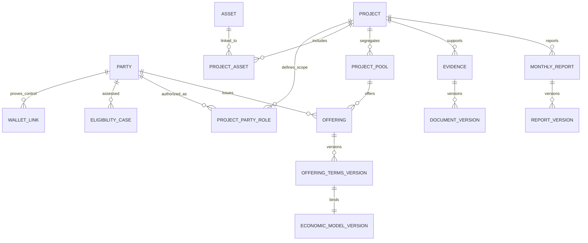
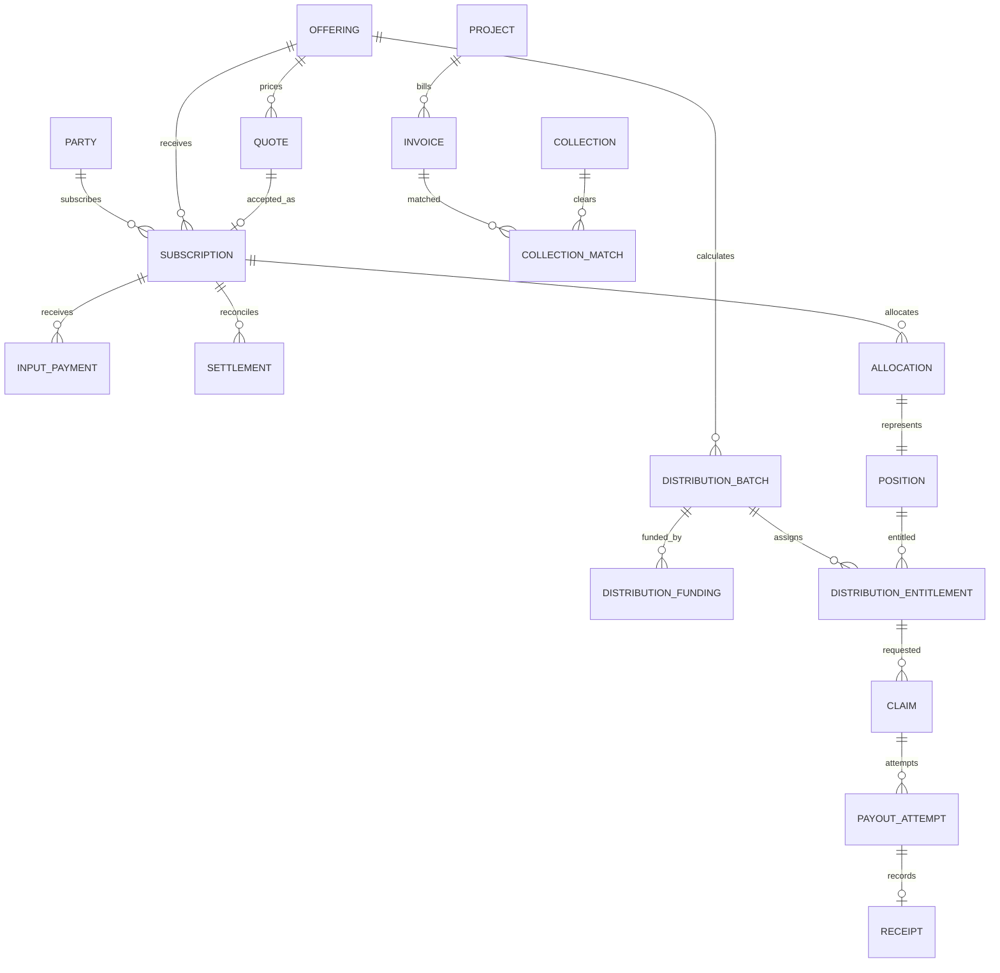
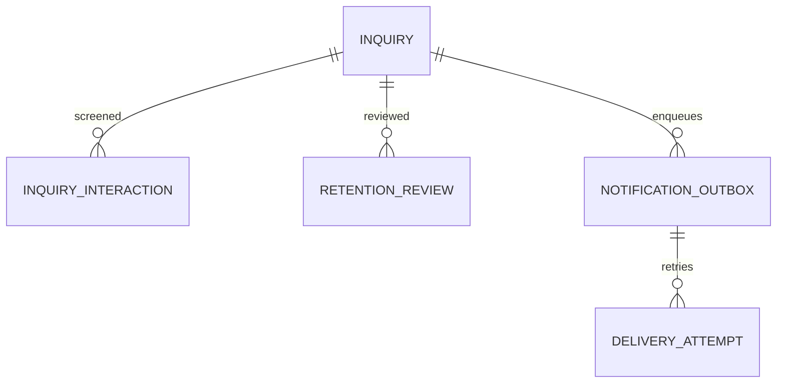

# ERD dan model data Gen-Z

**Baseline:** 18 Oktober 2026. Ada dua tingkat: schema fisik auth yang tersedia di source, dan model logis target produk. Entitas target belum menjadi tabel/migrasi atau kontrak final. [Kamus data](engineering/data-model.md) menjelaskan field/invariant target; istilah domain ada di [Glossary](../GLOSSARY.md).

## 1. ERD fisik: identity yang sudah diimplementasikan

Sumber: [schema.ts](../apps/platform/src/server/db/schema.ts), [migrasi awal](../apps/platform/db/migrations/0001_wallet_identity.sql), [migrasi cutover Base](../apps/platform/db/migrations/20261017175425_base_siwe_identity.sql). Ini inspeksi definisi source, bukan introspeksi database hidup pada sesi ini.

Semua tabel di atas berada pada schema `identity`. Satu wallet account dapat mempunyai nol atau banyak sesi; setiap sesi mengacu tepat satu account. Challenge tidak mempunyai foreign key account: proof dapat dimulai sebelum account dibuat. Hubungan challenge/session melalui proses service, bukan FK yang tersimpan. Rate limit tidak mempunyai FK account.

| Constraint/index | Arti |
|---|---|
| Unique `(namespace, chain_id, address)` | Legacy dan EVM tidak otomatis digabung |
| Identity check | `solana/legacy`, atau `eip155` dengan chain `8453`/`84532` dan lowercase EVM address |
| Session FK `account_id` | Sesi mempunyai account valid; tidak memberi grant/eligibility |
| Environment check | Challenge/sesi hanya `demo` atau `testnet` |
| Composite PK rate limit | Satu counter per bucket/menit |
| Challenge expiry/binding index | Lookup/cleanup challenge |
| Session account/expiry index | Lookup sesi account dan expiry |

Default `solana`, `legacy` dan `legacy-siws` mempertahankan arti data lama. Service baru selalu menulis namespace EVM, chain aktif dan proof method SIWE; `readSession` menolak proof legacy. Runtime auth hanya Base Sepolia; schema yang mengizinkan `8453` tidak mengaktifkan mainnet.

Runner juga memiliki tabel operasional `public.genz_schema_migrations` untuk checksum migrasi; tabel itu bukan entitas produk. Detail: [ADR 0003](adr/0003-postgres-drizzle-migrations.md).

## 2. ERD logis target: proyek dan offering [R]

Diagram ini menggambarkan rancangan relasi, bukan nama tabel yang telah disepakati. Dalam target, Party/WalletLink memisahkan pihak legal dari wallet; belum ada automatic mapping `wallet_accounts` ke Party atau posisi investasi. Multiplicity mendukung perkembangan model, sedangkan demo tetap satu offering aktif.

Owner, operator dan issuer mempunyai role/authority tersendiri. Terms/model published tidak ditimpa. Dokumen mempunyai investor copy/original, policy akses, versi/sumber dan alasan redaksi. Mapping evidence lintas objek/period memakai link tervalidasi; satu FK project saja tidak mencakup semua kebutuhan evidence.

## 3. ERD logis target: investasi dan distribusi [R]

Asumsi cardinality quote→subscription di diagram: satu quote untuk paling banyak satu subscription, perlu ditegakkan pada implementasi. Diagram merangkum, bukan mewajibkan setiap intermediate object sudah ada sejak draft. Consent menyimpan versi terms/model/documents; payment/settlement dan allocation mempunyai business IDs unik. Collection match mendukung invoice dibayar parsial dan satu penerimaan melunasi beberapa invoice. Journal/ledger, FX legs, refund, audit dan chain observation dirinci di kamus data untuk menjaga diagram terbaca.

## 4. ERD logis target: inquiry dan notifikasi [R]

Inquiry + reference + outbox committed satu transaksi. Notification failure/retry tidak membuat inquiry baru atau mengubah waktu interaksi bermakna. Hubungan inquiry yang berlanjut ke project ditetapkan eksplisit; inquiry tidak otomatis menjadi evidence investasi.

## 5. Invariant data yang wajib dipertahankan

- Pisahkan project, asset, pool, offering, issuer dan token/position; jangan menggandakan kapasitas atau uang lintas pool.
- Allocation memerlukan net settlement dan closing; receipt token masuk bukan konfirmasi FX/bank settlement.
- Entitlement mengikat stable position/owner dan record-date snapshot; claim memerlukan funding dan reservasi atomik. Recovery menjaga claimed history.
- Nilai uang/raw token berupa integer/decimal strings beserta currency/asset/decimals; jangan menjumlah currency atau unit berbeda tanpa conversion legs.
- Raw telemetry, reviewed report, invoice, cleared collection dan distribution merupakan catatan berbeda.
- Demo, testnet dan live terpisah; missing bukan nol; draft/revisi tidak mengubah consent historis.

Sebelum menambah tabel: tetapkan keys/nullability/cardinality, unique/FK/check, indeks berdasarkan query, ownership/access, retensi dan strategi migrasi/backfill. Review SQL baru melalui satu runner. Uji drift/schema dan invariant terkait sebagaimana [Testing](TESTING.md).
