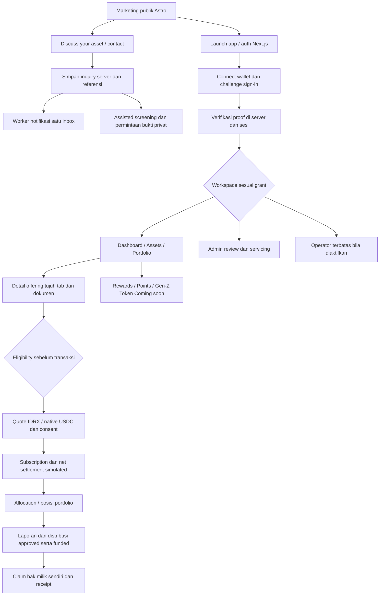
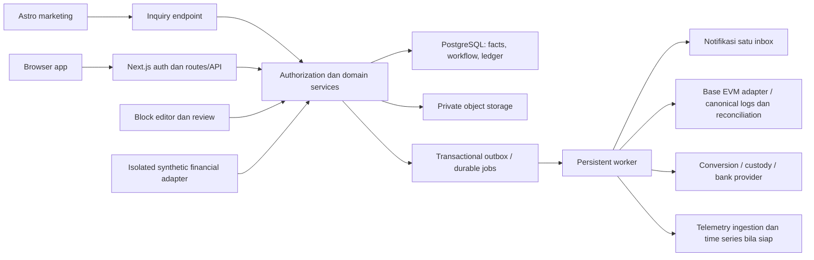

> **Arsip per 18 Oktober 2026.** Isi dipertahankan sebagai riwayat; dapat memuat keputusan yang tergantikan dan snapshot berbeda. Acuan aktif: [indeks dokumentasi](../README.md), [PRD](../PRD.md), [requirements MVP](../product/requirements.md).

# Gen-Z: arsitektur app, auth, routes dan API

**Versi:** 2.1-base, diperbarui 18 Oktober 2026, Asia/Jakarta. Nama file 12 Oktober dipertahankan agar tautan tetap berlaku. **Status:** rancangan implementasi, belum bukti fitur tersedia.

**Acuan utama:** [Spec MVP 17 Oktober](mvp-spec-2026-10-18.md), scope dikonfirmasi founder. Pendamping: [PRD](prd-2026-10-18.md) dan [schema/flows](schema-flows-2026-10-18.md). Spec v1.1-base memuat perubahan chain 18 Oktober dan mendahului baseline 12/17 Oktober yang diganti. **[F]** keputusan founder; **[R]** rancangan teknis dalam mandat; **[O]** dependency belum dipilih. Memo riset lama menyimpan konteks, bukan requirement aktif yang mengalahkan spec.

**Snapshot implementasi setelah kurasi platform, 17 Oktober:** marketing sudah Astro dan platform disatukan langsung di `apps/platform` dalam workspace root. Wallet Standard/SIWS, proof Ed25519, nonce sekali pakai dan sesi PostgreSQL telah diimplementasikan sebagai fondasi login; email/password, Better Auth, Drizzle dan contoh Notes/admin starter tidak dipakai. Driver `pg` + migrasi SQL adalah pilihan implementasi awal [R], bukan perubahan requirement produk. Database/container/image aplikasi memakai identitas Gen-Z. [Laporan penyelarasan](../history/2026-10-17-platform-alignment.md) membedakan hasil yang diuji dari pekerjaan yang belum tersedia; requirement investasi di bawah tetap rancangan.

**Pembaruan aktif, 18 Oktober 2026:** [F] Base menggantikan Solana atas arahan founder. Scope produk 17 Oktober tetap, dengan detail teknis [R] pada [riset Base/EVM 18 Oktober](../research/base-evm-2026-10-18.md) dan spec versi `1.1-base`. Pilihan Base tidak mengaktifkan kembali mock wallet D0, public deal detail, note wajib atau functional rewards. Fondasi login EVM/SIWE pada Base Sepolia kini diimplementasikan, dengan akun Solana historis tetap terpisah; kontrak/lifecycle investasi masih rancangan. Lihat [laporan fondasi Base](../history/2026-10-18-base-foundation.md) untuk scope serta bukti verifikasi. Bagian riset dan snapshot lama tetap bertanggal.

## 1. Keputusan terbaru dan cut line

**Pembaruan persistence, 18 Oktober [R]:** platform memakai PostgreSQL + Drizzle ORM dengan driver/pool `pg`, setelah peninjauan ulang atas arahan founder. Schema TypeScript dan query bertipe membantu pertumbuhan relasi identity, offering, subscription dan ledger. Drizzle Kit menghasilkan SQL untuk direview; runner checksum dan transaction lock tetap satu-satunya pelaksana migrasi. SQL `0001` dan data yang ada dipertahankan. Keputusan ini menggantikan pilihan tanpa ORM pada snapshot 17 Oktober di atas. [Panduan database](../../apps/platform/README.md#pilihan-database-18-oktober-2026) menjelaskan alasan dan baseline. Migrasi autentikasi Base/SIWE tetap pekerjaan terpisah yang belum tersedia pada runtime.

- **[F] Stack:** marketing publik Astro; auth dan seluruh app Next.js/TypeScript; blockchain Base/EVM [F, 18 Oktober]. PostgreSQL, private object storage dan worker persisten mengikuti baseline. Satu repo, dua aplikasi deployable merupakan rancangan [R].
- **[F] Akses:** wallet authentication sejak workspace demo pertama. Dashboard, navigasi app, daftar/detail proyek dan dokumen memerlukan sesi; eligibility transaksi diperiksa sebelum subscription, bukan syarat membaca approved investor copies.
- **[F] Demo:** satu proyek solar ilustratif interaktif dengan hybrid pembayaran tetap + partisipasi pendapatan variabel. Angka, dokumen dan transaksi simulated berlabel. Hybrid contoh bukan kewajiban universal; hak principal/expiry ditentukan eksplisit per offering.
- **[F] Investasi:** input IDRX + native USDC, quoted conversion ke satu hak denominasi IDR untuk proyek berkas IDR; allocation sesudah net settlement. Provider/capacity serta payout/refund currency aktual tetap [O].
- **[F] Batas DeFi:** subscription → allocation/token posisi → portfolio → distribusi → claim. Closed-end; tanpa swap, lending/borrowing, staking, secondary trading, instant exit atau transfer rutin.
- **[F] Navigasi:** Overview, Assets, Portfolio, Rewards, Points dan Gen-Z Token. Tiga area terakhir informasi/Coming soon; functional rewards, account linking, award/redemption/reversal dan TGE ditunda.
- **[F] Operator:** inquiry server-backed, assisted intake dan review minimum; portal self-service penuh ditunda. Laporan bulanan reviewed adalah fallback, API/IoT ditambahkan bila feasible.

**D0:** wallet proof nyata untuk sesi app, sementara lifecycle investasi tetap simulated dan terisolasi; inquiry harus tercatat server. **D1:** kontrak/ledger Base Sepolia 84532 setelah engineering review; Circle test USDC, Mock IDRX 2 decimals dan test ETH; alamat mock/deployment dicatat saat setup. **Live:** menunggu counterparties, issuer/legal/country/provider/custody/security/operasi aktual. Simulated tidak berarti wallet login boleh diganti email/sessionStorage atau pemilih role browser.

**Snapshot sebelum implementasi:** `landing` React/Vite memakai contact draft lokal, email sessionStorage dan dashboard preview. Snapshot ini menjadi alasan migrasi; status kode terbaru mengikuti catatan implementasi dan laporan penyelarasan di atas. Inquiry persisten dan lifecycle investasi belum tersedia.

## 2. Public → auth → workspace



Marketing berisi penjelasan dan ilustrasi yang disahkan untuk publik. Tidak ada katalog/detail offering atau dokumen app anonim. Link lama `/assets` atau `/assets/[slug]` diarahkan ke auth lalu resource app yang diizinkan, tanpa menyertakan payload privat pada redirect. Rendering server, API, download dan cache tunduk pada aturan yang sama.

`returnTo` hanya menerima path internal yang diizinkan dan tetap memerlukan resource authorization. Wallet proof tidak membuktikan KYC, eligibility, operator authority atau privilege admin. Routing memakai membership server; jika beberapa workspace tersedia, chooser hanya menampilkan grant yang benar-benar sah. Tidak perlu membangun portal operator penuh untuk intake awal.

## 3. Navigasi, detail offering dan editorial

| Area | Isi dan batas MVP |
|---|---|
| Overview `/app` | Ringkasan posisi dan aktivitas dengan currency/unit terpisah; empty state untuk pengguna tanpa posisi; tautan laporan/claim sesuai hak |
| Assets | Energy/Infrastructure; satu solar `active_demo`, showcase lain `coming_soon`; status fisik dan status offering terpisah |
| Portfolio | Posisi, settlement/alokasi, histori distribusi dan receipt; principal/income hanya bila model offering mendefinisikannya |
| Rewards, Points, Gen-Z Token | Halaman informasi/Coming soon setelah login; tanpa saldo poin, award, redemption, buy/stake atau konversi fiktif |
| Admin terbatas | Inquiry, project/evidence, editorial review, eligibility sandbox, funding/reconciliation, distribution/claim exceptions dan audit sesuai capability |
| Operator terbatas | Assigned project dan submission bukti bila diperlukan; assisted intake tetap jalur utama; tidak mengesahkan data/pembayarannya sendiri |

### Tujuh tab tetap

| Label tab [F] | Query key usulan [R] | Isi |
|---|---|---|
| Overview | `overview` | Ringkasan proyek/offering, status demo, hak dan sumber; shortcut Documents dari ringkasan [R] |
| Asset & Operator | `asset-operator` | Aset fisik, owner/operator, kewenangan dan kontrak operasi |
| Deal Terms | `deal-terms` | Model hak, fixed/variable basis, gross/net, fee, tenor, jadwal, principal/expiry; calculator skenario dengan asumsi eksplisit |
| Performance & Data | `performance-data` | Produksi/usage, invoice, kas dan distribusi sebagai catatan berbeda; Impact, sumber, periode, freshness, coverage dan koneksi |
| Reports & Updates | `reports-updates` | Laporan bulanan reviewed, update material dan histori koreksi |
| Risks | `risks` | Risiko aset/operator, model, FX, collection, likuiditas dan kehilangan modal |
| Documents | `documents` | Approved investor copies, versi/sumber/status, alasan redaksi dan pembatasan original sensitif |

**[R] Structured facts + editor blok:** fakta bertipe untuk project/asset/party/offering/terms/model; blok editorial tervalidasi untuk narasi, media, tabel atau diagram. Bentuk editorial fleksibel di dalam tujuh tab, tanpa mengubah taxonomy tab. CMS vendor belum dikunci; Payload/Lexical kandidat saja.

Listing, ringkasan, calculator, chart dan portfolio membaca canonical facts/model/dataset yang sama. Angka finansial utama tidak diisi ulang di rich text; editor tidak mengeksekusi formula bebas. Draft → review → published untuk terms/laporan; koreksi membuat versi baru, alasan dan histori. Subscription menyimpan versi terms/model/consent saat pemesanan; perubahan konten tidak mengubah hak historis diam-diam.

### Taxonomy dan status

Satu canonical asset memiliki primary category Energy atau Infrastructure serta tags. Project, asset fisik, issuer, offering/series dan token/hak kontraktual mempunyai ID serta relasi berbeda. Satu proyek dapat mempunyai beberapa seri pada model jangka panjang; MVP satu active offering, tanpa kapasitas ganda atau cross-pool cash.

Sumbu terpisah: `showcase_availability` (`active_demo`, `coming_soon`, `hidden`); `operations_state` (operational/maintenance/planned/unknown); `offering_state` (draft/demo_open/open/closed/servicing/paused/default). Coming soon tidak menerima quote, subscription, deposit atau allocation sekalipun checkout dibuka langsung. Missing data ditampilkan missing/unknown, bukan nol.

## 4. Route / slug manifest [R]

Nama route adalah rancangan, bukan bukti file/page tersedia. `assetSlug` human-readable; IDs project/asset/offering/subscription/position stabil dan tidak menjadi authorization boundary. Prefix app berikut diasumsikan pada origin Next.js; domain produksi belum dipilih.

| Route | Pemilik / akses | Perilaku MVP |
|---|---|---|
| `/` | Astro, publik | Penjelasan produk/stage, Discuss your asset dan Launch app |
| `/contact` | Astro, publik | Intake profil/kontak, kategori/lokasi/status aset dan kebutuhan pembiayaan; tanpa upload sensitif |
| `/how-it-works`, `/partners` | Astro, publik jika dibuat | Penjelasan tahap/peran; boleh berupa section landing; tanpa klaim partner nyata |
| `/legal/[documentSlug]` | Astro, publik | Privacy/terms/disclaimer produk; berbeda dari dokumen offering privat |
| `/auth` | Next.js, entry publik | Wallet challenge sign-in sejak D0; tanpa approval token/transfer |
| `/auth/workspace` | Next.js, sesi | Chooser grant server jika multi-role |
| `/app` | Next.js, sesi | Dashboard investor |
| `/app/assets` | Next.js, sesi | Katalog Energy/Infrastructure |
| `/app/assets/[assetSlug]` | Next.js, sesi + resource scope | Tujuh tab melalui validated `?tab=`; approved investor docs tanpa syarat eligibility transaksi |
| `/app/invest/[offeringId]` | Next.js, sesi + eligibility + offering gate | Quote/consent IDRX/USDC, net IDR rights, biaya dan expiry |
| `/app/subscriptions/[subscriptionId]` | Next.js, owner/org mandate | Pending/confirmed/conversion/settlement/allocation/refund status |
| `/app/portfolio` | Next.js, owner/org mandate | Posisi dan histori; model-specific principal/income |
| `/app/portfolio/[positionId]` | Next.js, owner/org mandate | Terms terikat, schedule jika ada, reports, distribusi, claim dan receipt |
| `/app/rewards`, `/app/points`, `/app/gen-z` | Next.js, sesi | Informasi/Coming soon; functional reward tidak diaktifkan |
| `/app/activity`, `/app/account`, `/app/support` | Next.js, owner | Aktivitas, session/wallet dan exception/case; dapat digabung untuk MVP |
| `/admin/inquiries` | Next.js, founder/admin berwenang | Penerimaan, screening, kebutuhan bukti, interaksi terakhir dan retensi |
| `/admin/projects/[projectId]` | Next.js, scoped reviewer/editor | Fakta, tujuh tab, evidence dan review/publikasi |
| `/admin/funding`, `/admin/servicing` | Next.js, finance capability | Reconciliation, approval, pendanaan distribusi, claim/refund exceptions |
| `/admin/access`, `/admin/audit` | Next.js, restricted capability | Grant, revocation dan histori; bukan role self-selection |
| `/operator/projects/[projectId]` | Next.js, assigned operator jika diperlukan | Submission terbatas; portal self-service penuh ditunda |

Tidak ada route partner reward/account linking/redemption aktif pada MVP. Contoh slug fixture: `solar-hybrid-demo`, `bess-showcase`, `ev-infra-showcase`; bukan catatan operating partner nyata.

Rancangan repo:

```text
apps/
  marketing/                 # Astro: public marketing/contact/legal
  platform/                  # Next.js: auth, protected workspaces, API
packages/
  domain/                    # typed facts/model, commands, invariants
  content-schema/            # validated editorial blocks, no arbitrary formulas
  design-tokens/             # shared brand tokens where compatible
workers/
  operations/                # durable notification, review, reconciliation jobs
```

Dua origin marketing/app adalah opsi [R]; satu hostname juga mungkin dengan pemilik route yang jelas. Marketing tidak memerlukan cookie app untuk rendering publik. Penerimaan inquiry memakai server endpoint tersendiri dengan origin/rate-limit controls; credentials privat tetap di server.

## 5. Wallet authentication dan resource authorization

**[R] Target sejak D0:** wagmi/viem + TanStack Query dan discovery EIP-6963 → connect wallet EVM → SIWE/ERC-4361 challenge server → proof → server verification → cookie sesi → current membership/capability → redirect. EOA melalui ERC-191; smart account deployed melalui ERC-1271 pada chain challenge, undeployed melalui ERC-6492 bila teruji. Verifier public client, bukan hanya recover EOA address; dukungan yang belum teruji fail closed. WalletConnect mobile dan Coinbase Wallet SDK opsional sesuai coverage; package/versi dipin saat implementasi. Safe signer EOA memerlukan membership organisasi terpisah, bukan otomatis proof akun Safe.

Challenge mengikat nonce sekali pakai, domain/origin, address, environment/chain ID EVM yang diizinkan, URI, waktu issue/expiry dan intent login. Verifikasi server harus mencocokkan seluruh konteks dan mengonsumsi nonce secara atomik. Signature authentication tidak memberi consent investasi atau izin transfer; connection saja tidak cukup.

Sesi server memakai cookie Secure pada deployment, HttpOnly, SameSite sesuai kebijakan, expiry dan revocation; mutation memakai CSRF/origin checks yang sesuai. Wallet berubah memerlukan proof baru; disconnect UI bukan logout server. Revoked role/session kedaluwarsa memblokir reads dan commands. Account/wallet linking tidak memigrasikan posisi atau memberi privilege baru secara otomatis.

**[R] Capability usulan:** investor/account owner; inquiry reviewer; project editor/reviewer; compliance reviewer; finance maker/approver; access manager. Scope organization/project/offering dan masa berlaku eksplisit. Login tidak membuat grant. Maker-checker dapat ditunjukkan sebagai skenario independen di demo; founder berpindah dua tampilan bukan bukti pemisahan tugas live.

Dokumen inti approved investor copy dapat dibaca pengguna login sebelum eligibility transaksi. Original sensitif mengikuti permission khusus, redaction reason dan access log. Lindungi server-rendered payload, API, object URLs/download, prefetch dan cache. Storage privat dengan access URL singkat atau proxy berotorisasi [R]; URL/hash file bukan izin. Respon privat tidak masuk shared cache lintas pengguna.

## 6. Komponen dan deployment boundaries [R]



Modular monolith: Identity/Access, Inquiry/Intake, Asset/Offering, Editorial/Evidence, Subscription/Settlement, Position/Ledger, Distribution/Claim, Reporting/Data. Editorial/evidence terpisah dari settlement, posisi, distribusi dan time series. Shared service/DTO membatasi data sesuai akses. Database transaction, unique keys dan outbox menjaga writes; worker melanjutkan notifikasi, indexing/finality serta reconciliation di luar lifecycle HTTP.

D0 dapat memakai fixture finansial deterministik dan reset, tetapi proof/sesi wallet serta inquiry persisten tidak diganti local preview state. Isolasi environment berlaku pada DB/storage/credentials/provider, bukan `simulate=true` di command live. Synthetic positions tidak dipromosikan menjadi hak live. Vendor hosting, CMS, RPC, connector, custody/FX, email dan production contract/custody mandate tetap [O].

**Pelaporan:** raw telemetry, aggregate, monthly reviewed report dan financial ledger berbeda. Source/observed_at/ingested_at, unit, period, coverage, freshness, missing/overdue/stale serta status koneksi ikut read model. Provisional telemetry berlabel tidak dapat menyetujui laporan atau memicu claimable. Optional hash anchoring bukan bukti sensor akurat, invoice lunas atau kas tersedia.

### 6.1 Batas kontrak dan jaringan Base [R]

D0 memakai proof SIWE nyata + financial synthetic adapter; konteks chain 84532, tanpa broadcast investasi. D1 Base Sepolia 84532; live Base 8453 hanya setelah gates. Registry mengikat chain/address/decimals; IDRX Base 2, USDC 6; test USDC + Mock IDRX beralamat deployment tersendiri. Tidak ada migrasi otomatis mainnet/testnet atau akun Solana/EVM.

Kontrak logis: restricted position ERC-20 per offering/series; subscription escrow dengan quote/consent/expiry/cap authorization; allocation ber-ID setelah net settlement dan closing; funded distributor dengan immutable entitlement dan claim sekali. Approval input token terpisah, exact/bounded allowance ke escrow terdaftar; direct transfer unmatched menjadi case. Event dan receipt harus membuktikan efek aktual; relayer/bundler outer tx sender bukan selalu investor.

Perhitungan/model/FX/bank collection tetap off-chain dan diaudit. Distributor mereservasi dana per batch, menolak shortfall/duplicate/wrong recipient, mempertahankan liability jika transfer gagal. Same-owner recovery memperbarui binding posisi/recipient tanpa reset claim history. Source/ABI, toolchain/compiler serta deployment manifest dipin dan diverifikasi; ordinary Anvil tidak dipakai untuk mengklaim native Base precompile teruji. B20/ERC-3643 dievaluasi, bukan standar produksi yang sudah diputuskan.

Safe kandidat admin/treasury; production authority, threshold, upgrade policy dan custody/FX provider [O]. Penjelasan wallet/kontrak, sources, finality/reorg, sponsorship opsional dan migration checklist ada pada [riset Base/EVM 18 Oktober](../research/base-evm-2026-10-18.md).

## 7. API contract manifest [R]

Logical app prefix `/api/v1`; command finansial synthetic dapat dipisah `/api/demo/v1` dengan auth/resource checks yang sama. Auth/inquiry sungguhan tidak disebut simulated. Server-rendered reads boleh memanggil domain services langsung. Manifest merupakan kontrak rancangan, bukan kewajiban membuat seluruh endpoint terpisah sekaligus.

| Method / resource | Akses | Perilaku |
|---|---|---|
| `POST /inquiries` | Publik, validated/rate-limited | Simpan inquiry + reference + outbox atomik; sukses setelah commit; idempotency/retry tidak membuat duplikat |
| `GET /admin/inquiries`, `PATCH /admin/inquiries/{id}` | Founder/admin berwenang | Screening, bukti kurang, status, interaksi terakhir; bukan publik atau auto marketing enrollment |
| `POST /auth/challenges`, `POST /auth/verify` | Anonymous/challenge holder | Challenge sekali pakai, proof SIWE/EVM server-side, sesi; tanpa grant dari browser |
| `GET /session`, `POST /auth/logout` | Pemilik sesi | Authorized workspaces/env/expiry; revoke server session |
| `GET /assets`, `GET /assets/{id}` | Sesi + resource scope | Katalog/detail privat; category/availability, approved content versions |
| `GET /offerings/{id}` | Sesi + read scope | Terms/model terstruktur, tujuh tab, provenance; eligibility transaksi tidak menjadi read gate umum |
| `GET /documents/{id}/access` | Sesi + document permission | Approved/redacted copy atau privileged original; reason, version, short expiry dan log |
| `GET /projects/{id}/performance`, `GET /projects/{id}/reports` | Sesi + read scope | Production/invoice/cash/distribution terpisah; monthly reviewed + labelled provisional data |
| `POST /offering-scenarios` | Sesi + offering read scope | Calculator memakai model/version dan asumsi; output forecast, tidak membuat hak/saldo |
| `GET /me/eligibility`, `POST /eligibility/applications` | Owner/org mandate | Decision per offering/country/expiry; sandbox demo jelas |
| `POST /investment-quotes` | Sesi + eligibility + offering open | Input IDRX/USDC, chain ID/token contract/decimals authoritative, fees/min_net/expiry/net IDR rights |
| `POST /subscriptions` | Eligible owner/org mandate | Cap reservation atomik, quote/terms/model/consent bound, idempotent; belum issuance |
| `GET /subscriptions/{id}` | Owner/org mandate | Expected/received/converted/settled/allocated serta refund/exception |
| `POST /subscriptions/{id}/payment-notifications` | Owner, untrusted hint | Worker verifikasi receipt sukses/event escrow, chain/token contract, subscription binding, amount, recipient dan canonical finality; tanpa client `paid=true` |
| `GET /me/positions`, `GET /positions/{id}` | Owner/org mandate | Holdings/hak dan breakdown sesuai model; tidak menganggap semua offering debt |
| `GET /me/distributions`, `GET /me/activity` | Owner/org mandate | Approved/funded/claimable/claimed/failed, units dan receipt refs |
| `POST /distribution-entitlements/{id}/claims` | Entitled owner + verified recipient | Hak dan funding cukup, reserve claim secara atomik, dispatch/reconcile; repeat tidak membayar dua kali |
| `GET /claims/{id}` | Owner/org mandate | Pending/submitted/confirmed/reconciled/failed; retry terkontrol |
| `POST /admin/projects/{id}/revisions` | Scoped editor | Fakta/blok tervalidasi; draft belum tampil |
| `POST /admin/revisions/{id}/review` | Scoped reviewer | Approve/reject versi persis; publish hanya versi approved; correction reason/history |
| `POST /admin/projects/{id}/reports` | Assigned submitter | Monthly report/evidence/invoice/collection terpisah; tidak self-approve |
| `POST /admin/distribution-batches` | Finance maker | Hitung hak/periode sesuai model dan kas; tidak langsung membuat claimable |
| `POST /admin/distribution-batches/{id}/approve` | Independent approver | Model/record date/funding checks; live mandat nyata |
| `POST /admin/distribution-batches/{id}/funding-notifications` | Finance, untrusted hint | Verifikasi dana tersedia dan reconciliation sebelum claimable |
| `POST /admin/refund-cases/{id}/approve` | Scoped approver | Sebelum/sesudah conversion sesuai terms; failure tetap liability |
| `POST /webhooks/providers/{providerKey}` | Authenticated provider | Signature/timestamp/replay check, durable ingestion dan reconciliation |
| `POST /cases`, `GET /cases/{id}` | Owner/assigned staff | Quote/funding/refund/claim/data/recovery exceptions, evidence dan histori |

Tidak ada API reward award/redemption/partner webhook aktif pada MVP. Scenario reset/advance demo hanya mengubah fixture investasi yang diotorisasi; tidak membuat admin role, dana nyata atau login bypass.

Envelope: `data`, `requestId`, `environment`, `provenance`, `asOf`; errors berkode stabil dengan langkah aman. 401 tanpa sesi, 403/resource-safe 404 tanpa izin, 409 state/version/cap conflict, 422 validation, 429 rate-limit, 503 route/provider unavailable. Uang sebagai integer/decimal string dengan currency, precision, chain ID/token address dan basis FX terkontrol; tidak memakai floating point settlement.

Idempotency key di-scope actor/resource/command dan body hash; key sama dengan body berbeda ditolak. Log canonical didedupe `(chain_id, tx_hash, log_index)`; block hash/finality/cursor dan histori reorg disimpan. Business IDs subscription/allocation/entitlement ditegakkan juga pada kontrak agar hash replacement/reorg tidak menggandakan efek. Worker backfill dan memeriksa receipt sukses + canonical finalized head sebelum final accounting/allocation/funding activation/claimed; safe/included hanya intermediate. Unknown/dropped/replaced transaction direkonsiliasi berdasarkan attempt/sender+nonce sebelum retry.

## 8. Inquiry, evidence dan retensi

Inquiry publik memuat profil/kontak, kategori/lokasi/status aset, kebutuhan pembiayaan dan privacy acknowledgement yang sesuai. Tidak meminta original kontrak, identitas sensitif atau bank statements di contact publik. Setelah record tersimpan dengan reference, outbox mengirim notifikasi ke satu inbox. Notifikasi gagal ditandai/retry oleh worker; inquiry tetap diterima, pengguna tidak diminta mengirim duplikat. Alamat inbox/provider belum dipilih.

Penerimaan bukan approval aset atau legal offering. Founder/admin berwenang melakukan screening, mencatat kebutuhan bukti dan meminta data sensitif lewat kanal privat. Project/evidence/report/period IDs menghubungkan hasil intake ke bukti; status/hasil screening dapat dikomunikasikan tanpa membuka record publik.

**[F] Retensi inquiry:** yang tidak berlanjut dihapus 90 hari sejak interaksi terakhir; yang aktif ditinjau setiap 90 hari. **[R]** Simpan `last_interaction_at`, status, review/delete due dan hasil job; retry notifikasi bukan interaksi baru yang memperpanjang retensi. Provider/inbox/backup retention harus dikonfigurasi sebelum aturan diterapkan. Retensi ini bukan instruksi menghapus investment evidence, financial ledger atau audit yang tunduk pada kebijakan terpisah. Tidak ada auto opt-in marketing.

## 9. Distribusi dan claim

Collection evidence → hak/periode/model calculation → review/approval → verified funding → claimable entitlement → owner claim → transfer/receipt reconciliation. `Estimated`, `approved`, `funded`, `claimable`, `claimed` berbeda. Claimable tidak muncul dari meter, invoice belum dibayar atau calculator.

Hak gross/net, potongan, fixed/variable serta principal/income (bila berlaku) terikat model/version dan posisi. Reservasi claim serta saldo tersedia atomik; claim concurrent/duplikat tidak menggandakan pembayaran. Transfer pending/unknown memerlukan reconciliation sebelum retry; failure tidak menghapus hak. Claim/redeem hak distribusi bukan principal redemption otomatis atau exit instan. Payout/refund currency aktual dan program custody tetap [O].

Transfer rutin ditutup pada seluruh jalur kontrak, termasuk transferFrom/allowance. Restricted ERC-20 per offering/series menjadi basis D1 [R]; production standard/authority tetap perlu review. Same-owner recovery melalui freeze/disable alamat lama, issuer approval dan perpindahan atomik ber-ID; stable position/party ID menjaga accrued entitlement serta claimed history. Assignment exception terpisah dari recovery dan memerlukan mandat legal. Demo tidak mengaku sebagai on-chain issuance. Live recovery harus menjaga hak/history dan menonaktifkan representasi lama sebelum pengganti agar tidak ada double claim.

## 10. Acceptance dan stress-test architecture

Tambahan Base yang harus diuji: EOA/1271/6492 sesuai support, wrong-chain/token/2-versus-6-decimal, forbidden transferFrom, cap/duplicate allocation, batch shortfall/recovery old-new claim, reverted/replaced/orphaned logs, crash setelah broadcast dan finalized-head RPC disagreement. Ini belum test result.

| Skenario | Hasil yang harus diverifikasi saat implementasi |
|---|---|
| Contact valid, retry/duplicate, notifikasi gagal | Satu record persisten + referensi; gagal notifikasi tidak menghapus penerimaan; founder/admin saja dapat membaca |
| Retensi memakai waktu uji | Inquiry tidak berlanjut dihapus pada batas 90 hari dari interaksi terakhir; aktif masuk review 90 hari; ledger tidak ikut dihapus |
| Tanpa sesi membuka app/API/download/cache/deep link | Tidak ada payload katalog/detail/dokumen privat; auth entry tetap bisa dibuka |
| Login tanpa eligibility transaksi | Tujuh tab dan approved investor copies terbaca; checkout diblokir sampai eligible; original sensitif tetap restricted |
| Wallet proof invalid/expired/replayed atau hanya connected | Tidak memperoleh sesi; auth D0 tidak diganti mock/email |
| Role/query/organization dimanipulasi atau role dicabut | Resource check menolak; grant hanya dari server; scoped data tidak bocor |
| Solar hybrid IDRX dan USDC | Quote → consent/eligibility sandbox → net settlement → allocation → posisi → report → distribution → funded claim → receipt konsisten |
| Quote expired, conversion pending/failed, closing/refund failure | Tidak dialokasikan prematur; liability/exception tetap tercatat; reconsent bila quote berubah |
| Coming soon dipanggil lewat direct command | Tidak menerima quote/payment/subscription/allocation |
| Claim tanpa hak/funding, wallet lain, duplicate/concurrent | Tidak membayar; retry tidak membuat transfer ganda; pending tetap dapat ditelusuri |
| Draft/revisi belum approved | Tidak tampil; correction memakai versi/reason/history baru; consent lama tetap terikat |
| Meter naik, invoice belum dibayar; feed terputus | Provisional/missing/stale bukan kas atau produksi nol; claimable tidak naik |
| Calculator/chart/table/portfolio | Model/version/unit/fixed-variable/gross-net/fees/principal-expiry konsisten; forecast terpisah actual |
| Rewards/Points/Token dibuka | Informasi/Coming soon, tanpa saldo/aksi finansial fiktif |
| Mobile/keyboard/focus/errors/reduced motion | Alur utama dapat dijalankan, termasuk empty/loading/error/unavailable states |

Ini acceptance seluruh arsitektur yang direncanakan, bukan laporan seluruh fitur lulus. Fondasi SIWE/Base, migrasi identity dan sesi/browser telah memiliki 15 tests lulus pada [laporan fondasi](../history/2026-10-18-base-foundation.md); contract tests dan lifecycle investasi belum dijalankan.

## 11. Urutan implementasi dan dependency

**[R] Urutan:** (1) batas Astro/Next.js, inquiry persisten serta wallet proof/session; (2) canonical facts, tujuh tab/editor/review, dokumen privat; (3) fixture solar hybrid dan calculator; (4) quote/subscription/net settlement/allocation/portfolio simulated; (5) monthly report/distribution/funded claim/receipt serta failure cases; (6) admin review dan retensi; (7) engineering review kontrak/registry token dan test funding Base Sepolia. API/IoT bertahap bila akses nyata siap; functional rewards tidak menjadi milestone MVP.

**[F] Kapasitas:** founder 2–4 jam/hari, free-first hingga testnet; tidak ada tanggal baru. **[F] Bahasa:** English-first, Indonesia menyusul; canonical IDs, terms/model dan ledger tidak berubah saat locale berubah. [DESIGN](../../DESIGN.md) menyimpan arah visual baseline; QA UI yang telah dijalankan hanya scope login/session pada laporan fondasi, bukan seluruh app.

**[O] Teknis:** CMS/hosting/library versions, versi wallet connectors/viem, production token standard/recovery/custody mandate, alamat deployment test/mock/funding, RPC, inbox/email provider dan backup retention. **[O] Live:** actual project/operator/issuer, izin data, legal wrapper, country/person/entity eligibility, KYC/KYB/custody/FX, payout/refund terms, reviewer/fund movement mandate, audit/security dan continuity operations. Rancangan teknis rutin tidak mengulang keputusan produk yang dikonfirmasi.

Keputusan chain Solana 17 Oktober diganti Base/EVM pada 18 Oktober; SIWE/Solidity/restricted ERC-20 D1 menjadi rancangan baru, Safe kandidat treasury/admin. Anonymous project detail, mock wallet D0 dan simulated partner/rewards dari baseline 12 Oktober tetap tergantikan. Memo riset dan catatan wawancara tetap histori; tidak menjadi instruksi implementasi aktif di atas spec v1.1-base yang diperbarui 18 Oktober.
