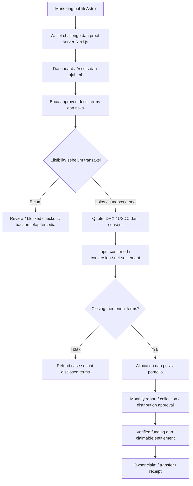
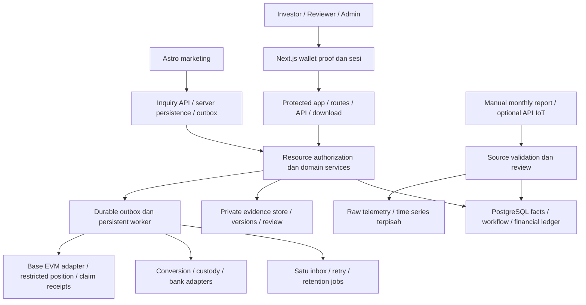

> **Arsip per 18 Oktober 2026.** Isi dipertahankan sebagai riwayat; dapat memuat keputusan yang tergantikan dan snapshot berbeda. Acuan aktif: [indeks dokumentasi](../README.md), [PRD](../PRD.md), [requirements MVP](../product/requirements.md).

# PRD Gen-Z

**Green Energy Network, Zero-Emission / Green Energy for Next Gen, Zero Emission**  
**One-liner:** Platform untuk berinvestasi di aset infrastruktur energi produktif.  
**Versi:** 2.1-base-pre-pilot, mempertahankan scope 17 Oktober dengan perubahan chain 18 Oktober 2026. **Data awal:** 11 Oktober 2026; **pembaruan:** 18 Oktober 2026, Asia/Jakarta.  
**Lokasi aset awal:** Indonesia; ekspansi aset ASEAN setelah model lokal terbukti. **Target investor [F]: individu dan institusi global**, dengan eligibility negara/segmen per offering.  
**Status:** dokumen produk dan rancangan pre-pilot; bukan penawaran investasi, persetujuan transaksi live atau bukti fitur sudah dibangun.

**Acuan scope utama:** [SPEC-MVP-Gen-Z-2026-10-17](mvp-spec-2026-10-18.md), versi `1.1-base`. Shared understanding MVP dikonfirmasi founder pada 17 Oktober. Spec ini memuat perubahan chain 18 Oktober dan mendahului keputusan 12/17 Oktober yang diganti; keputusan produk yang selesai tidak ditanyakan ulang. [Arsitektur](app-architecture-2026-10-18.md) dan [schema/flows](schema-flows-2026-10-18.md) menerjemahkannya menjadi rancangan implementasi.

**Catatan implementasi berikutnya, 17 Oktober:** fondasi kode sudah bergerak ke Astro marketing + satu workspace Next.js, dengan proof wallet Solana dan sesi PostgreSQL. Ini belum implementasi seluruh PRD. [Laporan penyelarasan platform](../history/2026-10-17-platform-alignment.md) mencatat pilihan teknis awal, hasil uji serta fitur yang tetap belum dibuat; snapshot kode lama pada dokumen ini merupakan konteks sebelum migrasi.

**Pembaruan aktif, 18 Oktober 2026:** [F] Base menggantikan Solana atas arahan founder. Scope produk 17 Oktober tetap, dengan detail teknis [R] pada [riset Base/EVM 18 Oktober](../research/base-evm-2026-10-18.md) dan spec versi `1.1-base`. Pilihan Base tidak mengaktifkan kembali mock wallet D0, public deal detail, note wajib atau functional rewards. Fondasi login EVM/SIWE pada Base Sepolia kini diimplementasikan, dengan akun Solana historis tetap terpisah; kontrak/lifecycle investasi masih rancangan. Lihat [laporan fondasi Base](../history/2026-10-18-base-foundation.md) untuk scope serta bukti verifikasi. Bagian riset dan snapshot lama tetap bertanggal.

Konvensi dokumen:

- **[F] Keputusan/arahan founder:** scope yang dinyatakan/disetujui, belum tentu tervalidasi secara komersial atau legal.
- **[R] Rancangan/rekomendasi PM dan engineering:** turunan teknis dalam mandat, bukan keputusan vendor baru oleh founder.
- **[A] Asumsi/fixture:** input sintetis atau skenario, bukan proyek nyata atau proyeksi yang dijanjikan.
- **[V] Terverifikasi pada tanggal riset yang disebutkan:** didukung sumber saat dicatat; pembaruan scope ini tidak memverifikasi ulang seluruh data pasar/regulasi.
- **[O] Dependency/open question:** belum dipilih; **[perlu verifikasi]** atau **[perlu riset lanjutan]** menyatakan kekurangan bukti.

Seluruh target, budget, threshold dan contoh keuangan adalah [R]/[A] kecuali ditandai [F]/[V]. Subscription berarti pemesanan hak investasi, berbeda dari langganan aplikasi. Model hak dan dokumen offering nyata belum ditetapkan dari contoh.

### Keputusan founder aktif, 18 Oktober 2026

1. Gen-Z perantara RWA aset energi produktif milik mitra Indonesia. Owner/operator, issuer, offering/series serta token/hak kontraktual berbeda; Gen-Z tidak otomatis memiliki aset atau menjadi obligor.
2. Marketing publik memakai **Astro**; auth dan seluruh app memakai **Next.js/TypeScript**; blockchain ditetapkan ke **Base/EVM** [F, 18 Oktober]. PostgreSQL, object storage dan worker persisten mengikuti baseline. wagmi/viem/SIWE serta Solidity/OpenZeppelin/Foundry menjadi rancangan [R]; vendor/versions, CMS dan production token/custody mandate belum dikunci.
3. **Wallet authentication sejak demo workspace pertama.** Dashboard, navigasi app, katalog/detail proyek dan dokumen perlu sesi. Connection saja bukan proof; role/eligibility/admin privilege tidak berasal dari browser.
4. **Satu demo solar hybrid interaktif:** pembayaran tetap + partisipasi pendapatan variabel, angka/dokumen/transaksi simulated berlabel. Showcase Energy/Infrastructure lain Coming soon dan tidak dapat diinvestasikan. Model nyata ditentukan per offering; hybrid bukan kewajiban universal dan note bukan default wajib.
5. **Tujuh tab:** Overview; Asset & Operator; Deal Terms; Performance & Data; Reports & Updates; Risks; Documents. Impact di Performance & Data, calculator skenario di Deal Terms. Structured facts + editor blok disetujui; Payload/Lexical kandidat CMS, belum keputusan vendor.
6. **Eligibility sebelum transaksi.** Setelah login, approved investor copies dokumen inti dapat dibaca sebelum eligibility transaksi. Original sensitif dibatasi; alasan redaksi/pembatasan, versi/sumber/status terlihat.
7. **Input IDRX + native USDC → satu hak denominasi IDR untuk kas IDR.** Quoted conversion, biaya/min_net/expiry dan allocation mengikuti net settlement. Provider/capacity serta payout/refund currency aktual tetap [O].
8. **Batas DeFi:** subscription, allocation/token posisi, portfolio, distribusi dan claim. Closed-end; tanpa swap, lending/borrowing, staking, secondary trading, transfer rutin atau exit instan. Hak principal/expiry eksplisit per offering; tidak ada principal redemption otomatis.
9. **Distribusi/claim:** collection → perhitungan hak/periode → review/approval → pendanaan terverifikasi → owner claim → receipt. Estimated, funded, claimable dan claimed berbeda; telemetry/invoice/forecast tidak menciptakan dana claimable.
10. **Pelaporan:** monthly reviewed reports menjadi fallback; API/IoT bila feasible. Sumber, periode/unit, freshness/coverage dan koneksi terlihat. Draft terms/laporan direview sebelum terbit; koreksi versi/reason/history baru. Provisional telemetry terpisah dari laporan reviewed dan ledger.
11. **Inquiry operator:** tersimpan server + referensi sebelum dianggap diterima, lalu notifikasi ke satu inbox. Notification failure tidak menghapus record/meminta submit duplikat. Assisted intake, screening dan permintaan bukti privat; tidak meminta dokumen sensitif di contact publik.
12. **Retensi inquiry:** akses founder/admin berwenang; tidak otomatis marketing. Inquiry tidak berlanjut dihapus 90 hari sejak interaksi terakhir; yang aktif ditinjau tiap 90 hari. Provider/inbox/backup retention saat konfigurasi; bukan aturan menghapus bukti investasi atau ledger.
13. **Rewards, Points dan Gen-Z Token:** navigasi informasi/Coming soon; functional rewards/account linking/award/redemption/reversal, TGE dan konversi poin ditunda. Native tetap arah utility/governance, terpisah dari hak proyek dan saham/revenue perusahaan.
14. Tahap pre-pilot: belum ada mitra/aset atau anchor konkret pada baseline; satu demo simulated → testnet setelah engineering review. Existing wallet, transfer rutin tertutup dan same-owner recovery tetap arah baseline, tetapi representasi/recovery Base mengikuti rancangan baru dan review issuer/security.
15. Baseline founder 2–4 jam/hari, free-first hingga testnet; English-first kemudian Indonesia. Tidak ada komitmen tanggal baru. Anchor discovery institutional/family-office dan qualified individual tetap konteks sourcing; target global bukan semua negara eligible.

### Riwayat keputusan yang tergantikan dan batas bukti

Keputusan Solana 17 Oktober diganti Base/EVM pada 18 Oktober. Solidity/OpenZeppelin/Foundry, SIWE dan restricted ERC-20 D1 kembali menjadi rancangan teknis yang diperiksa lewat riset baru; Safe adalah kandidat treasury/admin, bukan mandat custody final. Public app discovery/detail, mock wallet D0, note wajib dan simulated partner/rewards P0-D tetap tergantikan. Login sejak D0, model per offering dan reward informational tetap aktif. Catatan wawancara Q8–Q12 dan rekomendasi lama tetap histori, bukan alasan membuka ulang keputusan produk.

[Memo chain/stack/bisnis](../research/chain-business-2026-10-12.md), [wallet/token lifecycle](../research/wallet-lifecycle-2026-10-12.md), [RWA fit](../research/rwa-product-fit-2026-10-12.md), [market/features](../research/market-features-2026-10-12.md), [riset GEN 17 Oktober](../research/2026-10-17/GEN-AND-ARCHITECTURE.md), [catatan founder](founder-interview-2026-10-17.md) dan [brief demo lama](demo-brief-2026-10-12.md) menyimpan evidence/trade-off bertanggal. Jika proposal di sana bertentangan dengan spec terkonfirmasi, gunakan spec 17 Oktober. Snapshot pasar, benchmark dan regulasi di PRD dipertahankan sebagai konteks riset; tidak diklaim telah diperbarui atau menjadi legal opinion melalui sinkronisasi ini.

## 1. Executive Summary

**Gen-Z: platform untuk berinvestasi di aset infrastruktur energi produktif.** Gen-Z mempertemukan owner/operator aset energi mitra Indonesia dengan investor individu dan institusi global yang memenuhi eligibility. Fokus baseline aset operasional berkontrak mendukung renewable energy tetap berlaku; lokasi/operator/issuer dan terms proyek nyata menunggu data serta legal review.

Masalah utama adalah keterlacakan hak dan bukti: investor perlu memahami aset fisik, operator, issuer dan offering, menelusuri produksi/usage, invoice dan kas diterima sebagai catatan berbeda, lalu memperoleh posisi serta distribusi sesuai hak. Gen-Z menyediakan origination, kurasi, monitoring/reporting dan servicing; model pendapatan kerja [R] origination + servicing, dengan payer/tarif aktual [O].

**[F] MVP:** marketing publik Astro dengan Discuss your asset dan Launch app; wallet authentication pada Next.js sejak workspace pertama; satu proyek solar hybrid ilustratif interaktif, tujuh tab, dokumen inti approved setelah login, calculator berbasis model, subscription IDRX/native USDC, net settlement, allocation/token posisi, portfolio, laporan/distribusi dan funded claim. Semua angka, dokumen dan transaksi simulated ditandai. Blockchain ditetapkan ke Base/EVM; testnet setelah engineering review, bukan transaksi live.

Model ekonomi ditentukan per offering: fixed/variable, gross/net, fee, tenor, jadwal, principal/expiry dan residual harus jelas. Solar hybrid adalah fixture demo, bukan term sheet universal. IDRX dan native USDC untuk proyek berkas IDR menuju satu hak denominasi IDR berdasarkan net settled funds; provider/capacity, payout/refund currency aktual dan wrapper hukum masih [O]. Closed-end tanpa janji exit instan atau pengembalian pokok otomatis.

Inquiry operator harus benar-benar diterima server dan mempunyai referensi, kemudian notifikasi ke satu inbox, screening dan pengumpulan bukti privat secara assisted. Laporan bulanan reviewed menjadi fallback; API/IoT bertahap dengan sumber, freshness/coverage dan status koneksi. Telemetry provisional tidak memicu pembayaran. Draft dan koreksi mengikuti review/versioning.

Rewards, Points dan Gen-Z Token tersedia sebagai informasi/Coming soon setelah login, tanpa saldo atau transaksi loyalty fiktif. Functional rewards dan penerbitan native ditunda. Native utility/governance, poin dan hak kontraktual proyek tetap berbeda.

**Snapshot sebelum migrasi:** landing React/Vite, contact draft lokal, email sessionStorage dan dashboard preview adalah konteks lama. **Inspeksi 18 Oktober:** Astro/Next.js dan proof Solana/SIWS+sesi PostgreSQL tersedia pada source; fondasi SIWE/Base kini diimplementasikan, sedangkan inquiry persisten serta lifecycle kontrak investasi belum tersedia. Fase live menunggu counterparties/data permission, issuer/legal, allowed countries/investors, KYC/KYB/custody/FX, mandate, audit/security dan operasi.

## 2. Problem Statement & Market Opportunity

### 2.1 Tesis energi: valid sebagai arah, perlu diperbaiki sebagai klaim

**[F] Tesis awal:** kemajuan ekonomi berbanding lurus dengan konsumsi listrik per kapita; tidak ada high-income economy dengan konsumsi listrik rendah.

**[R] Formulasi yang lebih defensible:** listrik yang andal, terjangkau, dan cukup merupakan prasyarat penting bagi banyak aktivitas produktif. Konsumsi per kapita dapat menjadi indikator kapasitas ekonomi, tetapi bukan hubungan proporsional universal atau bukti kausal tunggal. Struktur jasa/manufaktur, iklim, efisiensi, outsourcing industri, dan perdagangan listrik memengaruhi perbandingan. Klaim “tidak ada” belum dibuktikan melalui analisis seluruh negara dan tidak boleh masuk pitch sebagai fakta.

Gen-Z harus mengejar **listrik produktif dengan cash flow sehat dan dampak emisi terukur**, bukan sekadar konsumsi listrik yang lebih tinggi. Ukuran kemajuan nasional bukan KPI yang secara langsung dapat diatribusikan ke platform.

### 2.2 Verifikasi angka pembanding

Gunakan 2024 sebagai baseline ekonomi/kapasitas bila tersedia; tahun konsumsi listrik ditampilkan per sel. Tabel ini merupakan komparasi indikatif, bukan dataset untuk regresi karena definisi dan tahun belum seragam.

| Negara | Penduduk | Kapasitas pembangkit | Konsumsi listrik per kapita | PDB per kapita nominal USD | Hasil pemeriksaan terhadap brief |
|---|---:|---:|---:|---:|---|
| Indonesia | ±281,6 juta, 2024 [V] | 100,649 GW, 2024 [V] | 1.411 kWh, 2024, ESDM [V] | 4.960,3, 2024 [V] | Rentang founder dekat untuk 2024; kapasitas sudah sedikit di atas 100 GW |
| China | 1.408,28 juta, akhir 2024 [V] | 3.348,62 GW, 2024 [V] | ±6.996 kWh, 2024, hasil hitung konsumsi 9.852,1 TWh / penduduk akhir tahun | 13.445, 2024, rilis pemerintah [V] | Sekitar 7.000 didukung; 9.500 bukan angka 2024 yang terbukti dalam riset ini |
| Singapura | 6,0369 juta, 2024 [V] | 12,445 GW, 2024 [V]; 13,261 GW pada semester I 2025 [V] | 9.750 kWh, 2023, World Bank/IEA [V] | 85.000–90.000 dalam brief **[perlu verifikasi]** untuk tahun yang dimaksud | 13–15 GW tidak cocok dengan kapasitas akhir 2024; PDB perlu snapshot seri konsisten |
| Amerika Serikat | ±340,1 juta, Juli 2024 [V] | 1.250–1.300 GW **[perlu verifikasi]**: harus tentukan nameplate/net summer serta cakupan small-scale solar | 12.839 kWh, 2024, World Bank/IEA [V] | ±84.492, 2024, UNCTAD [V] | Populasi, konsumsi, dan PDB sejalan secara kasar; kapasitas belum disahkan |

Sumber Indonesia: [Statistik Ketenagalistrikan ESDM 2024](https://gatrik.esdm.go.id/assets/uploads/download_index/files/91fa8-buku-statistik-ketenagalistrikan-2024.pdf), [BPS, PDB 2024](https://www.bps.go.id/id/pressrelease/2025/02/05/2408/ekonomi-indonesia-tahun-2024-tumbuh-5-03-persen--c-to-c-.html), dan [publikasi pemerintah yang merujuk proyeksi penduduk BPS](https://satudata.pertanian.go.id/assets/docs/publikasi/Buletin_Konsumsi_Pangan_Semester_I_2024.pdf).

Sumber China: [NBS, statistik 2024](https://www.stats.gov.cn/english/PressRelease/202502/t20250228_1958822.html), [NEA, konsumsi listrik 2024](https://www.nea.gov.cn/20250120/4f7f249bac714e7693adecac996d742f/c.html), [pemerintah China, PDB per kapita](https://english.www.gov.cn/english.www.gov.cn/news/202510/20/content_WS68f62084c6d00ca5f9a06efc.html). Hasil hitung memakai populasi akhir tahun, bukan rata-rata tahunan.

Sumber Singapura: [SingStat, populasi](https://www.singstat.gov.sg/find-data/search-by-theme/population/population-and-population-structure/latest-data), [EMA, kapasitas](https://www.ema.gov.sg/resources/singapore-energy-statistics/chapter2), [World Bank/IEA, konsumsi listrik](https://data.worldbank.org/indicator/EG.USE.ELEC.KH.PC?view=null). Seri PDB yang ditemukan memiliki revisi berbeda; angka founder tidak dipertahankan sebagai angka terbaru yang telah terkonfirmasi.

Sumber AS: [US Census, populasi 2024](https://www.census.gov/library/stories/2024/12/population-estimates.html), [World Bank/IEA, konsumsi listrik](https://data.worldbank.org/indicator/EG.USE.ELEC.KH.PC?view=null), [UNCTAD, profil AS](https://unctadstat.unctad.org/CountryProfile/GeneralProfile/en-GB/840/index.html), [EIA, Electric Power Annual](https://www.eia.gov/electricity/annual). Nilai UNCTAD terindeks dalam pencarian; pengambilan halaman penuh gagal, sehingga arsip tabel perlu dilampirkan sebelum publikasi eksternal.

**Koreksi tambahan:**

- Dunia: **3.558 kWh/kapita pada 2023**, bukan langsung memakai ±3.300 tanpa tahun. Malaysia: **5.084 kWh/kapita pada 2023**, mendukung pembulatan ±5.000. [World Bank/IEA](https://data.worldbank.org/indicator/EG.USE.ELEC.KH.PC?locations=null)
- World Bank/IEA menampilkan Indonesia **1.445 kWh pada 2023**, sementara seri ESDM untuk tahun yang sama adalah **1.337 kWh**. Ini harus direkonsiliasi secara metodologis; jangan menyimpulkan perubahan tahunan dari perpindahan sumber. [World Bank](https://data.worldbank.org/indicator/EG.USE.ELEC.KH.PC?view=null), [ESDM](https://gatrik.esdm.go.id/assets/uploads/download_index/files/91fa8-buku-statistik-ketenagalistrikan-2024.pdf)
- Pembaruan Indonesia 2025: kapasitas **107,51 GW**, sehingga brief 95–100 GW bukan baseline terkini. Tabel tetap menggunakan 2024 agar tahun tidak tercampur diam-diam. [ESDM, kinerja 2025](https://www.esdm.go.id/en/media-center/news-archives/kapasitas-pembangkit-naik-7-gw-akses-listrik-masyarakat-meningkat)
- Penjualan PLN 2025 menunjukkan rumah tangga **42,36%** dan industri **29,94%**. Rumah tangga adalah kelompok terbesar, bukan mayoritas absolut; penjualan PLN tidak sama dengan seluruh konsumsi nasional karena pembangkit captive/non-PLN. Data ini juga tidak memisahkan industri high-tech. [Statistik PLN 2025](https://web.pln.co.id/statics/uploads/2026/03/Statistik-2025-16.3-c.pdf)

### 2.3 Kebutuhan investasi: skenario, bukan angka tunggal

**[A] Skenario founder:** penambahan 30 GW/tahun dan belanja USD30–40 miliar/tahun mengimplikasikan sekitar **USD1.000–1.333/kW**. Itu asumsi biaya rata-rata, bukan estimasi engineering terverifikasi; tidak cukup untuk menyatakan biaya pembangkit, grid, BESS, lahan, bunga konstruksi, dan cadangan sekaligus.

Dengan **asumsi kurs Rp16.000/USD**, USD30–40 miliar menjadi **Rp480–640 triliun**, bukan tepat Rp500–600 triliun. Kurs ini hanya input skenario. Teknologi, capacity factor, kebutuhan firming, dan lokasi harus menentukan model biaya.

Pembanding resmi: RUPTL PLN 2025–2034 memuat tambahan kapasitas **69,5 GW**, termasuk storage dalam komposisi program, dan peluang investasi **Rp2.967,4 triliun**: pembangkit Rp2.133,7 triliun, penyaluran Rp565,3 triliun, dan lainnya Rp268,4 triliun. Cakupan dan horizon berbeda dari skenario 30 GW/tahun. [ESDM EBTKE](https://ebtke.esdm.go.id/artikel/berita/peluang-investasi-dan-green-jobs-di-sektor-ebt-terbuka-lebar-lewat-ruptl-pln-2025-2034)

**[R] Dua pilar makro tetap relevan:** modal swasta/global membutuhkan kepastian hak dan kontrak bankable; ekspansi teknologi membutuhkan pembangkit, interkoneksi antarpulau, BESS, surya/EBT, dan kajian firm low-carbon power termasuk SMR. Gen-Z berkontribusi pada pembiayaan proyek terpilih; pembangunan super-grid dan SMR berada di luar kemampuan MVP.

### 2.4 Problem A: AI, compute, dan industri

IEA memperkirakan konsumsi data center global sekitar **415 TWh pada 2024**, dengan **945 TWh pada 2030 dalam base case**. Itu proyeksi global untuk data center, bukan TAM Indonesia dan bukan seluruhnya AI. [IEA, Energy and AI](https://www.iea.org/reports/energy-and-ai/energy-demand-from-ai), [ringkasan IEA](https://www.iea.org/reports/energy-and-ai/executive-summary%C2%A0)

**[R] Masalah yang dapat dilayani Gen-Z:** proyek energi skala lebih kecil di dekat demand anchor kesulitan membiayai aset karena kontrak, kualitas data, ticket size, atau biaya transaksi. Pernyataan “Indonesia belum punya fondasi energi” terlalu menyeluruh. Uji per lokasi: daya tersambung, waktu interkoneksi, kualitas tegangan, outage, tarif efektif, cooling, dan akses energi rendah emisi.

Data center, fab semikonduktor, serta smelter nikel/besi tidak memiliki underwriting yang identik. Data center membutuhkan kontinuitas dan redundansi; fab juga sangat sensitif terhadap kualitas daya; smelter membutuhkan energi proses besar dan menghadapi risiko komoditas. MVP tidak membiayai GPU, membangun data center, atau menanggung risiko harga nikel.

### 2.5 Problem B: EV

**[F] Pemicu founder:** risiko Selat Hormuz, kenaikan harga minyak, tekanan biaya BBM, dan dorongan beralih ke EV. Dokumen EIA Mei 2026 membahas gangguan produksi terkait penutupan Selat Hormuz, tetapi kondisi dan harga pada tanggal peluncuran harus diperbarui. Hubungan langsung dengan adopsi EV Indonesia belum terbukti. [EIA, outlook Mei 2026](https://www.eia.gov/outlooks/steo/pdf/steo_full.pdf?lv=true)

**[perlu riset lanjutan]** Tidak tepat menyatakan EV belum memiliki jaringan sama sekali. ESDM menyebut **3.558 SPKLU disiapkan untuk periode mudik 2025** pada wilayah yang disebut dalam rilis. Angka ini bukan ukuran utilisasi, availability, jumlah konektor unik, atau cakupan nasional terkini. [ESDM, SPKLU mudik 2025](https://esdm.go.id/en/media-center/news-archives/siapkan-3-ribu-spklu-menteri-esdm-pastikan-pemudik-nyaman-berkendara)

Masalah produk yang diuji: apakah ada lokasi dengan demand terikat tetapi kekurangan modal untuk charger/storage, dan apakah investasi tetap layak tanpa subsidi token? Analogi Pertamina membantu menjelaskan kebutuhan jaringan, tetapi operator EV, charging rumah, destination charging, dan PLN menciptakan struktur pasar yang berbeda.

| Riset wajib | Metrik dan pemisahan | Sumber/owner yang diusulkan | Pengaruh pada keputusan |
|---|---|---|---|
| Demand kendaraan | Stok aktif BEV roda 2/4, fleet vs pribadi, wilayah, km/hari; pisahkan penjualan dan stok | Product research; registrasi resmi, asosiasi, fleet | Memilih cluster pilot |
| Supply infrastruktur | Site, charger, connector, daya AC/DC, SPBKLU, compatibility, availability aktual | Energy lead; ESDM, PLN, operator | Menghindari hitung ganda dan lokasi oversupplied |
| Utilisasi | kWh/connector/hari, session/hari, durasi, peak occupancy, antrean, musim | Operator export minimal 6–12 bulan | Basis pendapatan |
| Unit economics | Tarif bersih, biaya listrik, sewa, demand charge bila berlaku, maintenance, payment fee, replacement | Finance dan operator | Break-even, DSCR, pricing |
| EV affordability | TCO kendaraan, pembiayaan, biaya/km, penghematan pengguna EV, willingness to pay | Interview pengguna EV/fleet dan data transaksi | Apakah insentif mengubah perilaku |
| Battery swap/storage | Swaps/baterai/hari, SoH, kehilangan, spare inventory, round-trip efficiency, keselamatan | OEM/operator dan engineer | Besar reserve dan masa manfaat |
| Konversi insentif | Repeat usage vs control, biaya per incremental session, fraud rate | Product analytics | Layak/tidaknya program poin |

### 2.6 TAM, SAM, SOM

**[R] Jangan menyamakan belanja energi nasional dengan market revenue Gen-Z.** TAM pembiayaan = kebutuhan modal aset yang berpotensi cocok; SAM = bagian yang memenuhi yurisdiksi, jenis instrumen, ukuran, dan standar underwriting; SOM = nilai proyek yang realistis dioriginate dan ditutup oleh tim.

**[V] Konteks pasar:** ESDM mencatat PLTS terpasang **1.494,1 MW** akhir 2025 dan tambahan **584,7 MW** selama 2025. Total EBT 15.630 MW di laporan termasuk 468 MW gasifikasi batubara/WHB, sehingga tidak otomatis seluruhnya renewable/eligible. RUPTL 2025–2034 memuat investasi EBT melalui IPP **Rp1.341,8 triliun**, tetapi banyak proyek greenfield dan capex multi-tahun. Angka tersebut bukan annual financing market atau revenue Gen-Z. [ESDM LKj EBTKE 2025](https://www.esdm.go.id/assets/media/content/content-laporan-kinerja-ditjen-ebtke-tahun-2025.pdf), [ESDM RUPTL](https://www.esdm.go.id/id/media-center/arsip-berita/dongkrak-energi-bersih-menteri-esdm-tekankan-pentingnya-komitmen-laksanakan-ruptl).

**[R] Horizon sizing: 12 bulan.** TAM = jumlah net financing/refinancing need aset operasional berkontrak dalam ruang produk; SAM = bagian yang lolos service/legal/credit/rail filters; SOM = closed/disbursed capital, dibatasi verified demand, committed eligible anchor capital dan execution capacity. National TAM sesuai definisi produk masih **[perlu verifikasi]**, karena data asset-level debt/funding need belum tersedia. Global investor target memperluas sumber modal, bukan otomatis ukuran aset Indonesia.

| Skenario sourcing 12 bulan, seluruh angka [A] | Rendah | Basis | Tinggi |
|---|---:|---:|---:|
| Universe hipotetis dipetakan | 100 proyek | 100 proyek | 100 proyek |
| Punya funding need × lolos filters | 20% × 30% | 30% × 40% | 40% × 50% |
| Eligible hasil model | 6 proyek | 12 proyek | 20 proyek |
| Serviceable capital/proyek | Rp2 miliar | Rp5 miliar | Rp10 miliar |
| **SAM sourcing model** | **Rp12 miliar** | **Rp60 miliar** | **Rp200 miliar** |
| Closing capacity jika gates/anchor tersedia | 1 proyek | 2 proyek | 3 proyek |
| **SOM capital model** | **Rp2 miliar** | **Rp10 miliar** | **Rp30 miliar** |

**Ini sensitivity, bukan national TAM, pipeline nyata, forecast atau target founder. Downside wajib: 0 closing / Rp0 funding.** Belum ada mitra/anchor nyata; nominal satu pilot mengikuti kas/debt capacity. Contoh revenue [A]: funding Rp10miliar × fee2% + average outstanding Rp5miliar × servicing1% × satu tahun = **gross fee Rp250juta**, sebelum semua biaya/tax/run-off, bukan profit atau accepted pricing. Fee prorata dan average outstanding mengikuti amortisasi.

Sourcing register wajib memuat owner/COD/technology, contracts/currency, collections, CFADS, existing debt/security/lender consent, net funding need/date dan operator data permission. Dedupe refinancing agar uang yang sama tidak dihitung ulang. Bukti pasar/operator, semua sumber, formulas dan data gaps ada pada [riset market sizing](../research/market-features-2026-10-12.md). Jangan memakai capex/MW, token RWA market cap atau pemilik kripto sebagai dana yang sudah bersedia masuk Gen-Z.

## 3. Vision, Mission, Goals & Non-Goals

**[F/R] Vision:** akses investasi yang bertanggung jawab untuk memperluas infrastruktur energi produktif Indonesia, lalu ASEAN.

**[R] Mission:** menyeleksi proyek, memperjelas hak ekonomi investor, menghubungkan pendanaan dengan penggunaan dana, serta memverifikasi kinerja aset dan distribusi kas.

| Horizon | Goal yang diusulkan | Bukti keberhasilan |
|---|---|---|
| MVP | Memvalidasi siklus proyek dan investasi end-to-end | UAT sukses, term sheet, data room, rekonsiliasi simulasi |
| Pilot live | Membuktikan hak dan pembayaran berjalan | Satu closing sah dan tiga siklus laporan/distribusi |
| Beta | Membuktikan proses dapat diulang | Beberapa proyek lolos, biaya layanan terukur, operator repeat |
| Scale | Memperluas aset secara terkendali | Kualitas portofolio dan ekonomi membaik tanpa subsidi token |

**Non-goals MVP:** dana/payout live, token sale/TGE native, functional rewards/points/redemption/reversal, konversi otomatis poin, swap, lending/borrowing, staking, secondary trading, transfer rutin, exit instan, bridging/multi-chain, portal operator self-service penuh, IoT wajib, fractionalization tanpa wrapper legal, aplikasi charger baru, pembangunan pembangkit besar/SMR dan klaim zero-emission otomatis.

Nama Gen-Z adalah identitas brand. Label “Zero Emission” tidak boleh menjadi klaim kinerja setiap aset. Charging dari grid dan baterai tidak otomatis bebas emisi; ukur asal energi, batas sistem, dan lifecycle sesuai metodologi yang disepakati.

## 4. Target Users & Personas

Persona berikut **[A] hipotesis segmen**, bukan hasil wawancara atau pengguna nyata.

**[F] Investor target global; belum ada calon anchor. Target produk individu dan institusi global; prioritas discovery baseline institutional/family-office yang eligible, qualified individual/HNWI kandidat sekunder.** Allowed jurisdictions mengikuti review; nama family office tidak otomatis menentukan qualification. Lokasi aset Indonesia tidak berarti semua investor harus resident Indonesia, dan global target tidak otomatis membuka subscription semua negara.

| Persona | Job to be done | Pain utama | Kebutuhan produk | Prioritas |
|---|---|---|---|---|
| Retail investor eligible | Mengalokasikan dana jangka menengah ke proyek yang dipahami | Sulit menilai risiko, bingung hak token dan exit | Ringkasan risiko, KYC, minimum ticket jelas, distribusi dan pajak | Beta setelah jalur retail disahkan |
| Institusi/family office | Mendapat eksposur aset dengan due diligence dan governance | Data tidak standar, enforcement, currency mismatch | Data room, KYB/UBO, covenants, reporting, ukuran ticket | Anchor pilot |
| Pemilik UMKM dengan surplus kas | Diversifikasi dana yang tidak dibutuhkan untuk modal kerja | Tenor tidak cocok, likuiditas, kapasitas menanggung rugi | Suitability dan cash planning; status badan usaha tidak otomatis qualified investor | Selektif, bukan sasaran massal |
| Pengguna layanan mitra | Mendapat manfaat dari layanan eligible dan reward yang dapat ditelusuri | Account linking sulit, poin tidak jelas, transaksi tidak terverifikasi | Wallet terverifikasi, account link, bukti layanan/pembayaran dari mitra, status poin dan dispute | Ekspansi reward ditunda; tidak wajib investor |
| Fleet operator | Menjamin energi tersedia untuk rute operasional | Ketidakpastian kapasitas dan biaya | Kontrak volume/SLA, laporan biaya per kendaraan, depot charging | Demand anchor untuk fase EV |
| Asset operator/developer | Membiayai ekspansi atau refinancing secara efisien | Biaya modal, kelengkapan dokumen, reporting | Intake proyek, checklist DD, milestone, akses investor | Supply anchor |

Investor, pengguna layanan mitra, dan operator adalah peran berbeda. Charging, swap, atau subscription AI merupakan kategori layanan sesuai fase, bukan pembatas persona reward. Satu pihak dapat memiliki beberapa peran, tetapi kepemilikan investasi tidak otomatis memberi hak mengubah settlement atau menyetujui data operasionalnya sendiri.

## 5. Competitive Landscape

Snapshot situs publik per tanggal riset. Klaim pemasaran milik kompetitor bukan hasil audit independen. Tidak ada klaim bahwa platform tertentu sudah memperoleh izin Indonesia. Angka pipeline bukan funded AUM dan target yield bukan realized return.

| Dimensi | ReFi Hub | Habitat Protocol | GEN / ge.network |
|---|---|---|---|
| Model bisnis | Akses investasi aset energi operasional dan distribusi cash flow; detail fee perlu konfirmasi | Mengubah surplus energi terbarukan menjadi layanan compute/storage dan marketplace | Infrastruktur tokenisasi dengan lapisan GEN Core, GEN Network, GEN Invest; tarif komersial belum terkonfirmasi |
| Aset/eksposur | Solar dan kategori EV charging; proyek individual dan produk portofolio Volt | Green Credits dan Energy Vouchers yang mewakili compute; bukan otomatis saham proyek energi | Solar, EV charging, storage, data center disebut sebagai kategori aset |
| Yield/manfaat | Pendapatan aset; Volt mengiklankan target 6% dan withdrawal mingguan | Utility compute dan akses voucher; cash yield investor tidak terverifikasi | Instrumen yield dari offtake energi dan distribusi bulanan menurut situs |
| Token | Volt disebut SPL token portofolio dengan komposisi 70% aset energi/30% likuid; jangan disamakan dengan token governance native | $HABITAT, Green Credits, Energy Vouchers; litepaper memuat alokasi 75/10/10/5% | Bentuk legal token proyek dan native token belum cukup terungkap di halaman yang ditinjau **[perlu verifikasi]** |
| Kekuatan yang tampak | Penjelasan kontrak, operating assets, dan distribusi; pembanding dekat untuk Gen-Z | Hubungan energi-surplus dengan demand compute konkret | Integrasi telemetry dengan produk investasi; vertikal sudah luas |
| Kelemahan/hal belum terbukti | Buffer likuiditas tidak menjamin redemption saat stress; fee dan implementasi withdrawal perlu diuji | Eksekusi compute, utilization, SLA, dan economics voucher perlu pembuktian; bukan pembanding yield langsung | Telemetry tidak membuktikan penerimaan kas atau hak hukum; klaim on-chain ownership perlu validasi dokumen |

Sumber: [ReFi Hub](https://www.refihub.io/), [Volt](https://www.refihub.io/volt), [Habitat](https://www.habitatprotocol.com/), [Habitat Litepaper](https://www.habitatprotocol.com/litepaper), [GEN](https://www.ge.network/), [GEN Invest](https://invest.ge.network/). Akses yang sempat gagal telah diulang pada 12 Oktober; halaman utama Habitat dan litepaper dapat ditinjau. Status operasional mutakhir tetap memerlukan bukti di luar halaman pemasaran.

**Pembaruan benchmark 12 Oktober:** revenue participation ReFi berbeda menurut proyek. FLP II mempunyai fixed/variable payment serta operator support; Surya melaporkan pembagian kas net. Laporan CRN membedakan interim development payments dari generation revenue. Benchmark bisnis lebih mapan seperti Maple/Ondo/Centrifuge digunakan untuk menguji issuer, principal recovery, servicing dan pemisahan native/project rights, bukan menyalin underlying risk atau headline yield. Detail bukti bertanggal, ketidaksesuaian data dan sumber tersedia di [memo riset](../research/rwa-product-fit-2026-10-12.md).

**Audit fitur terbaru:** ReFi public app list/detail dapat ditinjau: Deal Terms, Performance, Risks, Asset & Operator, Documents, historical distributions dan calculator; authenticated portfolio/checkout belum diuji. **GEN /invest dan /network WIP**, sedangkan Habitat marketplace/compute banyak berupa litepaper/roadmap; jangan memperlakukan ilustrasi landing sebagai production app. [GEN Invest](https://www.ge.network/invest), [GEN Network](https://www.ge.network/network), [ReFi public detail](https://app.refihub.io/investments/9). Kurasi fitur ReFi/Ondo/GEN/Habitat/Glow/SunContract beserta scope observasi ada pada [memo fitur](../research/market-features-2026-10-12.md).

**[R] Celah Gen-Z yang perlu dibuktikan:**

- Origination lokal: kontrak, bank, operator, dan collection rupiah yang bisa diverifikasi.
- Hak investor dan proses default yang ditulis dalam bahasa Indonesia dan dapat dijalankan melalui struktur lokal.
- Pelaporan tiga bukti: energi dikirim, invoice diterbitkan, kas diterima. Jangan menyamakan ketiganya.
- Energy-first origination dengan kontrak pendapatan dan mitra kredibel, dilanjutkan pembiayaan/layanan EV dan infrastruktur lain sesuai kesiapan.

“EV + AI” bukan keunikan yang sudah terbukti karena GEN menyebut kategori serupa. Kepatuhan juga belum menjadi moat sebelum Gen-Z memiliki jalur operasional yang sah. Substitusi utama meliputi kredit bank, leasing peralatan, modal operator, dan SCF konvensional; Gen-Z harus unggul pada biaya total, kecepatan, atau akses modal dibanding opsi tersebut.

## 6. Product Overview & Core Value Proposition

**[F] Satu proyek, satu pool. [R]** Setiap offering/series mempunyai issuer, kelas hak, denominasi, model, terms dan version yang jelas. Project ekonomi, aset fisik, owner/operator, issuer, offering dan token representation berbeda; dana proyek A tidak menutup distribusi proyek B. Isolasi hukum perlu bukti, bukan wallet berbeda saja.

| Pengguna | Value proposition yang diuji pada MVP |
|---|---|
| Investor | Membaca bukti/terms/risiko sebelum transaksi, memahami model, mendapatkan posisi dan claim yang dapat direkonsiliasi |
| Operator | Inquiry diterima dengan reference, screening dan permintaan bukti jelas; assisted intake tanpa portal penuh |
| Reviewer/admin | Fakta dan evidence terhubung project/period, review sebelum publish, audit perhitungan dan pendanaan distribusi |
| Pengguna Rewards/Points/Gen-Z Token | Memahami status Coming soon dan perbedaannya dari hak proyek; belum menerima reward |

Modul aktif: marketing/inquiry, wallet identity/access, asset/offering, editorial/evidence, subscription/settlement, position/ledger, reporting/data, distribution/claim dan review minimum. Loyalty/AI reward adalah ekspansi, tidak menjadi dependency investment core.

Model domain: `Mitra/Issuer → Project/Asset → Pool/Offering → Terms/Model Version → Quote/Consent/Subscription → Net Settlement → Allocation/Position → Distribution Entitlement + Funding → Claim/Receipt`. Operation, invoice dan collection tetap records berbeda; evidence/report terikat source/period. Definisi yang sudah ada di [GLOSSARY](../../GLOSSARY.md) tetap dipakai.

## 7. User Journey & Key User Flows

**[F] Urutan investor:** marketing → wallet authentication → dashboard/Assets → detail tujuh tab → bukti/terms/risiko → eligibility sebelum transaksi → quote/consent/subscription → net settlement → allocation/token posisi → portfolio → laporan/distribusi → funded claim → receipt. [Architecture](app-architecture-2026-10-18.md) memuat route/API/access; [schema/flows](schema-flows-2026-10-18.md) memuat relasi, state dan acceptance.

### 7.1 Investor



1. Wallet connection dilanjutkan challenge, proof server dan sesi; bukan KYC atau grant role. Katalog/detail/dokumen app membutuhkan sesi sejak demo pertama.
2. Login tanpa eligibility transaksi boleh membaca dokumen inti approved investor copy. Original sensitif dibatasi dengan alasan, versi/sumber/status dan permission tersendiri.
3. Detail mempunyai tujuh tab tetap: Overview; Asset & Operator; Deal Terms; Performance & Data; Reports & Updates; Risks; Documents. Calculator di Deal Terms, Impact di Performance & Data; shortcut Documents dari ringkasan adalah rancangan [R].
4. Pilih IDRX/native USDC; quote menjelaskan FX/fees/expiry/min_net/net IDR rights. Consent mengikat offering, terms/model version dan quote. Wrong chain/token contract, expired/under/overpayment atau conversion failure masuk exception; frontend tidak menentukan paid/allocated.
5. Allocation hanya sesudah net settlement dan closing terpenuhi. Simulated positions bukan legal/on-chain issuance. Token production mengikuti review Base/EVM dan issuer/register yang disahkan; D1 memakai restricted ERC-20 per offering/series [R].
6. Portfolio menampilkan hak/unit, cost, histori dan principal/income hanya jika model mendefinisikan. Seluruh distribusi tidak otomatis profit. Due/forecast, approved, funded, claimable dan claimed berbeda.
7. Claim hanya untuk entitlement sendiri yang didukung dana tersedia; duplicate/wallet lain/no funding ditolak. Pending/failed/retry serta receipt dapat ditelusuri tanpa double pay. Claim tidak menjadi exit atau principal redemption otomatis.
8. Shortfall/overdue/default/refund tetap terlihat; expiry/residual/amortisasi hanya mengikuti terms offering. Closed-end tanpa janji exit instan.

### 7.2 Rewards, Points dan Gen-Z Token

Setelah login, ketiga halaman dapat dibuka sebagai informasi/Coming soon. Tidak ada account linking, synthetic points balance, award, redemption, reversal, staking atau konversi poin pada MVP. Penjelasan membedakan poin, native utility/governance dan hak proyek. Functional rewards/AI partner serta TGE ditunda; rencana usage-first lama hanya konteks ekspansi, bukan acceptance D0.

### 7.3 Operator dan admin

```text
Discuss your asset → inquiry tervalidasi → commit server + reference
→ notifikasi satu inbox → screening founder/admin → status dan permintaan bukti privat
→ project/asset/owner/operator/issuer/evidence/period linkage
→ facts + tujuh tab editorial → review terms/report → publish approved copies
→ collection reconciliation → calculation → approval → funding → owner claim → receipt
```

Contact awal mengumpulkan profil/kontak, kategori/lokasi/status aset serta kebutuhan pembiayaan, tanpa original sensitif. Inquiry diterima setelah tersimpan, bukan setelah email terkirim. Kegagalan notifikasi tidak menghapus penerimaan/meminta kirim duplikat. Akses hanya founder/admin berwenang; tidak otomatis marketing. Yang tidak berlanjut dihapus 90 hari sejak interaksi terakhir; aktif ditinjau setiap 90 hari. Retensi provider/inbox/backup diselesaikan saat konfigurasi; bukan retensi ledger/bukti investasi.

MVP memakai assisted intake/review minimum; operator full self-service ditunda. Live reviewer/finance maker/approver memerlukan mandat independen; founder berpindah role di demo bukan bukti segregation of duties live.

## 8. Functional Requirements

**D = demo pertama; T = testnet setelah engineering review; L = sebelum dana nyata; P1/P2 = ekspansi ditunda.** Semua acceptance merupakan target implementasi; pembaruan ini tidak mengklaim test lulus. Demo lifecycle keuangan synthetic berlabel, tetapi wallet proof/session dan inquiry persistence wajib sejak D.

| ID / Fase | User story | Acceptance criteria |
|---|---|---|
| FR01 D/T/L | Investor hanya dapat bertransaksi saat eligible | Decision per offering/country/party/expiry; sandbox demo jelas; rejected/expired tidak subscribe; wallet login berbeda dari KYC/KYB/UBO dan privilege |
| FR02 D/T/L | Investor membaca hak/risiko sebelum investasi | Tujuh tab tetap; approved investor copies setelah login tanpa eligibility transaksi; issuer/model/fees/tenor/principal-expiry jelas; draft/revisi belum approved tidak tampil |
| FR03 D/T/L | Operator mengajukan aset dan evidence | Server inquiry+reference, screening/needed evidence, private assisted intake; project/asset/party/offering/period links dan akses original sensitif terbatas |
| FR04 D/T/L | Investor memesan tanpa over-allocation | Cap/reservation atomik, min/max/expiry, quote+terms/model/document consent versioned; concurrent/retry tidak menggandakan hak |
| FR05 D/T/L | Finance menelusuri subscription funds | Expected/received/converted/net_settled/allocated terpisah, unique source event, controlled precision, unmatched/failed tetap liability/exception |
| FR06 D/T/L | Investor memilih IDRX atau native USDC | Satu hak IDR untuk kas IDR; fees/FX/min_net/expiry; chain ID/token contract/decimals per environment authoritative; pending/expired tidak allocated; provider/capacity/payout/refund currency aktual [O] |
| FR07 D/T/L | Refund jika closing gagal | Conditions/deadline terdokumentasi; before/after conversion terms; no allocation + full refund dana sama; gagal refund tetap kewajiban |
| FR08 D/T/L | Pemegang hak memperoleh posisi benar | Allocation sesudah net settlement dan closing; supply/units/register dapat direkonsiliasi; synthetic bukan issuance; restricted ERC-20 D1, supply/recovery dan register Base setelah review |
| FR09 D/T/L | Ledger dapat direkonsiliasi | Per pool/currency/asset, conversion legs dan rounding eksplisit; no cross-pool netting; reversal/correction, bukan overwrite; cadence live sesuai operasi |
| FR10 D/T/L | Distribusi dan claim dapat dijelaskan | Hak/periode/cleared collection → review/approval → verified funding → owner claim/receipt; fixed/variable, gross/net, fee/tax dan principal/income jika applicable; no funding/no entitlement/duplicate tidak membayar |
| FR11 D/T/L | Investor memahami principal dan exit | Hak principal/expiry/residual/schedule sesuai model per offering; tidak semua distribusi profit atau amortisasi; closed-end tanpa instant exit/redemption tersirat |
| FR12 D/T/L | Investor melihat data dan laporan yang dapat ditelusuri | Production/usage/invoice/cash/distribution terpisah, periode/unit/source/freshness/coverage/koneksi; monthly reviewed; missing/stale bukan nol; provisional bukan trigger claim |
| FR13 D/T/L | Risiko/shortfall tetap tercatat | Overdue, default, cash shortfall, pending/conversion/claim failure memicu case/history; tidak menyembunyikan kewajiban atau koreksi |
| FR14 D/T/L | Akses dan approval aman | Server-side RBAC/resource/download/cache checks; role bukan pilihan browser; nonce/session replay/expiry/revocation; critical finance mandate/maker-checker/step-up live sesuai threat model |
| FR15 D/T/L | Investor melihat posisi/receipt dan bantuan | Owner/org-scoped portfolio/activity/report/claim status; exceptions dan receipt; formal statements/helpdesk/recovery live sesuai mandat dan legal retention |
| FR16 D/T/L | Data pribadi dan inquiry terlindungi | No PII on-chain, original privat; founder/admin only inquiry; inactive delete 90 hari sejak last interaction, active review 90 hari, no auto marketing; backup/inbox retention dikonfigurasi; ledger retention terpisah |
| FR17 P1 | Pengguna mendapat functional rewards bila program siap | Di luar MVP; partner/budget/terms dan service completion+payment final+account linkage terbukti; dedupe/refund/reversal/benefit policy sebelum aktivasi |
| FR18 Opsional setelah akses data siap | Operator mengintegrasikan API/IoT | Feasibility/permission/source/coverage tervalidasi; raw telemetry/time series terpisah report/ledger; signed/anchored data bukan bukti akurasi atau kas |
| FR19 P1/L sesuai institusi | Institusi memakai multi-user approval | Beneficial owner/account mandate, viewer/approver serta recipient/signing permissions terpisah dari login |
| FR20 P1/P2 bersyarat | Program poin/native diluncurkan bila layak | Ditunda; utility/legal/emission/funded benefit/terms sebelum konversi; tanpa janji automatic points-to-token |
| FR21 P2 bersyarat | Pengalihan hak resmi bila diizinkan | Transfer rutin ditutup; assignment exception/recovery sesuai issuer/legal/security, tidak menjanjikan pembeli atau exit |
| FR22 P2 | Aset/investor lintas negara | Eligibility/legal/currency/tax per negara dan offering; global target tidak berarti universal access |
| FR23 P2 ekspansi | Reward AI/compute jika partner tersedia | Di luar MVP; authorized programme, paid service/payment/account attribution, funded budget, duplicate/refund; tanpa password/isi chat vendor |
| FR24 D | Pengunjung memahami stage dan dua jalur | Marketing publik Astro, Discuss your asset dan Launch app; inquiry sukses setelah server commit+reference; notifikasi satu inbox asynchronous/retry-safe |
| FR25 D/T | Admin mengelola tujuh tab | Structured facts + validated blocks, review sebelum publish, koreksi version/reason/history; CMS belum dikunci; financial source bukan rich text/formula bebas |
| FR26 D/T | Investor menggunakan calculator dan chart | Model/version/dataset sama dengan tabel/portfolio, asumsi/unit/basis eksplisit; forecast terpisah actual; tidak menambah claimable |
| FR27 D | User membuka Rewards/Points/Gen-Z Token | Login wajib; informasi/Coming soon tanpa saldo/aksi finansial fiktif; tidak ada functional reward walkthrough MVP |

**Non-functional [R]:** target live baseline availability 99,5%/bulan; read API p95 <2 detik pada beban UAT disepakati di luar latency mitra; ledger RPO ≤15 menit dan RTO ≤4 jam dengan restore drill. Ini target, bukan capaian. Financial mutations membutuhkan idempotency, reconciliation, observability dan alerting; worker tidak bergantung lifecycle request. Inquiry commit+outbox dan claim reservation/funding harus atomik.

Accessibility implementasi: mobile, keyboard/focus, error feedback, WCAG AA, reduced motion serta loading/empty/error/unavailable/partial/stale states. Pembaruan dokumen ini tidak membangun UI atau mengklaim visual Delivery Gate lulus.

### 8.1 Target MVP dan batas verifikasi

[Spec sumber](mvp-spec-2026-10-18.md) memuat tujuh Testing Decisions; [schema/flows](schema-flows-2026-10-18.md) memetakan M01–M17 ke ketujuhnya. Uji harus mencakup browser → API → persistence/domain outcome, bukan komponen UI saja: inquiry/notifikasi/retensi; auth/tab/docs; dual-input settlement/posisi/claim; owner/funding/duplicate; publication/data gaps; model/rounding/refund/shortfall; Coming soon dan aksesibilitas.

Live identity/legal/collection/funding/custody/quote serta approvals tidak boleh mock. Trial synthetic/testnet dan chain ID/token contract/decimals yang digunakan dinyatakan jelas; jangan mengasumsikan mainnet stablecoin tersedia pada testnet.

## 9. Tokenomics & Incentive Design

### 9.1 Hak proyek, poin dan native berbeda

| Elemen | Hak/token posisi proyek | Poin Gen-Z | Gen-Z Token platform |
|---|---|---|---|
| Dasar | Offering/issuer, terms/model/version, units/register | Program layanan mitra bila kelak diaktifkan | Arah utility/governance, fitur rinci [O] |
| Hak ekonomi | Sesuai kontrak proyek, bukan otomatis kepemilikan fisik | Bukan saldo tunai atau yield investasi | Bukan saham/revenue perusahaan atau hak yield proyek |
| MVP | Synthetic allocation/portfolio/distribution/claim berlabel | Informasi/Coming soon, tanpa saldo/award/redemption | Informasi/Coming soon; tanpa TGE/buy/stake/konversi |
| Transfer/akhir hak | Transfer rutin ditutup; principal/expiry/residual sesuai offering | Terms ekspansi belum diaktifkan | Supply/ticker/vesting/issuer/legal [O] |

### 9.2 Model ekonomi per offering

**[F]** Hybrid/revenue participation dibuka; demo pertama solar hybrid fixed payment + variable revenue participation. Note bukan default wajib. Pilihan note, participation atau model lain memerlukan facts dan terms eksplisit; hak principal/amortisasi, expiry/residual serta gross/net tidak dapat disimpulkan dari kata token atau closed-end.

| Opsi ekonomi | Yang harus dijelaskan | Batas |
|---|---|---|
| Hybrid fixed + variable | Basis/jadwal komponen tetap, formula/basis komponen variabel, gross/net, fees, tenor, principal/expiry | Dipakai fixture solar sintetis, tidak menetapkan persentase proyek nyata |
| Revenue participation | Revenue eligible, cash collected vs accrual, potongan, investor share, tenor/akhir hak | Tidak otomatis mengembalikan pokok atau menjamin distribusi |
| Note/private credit | Principal, coupon, amortisasi/maturity, seniority/collateral dan debt capacity | Opsi underwriting/legal, bukan kewajiban MVP universal |
| Equity/SPV bila disahkan kelak | Kepemilikan/dividen/residual dan governance | Bukan native token dan tidak otomatis punya redemption nominal |

Fixed tenor bukan fixed yield; komponen tetap tetap berisiko shortfall/default. Amount investasi/net cost berbeda dari janji principal repayment. Calculator dan portfolio membaca model yang sama, dengan forecast/actual jelas.

### 9.3 Arah reward masa depan, di luar MVP

Baseline usage-first tetap konteks ekspansi: akun+wallet verified, layanan eligible selesai, payment final mitra dan account attribution; tanpa wajib investasi/staking. Satu partner/linking method, partner-funded voucher/diskon dan co-funding terbatas pernah dibahas, tetapi tidak diwujudkan sebagai simulated reward flow pada MVP 17 Oktober.

Jika diaktifkan kelak: budget sponsor funded, unique transaction entitlement, pending/available/used/reversed states, fraud/duplicate/refund/benefit liability dan dispute harus tersedia. Poin tidak otomatis menjadi token. Subscription AI/compute adalah opsi ekspansi dengan partner berwenang; nama vendor atau klik referral bukan bukti integrasi/paid conversion, dan tidak membuktikan energi renewable dari aset Gen-Z.

### 9.4 Native Gen-Z dan sustainability

**[F]** Nama native tingkat platform Gen-Z; arah utility/governance terpisah dari saham/revenue rights perusahaan. Ticker/supply/allocations/vesting/issuer dan fitur spesifik [O]. Tidak ada tanggal TGE, fixed points conversion atau janji harga/return.

Reward/native tidak boleh mengambil pokok investor atau mengubah hak/waterfall proyek melalui voting umum. Pendapatan proyek berasal dari kontrak/collection yang sah, bukan penjualan token baru. Governance/upgrade tidak membatalkan hak pemegang offering. Ekspansi memerlukan utility nyata, legal review, funded budget, security dan ekonomi yang berkelanjutan.

## 10. Asset Onboarding & Due Diligence Framework

### 10.1 Stage gate

```text
Server inquiry + reference → assisted screening → bukti privat/kewenangan → dokumen/data lengkap → technical + commercial + legal DD
→ financial model downside → investment committee → final terms
→ conditions precedent → funding → pencairan terkontrol → monitoring → repayment/workout
```

**[F] Pilot mengutamakan brownfield/operational assets**; greenfield ditunda. **[R] Data awal:** rekam operasi dan collection 6–12 bulan yang dapat diuji. Bila periode tersedia lebih pendek, itu exception material yang memerlukan alasan dan risk acceptance; bukan diisi data sintetis. Greenfield baru masuk setelah tim mampu mengelola completion guarantee, milestone, contingency, dan risiko konstruksi.

| Area | Bukti minimum | Red flag / alasan menolak |
|---|---|---|
| Identitas dan kepemilikan | Akta, izin, UBO, hak lahan/sewa, daftar aset dan serial number, existing liens | Pemilik tidak jelas; aset sudah dijaminkan tanpa consent |
| Proyek dan legal wrapper | Hak penerbit atas aset/cash flow; assignment, security dan enforcement review | Token memberi hak yang tidak dapat diberikan penerbit |
| Operator | Rekam operasi, laporan keuangan, tim teknis, SLA/O&M, perkara dan transaksi afiliasi | Operator tidak menyediakan bank statement atau akses meter |
| Off-taker/PPA | Kontrak ditandatangani, tenor, tarif, volume, termination, creditworthiness, collection history | LOI dianggap pendapatan pasti; offtaker tak mampu membayar |
| EV demand | Fleet agreement, minimum commitment bila ada, sesi historis, site catchment, kompetitor | Proyeksi hanya berdasarkan EV nasional; tanpa data lokasi |
| Valuasi | Independent capex check, replacement cost, cash-flow DCF, residual value konservatif | Harga aset ditentukan dari target APY; inflated related-party sale |
| Teknis | Independent engineer, commissioning, capacity, grid connection, downtime, degradation | Spesifikasi tidak sesuai produksi; keselamatan bermasalah |
| Baterai | MW dan MWh, SoH, cycle life, warranty exclusions, fire protection, replacement plan | Margin mengabaikan degradasi dan penggantian |
| Insurance | Polis, deductible, exclusions, insured party dan loss payee, business interruption bila tersedia | Menganggap semua downtime/default ditanggung asuransi |
| Keuangan | Invoice, bank receipt, OPEX, pajak, debt schedule, sensitivity, reserve policy | Yield dibayar dari subscription baru; arus kas tidak cocok |
| Lingkungan/sosial | Izin relevan, keselamatan, limbah baterai, grievance, sumber listrik dan baseline emisi | Klaim hijau tanpa bukti; risiko limbah dan kebakaran tak dikelola |
| Data/oracle | Meter calibration, source ownership, API/export rights, auditability | Operator dapat mengubah semua bukti tanpa jejak |

**[R] Underwriting awal:** seluruh syarat legal/ownership wajib lolos; tidak dikompensasi skor tinggi di aspek lain. Target DSCR base case ≥1,30×, downside ≥1,00× untuk struktur debt, reserve sesuai tenor collection dan debt service, serta tenor hak lahan/PPA cukup menutup masa instrumen plus buffer. Semua threshold harus dikalibrasi engineer, credit lead, dan investor; bukan standar regulator yang diklaim berlaku universal.

**[O] Sponsor co-investment, first-loss, jaminan, atau reserve:** berguna bila kapasitas sponsor nyata, bukan kata “guaranteed” di materi marketing. Periksa enforceability, sumber dana, prioritas kreditur, dan apakah reserve dibentuk dari proceeds investor sehingga modal produktif berkurang.

### 10.2 Monitoring berbasis tiga bukti

1. **Operasi:** produksi/usage, kWh, uptime atau metric yang sesuai aset, period/unit/source dan quality.
2. **Invoice:** delivered/eligible service, tarif/kontrak, tagihan/due date, credit note dan dispute.
3. **Collection:** kas yang benar-benar diterima, payer/currency, tanggal, bank/custody evidence dan matching invoice; bukan screenshot meter.

**[F]** Laporan bulanan reviewed menjadi fallback MVP; API/IoT ditambahkan bila feasible dan izin data tersedia. Semua data memuat sumber, freshness, coverage, missing/overdue/stale serta status koneksi. Data hilang tidak dianggap pengukuran nol. Raw telemetry, aggregate, monthly report dan ledger terpisah; provisional telemetry berlabel tidak memicu distribusi atau claimable.

**[F/R]** Terms/laporan direview sebelum terbit; koreksi versi baru dengan alasan/histori. Chart/calculator memakai canonical model/dataset, bukan angka manual di editor. Impact berada di Performance & Data dan memerlukan baseline/metodologi/sumber, tanpa klaim zero-emission otomatis. Optional anchoring hanya commitment data, bukan bukti sensor akurat, invoice lunas atau hak legal.

**[R] Live cadence baseline:** rekonsiliasi kas harian, investor report bulanan dan covenant/inspeksi berbasis risiko; disesuaikan kontrak serta kapasitas nyata. Missing report tampil sebagai overdue/unavailable, bukan grafik normal buatan.

## 11. Yield Mechanism & Risk Model

### 11.1 Sumber yield nyata

| Aset | Sumber penerimaan | Biaya/risiko yang harus dikurangi |
|---|---|---|
| Solar/pembangkit | Penjualan listrik dari kontrak yang sah | Curtailment, losses, O&M, insurance, land lease, pajak dan collection |
| Energi untuk compute | PPA/energy service contract dengan pelanggan | SLA, interkoneksi, redundansi dan credit risk; bukan otomatis revenue AI |
| SPKLU | Tarif charging, layanan atau kontrak fleet | Pembelian energi, sewa lokasi, payment fee, downtime, maintenance |
| Battery swap | Fee per swap/subscription layanan | Energi, baterai cadangan, degradasi, kehilangan, replacement dan kompatibilitas |
| BESS | Availability/lease/energy service fee yang terkontrak | Charging cost, round-trip loss, degradation, augmentation, safety |

**[R] Jangan memasukkan revenue ancillary services, energy arbitrage, carbon credits, REC, atau penjualan token ke base case sebelum hak, aturan pasar, dan pembelinya terbukti.** Carbon credit dan REC tidak sama dengan token RWA; penghindaran emisi juga tidak otomatis menjadi kredit yang dapat dijual.

### 11.2 Opsi tenor dan exit

| Model | Kelebihan | Risiko | Pilihan yang diusulkan |
|---|---|---|---|
| Closed-end participation | Batas periode partisipasi jelas dan selaras dengan aset illiquid | Pengembalian modal tidak otomatis; hak/residual harus ditentukan | [F] Closed-end; participation dibuka, terms per offering [O] |
| Closed-end amortizing note | Pokok turun menurut jadwal; income dipisahkan dari principal | Default tetap mungkin; reserve dan seniority perlu dibuktikan | [R] Opsi bila debt capacity dan legal route lolos; bukan default wajib |
| Closed-end, bullet | Distribusi interim dapat lebih besar | Maturity wall; perlu reserve, sale, atau refinancing yang belum pasti | Hanya jika sumber pelunasan pokok kuat |
| Evergreen dengan dealing windows | Investor punya kesempatan keluar berkala | Liquidity mismatch, queue/gates, pricing dan buffer drag | P2; wajib stress test dan terms yang eksplisit |
| Transfer sekunder | Tidak memaksa penerbit membayar saat transfer | Diskon besar atau tidak ada buyer; eligibility dan izin | P2, bukan jaminan exit |

Kata “fleksibel” harus menjelaskan notice period, cutoff, sumber kas, metode valuasi, gates, biaya, dan hak penundaan. Tidak boleh dipresentasikan setara tabungan.

### 11.3 Waterfall revenue participation: rancangan per offering

**[F] Hybrid/revenue participation dibuka; basis gross/net dan potongan harus eksplisit. [R]** Contoh di bawah memakai kas tertagih bersih. **[O]** Porsi investor, urutan komponen fixed/variable dan penyelesaian modal proyek nyata. Ini ilustrasi participation, bukan waterfall universal, kontrak final atau urutan kepailitan:

```text
Kas revenue eligible proyek yang cleared
→ potongan yang secara eksplisit diizinkan dalam kontrak
→ pajak, biaya operasi, servicing dan reserve sesuai basis yang dipilih
→ kewajiban lain yang mempunyai prioritas sah dan telah diungkap
→ distributable cash × porsi hak investor
→ allocation pro rata per unit hak revenue share
→ sisa sesuai kontrak untuk mitra/sponsor
```

Jika senioritas investor berbeda, model harus dihitung ulang; jangan menggunakan contoh tanpa utang senior untuk memasarkan instrumen junior. Dana proyek A tidak boleh menutup kekurangan proyek B. Biaya Gen-Z tidak boleh disisipkan setelah investor menyetujui terms.

### 11.4 Ilustrasi debt: pembanding, bukan term sheet

**Contoh ini merupakan pembanding risiko debt, bukan proyeksi pilot atau persetujuan instrumen. [A]** Semua angka Rp juta/tahun. Pendanaan investor Rp1.000 juta, tanpa utang senior lain. Debt service Rp160 juta = imbal hasil Rp80 juta + amortisasi pokok Rp80 juta. Reserve awal didanai sponsor; top-up Rp20 juta merupakan input contoh.

| Komponen | Base | Downside | Severe |
|---|---:|---:|---:|
| Kas pendapatan yang benar-benar tertagih | 500 | 375 | 250 |
| Biaya operasi/pajak/servicing | (260) | (240) | (220) |
| Top-up reserve sesuai asumsi | (20) | (20) | (20) |
| Kas tersedia untuk debt service | 220 | 115 | 10 |
| Debt service terjadwal | 160 | 160 | 160 |
| DSCR | 1,38× | 0,72× | 0,06× |
| Surplus / kekurangan pembayaran | +60 | −45 | −150 |

Pada base case, Rp160 juta distribusi bukan 16% yield: Rp80 juta adalah pengembalian modal. Imbal hasil kas bruto tahun pertama adalah 8% dari pokok awal dalam contoh ini, sebelum pajak investor; IRR butuh seluruh jadwal cash flow dan nilai recovery akhir. Karena downside DSCR <1×, contoh ini **gagal threshold underwriting usulan** dan perlu pendanaan lebih rendah, volume terikat lebih kuat, biaya lebih rendah, atau ditolak.

Reserve dapat mengatasi timing gap, tetapi tidak menyembuhkan proyek yang terus merugi. Jika collection tertunda, distribusi ditunda sesuai terms, shortfall dicatat, sponsor/collection action dijalankan, dan investor diberi pembaruan. Jangan mengganti kekurangan dengan native token tanpa persetujuan yang sah.

Sensitivity wajib: volume −25%/−50%, tarif −10%, biaya listrik +20%, downtime 30/90 hari, pembayaran offtaker terlambat 60/90 hari, replacement lebih cepat, residual value nol, dan kurs rupiah melemah 10%/20% bila ada eksposur USD. Shock adalah skenario usulan, bukan ramalan. Uji kombinasi shock, bukan hanya satu variabel.

Expected loss dapat dimodelkan sebagai PD × LGD × EAD hanya setelah parameter yang memadai tersedia. MVP tidak boleh membuat risk score numerik seolah telah dikalibrasi dari portofolio historis yang belum ada.

### 11.5 Ilustrasi participation: gross/net dibedakan, terms nyata [O]

**[A] Ilustrasi aritmetika, bukan term sheet:** kas revenue eligible 100, biaya/reserve eligible 70, share investor 30%. Gross collected revenue share menghasilkan 30 untuk investor; net distributable cash share menghasilkan (100 − 70) × 30% = 9. Selisih ini menjelaskan mengapa istilah revenue share harus didefinisikan sebelum memproyeksikan yield.

Pada skenario kas revenue turun menjadi 60 dengan biaya/reserve tetap 70, gross-share formula menghasilkan klaim 18 meskipun proyek defisit; kemampuan membayar tetap perlu diuji. Dalam contoh net-share formula, tidak ada kas positif untuk dibagikan. Tidak satu pun formula otomatis mengembalikan pokok investasi.

**[O] Penyelesaian modal:** bagian distribusi dialokasikan sebagai capital recovery; hak atas hasil penjualan/residual aset; buyback terkontrak dengan risiko obligor; atau revenue-share term yang berakhir tanpa pembayaran pokok terpisah. Semua harus dipisahkan dari income dalam tampilan investor. Besaran modal, tenor dan risk appetite proyek nyata menunggu underwriting; scope demo hybrid telah dikonfirmasi dan tidak perlu diwawancarai ulang. Jangan membuat APY atau principal guarantee proyek nyata dari fixture.

## 12. Payment & Stablecoin Strategy

**[F]** IDRX langsung dan native USDC melalui quoted conversion menjadi dua input untuk satu hak berdenominasi IDR pada proyek berkas IDR. Pilihan input tidak menciptakan kewajiban USD otomatis. Currency hak, input settlement, kas proyek dan payout/refund currency adalah field/keputusan berbeda.

| Tahap | Perilaku dan batas |
|---|---|
| D0 simulated | UI IDRX/native USDC, quote/fees/expiry/min_net/net IDR rights dan settlement fixtures berlabel; wallet proof tetap wajib, tanpa dana investasi nyata |
| D1 testnet | Base Sepolia 84532; Circle test USDC 6 decimals + Mock IDRX 2 decimals dan test ETH setelah review; registry alamat deployment terpisah dari mainnet |
| Live setelah gates | Kedua input memerlukan issuer/provider/country/eligibility/capacity serta legal fund flow yang valid; unavailable bila belum siap, tanpa menerima dana |

**[R] Token identity/precision:** IDRX Base 2 decimals dan native USDC 6; chain/address registry per environment, approval seperlunya ke escrow yang benar. D1 test USDC dan Mock IDRX bukan dana nyata/issuer IDRX testnet.

**[R] Quote/consent:** input asset/chain ID/token contract/decimals authoritative, amount/precision, FX pair/basis/time, fee/spread, min_net, expiry, route/provider dan output net IDR rights. Consent mengikat quote + terms/model version. Rate API bukan executable quote; net allocation berasal dari dana settled yang direkonsiliasi.

**State:** input submitted/confirmed, conversion pending/failed/settled, net settlement, closing/allocation serta refund terpisah. Wrong chain/token contract, expiry, under/overpayment, provider outage dan uncertain transaction masuk exception. Tidak auto repricing atau allocation dari notifikasi frontend; idempotency/reconciliation mencegah double accounting.

**[O]** Provider/executable capacity, custody, beneficiary, payout/refund currency, FX/fee sebelum/sesudah conversion, discharge saat depeg/freeze dan settlement SLA belum dipilih. Jangan menjamin refund nominal USD awal tanpa dasar terms/penanggung biaya. Refund gagal tetap liability; settled funds tidak boleh sekaligus full-refunded dan dialokasikan.

IDRX/stablecoin berbeda dari rupiah bank atau CBDC; peg tidak membuktikan izin penggunaan atau kesesuaian transaksi. Riset issuer/rail 12 Oktober pada [memo market/features](../research/market-features-2026-10-12.md) adalah konteks bertanggal, bukan validasi route/custody Base untuk Gen-Z; alamat/decimals terbaru serta batas issuer dirujuk pada riset 18 Oktober. Payment layanan mitra/QRIS terpisah dari subscription dan ditunda bersama functional rewards.

Jika hak IDR dibayar melalui aset USD, jumlah USD bergantung kurs dan terms; stablecoin tidak menghilangkan FX, issuer, freeze, depeg atau liquidity risk. Kontrol live mencakup wallet proof/source of funds, segregasi, quote all-in, beneficiary/mandate, reconciliation dan circuit breaker. Label aksi produk Invest / Subscription Investasi, bukan staking validator.

## 13. Technical Architecture

Bagian ini mencatat keputusan produk [F], rancangan teknis [R] dan dependency [O]; bukan klaim teknologi telah dipasang atau program diaudit.



### 13.1 Blockchain dan custody

**[F, 18 Oktober] Base/EVM** menggantikan Solana. Tetap satu chain tanpa bridge. **[R]** D0 proof EVM/SIWE nyata dengan lifecycle finansial synthetic; D1 Base Sepolia 84532, native test USDC + Mock IDRX 2 decimals + test ETH. Base mainnet 8453 hanya setelah live gates. Registry aset mengikat environment/chain/token address/decimals; IDRX Base 2 dan native USDC 6 decimals, integer/decimal strings serta rounding/residual eksplisit. Identitas/alamat/sumber ada pada [riset Base/EVM 18 Oktober](../research/base-evm-2026-10-18.md).

**[R]** wagmi + viem + TanStack Query untuk koneksi existing wallet; SIWE/ERC-4361 server challenge, exact context, single-use nonce dan sesi PostgreSQL. Verifikasi EOA dan ERC-1271/6492 untuk smart account yang diklaim didukung; fail closed bila belum diuji. Wallet key/signing control, organisasi/eligibility dan custody dana pool berbeda. Private keys tidak disimpan pada database aplikasi. Safe kandidat multisig issuer/treasury; signers/threshold/custody mandate [O], login signer EOA tidak membuktikan kontrol akun Safe.

**[R]** Solidity/OpenZeppelin versi dipin dengan Foundry/build Base; restricted ERC-20 per offering/series untuk D1, bukan ERC-20 bebas transfer per physical asset. Escrow menerima input ber-ID; allocation authority mint sesudah net settlement/closing; distributor membayar entitlement funded satu kali. Library/custom restriction/recovery tetap perlu review/audit. B20/ ERC-3643 merupakan evaluasi produksi, ERC-4626 bukan default hybrid closed-end Gen-Z; sponsorship/embedded wallets bukan dependency MVP.

**[R] Finality:** worker receipt/log canonical, dedupe chain/tx hash/log index serta business IDs, block hash/cursor/backfill dan reorg/replacement handling. Preconfirmation/included hanya progress; default final accounting/allocation/funding activation/claimed menunggu head finalized serta domain reconciliation. Finality chain tidak membuktikan bank/FX settle. RPC/custody/FX/payout/refund route produksi tetap [O].

### 13.2 Marketing, app, editorial dan evidence

**[F]** Marketing publik Astro; auth dan seluruh app Next.js/TypeScript. **[R]** Satu repo dengan `apps/marketing`, `apps/platform`, shared domain/schema/design tokens serta worker. Origin/hosting/routing produksi belum dikunci. Snapshot sebelum migrasi adalah React/Vite dengan contact draft lokal dan email sessionStorage; source terbaru memakai Astro/Next.js dan login Solana/SIWS. Fondasi SIWE/Base selanjutnya telah diimplementasikan sesuai laporan fondasi 18 Oktober.

Semua dashboard/navigasi app/katalog/detail/dokumen memerlukan sesi. Read approved investor copies tidak memerlukan eligibility transaksi; original sensitif memakai permission lebih ketat beserta alasan redaksi. Server-rendered payload, APIs, downloads/object URLs, prefetch dan cache harus tunduk resource authorization; layout/menu hiding tidak cukup.

Tujuh tab tetap memakai structured facts + validated blocks. CMS vendor [O], Payload/Lexical kandidat. Editorial/evidence terpisah dari settlement, posisi, distribusi dan time series. Financial facts/model authoritative menjadi sumber listing, calculator, chart/table dan portfolio; tidak ada formula bebas editor atau angka finansial yang ditimpa rich text.

Draft terms/report → review → published. Koreksi membuat versi baru, reason dan histori. Subscription/position mengikat versi terms/model/consent; revisi tidak mengubah hak historis tanpa proses sah. Dokumen privat dalam object storage; private short-lived URLs/proxy [R], permission dan log berlaku per akses.

### 13.3 Subscription, posisi, distribusi dan claim

Quoted dual input → confirmed input → conversion/net settlement → conditions closing → allocation/position. Simulated allocation tidak disebut issuance on-chain atau hak hukum live. Money/units/FX precision, fees/rounding/residual dan event uniqueness terkontrol.

Collection → hak/periode/model calculation → review/approval → verified funding → claimable → owner claim → receipt. Estimated, approved, funded, claimable dan claimed terpisah. Claim checks owner, verified recipient, entitlement dan available funds, dengan atomic reservation/idempotency; unknown transfer direkonsiliasi sebelum retry.

Token representation/register dan legal entitlement harus cocok. Principal/amortisasi hanya bila model mendefinisikan; income bukan principal, unit token tidak otomatis dibakar saat distribusi. Closed-end dan transfer rutin tertutup; same-owner recovery/assignment exception dalam mandat baseline memakai jalur khusus Base dan review issuer/legal. Recovery produksi belum dikunci dan tidak menggandakan hak.

### 13.4 Backend, reporting dan operasi

**[R]** Modular monolith dengan PostgreSQL, private object storage dan worker persisten; DB transaction, unique command/event keys, transactional outbox dan durable jobs. Worker menangani notifikasi/retensi, ingestion/review/reconciliation dan chain indexing, bukan lifecycle request browser. Vendor/cloud/versions belum dipilih.

D0 boleh memakai synthetic financial adapters dan deterministic reset, tetapi inquiry server-backed dan wallet proof/sesi tetap wajib. Auth/inquiry sungguhan berbeda dari synthetic investment API/data; environment/credentials/DB/storage/provider terisolasi. Tidak ada command live `simulate=true` atau role selector yang memberi admin; synthetic records tidak dipindah ke register live.

Monthly reviewed reports menjadi fallback; optional API/IoT menambah raw/time series, source/observed/ingested time, period/unit, freshness/coverage/koneksi. Missing/stale bukan nol. Provisional telemetry berlabel tidak membuat financial entitlement/claimable. Optional hash anchoring bukan bukti keakuratan fisik, pembayaran invoice atau hak legal.

### 13.5 Security dan verifikasi

Challenge single-use mengikat address, domain/origin, environment/context, issued/expiry dan intent; server memverifikasi proof sebelum sesi. Sesi cookie Secure pada deployment, HttpOnly, SameSite/CSRF sesuai kebijakan, expiry/revocation/current membership checks. Login, eligibility, role dan fund movement mandate terpisah.

Invariants: unit/hak tidak melampaui allocation; funded claim tidak melampaui entitlement/dana; duplicate/concurrent/retry tidak membayar dua kali; pool segregated; no full refund+allocation atas dana sama; draft tidak publish; private docs/cache tidak bocor; calculator/report/position memakai basis konsisten. Uji failure, rounding, expiry, source gap, replay dan revoked privileges.

Live memerlukan threat model, review/audit sesuai scope, penyelesaian temuan material, recovery/restore/access drill, incident runbook dan mandate maker-checker nyata. Dokumen ini belum menjalankan wallet integration, runtime, migration atau program tests. [Architecture](app-architecture-2026-10-18.md) dan [schema](schema-flows-2026-10-18.md) merinci kontrak serta acceptance implementasi.

## 14. Legal, Regulatory & Compliance

**Bagian ini merupakan pemetaan isu produk, bukan legal opinion. Peluncuran perlu konsultasi counsel Indonesia dengan keahlian pasar modal, AKD/kripto, pembayaran, pajak, dan ketenagalistrikan.** Tidak ada satu izin “RWA” yang boleh diasumsikan mencakup seluruh aktivitas Gen-Z.

**Pembaruan dari sesi founder:** DPR melaporkan persetujuan RUU Satu Data Indonesia pada 6 Oktober 2026. Temuan ini relevan dengan kabar regulasi baru yang disampaikan founder, tetapi nomor/naskah UU final dan applicability pasal blockchain pada model Gen-Z masih **[perlu verifikasi]**. PADK OJK 3/2026 yang berlaku 1 September 2026 mengatur pelaksanaan/pelaporan perdagangan AKD; bukan UU blockchain yang disahkan DPR. Rincian dan batas validasi dicatat pada [sesi stress-test](founder-interview-2026-10-17.md). [DPR](https://emedia.dpr.go.id/news/2026/10/07/dpr-setujui-ruu-satu-data-indonesia-sturman-data-jadi-fondasi-kebijakan), [OJK](https://ojk.go.id/id/regulasi/Pages/PADK-Nomor-3-Tahun-2026-Penyelenggaraan-Perdagangan-Aset-Keuangan-Digital-termasuk-Aset-Kripto.aspx)

### 14.1 Peta kewenangan dan implikasi

| Area | Baseline yang ditemukan | Implikasi untuk Gen-Z |
|---|---|---|
| Aset kripto/AKD | Pengawasan beralih dari Bappebti ke OJK pada 10 Januari 2025; POJK 27/2024 telah diubah oleh POJK 23/2025 | Jangan memakai rezim Bappebti sebagai rujukan utama terkini; konfirmasi scope izin setiap mitra |
| Securities crowdfunding | POJK 17/2025 menggantikan POJK 57/2020 | Kemitraan SCF berizin menjadi opsi; instrumen, issuer, investor limit dan penyimpanan/pencatatan wajib mengikuti aturan terkini |
| ITSK/sandbox | POJK 3/2024 menjadi dasar sandbox | Sandbox merupakan jalur penilaian inovasi, bukan izin otomatis menghimpun dana publik |
| Pembayaran | BI menegaskan virtual currency bukan alat pembayaran sah Indonesia | Stablecoin subscription dan settlement tidak boleh diaktifkan hanya karena teknisnya memungkinkan |
| Perlindungan konsumen | POJK 22/2023 | Disclosure, pemasaran yang tidak menyesatkan, pengaduan, dan perlakuan konsumen harus masuk desain |
| Energi/EV | Permen ESDM 1/2023 mengatur penyediaan infrastruktur charging kendaraan listrik berbasis baterai | Periksa izin badan usaha/proyek, keselamatan, kerja sama penyediaan listrik, tarif dan operasi masing-masing lokasi |

Rujukan: [OJK, transisi Januari 2025](https://www.ojk.go.id/id/berita-dan-kegiatan/siaran-pers/Documents/Pages/Pertemuan-Tahunan-Industri-Jasa-Keuangan-2025/SP%2029%20-%20Pertemuan%20Tahunan%20Industri%20Jasa%20Keuangan%20PTIJK%202025.pdf), [POJK 23/2025](https://peraturan.bpk.go.id/Download/407174/POJK%2023%20Tahun%202025.pdf), [OJK, penggantian aturan SCF](https://ojk.go.id/id/berita-dan-kegiatan/siaran-pers/Pages/RDKB-Agustus-2025.aspx), [FAQ POJK 17/2025](https://ojk.go.id/id/regulasi/Documents/Pages/POJK-17-Tahun-2025-Penawaran-Efek-Melalui-Layanan-Urun-Dana-Berbasis-Teknologi-Informasi/FAQ%20POJK%2017%20Tahun%202025%20Penawaran%20Efek%20Melalui%20Layanan%20Urun%20Dana%20Berbasis%20Teknologi%20Informasi.pdf), [sandbox OJK](https://ojk.go.id/id/fungsi-utama/itsk/regulatory-sandbox/default.aspx), [BI](https://www.bi.go.id/id/publikasi/ruang-media/news-release/Pages/sp_200418.aspx), [POJK 22/2023](https://ojk.go.id/id/regulasi/Pages/Pelindungan-Konsumen-dan-Masyarakat-di-Sektor-Jasa-Keuangan.aspx), [JDIH ESDM](https://jdih.esdm.go.id/dokumen/view?id=2360).

**[R] Isu klasifikasi terpenting:** token yang memberi hak atas bunga, dividen, revenue share, atau pelunasan dapat memicu analisis efek/instrumen investasi berdasarkan substansi. Melabelinya utility atau mencatatkannya pada blockchain tidak menyelesaikan klasifikasi. Perdagangan aset kripto yang diizinkan bukan otomatis izin menerbitkan instrumen yield kepada retail.

### 14.2 Pilihan struktur legal

| Struktur | Pros | Cons / syarat | Rekomendasi |
|---|---|---|---|
| Mitra SCF Indonesia berizin; instrumen dan settlement mengikuti kerangka SCF | Jalur distribusi/investor servicing yang lebih jelas | Kesesuaian revenue share, proyek/SPV, batas penggalangan dan token representation harus dikonfirmasi | **[F] Jalur scale**, belum diasumsikan cocok otomatis |
| Entitas proyek/SPV + struktur penawaran anchor yang mempunyai dasar hukum | Dapat disesuaikan dengan anchor investor dan proyek | “Invite-only” atau “private” tidak otomatis mengecualikan kewajiban izin/penawaran | **[F] Arah pilot**, struktur final mengikuti legal review |
| Wrapper luar negeri + investasi ke SPV Indonesia | Dapat memfasilitasi investor asing tertentu | Aturan distribusi negara investor, Indonesia, FX, pajak, PMA dan enforcement berlapis | Tunda; bukan shortcut regulatory arbitrage |

Contoh hubungan usulan:

```text
Investor → memiliki instrumen yang diterbitkan entitas yang berwenang
         → token mencerminkan hak dalam register/dokumen legal
SPV proyek → memiliki aset ATAU hak piutang/cash flow yang sah dan dapat dialihkan
Operator → menjalankan aset berdasarkan kontrak O&M
Off-taker/fleet → membayar ke collection account yang dikendalikan sesuai mandat
Security agent/trustee jika relevan → menjalankan hak jaminan menurut hukum
Gen-Z → origination, teknologi dan servicing sesuai izin/kemitraan
```

SPV tidak otomatis bankruptcy-remote. Periksa pemisahan aset, commingling, assignment piutang, fidusia/jaminan lain, persetujuan lender, rekening, related-party agreements, kewenangan direksi, serta siapa yang dapat mengeksekusi saat default. Token holder mungkin kreditur SPV, bukan pemilik charger. Dokumen penawaran harus menyatakannya secara eksplisit.

Legal diligence juga mencakup UU PDP dan aturan pelaksana yang berlaku, PSE bila relevan, electronic signature, AML/CFT dan beneficial ownership, pemasaran/influencer, foreign ownership, perizinan tenaga listrik/grid connection, hak lahan, izin lingkungan, keselamatan, serta tata kelola limbah baterai. Applicability per entitas dan pasal/ketentuan teknis **[perlu verifikasi]** oleh counsel; jangan menyatakan seluruhnya telah dipenuhi.

### 14.3 Perpajakan

PMK 50/2025 berlaku mulai 1 Agustus 2025. DJP menjelaskan penyerahan aset kripto tidak dikenai PPN dan PPh Pasal 22 final penjual sebesar **0,21%** untuk transaksi melalui PPMSE dalam negeri serta **1%** melalui PPMSE luar negeri sesuai ketentuan pemungutannya. Jasa platform dan aktivitas lain memiliki perlakuan tersendiri. [DJP, siaran pers](https://www.pajak.go.id/en/node/117261), [PMK 50/2025](https://jdih.kemenkeu.go.id/api/download/66a7633b-9e1b-4a54-9046-5320aa96c7e1/2025pmkeuangan050.pdf)

**[R] Jangan menerapkan tarif perdagangan kripto tersebut otomatis ke bunga, dividen, revenue share, atau pelunasan RWA.** Tax memo harus memisahkan: subscription, jual/beli stablecoin, distribusi proyek, fee Gen-Z, penjualan sekunder, poin/reward, withholding investor domestik/asing, dan pajak SPV. Return dashboard harus menyatakan gross/net dan siapa pemotong pajak. Tarif serta klasifikasi final setiap arus **[perlu verifikasi]**.

### 14.4 Launch gates yang tidak dapat dilewati

Sebelum dana nyata: legal classification memo; izin/kemitraan yang mencakup aktivitas; offering/investor eligibility matrix; dokumen instrumen dan penegakan hak; legal settlement rail; custody/escrow arrangement; tax memo; operator permits; complaint process; security sign-off; dan persetujuan investment committee. **Jika belum lolos, hasil yang dapat diluncurkan hanya demo tanpa dana nyata atau non-transactional discovery portal.**

### 14.5 Target investor global dan country eligibility

**[F] Global merupakan target investor individu/institusi; belum ada calon anchor atau negara pilot. [R]** Pisahkan marketing publik, app/deal review setelah wallet login dan subscription setelah eligibility. Negara yang belum disetujui tidak mendapat akses subscription. Eligibility mencakup entity/residence/UBO dan instrument, bukan wallet/IP saja; copy/offers memerlukan review sebelum publikasi. Institutional/accredited bukan exemption otomatis.

[MAS guide 14 Nov 2025](https://www.mas.gov.sg/-/media/mas/sectors/guidance/guide-on-the-tokenisation-of-capital-markets-products.pdf) menekankan economic substance, syarat offering exemptions dan licensing intermediary yang terpisah. Ini contoh kebutuhan review negara investor, bukan memilih issuer Singapore. Indonesia dan negara investor tetap dianalisis bersama.

**[V] FAQ IDRX saat akses 12 Okt** mengecualikan beberapa negara support, termasuk USA; business accounts memerlukan approval. Scope entity/UBO, foreign bank/omnibus dan custody belum terkonfirmasi. Jangan menyamakan wallet bisa menerima IDRX dengan investor eligible atau direct mint/redeem tersedia. [IDRX FAQ](https://idrx.co/en/). Diligence dan rencana discovery ada pada [pre-pilot global](../research/pre-pilot-2026-10-12.md).

## 15. Business Model & Revenue Streams

**[R] Gen-Z menghasilkan pendapatan dari jasa origination dan servicing, bukan dari kenaikan harga native token.** Semua fee berikut hipotesis pricing untuk divalidasi, bukan benchmark pasar.

**[F] Mandat founder:** pilih rancangan bisnis paling fit. **[R] Pilihan kerja PM:** managed marketplace untuk mitra penerbit, dengan pekerjaan origination/DD/closing dan servicing sepanjang tenor. Tarif, payer contract dan minimum deal size masih **[O]**. Alternatif operator SaaS/bring-your-own-anchor mengurangi kebutuhan acquisition investor bila operator membawa investor sendiri, tetapi value dan izin aktivitas tetap perlu diuji; dieksplorasi setelah workflow inti terbukti. Menjadi lender dari balance sheet atau pooled asset manager menambah kewajiban berbeda dan bukan arah default founder.

Benchmark resmi [Maple](https://docs.maple.finance/technical-resources/protocol-overview/fees) memisahkan origination/service/management fee; [Centrifuge](https://docs.centrifuge.io/user/manager/) memisahkan manager offering dari infrastructure platform. Fee [Ondo OUSG](https://ondo.finance/ousg) merupakan produk Treasury fund dan bukan patokan DD energi. Pola, cost model dan trade-off lengkap ada di memo chain/bisnis. Tidak ada angka pricing baru yang dianggap disetujui founder.

| Revenue | Payer/basis | Opsi harga awal [A] | Trade-off |
|---|---|---|---|
| Origination/arrangement | Operator/penerbit, successful closing; gross/net deployable funds transparan | Belum ditetapkan; quotation dan cap disepakati | Menutup pekerjaan closing; conflict incentive perlu kontrol |
| Servicing/reporting | Operator/penerbit; beban proyek disclosed; basis outstanding atau fixed minimum | Belum ditetapkan; minimum + scalable formula yang eksplisit | Recurring; jika ada amortisasi outstanding menurun, biaya monitoring tetap |
| Operator analytics | Operator, subscription layanan data | Belum ditetapkan | Tidak bergantung pada token; harus punya manfaat operasional |
| Performance fee | Sesuai kontrak atas excess return yang terdefinisi | Tunda MVP | Konflik dan kompleksitas perhitungan |
| On/off-ramp referral atau spread | Sesuai izin dan perjanjian mitra | Pass-through transparan dahulu | Hidden spread menurunkan trust; jangan merangkap aktivitas tanpa izin |

Contoh **[A]**: pool Rp2 miliar, origination 1,5% memberi Rp30 juta sekali; servicing 0,75% atas outstanding rata-rata Rp1,8 miliar memberi Rp13,5 juta/tahun. Ini **gross revenue**, belum biaya legal, engineer, KYC, custody, audit, support dan loss management. Satu pool kecil hampir pasti tidak cukup menjadi dasar proyeksi profit tanpa validasi biaya.

Contribution margin per proyek = collected fees − biaya pihak ketiga − alokasi servicing/support − incentive subsidy terkait. Tetapkan minimum deal size dari biaya ini, bukan demi jumlah proyek. Origination fee diungkap sebagai use of proceeds bila dibayar dari dana penggalangan; investor harus tahu berapa yang benar-benar menjadi aset produktif.

**[R] Stress-test fee:** bila offering memakai principal/amortisasi, outstanding principal berkurang selama amortisasi; recurring fee berbasis outstanding bisa tidak menutup fixed monitoring costs. Uji minimum servicing yang transparan dan terjangkau proyek, quotation DD/legal/custody serta willingness-to-pay operator. Pisahkan biaya platform sekali, biaya per closing, biaya selama tenor dan run-off/default servicing. Grant, prize, project principal dan marketing budget bukan recurring platform revenue.

**[R] Struktur komersial best-fit:** prescreen dibatasi; vendor DD hanya setelah budget tertulis disetujui mitra, dengan penggunaan/cancellation/refund deposit jelas; origination saat successful closing; servicing minimum transparan dan continuity budget selama tenor. Pembayaran DD tidak menjamin proyek lolos. Fee priority, reserve, shortfall/default costs dan kewajiban platform memerlukan kontrak; angka ilustrasi di atas bukan tarif. Operator SaaS merupakan opsi ekspansi setelah workflow terbukti. Rancangan lengkap ada di bagian 8 memo chain/bisnis.

Mitigasi konflik: investment committee terpisah dari sales incentive, disclosure pihak terkait, tidak menurunkan DD karena sponsor membayar fee, dan tidak memasarkan token native sebagai sumber pembiayaan permanen biaya operasi.

## 16. Go-To-Market Strategy

### 16.1 Wedge pilot

**[F] Mulai dari infrastruktur energi operasional milik mitra dengan kontrak monetisasi dan histori collection**, mendukung renewable energy dan dapat melayani AI/compute, PLN atau pelanggan lain. **[R] Kandidat awal:** solar ber-PPA atau storage/energy service berkontrak dengan bukti kas. Teknologi dan lokasi final mengikuti kualitas proyek; greenfield ditunda sesuai keputusan founder.

Proposisi mitra aset: pembiayaan proyek dengan pelaporan terstruktur. Proposisi anchor investor: hak revenue share yang dapat diunderwrite dan dimonitor. Program pengguna layanan mitra memakai poin usage-first sebagai perluasan; bukti account-link dan pembayaran harus tersedia sebelum aktivasi.

### 16.2 Urutan peluncuran

1. Discovery: wawancara usulan 5 mitra/operator energi, calon off-taker dan 5 calon anchor investor; minta data dan willingness to pay, bukan hanya minat verbal.
2. Design partner: pilih satu operator dan satu calon partner regulated rail; dapatkan akses dataset dan indikasi terms tanpa menganggap LOI sebagai PPA bankable.
3. Closed demo: wallet login sejak workspace pertama, satu solar hybrid sintetis, quote/settlement/portfolio/report/funded claim dan failure cases; testnet/test funds hanya setelah engineering review.
4. Controlled live pilot: investor eligible, cap sesuai struktur legal, exposure terkendali, satu proyek, komunikasi berkala.
5. Beta: ulang proses dengan operator/proyek kedua; uji apakah kualitas tetap sama dan biaya turun.
6. Scale melalui SCF sesuai pilihan founder, setelah kesesuaian instrumen terpilih dan izin diverifikasi; ekspansi aset ASEAN dan country access investor mengikuti jalur hukum masing-masing.

Akuisisi awal melalui operator, fleet, asosiasi industri dan jaringan investor institusional. Konten edukasi menunjukkan data proyek dan downside, bukan APY tertinggi atau iming-iming airdrop. Investor referral hanya setelah aturan pemasaran dan insentif diperiksa.

**GTM stop criteria [R]:** tidak ada akses collection data, proyek hanya layak dengan token subsidy, biaya hukum melebihi willingness to pay, atau tidak ada jalur legal yang realistis. Hentikan fundraising dan lanjutkan sebagai layanan data/servicing bila manfaat B2B terbukti.

## 17. Roadmap: MVP → Beta → Scale

**[F] Fase berjalan:** perencanaan/dokumen pre-pilot dan satu demo investasi solar hybrid interaktif. Baseline founder solo, product/partnership dibantu coding tools, 2–4 jam/hari, free-first hingga testnet; belum ada mitra/aset/anchor konkret pada baseline. Tidak ada komitmen tanggal baru. Simulated → testnet tetap berurutan, wallet authentication tidak ditunda ke testnet.

**[F] Bahasa:** Inggris dikerjakan dahulu, Indonesia menyusul. Locale tidak mengubah canonical IDs, unit/currency/ledger atau governing legal document version. Palette baseline dari [DESIGN](../../DESIGN.md) tetap konteks; sinkronisasi dokumen ini tidak mendesain UI baru.

| Milestone [R] | Scope | Exit criteria yang akan diuji |
|---|---|---|
| M0: dokumen dan validation kit | Scope confirmed, model rights/flows, source/provenance, operator/anchor discovery | Tidak ada requirement lama yang mengalahkan spec; dependency live jelas |
| M1: entry dan inquiry | Astro marketing, Next.js auth, server inquiry+reference+outbox, wallet proof/sesi, scoped admin intake | Proof invalid/replay ditolak; inquiry accepted sebelum email, retry/failure/retensi teruji |
| M2: asset/evidence demo | Energy/Infrastructure, satu solar hybrid, tujuh tab/facts/blocks/review, approved docs setelah login | Model/calculator/source konsisten; draft dan original sensitif terlindungi; Coming soon non-investable |
| M3: investment lifecycle simulated | IDRX/USDC quote/consent/eligibility sandbox/net settlement/allocation/portfolio; monthly report/distribution/funded claim/receipt | Owner/funding/idempotency/cap/expiry/shortfall/refund/failure direkonsiliasi; synthetic label jelas |
| M4: testnet engineering | Review SIWE/EOA/smart account, restricted ERC-20/escrow/distributor, Base Sepolia registry/test funding dan finalized reconciliation | Functional flow sesuai scope dan failure cases, tanpa asumsi mainnet token tersedia di testnet |
| M5: finance pilot gates | Actual parties/data/issuer/legal/country/provider/custody/security/mandates/operasi | Evidence live tersedia; app selesai bukan izin menerima dana |
| Beta/Scale bersyarat | Ulang proyek setelah operasi terbukti; SCF scale dan aset ASEAN sesuai baseline/legal | Kualitas rights/reporting/collection dan economics dapat diulang; country/legal review per ekspansi |

Rewards, Points dan Gen-Z Token tetap informasi/Coming soon pada MVP, tanpa partner/reward sandbox milestone. API/IoT bila feasible, bukan hardware wajib. Portal operator penuh dan functional rewards/AI/TGE ditunda. Estimasi kalender tim 10–12 minggu dari dokumen lama tidak dipakai sebagai commitment founder solo.

### 17.1 Scope prototype dan finance pilot

| Komponen | D0 demo | D1 / Live |
|---|---|---|
| Wallet/session | Proof wallet dan sesi server wajib sejak pertama | SIWE/EVM integration/security/current grant diuji; mandate/custody live terpisah |
| Inquiry | Server-backed+reference, notification retry, screening, retensi | Inbox/provider/backup retention dikonfigurasi; evidence investasi memakai kebijakan terpisah |
| KYC/KYB/eligibility | Sandbox synthetic berlabel, gate sebelum transaksi | Actual identity/country/entity decision sebelum dana nyata |
| Asset/terms/docs | Solar hybrid sintetis, tujuh tab/review; approved investor copies setelah login | DD/data/issuer/rights nyata; percentage/principal/expiry proyek tidak diwarisi fixture |
| Subscription/position | Simulated quote/net settle/allocation/portfolio, tanpa dana nyata/on-chain issuance claim | Base Sepolia/test token registry setelah review; live executable provider/legal/register/custody |
| Distribution/claim | Synthetic collection/approval/funding/owner claim/receipt dan failure | Live hak, kas/funding dan recipient/mandate terverifikasi; no double payment |
| Data | Monthly reviewed fallback + provisional bila ada | API/IoT opsional; sumber/freshness/coverage, no sensor-to-payment shortcut |
| Rewards/Points/Gen-Z Token | Informasi/Coming soon saja | Functional loyalty/TGE di luar MVP, perlu programme/budget/utility/legal tersendiri |
| Security/compliance badge | Tidak membuat klaim palsu | Hanya hasil/izin yang benar-benar relevan dan terbukti |

**[R] Pengendalian scope:** sederhanakan halaman/otomasi dan gabungkan view review bila perlu. Pertahankan wallet auth, inquiry persistence, tujuh tab, rights/model consistency, access control, net settlement, refund/exception dan funded claim yang sudah disepakati; jangan mengaktifkan fitur reward untuk mengisi dashboard.

## 18. Success Metrics / KPIs

**Current pre-pilot [R]:** inquiry accepted/screened dengan reference, kelengkapan evidence, wallet-login completion, comprehension tujuh tab/rights/gross-net/principal-expiry, konsistensi quote→settlement→posisi→funded claim, reporting freshness/coverage, qualified operator/investor discovery, izin data serta actual provider/cost quotes. Target count/tanggal mengikuti capacity. Belum ada mitra/anchor berarti tidak mengklaim funded projects atau TVL sebagai traction.

**North-star [R]: cash flow proyek yang terverifikasi dan dialokasikan/diselesaikan dengan benar kepada pemegang hak, dengan default dan loss dilaporkan.** Jangan memaksimalkan TVL jika kualitas underwriting menurun.

| KPI | Definisi dan guardrail | Sumber/frekuensi | Target pilot usulan |
|---|---|---|---|
| Deployed principal | Dana investor yang benar-benar dicairkan ke proyek, net refund | Ledger, bulanan | Satu proyek; nilai sesuai underwriting, bukan target vanity |
| TVL on-chain | Saldo aset pada kontrak yang dikuasai untuk produk; bukan nilai pembangkit | Indexer, harian | Dilaporkan terpisah dari AUM; tidak dihitung ganda |
| AUM/outstanding | Hak/unit dan principal tersisa atau NAV jika didefinisikan instrumen; tidak ditambah TVL lagi bila merepresentasikan uang sama | Register/ledger, bulanan | Cocok dengan register |
| Jumlah proyek | Pisahkan sourced, approved, funded, operational, impaired | Project registry | 1 funded yang lolos gates |
| MW terbiayai | Kapasitas proyek × porsi pendanaan Gen-Z, dengan denominator dan metode disclosed | DD/ledger, kuartalan | Bedakan refinancing dan additional capacity |
| Storage/EV capacity | MW dan MWh BESS; connector serta kW charging; bukan semua dikonversi menjadi MW pembangkit | Asset register | Lengkap untuk pilot |
| Yield terdistribusi | Kas income dibayar, terpisah return of capital, gross/net investor tax | Distribution ledger | Tiga siklus sesuai kas/terms, bukan jaminan return |
| On-time payments | Kewajiban dibayar tepat waktu / kewajiban jatuh tempo | Servicing, bulanan | 100% target operasional; tunggakan tetap tampil |
| Reconciliation breaks | Selisih tak terselesaikan antara bank/custody, ledger, register, chain | Harian | Nol selisih tanpa penjelasan saat closing/payout |
| Collection/credit | Collection ratio, aging, covenant breach, DSCR, impairment, realized loss | Finance, bulanan | Seluruhnya dilaporkan; jangan hanya tampilkan yield |
| MAU | Investor verified yang melakukan aktivitas meaningful; admin/bot dikecualikan | Analytics, bulanan | Baseline dahulu; bukan indikator utama investasi pasif |
| Charging sessions, ekspansi | Completed and paid sessions eligible, deduplicated | Operator, harian | Baseline lalu incremental uplift vs control |
| Retention pengguna layanan mitra, ekspansi | Proporsi cohort eligible yang kembali bertransaksi dalam 30/90 hari, dipisah per kategori layanan | Verified service transaction cohort | Target ditetapkan setelah baseline |
| Retention investor | Repeat investment di antara yang eligible dan memiliki kesempatan berinvestasi | Ledger/cohort, kuartalan | Tidak disamakan dengan belum bisa redeem |
| Economics | Collected fee margin/proyek, CAC, servicing cost, incentive cost/incremental session | Finance, bulanan | Rencana margin positif tanpa token subsidy |
| Kualitas layanan | Payout failure, complaint resolution, uptime portal, stale data | Ops, mingguan | Sesuai SLA FR dan vendor |
| Impact | Renewable kWh, attributable capacity, avoided emissions dengan baseline dan additionality | Engineer, kuartalan | Klaim hanya jika metodologi dan data tersedia |

KPI charging/loyalty hanya berlaku jika program ekspansi diaktifkan; MVP tidak membuat points balance/retention atau funded traction sintetis seolah aktual.

**[R] Pilot continuation gate:** tiga siklus laporan dapat direkonsiliasi; tidak ada insiden dana/hak investor yang belum diselesaikan; pembayaran dan breach dijelaskan; biaya actual terukur; serta operator/investor bersedia mengulang. Satu default tidak boleh disembunyikan dengan menambah proyek baru agar rasio terlihat membaik.

## 19. Risks & Mitigations

| Risiko | Tingkat awal [R] | Mitigasi | Trigger / owner |
|---|---|---|---|
| Penawaran RWA tidak sesuai izin | Kritis | Classification memo, regulated partner, eligibility dan geofencing; geofencing bukan pengganti hukum | Scope izin tidak mencakup produk: stop launch; legal/compliance |
| Hak token tidak enforceable | Kritis | Kontrak, register, assignment/security, counsel dan recovery representative | Hak aset/assignment tidak jelas: reject; legal |
| Rail stablecoin investasi tidak sesuai struktur | Kritis | Stablecoin tetap keputusan produk; legal classification dan fund-flow review per aktivitas | Rail belum tervalidasi: subscription live belum dibuka; compliance |
| Utilisasi rendah/offtaker default | Tinggi | Demand anchor, conservative cases, collection control, concentration limit | DSCR/covenant breach: stop new exposure; credit lead |
| Operator fraud/data manipulation | Tinggi | Meter/invoice/bank triangulation, audit rights, surprise inspection | Mismatch material: hold approval; asset operations |
| Construction/delay | Tinggi | Brownfield MVP; kelak milestone, contingency, completion support | Milestone tidak tercapai: hold disbursement; asset lead |
| Baterai rusak/kebakaran | Tinggi | OEM warranty DD, reserve replacement, safety/insurance | SoH/safety breach: operator action, notify risk; engineer |
| Smart contract/key compromise | Kritis | Audit, multisig, least privilege, cap exposure, emergency pause | Suspicious transaction: incident response; security lead |
| Redemption mismatch | Tinggi | Closed-end terms, tidak menjanjikan liquidity; buffer stress test jika evergreen | Queue melebihi kapasitas: gates sesuai terms; treasury |
| Depeg, freeze, FX | Tinggi | Exposure limits, circuit breaker, kurs transparan, hedge bila layak | Peg/redemption/issuer risk trigger: stop conversion; treasury |
| Platform atau vendor gagal | Tinggi | Segregated records/funds, backup servicer, export, recovery plan | Insolvency/outage: continuity plan; COO |
| Reward inflation/farming, ekspansi ditunda | Tinggi | Budget cap, paid sessions, dedupe, anti-Sybil, cohort economics | Reward cost melampaui incremental margin: pause; product |
| Greenwashing | Tinggi | Batas emisi, grid mix, additionality; audit claims | Klaim tanpa bukti: tarik klaim; product/legal |
| Mis-selling/reputasi | Tinggi | Pisahkan target/aktual, pokok/yield, tenor/likuiditas; marketing approval | Materi menjanjikan APY pasti: hentikan; compliance |
| Pajak/cross-border | Tinggi | Tax memo per flow, withholding dan statement | Klasifikasi berubah: update terms/rail; finance/legal |

Tidak semua risiko dapat dihilangkan. Investor tetap dapat kehilangan sebagian atau seluruh modal. Insurance, audit kontrak, dan blockchain transparency bukan jaminan pembayaran.

## 20. Assumptions, Dependencies & Open Questions

### 20.1 Register keputusan founder dan dependency

| ID | Topik | Status | Langkah berikutnya / batas |
|---|---|---|---|
| D01 | Gen-Z; aset Indonesia lalu ASEAN; investor individu/institusi global | [F]; countries [O] | Eligibility/offer per negara, bukan izin dunia tunggal |
| D02 | Energy/Infrastructure, aset mitra operasional berkontrak | [F] baseline | Demo solar hybrid tidak memilih proyek nyata atau membatasi semua aset ke solar |
| D03 | Satu proyek satu pool, offering/series/issuer terpisah dari aset | [F/R] | Ring-fencing hukum/accounting dan prior obligations harus eksplisit |
| D04 | Project rights, points dan native utility/governance berbeda | [F] | Native bukan saham/revenue perusahaan atau yield proyek |
| D05 | Subscription stablecoin IDRX/native USDC | [F] | Net settled IDR rights untuk kas IDR; tidak auto fallback produk IDR bank-only |
| D06 | Anchor discovery, SCF scale baseline | [F]; actual countries/ticket/route [O] | Target individu/institusi global tetap, anchor bukan exemption hukum |
| D07 | Belum ada actual partner/project/anchor pada baseline | [F] | Sourcing, izin data, prescreen dan investor discovery |
| D08 | Ekonomi eksplisit per offering; hybrid/revenue participation dibuka | [F] 17 Oktober | Solar hybrid fixed+variable demo; note bukan default wajib; actual wrapper/terms [O] |
| D09 | Fees/tenor/schedule/principal/expiry/gross-net | Kewajiban disclosure [F]; nilai nyata [O] | Fixture sintetis dalam rancangan teknis; tidak mengunci APY/principal guarantee |
| D10 | Closed-end dan transfer rutin tertutup | [F]/mandat baseline | Tidak menjanjikan instant exit; Base recovery/exception produksi direview |
| D11 | Quoted IDRX/native USDC → hak IDR | [F]; provider/capacity/payout/refund [O] | Fees/min_net/expiry/consent dan allocation sesudah net settlement |
| D12 | Rewards/Points/Gen-Z Token informational/Coming soon | [F] 17 Oktober | Functional rewards/account linking/redemption/reversal/TGE/konversi ditunda |
| D13 | Usage-first/service/payment/account attribution | Konteks ekspansi baseline | Tidak diimplementasikan sebagai simulated reward P0-D |
| D14 | Governance/upgrade/emergency/signing mandates | [O] live | Tidak membatalkan hak offering; actor independence nyata |
| D15 | Astro marketing; Next.js/TypeScript app/auth; Base/EVM | [F] chain diubah 18 Oktober | PostgreSQL/storage/worker baseline; wagmi/viem/SIWE/Solidity/OpenZeppelin/Foundry [R], production standard/vendors/versions [O] |
| D16 | Origination + servicing | [R] dalam mandat | Fee/payer/minimum deal size/continuity budget actual [O] |
| D17 | Issuer/legal wrapper, permitted countries/identity/custody/FX | [O] live | Menunggu counterparties/data; tidak dijawab dengan angka/entitas fiktif |
| D18 | Founder 2–4 jam/hari, free-first hingga testnet | [F] baseline | Engineering/review/funding live [O]; tidak ada tanggal baru |
| D19 | Green/renewable-supporting energy | [F] baseline | Impact perlu metode/source; telemetry bukan bukti kas atau zero-emission |
| D20 | KPI/risk appetite/concentration/thresholds | [O] proyek/live | Tetapkan dari underwriting/ops, bukan benchmark atau fixture |
| D21 | Satu solar hybrid demo; showcase Coming soon | [F] 17 Oktober | Investment core→portfolio→distribution→funded claim; full operator portal ditunda |
| D22 | Demo memvalidasi kejelasan hak/bukti dan calon stakeholder | [F]/acceptance [R] | Jangan menganggap pujian UI atau simulation sebagai investment commitment |
| D23 | English-first kemudian Indonesia | [F] baseline | Model/terms/angka lintas bahasa konsisten, tanpa switch kosong |
| D24 | Nemesis mint/teal dan netral baseline | Referensi [F] | [DESIGN](../../DESIGN.md); bukan klaim bisnis referensi |
| D25 | Wallet proof/sesi sejak D0; seluruh app setelah login | [F] 17 Oktober | Server resource/API/download/cache checks; login bukan role/KYC/eligibility |
| D26 | Tujuh tab + facts/block editor | [F] 17 Oktober | Calculator di Deal Terms; Impact di Performance & Data; CMS belum dipilih |
| D27 | Approved core investor copies sebelum eligibility transaksi | [F] 17 Oktober | Original sensitif permission tersendiri; redaction reason/version/source/status |
| D28 | Monthly reviewed, API/IoT feasible, provisional berlabel | [F] 17 Oktober | Freshness/coverage/missing/overdue/stale/koneksi; no missing=zero atau sensor-to-claim |
| D29 | Inquiry server+reference, notifikasi satu inbox, assisted screening | [F] 17 Oktober | Failure notifikasi bukan failure penerimaan; no public sensitive docs/no auto marketing |
| D30 | Inquiry inactive delete 90 hari; active review 90 hari | [F] 17 Oktober | Sejak last interaction untuk inactive; provider/inbox/backup config [O]; ledger/bukti investasi terpisah |
| D31 | Claim hak sendiri yang funded, receipt traceable | [F] 17 Oktober | Approval/funding/claimable/claimed dipisah; concurrent/retry/unknown tidak double pay |

### 20.2 Dependencies dan pemilik kerja

| Dependency | Owner yang diusulkan | Bukti siap |
|---|---|---|
| Operator bersedia membuka data dan collection | Founder/partnership | Data access agreement, dataset dan statement |
| Legal route feasible | Counsel/compliance | Memo dengan scope aktivitas, investor dan izin |
| Proyek layak secara teknis/keuangan | Energy engineer/credit | DD report, downside model, investment committee sign-off |
| Settlement/custody tersedia | Finance/engineering | Kontrak, sandbox test, payout/refund flow dan SLA |
| Kas operasi platform tersedia | Founder/finance | Runway dan budget audit/servicing, tanpa native-token proceeds wajib |
| Security dan business continuity | Engineering/security | Audit closure, recovery drill dan backup servicing |

**Asumsi paling berbahaya:** demand energi nasional berarti setiap charger laku; proyek yang menghasilkan kWh pasti menerima uang; token berarti kepemilikan aset; stablecoin rupiah berarti alat pembayaran rupiah; liquidity pool berarti exit dijamin; dan reward berarti retention incremental. Seluruhnya harus diuji atau dibatalkan sebelum scale.

## 21. Appendix

### 21.1 Glosarium ringkas

Glosarium domain proyek tersedia di [GLOSSARY.md](../../GLOSSARY.md). Istilah pendukung:

| Istilah | Arti dalam PRD |
|---|---|
| RWA | Representasi digital hak atas aset/instrumen dunia nyata; substansi hak ditentukan hukum |
| SPV | Entitas dengan tujuan proyek tertentu; tidak otomatis terisolasi dari semua risiko kepailitan |
| PPA / off-taker | Kontrak jual-beli listrik / pihak pembeli listrik |
| SPKLU / SPBKLU | Infrastruktur pengisian listrik umum / penukaran baterai kendaraan listrik umum |
| BESS | Battery Energy Storage System; kapasitas daya MW dan energi MWh berbeda |
| MW, MWh, kWh | Daya versus energi; 1 MWh = 1.000 kWh |
| Capacity factor | Energi aktual dibanding energi maksimum pada nameplate selama periode yang sama |
| Yield | Imbal hasil, tidak termasuk pengembalian pokok |
| IRR | Tingkat diskonto yang membuat NPV seluruh cash flow investasi nol |
| DSCR | Kas yang tersedia untuk debt service dibagi kewajiban debt service pada periode yang sama |
| NAV | Nilai aset bersih menurut metodologi yang diungkap; bukan jaminan harga exit |
| Oracle | Mekanisme penyampaian data eksternal ke sistem blockchain; tidak menghapus risiko data palsu |
| KYC/KYB/UBO | Verifikasi individu/badan usaha/pemilik manfaat akhir |
| Mint/burn | Penerbitan/penghapusan token; harus mengikuti perubahan hak legal |
| Additionality | Dampak tambahan yang terjadi karena pembiayaan/intervensi; refinancing bukan otomatis kapasitas baru |
| Token native | Instrumen platform yang terpisah dari token hak proyek |

### 21.2 Indeks sumber dan standar penggunaan

Seluruh tautan sumber ditempatkan dekat klaim pada bagian terkait. Rujukan inti untuk review:

| Kelompok | Referensi utama | Catatan penggunaan |
|---|---|---|
| Base/EVM, wallet dan stablecoin | [Riset implementasi 18 Oktober](../research/base-evm-2026-10-18.md) | Sumber primer Base, Circle, IDRX, SIWE, viem/wagmi, OpenZeppelin/Safe; bukan klaim route live atau migrasi kode selesai |
| Energi Indonesia | [ESDM 2024](https://gatrik.esdm.go.id/assets/uploads/download_index/files/91fa8-buku-statistik-ketenagalistrikan-2024.pdf), [PLN 2025](https://web.pln.co.id/statics/uploads/2026/03/Statistik-2025-16.3-c.pdf), [RUPTL](https://ebtke.esdm.go.id/artikel/berita/peluang-investasi-dan-green-jobs-di-sektor-ebt-terbuka-lebar-lewat-ruptl-pln-2025-2034) | Bedakan nasional, penjualan PLN, pembangkit dan storage |
| Ekonomi/konsumsi lintas negara | [BPS](https://www.bps.go.id/id/pressrelease/2025/02/05/2408/ekonomi-indonesia-tahun-2024-tumbuh-5-03-persen--c-to-c-.html), [NBS](https://www.stats.gov.cn/english/PressRelease/202502/t20250228_1958822.html), [World Bank/IEA](https://data.worldbank.org/indicator/EG.USE.ELEC.KH.PC?locations=null), [EMA](https://www.ema.gov.sg/resources/singapore-energy-statistics/chapter2), [EIA](https://www.eia.gov/electricity/annual) | Tahun/definisi berbeda; jangan dipakai seolah dataset seragam |
| AI demand | [IEA Energy and AI](https://www.iea.org/reports/energy-and-ai/energy-demand-from-ai) | Global scenario, bukan demand kontraktual Indonesia |
| Benchmark | [ReFi Hub](https://www.refihub.io/), [Volt](https://www.refihub.io/volt), [Habitat Litepaper](https://www.habitatprotocol.com/litepaper), [GEN](https://www.ge.network/) | Self-reported, status/fee/performance perlu DD langsung |
| Regulatory | [OJK sandbox](https://ojk.go.id/id/fungsi-utama/itsk/regulatory-sandbox/default.aspx), [OJK SCF update](https://ojk.go.id/id/berita-dan-kegiatan/siaran-pers/Pages/RDKB-Agustus-2025.aspx), [BI](https://www.bi.go.id/id/publikasi/ruang-media/news-release/Pages/sp_200418.aspx), [DJP](https://www.pajak.go.id/en/node/117261) | Baseline hasil riset, counsel harus memeriksa amendemen dan applicability sebelum launch |

Tidak ada audit independen kompetitor, legal opinion proyek, atau data primer operator yang tersedia dalam brief. Hasil riset ini tidak membuktikan Gen-Z/kompetitor sudah licensed, bankable, profitable, atau audit-compliant.

### 21.3 Data yang masih perlu diverifikasi

| Item | Label | Langkah penyelesaian |
|---|---|---|
| PDB/kapita Singapura dan konsistensi revisi lintas negara | [perlu verifikasi] | Simpan ekstrak SingStat/World Bank bertanggal; pakai vintage yang sama |
| Kapasitas AS 1.250–1.300 GW | [perlu verifikasi] | Ambil tabel EIA capacity, pisahkan nameplate/net summer, utility/small-scale |
| Harmonisasi ESDM vs World Bank/IEA | [perlu verifikasi] | Bandingkan definisi end use, own use, captive, losses dan populasi |
| Klaim absolut high-income economy dan listrik | [perlu verifikasi] | Uji dataset seluruh negara dan definisi high-income; hindari causal overclaim |
| 30 GW/tahun dan capex USD30–40 miliar | [A], [perlu verifikasi] | Bangun technology mix dan cost model dengan grid/storage/financing |
| Dampak Hormuz ke BBM dan adopsi EV Indonesia | [perlu riset lanjutan] | Snapshot harga/kebijakan dan survei TCO/adopsi; jangan mengasumsikan pass-through penuh |
| EV stock, station/connector count, utilization dan affordability | [perlu riset lanjutan] | Riset operator/lokasi serta data resmi, sebagaimana tabel 2.5 |
| Kontrak, cash collection, collateral dan insurance proyek pilot | [perlu riset lanjutan] | Data room dan independent DD |
| Fee, token rights, status live dan kinerja kompetitor | [perlu verifikasi] | Review kontrak/terms dan wawancara resmi; website bukan audit |
| IDRX reserve/redemption, liquidity dan status izin/scope | [perlu verifikasi] | Bukti terbaru issuer, partner, regulator; redemption test terotorisasi |
| Tax dan legal treatment setiap flow | [perlu verifikasi] | Counsel memo, licensed partner sign-off, konfirmasi regulator bila perlu |
| Trademark nama native token | [perlu verifikasi] | Pemeriksaan merek, domain, ticker dan negara target |

### 21.4 Pemeriksaan kelengkapan dan batas verifikasi

- Seluruh 21 bagian dipertahankan; scope produk, perjalanan, requirement, payment, arsitektur, roadmap dan register diselaraskan ke [spec 17 Oktober](mvp-spec-2026-10-18.md). Riset makro/benchmark/legal bertanggal tetap konteks, bukan riset ulang.
- Model per offering, fixed/variable/gross-net/fees/principal-expiry, quote/net settlement, positions serta funded claim dibedakan. Ilustrasi debt/participation bukan default pilot atau term sheet proyek nyata.
- Architecture/schema dan spec v1.1-base diperbarui bersama untuk Base/EVM. wagmi/viem/SIWE, restricted ERC-20 D1, escrow/distributor dan finalized reconciliation adalah rancangan [R]; production token/recovery/custody authority serta provider/payout/refund actual tetap terbuka.
- Implementasi fondasi 18 Oktober telah menyelesaikan SIWE/Base Sepolia, migrasi identity serta 15 tests auth/DB/browser dan QA UI login yang dicatat pada [laporan fondasi](../history/2026-10-18-base-foundation.md). Inquiry persistence, investment workspace, contract tests/deploy, legal opinion, asset DD dan audit belum tersedia. Acceptance seluruh PRD belum diklaim lulus; Delivery Gate pada laporan hanya berlaku untuk scope login yang diubah.

### 21.5 Shared understanding MVP telah selesai

Founder mengonfirmasi rangkuman scope MVP pada 17 Oktober 2026. Keputusan produk yang selesai tidak ditanyakan ulang. [Catatan founder](founder-interview-2026-10-17.md) menyimpan riwayat; proposal lama yang berbeda tidak menjadi requirement aktif. Desain teknis rutin/vendor dapat diselesaikan dalam mandat dengan penandaan yang jelas.

Pertanyaan fase live di bawah menunggu actual counterparties, data, quote dan legal/operational mandate. Nilai proyek nyata tidak ditebak untuk menutup dependency; dokumentasi pre-pilot tidak menyatakan issuer/legal route atau transaksi live telah disetujui.

### 21.6 Maksimal 10 pertanyaan prioritas sebelum PRD fase live difinalkan

Pertanyaan ini menunggu counterparties/data/quote; tidak diminta dijawab dengan tebakan pada tahap pre-pilot.

1. Proyek/operator mana yang membuka data, dan apa currency, tenor, termination serta collection history kontraknya?
2. Calon anchor mana, dari negara/entity/residence/UBO apa, dengan ticket dan proses investment committee seperti apa?
3. Siapa issuer/obligor, apa wrapper/hak investor, seniority/collateral dan mekanisme enforcement/default?
4. Aktivitas Gen-Z/partner memerlukan izin atau mandat apa di Indonesia dan negara investor, termasuk komunikasi penawaran?
5. Model hak offering mana, fixed/variable basis, gross/net/fees, tenor, hak principal/expiry/residual dan downside loss apa yang didukung actual cash model?
6. Provider IDRX/native USDC/custody/FX di Solana mana yang menyetujui entity/country, beneficiary, executable capacity/SLA, payout/refund currency dan depeg/freeze/discharge terms?
7. Bagaimana memperoleh engineering/review dan funding counsel, DD, security serta continuity servicing untuk live? Waktu founder 2–4 jam/hari dan demo tanpa cash budget sudah diketahui.
8. Fee/payer/minimum deal size apa yang menutup biaya dan masih diterima operator serta investor setelah disclosure?
9. Siapa register authority, maker/checker/signers, dan bagaimana record date, recovery, dispute serta assignment dijalankan?
10. Jika loyalty/native expansion dibuka, partner/budget/utility/legal route apa yang membenarkan rollout tanpa mengandalkan inflasi token?
