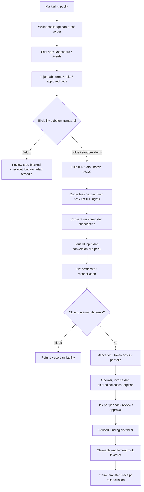
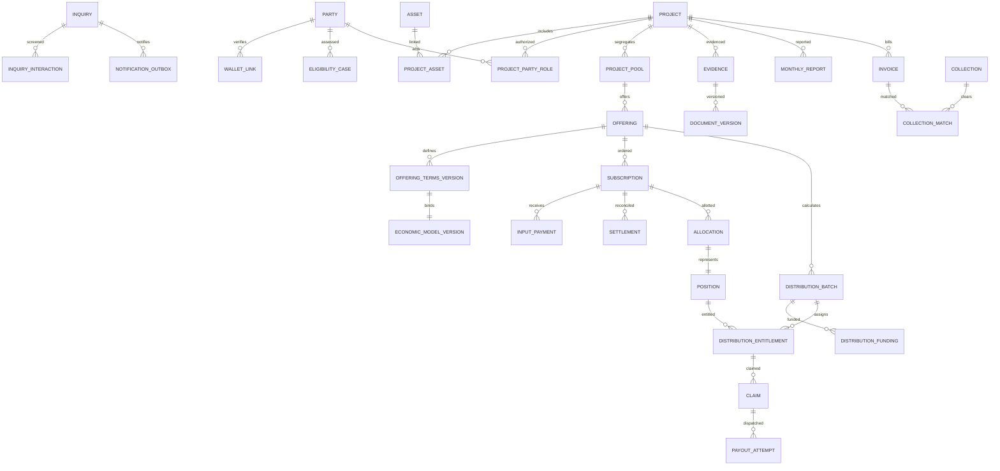

> **Arsip per 18 Oktober 2026.** Isi dipertahankan sebagai riwayat; dapat memuat keputusan yang tergantikan dan snapshot berbeda. Acuan aktif: [indeks dokumentasi](../README.md), [PRD](../PRD.md), [requirements MVP](../product/requirements.md).

# Gen-Z: schema, app flows dan acceptance MVP

**Versi:** 2.1-base, diperbarui 18 Oktober 2026, Asia/Jakarta. Nama file 12 Oktober dipertahankan untuk kompatibilitas tautan. **Status:** scope produk dikonfirmasi founder; logical schema dan kontrak transisi di bawah adalah rancangan [R], bukan migrasi/database atau fitur yang sudah diuji.

**Acuan utama:** [Spec MVP 17 Oktober](mvp-spec-2026-10-18.md), versi 1.1-base, memuat perubahan chain 18 Oktober dan mendahului artefak 12/17 Oktober yang diganti. Pendamping: [PRD](prd-2026-10-18.md), [architecture/routes/API](app-architecture-2026-10-18.md). **[F]** keputusan founder; **[R]** rancangan dalam mandat; **[O]** dependency terbuka; **[A]** asumsi/fixture sintetis.

**Pembaruan aktif, 18 Oktober 2026:** [F] Base menggantikan Solana atas arahan founder. Scope produk 17 Oktober tetap, dengan detail teknis [R] pada [riset Base/EVM 18 Oktober](../research/base-evm-2026-10-18.md) dan spec versi `1.1-base`. Pilihan Base tidak mengaktifkan kembali mock wallet D0, public deal detail, note wajib atau functional rewards. Fondasi login EVM/SIWE pada Base Sepolia kini diimplementasikan, dengan akun Solana historis tetap terpisah; kontrak/lifecycle investasi masih rancangan. Lihat [laporan fondasi Base](../history/2026-10-18-base-foundation.md) untuk scope serta bukti verifikasi. Bagian riset dan snapshot lama tetap bertanggal.

## 1. Deliverable pertama dan batas fase

**[F] D0 terpilih:** satu demo solar interaktif dengan hybrid pembayaran tetap + partisipasi pendapatan variabel, wallet authentication sejak workspace pertama, input IDRX/native USDC menuju satu hak IDR sesudah net settlement, portfolio, laporan/distribusi dan claim atas hak yang funded. Angka, dokumen dan transaksi simulated ditandai; bukan aset funded atau instrumen legal yang sudah terbit. Model proyek nyata ditentukan per offering, bukan diwajibkan hybrid atau note universal.

Marketing publik memakai Astro; auth dan seluruh app Next.js; blockchain Base/EVM [F, 18 Oktober]. PostgreSQL, private object storage dan worker persisten tetap baseline. D0 boleh memakai fixture finansial deterministik, tetapi login membutuhkan wallet proof/sesi server dan contact inquiry harus tersimpan server. Email/sessionStorage, wallet connection saja atau synthetic role selector tidak memenuhi authentication.

Rewards, Points dan Gen-Z Token tetap navigasi informasi/Coming soon sesudah login; functional reward/account linking/award/redemption/reversal, TGE dan konversi poin ditunda. Batas DeFi hanya subscription, allocation/token posisi, portfolio, distribusi dan claim. Closed-end; tanpa transfer rutin, swap, lending/borrowing, staking, secondary trading atau exit instan.

**D1:** simulated → functional testnet setelah engineering review, pada Base Sepolia 84532 dengan Circle test USDC + Mock IDRX 2 decimals dan test ETH; alamat deployment dicatat eksplisit; tidak mengasumsikan stablecoin mainnet ada di jaringan uji. **Live:** menunggu actual counterparties, legal/country/identity/custody/FX, mandate, security dan operasi. Founder 2–4 jam/hari, free-first hingga testnet; tidak ada tanggal delivery baru.

## 2. Information architecture dan sumber data

| Area | Isi / batas |
|---|---|
| Marketing/contact publik | Penjelasan peran/stage, Discuss your asset, Launch app; inquiry tanpa upload dokumen sensitif |
| Auth | Connect wallet → challenge → proof server → sesi; entry publik, resource app privat |
| Assets setelah login | Energy/Infrastructure, satu `active_demo`, showcase lain `coming_soon`; status fisik berbeda dari availability dan offering lifecycle |
| Detail offering | Tujuh tab: Overview; Asset & Operator; Deal Terms; Performance & Data; Reports & Updates; Risks; Documents |
| Deal Terms | Model hak, fixed/variable basis, gross/net, fee, tenor, schedule dan principal/expiry; calculator skenario dengan asumsi jelas |
| Performance & Data | Produksi/usage, invoice, kas diterima, distribusi dan Impact; periode/unit/sumber, freshness/coverage dan status koneksi |
| Reports & Updates / Documents | Monthly reviewed reports, koreksi versi/histori; approved investor copies bisa dibaca setelah login sebelum eligibility transaksi |
| Invest / Portfolio | Eligibility sebelum transaksi, quote/consent/net settlement/alokasi, posisi, histori, funded claim dan receipt |
| Rewards / Points / Gen-Z Token | Informasi/Coming soon; tidak ada saldo/aksi finansial fiktif |
| Intake/review minimum | Founder/admin mengelola inquiry, evidence, publication serta finance exceptions; operator full self-service ditunda |

**[F/R] Structured facts + editor blok:** admin menyusun konten editorial fleksibel di tujuh tab, dengan tipe blok tervalidasi. Identitas aset/offering, model hak serta angka finansial utama berasal dari data terstruktur. Calculator, chart, tabel dan portfolio memakai model/dataset yang sama; tidak mengeksekusi formula bebas dari editor. Payload/Lexical kandidat, vendor CMS belum dipilih.

## 3. Flows end-to-end

### 3.1 Inquiry operator dan assisted intake

```text
Marketing → Discuss your asset → validasi profil/kontak/kategori/lokasi/status/kebutuhan dana
→ simpan Inquiry + reference + notification outbox dalam transaksi server
→ tampilkan penerimaan dengan reference → worker notifikasi ke satu inbox
→ founder/admin screening → status penerimaan/screening/kekurangan bukti
→ minta evidence sensitif via kanal privat → tautkan ke project/asset/period yang tepat
```

Gagal notifikasi tidak menghapus inquiry atau meminta submit duplikat. Idempotency/retry tidak menghasilkan record ganda. Akses hanya founder/admin berwenang; tidak otomatis masuk marketing. Inquiry tidak berlanjut dihapus 90 hari sejak interaksi terakhir; inquiry aktif ditinjau tiap 90 hari. Retensi inbox/provider/backup diselesaikan saat konfigurasi; kebijakan ini tidak menghapus bukti investasi atau ledger.

### 3.2 Investor, subscription dan claim



Eligibility tidak menjadi syarat membaca approved investor copies setelah login. Original sensitif dibatasi dengan alasan redaksi/pembatasan, versi/sumber/status dan permission tersendiri. Semua API/download/cache mengikuti server authorization.

IDRX dan native USDC adalah dua input ke satu denominasi hak IDR untuk kas IDR. Quote berisi biaya/kurs/basis/expiry/min_net; allocation mengikuti net settled amount, bukan gross transfer atau angka dari browser. Provider/executable capacity dan payout/refund currency aktual [O]. Claim bukan janji principal redemption, profit tetap atau exit instan.

### 3.3 Laporan dan publikasi

Submission facts/evidence/report → draft revision → review versi tertentu → approval → published investor copy/read model. Koreksi membuat versi baru beserta alasan/histori; consent posisi lama tetap terikat versi terms/model yang disetujui.

Fallback laporan bulanan reviewed; API/IoT hanya bila feasible. Raw telemetry terpisah dari laporan reviewed dan ledger. Provisional data berlabel dapat ditampilkan setelah permission/validasi yang sesuai; tidak menciptakan saldo claimable. Missing/overdue/stale dan koneksi putus bukan pengukuran nol. Hash anchoring opsional bukan bukti invoice sudah dibayar atau sensor akurat.

## 4. Logical data schema [R]

Rancangan relasional untuk PostgreSQL/modular monolith dengan object storage privat dan worker. Nama entity belum mengunci CMS, token standard atau provider; bukan SQL yang telah dijalankan. Entitas dapat dibangun bertahap, tetapi invariant tidak dihapus saat tabel digabung.

### 4.1 Access, intake, project dan editorial

| Entity | Data minimum | Relasi / invariant |
|---|---|---|
| Party / Account | person/organization, country, status, private identity refs | Target individu/institusi global tidak otomatis eligible; account bukan issuer/operator otomatis |
| OrganizationMembership / CapabilityGrant | account, organization/project/offering scope, role, mandate, validity, revocation/version | Login wallet tidak membuat grant; role dari browser diabaikan |
| WalletLink | account/party, namespace, chain_id, normalized address, account kind, proof ref, verified_at, status | SIWE mengikat namespace eip155/chain/address; unique tuple terkontrol, checksum untuk display; account link bukan migrasi posisi/eligibility atau automatic Solana merge |
| AuthChallenge / Session | nonce hash, exact SIWE message/context, domain/URI, chain_id/address, browser binding, env, intent, issued/expiry/consumed; session subject/revocation | Single-use atomik; current grant/resource checks; no signing keys |
| EligibilityCase | party, offering/country scope, KYC/KYB/UBO refs, decision, expiry, reviewer, sandbox flag | Gate sebelum quote/subscription; bukan gate umum membaca approved investor copies |
| Inquiry | reference, profile/contact, asset category/location/status, financing need, privacy acknowledgement, state, last_interaction_at | Publik boleh submit, founder/admin saja baca; tidak meminta dokumen sensitif atau auto marketing |
| InquiryInteraction / RetentionReview | inquiry, actor/time, screening/needed evidence, last meaningful interaction, review/delete due, disposition | Tidak berlanjut: hapus 90 hari sejak interaksi terakhir; aktif: review tiap 90 hari; notification retry tidak mereset jam |
| NotificationOutbox / DeliveryAttempt | inquiry_ref, destination config ref, delivery state, retry/attempt/error | Inquiry + outbox committed bersama; satu inbox; delivery failure tidak membatalkan penerimaan |
| Partner / ProjectPartyRole | party, owner/operator/issuer role, project/asset scope, authority evidence, effective dates | Owner, operator, issuer dan Gen-Z terpisah; kewenangan dibuktikan |
| Project / Asset / ProjectAsset | project identity; asset technology/location/units/stage; membership relation | Project ekonomi berbeda dari peralatan fisik; capacity tidak dihitung ganda |
| AssetClassification / ShowcaseVisibility | asset, primary Energy/Infrastructure, tags, slug, active_demo/coming_soon/hidden | Availability berbeda dari operations_state dan offering_state; Coming soon non-investable |
| ProjectPool / Offering | project/pool, issuer, series/class, instrument/model type, rights currency, cap/min/max, lifecycle | Satu pool satu proyek; tiap offering mengikat terms/model version; satu offering aktif pada demo |
| OfferingTermsVersion / EconomicModelVersion | fixed/variable components, basis gross/net, fees, tenor/schedule, principal policy, expiry/residual, rounding, effective/review state | Hybrid/revenue participation dibuka; note bukan default wajib; published versions immutable |
| ContentRevision / TabContent / Block | entity/locale/tab key, typed facts refs, validated block type/payload, schema version, draft/review/published | Tujuh tab tetap; konten fleksibel, tanpa angka finansial utama/formula bebas yang melewati model |
| Evidence / DocumentVersion / DocumentAccessPolicy | project/asset/party/offering/period refs, source, type, object key/hash/version, investor copy/original, redaction reason, permission | Core approved copy terbaca setelah login; original sensitif privileged; object storage privat |
| ReviewDecision / Publication / Correction | entity+version, submitter/reviewer, decision/reason/time, published/superseded ref | Draft tidak tampil; koreksi versi baru; history tidak ditimpa, reviewer live sesuai mandat |

Inquiry yang berlanjut ke project ditautkan secara eksplisit; data inquiry tidak otomatis menjadi bukti investasi. Penghapusan inquiry mencakup data inquiry terkait menurut konfigurasi retensi, tanpa menghapus record proyek/keuangan yang mempunyai dasar retensi tersendiri. Backup/inbox copies perlu lifecycle yang ditetapkan sebelum penerapan kebijakan.

### 4.2 Subscription, settlement, posisi dan claim

| Entity | Data minimum | Relasi / invariant |
|---|---|---|
| Quote | offering+terms/model version, input asset/chain_id/token_address/decimals, gross amount, FX pair/rate/basis/time, fees, net settlement/net rights, min_net, expiry, provider ref | Display quote bukan executable capacity; consent mengikat versi; tidak repriced diam-diam |
| Subscription / Consent | investor/org, offering, quote, requested/accepted amount, terms/model/document versions, consent_at, cap reservation, state, idempotency/body hash | Eligibility+cap atomik; no allocation sebelum net settle; financial demo berlabel |
| InputPayment / Conversion / Settlement | subscription, input chain_id/token_address/decimals, received amount, tx_hash/log_index/block_hash, conversion/provider refs, net settled amount, fees, states | Chain input confirmed berbeda dari conversion/net settlement; unique evidence tidak menambah dana dua kali |
| Allocation / Position / TokenRepresentation | subscription, investor, offering+terms/model version, register ref, units, acquisition/net cost, principal fields jika berlaku, chain_id/token_contract/contract_version/allocation_id refs jika ada | Simulated allocation bukan legal/on-chain issuance; jumlah units cocok rights/register; principal nullable/not applicable sesuai model |
| Schedule / Obligation | offering/position, period/due_date, fixed/variable basis, principal/income due jika berlaku, calculation ref, state | Due/forecast berbeda dari received; expiry tanpa principal terpisah harus eksplisit |
| Journal / LedgerEntry | pool, currency/asset, debit/credit account, amount/precision, source, reversal_of | Balance per currency/asset; conversion legs/clearing/valuation terpisah; tanpa cross-pool netting |
| DistributionBatch / Calculation | pool/offering/model version, period/record_date, eligible collection refs, gross/deductions/reserve/net, review/approval refs | Hak dan kas/periode cocok; approved tidak otomatis funded/claimable |
| DistributionFunding | batch, settlement chain/token/decimals, expected/verified available amount, reserved/claimed, evidence/tx/log refs, finality/reconciliation state | Funding terverifikasi; reserved+claimed tidak melebihi dana tersedia untuk distribusi |
| DistributionEntitlement | batch, position/owner, units snapshot, fixed/variable amounts, principal/income jika applicable, fees/tax/net, payout asset, state | Hak milik sendiri; gross/net disclosure; payable dibatasi hak dan funding, bukan estimated yield |
| Claim / PayoutAttempt / Receipt | entitlement, owner/verified recipient, amount/asset, reservation/idempotency, attempt/sender+nonce refs, tx_hash, receipt/event refs, finality_policy_version/reconciliation, failure reason | Atomic reservation; duplicate/concurrent tidak membayar ganda; pending unknown direkonsiliasi sebelum retry |
| Refund / ExceptionCase | subscription/position/claim, reason, before/after conversion, asset/amount, approvals, liability, payment outcome | No allocation + full refund atas dana sama; gagal refund/payout tetap kewajiban tercatat |
| AuditEvent / ReconciliationRun / Break | actor/action/entity/version/time, bank/custody/chain/register/ledger refs, discrepancy, resolution | Reversal/correction traceable; tidak overwrite bukti; live critical actions sesuai mandat independen |
| DemoScenario / SyntheticDataset | environment, version/seed, synthetic facts/events/time, reset ownership | Tidak memasukkan synthetic posisi/transaksi ke register live; reset bukan bypass login/grant |

**Precision:** uang integer minor units atau decimal dengan precision terkontrol; settlement bukan floating point. Chain ID/token address/decimals authoritative berasal dari registry per environment: IDRX Base 2, USDC 6; Base Sepolia 84532 memakai test USDC + Mock IDRX, live Base 8453 terpisah. Raw amount integer/bigint dan API strings; validasi excess precision, rounding FX/units dan dust. FX pair/basis/time, unit produksi, rounding dan residual tercatat. API mengirim decimal/integer strings beserta currency/unit. Jangan menjumlah IDRX, USDC, IDR dan hak unit mentah.

**Model rights:** posisi menyimpan unit/hak dan net cost; initial/outstanding principal hanya jika terms mendefinisikan principal. Distribusi income tidak mengurangi principal; pembayaran modal tidak otomatis seluruhnya profit. Expiry/residual/penyelesaian mengikuti offering, bukan label token. Restricted ERC-20 per offering/series menjadi basis D1 [R]; transfer rutin/allowance bypass ditolak. Stable position/party IDs menjaga hak dan claimed history saat same-owner recovery; freeze/disable old wallet dan issuer approval wajib. Production standard/authority [O], B20/ERC-3643 evaluasi terpisah.

### 4.2.1 Data chain dan business idempotency Base [R]

| Entity | Data minimum / invariant |
|---|---|
| ChainAssetRegistry | env, chain_id, asset_id, token_address, decimals, enablement, source, verified_at; wrong symbol/chain ditolak; Mock IDRX bukan issuer token |
| ContractDeployment | chain_id, contract_address, offering/pool, kind/version, ABI/source/build hash, deployment block, roles; registry bukan claim audited |
| ChainEventObservation | chain_id, tx_hash, log_index, contract, block_number/hash, payload, canonical/finality state; canonical dedupe chain/tx/log, histori reorg tetap ada |
| IndexerCursor | chain/contract, last scanned/finalized block/hash, overlap/backfill, retry/lag; restart tidak kehilangan log atau menambah uang dua kali |
| TransactionAttempt | command/business ID, sender+nonce, signed attempt ref, tx hash/replacements, receipt/status/finality; unknown direkonsiliasi sebelum mengirim lagi |
| AllocationExecution | allocation_id/subscription_id, mint contract, units, approved net settlement/closing ref; unique on-chain business ID dan register reconciliation |
| RecoveryCase | stable party/position ID, old/new wallet, same-owner proof/issuer approval, freeze/disable + tx ref, binding history; claimed history tidak direset |

Wallet unique identity target adalah namespace + chain ID + normalized address; perubahan dari unique base58 address saat ini memakai migrasi SQL baru dan revoke sesi/challenge cutover. Tidak mengedit migrasi 0001 yang sudah diterapkan atau menggabungkan akun Solana/EVM tanpa proof/mandat. Smart account ERC-1271/6492 verification memakai chain challenge; connector/signer bukan legal party secara otomatis.

Default konservatif: receipt included/safe hanya intermediate; final accounting/allocation/funding activation/claimed setelah canonical finalized head + domain reconciliation. Reorg membatalkan pending projection dan memicu reconciliation break bila dalam; tidak overwrite journal final. Business IDs juga ditegakkan pada escrow/allocation/distributor karena hash/log saja tidak mencegah duplicate economics.

Distribusi terikat snapshot hak record-date dan stable position/party ID, bukan saldo token saat claim. Immutable entitlement mencatat payout recipient binding/version, batch/asset/amount, funding reservation dan claimed state; old wallet diblokir setelah recovery. Reserve per batch/pool melarang satu saldo funding dipakai dua kali. Merkle proofs/sponsorship opsional setelah mapping distributor D1 terbukti. Detail/sumber primer: [riset Base/EVM 18 Oktober](../research/base-evm-2026-10-18.md).

### 4.3 Reporting dan time series

| Entity | Data minimum | Relasi / invariant |
|---|---|---|
| SourceConnection / MetricDefinition | project/asset, source/device/provider, permission, metric/unit/basis, expected cadence, connection state | API/IoT opsional; koneksi bukan jaminan akurasi |
| RawObservation / MetricAggregate | source, observed_at/ingested_at, period, value/unit, quality, coverage, missing/stale flag, provisional/review status | Nilai missing bukan nol; raw/aggregate terpisah dari monthly report dan ledger |
| OperationRecord | project/asset/period, production/usage, unit, source/evidence, review | Produksi bukan invoice atau kas; Impact memakai methodology/baseline tersendiri |
| Invoice / Collection | project, period, payer/currency, billed amount/due, cleared amount/time, bank/custody refs, evidence/review | Satu invoice dapat dibayar parsial; perlu relasi matching, bukan meter=paid |
| CollectionMatch | invoice, collection, matched amount, currency/basis, reconciliation | Partial/multi-invoice cash dapat ditelusuri; tidak dihitung dua kali |
| MonthlyReport / ReportVersion | project/offering/period, facts/operation/invoice/collection refs, submitted/reviewed/published, correction reason/prior version | Fallback bulanan reviewed; draft/provisional tidak menjadi laporan final atau dana claimable |
| ImpactMeasurement | project/period, metric/unit, methodology/baseline/source, forecast/actual, review | Hindari klaim zero-emission/additionality tanpa bukti; bukan basis pembayaran otomatis |

Functional reward entities dari baseline lama ditunda; tidak masuk schema implementasi MVP. Halaman Coming soon tidak memerlukan saldo loyalty atau campaign palsu.

### 4.4 Relasi utama



Diagram ringkas tidak menggantikan field/invariant pada tabel. Evidence dapat terkait lebih dari satu objek/period melalui link tervalidasi. Multiplicity bukan mandat menerbitkan banyak seri, menduplikasi kapasitas atau membangun portal penuh pada demo.

## 5. State machines dan failure paths

| Object | Normal states [R] | Failure / review |
|---|---|---|
| Inquiry | received → screening → awaiting_evidence → active → progressed/closed | rejected/not_proceeding; notification_pending/failed terpisah; active retention review; inactive deletion due |
| AuthChallenge | issued → verified_and_consumed → session_created | rejected, expired, replayed; grant tidak ditambah oleh transisi ini |
| Project/Offering | draft → evidence_review → approved → demo_open/open → closed → servicing → resolved | incomplete/rejected/paused/default/workout; open live hanya setelah gates |
| Content / Terms / Report | draft → submitted → reviewed → approved → published → superseded | rejected/changes_requested; correction new version+reason, tidak overwrite |
| Subscription | draft → eligibility_passed → quoted → consented → payment_pending → input_confirmed → conversion_pending bila perlu → net_settled → allocated | quote_expired/unmatched/underpaid/overpaid/conversion_failed/closing_failed/refund_pending/refunded |
| DistributionBatch | calculated → reviewed → approved → funding_pending → funded → claimable → partially_claimed → completed | rejected/shortfall/paused/reconciliation_break; approved bukan uang tersedia |
| Claim | requested → reserved → submitted → confirmed → reconciled/claimed | denied/failed/retry_pending/unknown; reserve dilepas hanya setelah aman tidak terjadi pembayaran |
| Chain observation | submitted → included → safe → finalized → reconciled | reverted/dropped/replaced/orphaned/RPC_unavailable; finalized chain bukan FX/bank settlement |
| Source/reporting | expected → received/provisional → validated → reviewed_aggregate | missing/overdue/stale/disconnected/corrected; bukan measurement zero |

Actor/mandate menentukan transisi; callback browser tidak mengesahkan pembayaran/eligibility/funding. Effect sekali dicapai melalui unique refs/idempotency, atomic reservation dan reconciliation, tanpa asumsi webhook datang sekali atau berurutan. Unknown transfer tidak dikirim ulang buta. Expiry subscription/quote tidak menghapus dana yang sudah datang; masuk exception/refund sesuai terms.

## 6. Targets, stories dan acceptance

**P0-D:** wajib demo pertama; **P0-T:** sebelum functional testnet dinilai selesai; **P0-L:** sebelum dana nyata; **P1/P2:** ditunda setelah core/dependency siap. Semua baris berikut adalah kriteria implementasi yang akan diuji, bukan test result.

| ID / Fase | User story | Acceptance |
|---|---|---|
| M01 P0-D | Pengunjung memahami produk dan menghubungi tim | Marketing menjelaskan peran/stage dan dua CTA; inquiry valid tersimpan server+reference lalu notifikasi; invalid/retry/duplicate/failure tidak menghilangkan record |
| M02 P0-D | Founder/admin screening inquiry | Akses terbatas; status/needed evidence tercatat; tidak meminta dokumen sensitif pada contact; no marketing otomatis; uji clock 90 hari untuk inactive deletion/active review |
| M03 P0-D/T | User memperoleh sesi wallet | Proof server sejak D0, valid/rejected/expired/replay diuji; connected saja tidak login; sesi berbeda dari KYC/role/eligibility |
| M04 P0-D/T | Login membaca bukti sebelum investasi | Tanpa sesi app/API/download/cache terlindungi; login tanpa eligibility bisa membaca tujuh tab+approved investor copies; original/akun lain/admin tetap restricted |
| M05 P0-D | Investor menjelajahi demo | Energy/Infrastructure; satu solar hybrid active_demo, lainnya Coming soon; transaksi/angka/dokumen sintetis jelas; direct checkout Coming soon diblokir |
| M06 P0-D/T | Admin mengelola tujuh tab | Structured facts+typed blocks; draft terms/report tidak tampil sebelum review; koreksi versi/reason/history; CMS tetap pilihan implementasi |
| M07 P0-D/T | Investor memahami model hak | Fixed/variable, gross/net, fees, tenor, schedule dan principal/expiry eksplisit; calculator forecast terpisah actual; model/table/chart/portfolio dapat direkonsiliasi |
| M08 P0-D/T | Peserta memilih input IDRX/USDC | Quote/expiry/min_net/fees/net IDR rights; versioned consent+eligibility sandbox; wrong chain/token contract dan stale quote ditolak; reconsent jika berubah |
| M09 P0-D/T | Investor mendapat posisi setelah settle | Input confirmed/conversion/net settled/allocated berbeda; duplicate/concurrent/cap tidak menggandakan hak; synthetic bukan issuance on-chain |
| M10 P0-D/T | Investor menelusuri reporting dan kas | Produksi/invoice/collection/distribution terpisah; period/unit/source/coverage/freshness; monthly reviewed; provisional/missing/stale bukan nol atau claimable |
| M11 P0-D/T | Investor claim hak yang funded | Collection → calculation → approval → funding → claim → receipt; no entitlement/no funds/wallet lain/duplicate tidak membayar; failed/pending dapat ditelusuri tanpa double send |
| M12 P0-D/T/L | Finance menangani exception | Expired/pending/conversion failure/closing failure/refund/shortfall/overdue/claim failure tersimpan; no mint+full refund; gagal pembayaran tetap liability |
| M13 P0-D/T/L | Reviewer/admin bekerja sesuai mandat | Server resource checks, audit/history, revoked sessions; demo actor separation berlabel; live maker-checker/signers sesuai mandat nyata |
| M14 P0-T/L | Pemulihan menjaga hak investor | Recovery Base direview: same-owner/issuer approval, old representation disabled sebelum replacement; accrued entitlements tidak hilang/ganda; bukan recovery private key |
| M15 P0-L | Live memenuhi dependency aktual | DD/operator/data permission, legal wrapper, allowed countries/person/entities, identity/custody/FX, executable routes, payout/refund terms, security/continuity dan operation mandate nyata |
| M16 P0-D | User membuka Rewards/Points/Token | Semua setelah login sebagai informasi/Coming soon, tanpa saldo/award/redemption/conversion/stake fiktif |
| M17 P0-D/T | User menjalani alur dengan aksesibel | Mobile/keyboard/focus/error feedback/reduced motion dan empty/loading/error/unavailable diuji pada flow utama |

**Pemetaan ke Testing Decisions spec 17 Oktober:** butir 1 → M01–M02; 2 → M03–M04; 3 → M05, M07–M11; 4 → M11; 5 → M06, M10; 6 → M07–M09, M12; 7 → M16–M17. Invariant access/financial tetap diuji hingga persistence/domain result yang relevan.

## 7. Stress-test implementasi

| Kasus | Jawaban rancangan yang diuji |
|---|---|
| Server commit inquiry berhasil, inbox gagal | Referensi tetap valid; worker retry satu notifikasi, tidak meminta submit ulang |
| Inquiry aktif tidak ada interaksi 90 hari | Review due; tidak dihapus otomatis hanya karena aktif; inactive mengikuti deletion policy |
| User anonim tahu URL dokumen/blob/API | Tidak memperoleh data; hash/URL bukan permission, cache tidak bocor |
| Wallet authenticated, eligibility belum lolos | Bacaan approved tersedia; transaksi diblokir, original sensitif tetap dibatasi |
| 100 USDC datang setelah quote expired | Exception; tidak auto repricing/allocation; requote berconsent atau refund terms |
| USDC confirmed, conversion gagal | Catat aset/liability yang benar; belum membeli hak IDR |
| Closing gagal sesudah conversion | Currency/FX/fee refund mengikuti terms; tidak menjanjikan nominal USD awal tanpa penanggung biaya |
| Meter bagus tetapi pelanggan belum bayar | Operation terlihat; invoice/collection pending; tidak menciptakan funded claim |
| Hak 100, dana tersedia 0 atau user lain mengklaim | Tidak membayar; funding dan owner check server wajib |
| Receipt sukses tetapi belum finalized, RPC berselisih atau log orphaned | Pending projection/reconciliation; belum final allocation/funding/claimed; backfill canonical dan hentikan transisi bila kepastian belum cukup |
| IDRX 2 decimals, USDC 6; token sama simbol beda address | Registry/precision checks menolak salah token/excess precision; rounding/dust ledger eksplisit |
| Dua request claim bersamaan atau hasil tx belum pasti | Satu reservasi/pembayaran efektif; rekonsiliasi hasil sebelum retry |
| Offering tidak mendefinisikan principal terpisah | Tidak menampilkan amortisasi/redemption seolah wajib; net cost bukan principal guarantee |
| Admin mengedit nilai return dalam rich text | Tidak mengubah authoritative financial model/claim; perubahan model terms melalui review/versioning |
| Monthly report dikoreksi | Versi/reason/history baru; klaim/ledger terdampak dikoreksi traceable, bukan overwrite |
| Feed disconnect atau missing satu periode | Tampilkan gap/coverage/freshness; bukan angka nol atau live badge palsu |
| Founder memainkan maker dan checker di demo | Simulasi berlabel; belum membuktikan independent live mandate |
| Native token/rewards belum berfungsi | Informasi/Coming soon; investment core tidak bergantung TGE atau loyalty |

## 8. Keputusan pengganti dan dependencies

| Keputusan 12/17 Oktober yang tergantikan | Acuan aktif setelah pembaruan 18 Oktober |
|---|---|
| Keputusan Solana 17 Oktober | [F, 18 Oktober] Base/EVM; [R] SIWE, wagmi/viem, Solidity/OpenZeppelin/Foundry, restricted ERC-20 D1; Safe kandidat admin/treasury, bukan mandat custody final |
| Mock wallet D0 dan proof baru D1 | Wallet challenge/proof/sesi sejak demo workspace pertama |
| Public app catalogue/detail | Marketing publik; seluruh katalog/detail/dokumen app setelah login |
| Note/private credit sebagai kandidat wajib, participation perlu keputusan ulang | Ekonomi eksplisit per offering; solar hybrid untuk demo; hybrid/revenue participation dibuka, hak principal/expiry eksplisit |
| Simulated partner/rewards/points overview sebagai P0-D | Rewards/Points/Gen-Z Token informasi/Coming soon; functional reward ditunda |
| Enam tab ringkas dan data room umum | Tujuh tab tetap, structured facts+block editor, review/publikasi, investor copies sebelum eligibility |
| Generic payout tanpa claim owner/funding | Distribusi+claim: entitlement, approval, verified funding, claim/receipt dan idempotency |

Provider conversion/payout/refund currency, production contract/authority, CMS, deployment token uji/mock/funding Base Sepolia, RPC, inbox/provider/backup retention tetap [O] teknis. Counterparties, issuer/legal/country, KYC/KYB/custody/FX, reviewer/fund movement mandate, audit/security dan operasi tetap [O] live. Keputusan produk yang dikonfirmasi tidak ditanyakan ulang. Catatan wawancara/riset lama adalah histori; spec sumber v1.1-base diperbarui bersama dokumen turunan ini.

Logical schema investasi di atas tetap rancangan. Implementasi fondasi berikutnya telah menguji SIWE/EVM, migrasi identity dan sesi/browser; [laporan fondasi Base](../history/2026-10-18-base-foundation.md) mencatat 15 tests yang lulus. Ini tidak menyatakan seluruh acceptance investasi atau contract tests sudah dijalankan.
