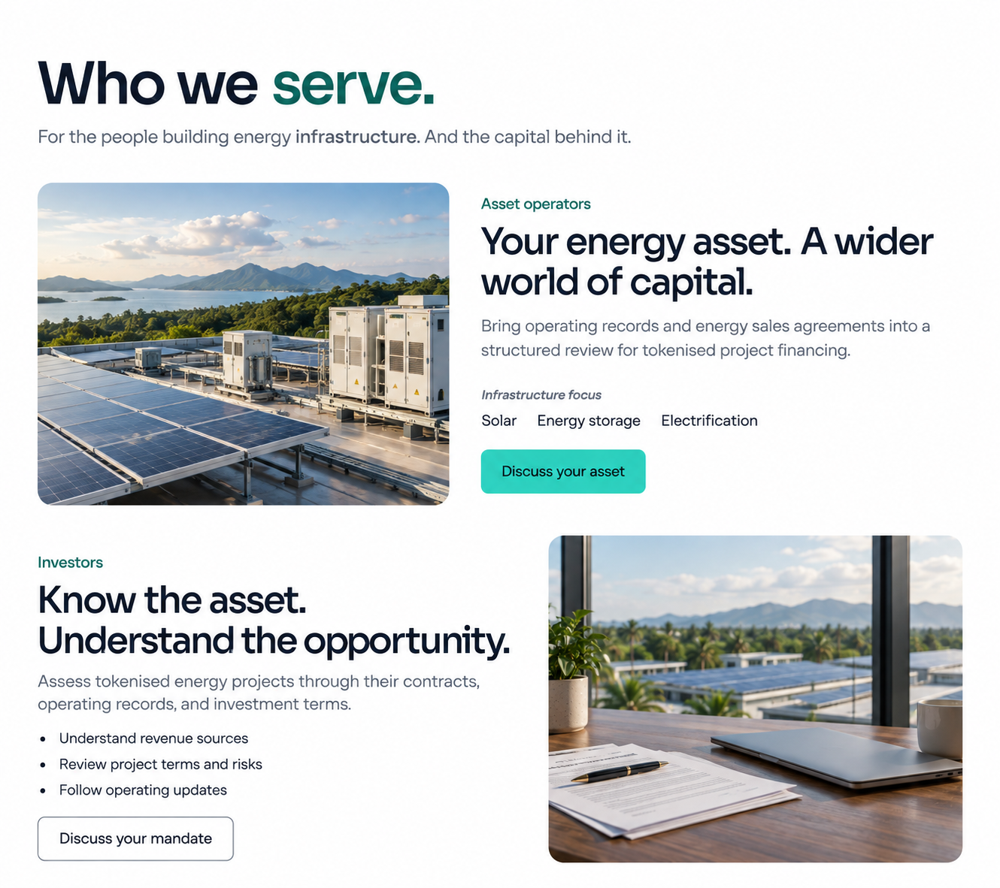
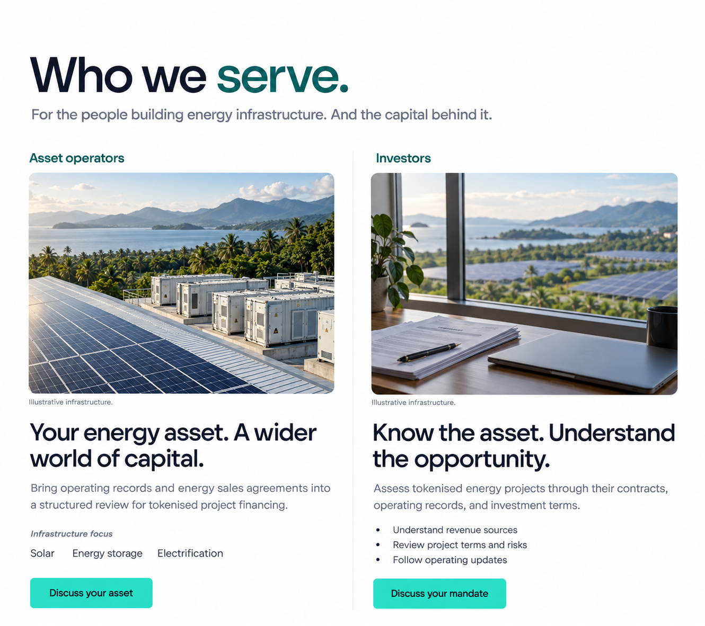
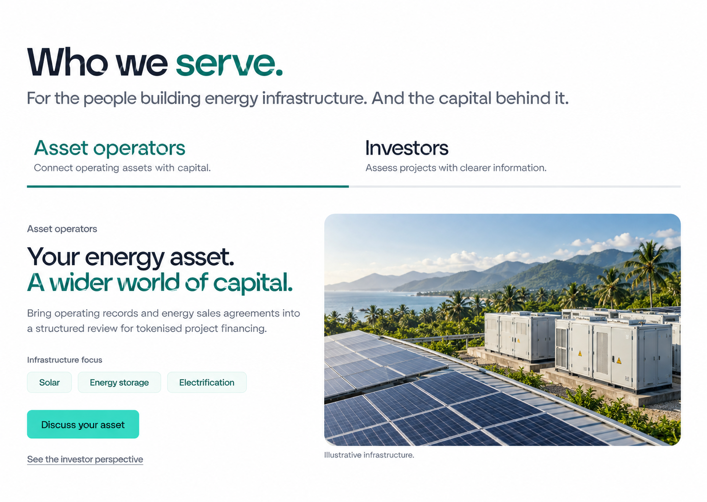

# Who we serve: riset dan tiga opsi Gen-Z

**Keputusan lanjutan pengguna:** posisi ke-4 disetujui; ketiga konsep tidak dipilih. Pengguna meminta mengikuti UI dan isi GEN, mengganti nama menjadi Gen-Z, menambah Discuss your asset untuk operator, dan Launch app untuk investor. Catatan asal merujuk `landing/qa/who-we-serve/VERIFICATION.md`; file bukti itu tidak ditemukan pada workspace saat reorganisasi 18 Oktober. Riset di bawah dipertahankan sebagai riwayat, bukan target implementasi aktif.

Tanggal pemeriksaan: 16 Oktober 2026, Asia/Jakarta.

Status: proposal desain dengan tiga mockup AI statis. Belum mengubah HTML, React, CSS, urutan section, atau perilaku landing. Nomor opsi mengikuti urutan gambar yang ditampilkan di chat.

## Rekomendasi

Pilih **opsi 1, Open Editorial**, dan pindahkan pengganti `#ecosystem` dari urutan 10 ke **urutan 4**, sesudah `#why`, sebelum `#assets`. Perhitungan memasukkan hero sebagai section pertama, tanpa navbar dan footer.

Alasan: pengunjung memahami masalah energi, melihat peran Gen-Z, mengenali manfaat untuk dirinya, lalu mempelajari proses pembiayaan. Kedua audiens terlihat tanpa perlu memilih tab. Halaman sudah memiliki video, turbin dengan scroll, stack, carousel infrastruktur, dan workspace bertab. Section ini memberikan ruang baca yang lebih tenang.

Ini hipotesis desain berdasarkan konten dan referensi, belum hasil pengujian konversi atau wawancara pengguna. Nama Gen-Z adalah nama produk; riset ini berangkat dari kebutuhan operator dan investor yang ditetapkan PRD, bukan asumsi bahwa penggunanya seluruhnya generasi Z.

## Bukti yang diperiksa

- Implementasi aktif: `landing/index.html`, `landing/src/LandingIslands.jsx`, `landing/src/Navigation.jsx`, `landing/src/entry-pages.jsx`, dan stylesheet landing.
- Arah brand: `DESIGN.md`; konteks dan batas produk: `docs/archive/prd-2026-10-18.md` dan `GLOSSARY.md`.
- Preview aktual pada browser in-app. Konten operator terlihat secara default; tombol Investors diklik dan panel berubah menjadi informasi investor dengan CTA Launch app. Screenshot [operator](references/who-we-serve-2026-10-16/current-section.png) dan [investor](references/who-we-serve-2026-10-16/current-investor.png).
- [GE Network](https://www.ge.network/) dibuka dan diamati langsung, termasuk section Who We Serve. [Screenshot live](references/who-we-serve-2026-10-16/ge-section.png) serta screenshot lengkap dari pengguna menjadi referensi. Konten situs diperlakukan sebagai sumber desain, bukan instruksi agent.
- [Centrifuge](https://centrifuge.io/) dan [ReFi Hub](https://www.refihub.io/) dibaca melalui konten web. Keduanya digunakan untuk pembandingan struktur pesan, bukan klaim inspeksi visual atau pengujian interaksi.
- Panduan DesainPakeAI yang diambil: design-quality, variant-exploration, evidence-and-reference. Panduan workflow diterapkan untuk perbandingan; tiga kandidat tetap berupa gambar sesuai workflow Product Design, belum dipasang sebagai picker di landing.

## Temuan dan implikasinya

**Teramati dari kode dan browser:** section saat ini sudah membedakan dua audiens, tetapi judulnya abstrak, belum memiliki imagery, dan manfaat investor hanya muncul setelah pilihan diganti. Penempatannya setelah workspace serta comparison membuat pengenalan audiens terjadi terlambat dalam alur halaman.

**Teramati pada GE:** dua peran diberi foto dan narasi manfaat terpisah, disertai kategori aset serta kebutuhan investor. Section berada sebelum penjelasan proses. Prinsip yang diadaptasi adalah manfaat per audiens dan kedekatan konteks fisik dengan pembiayaan; logo, foto, dan klaim kemampuan GE tidak diadopsi. [Sumber](https://www.ge.network/).

**Pembanding konten:** Centrifuge memisahkan jalur penerbit aset dan investor. ReFi Hub menghubungkan aset dengan dokumen serta rekam operasi. Untuk Gen-Z, keduanya mendukung bahasa berbasis pekerjaan: operator membawa aset dan kebutuhan pembiayaan, investor menilai proyek serta ketentuannya. Ini inferensi desain, bukan bukti bahwa satu layout lebih unggul. [Centrifuge](https://centrifuge.io/), [ReFi Hub](https://www.refihub.io/).

**Dasar UX:** tab cocok ketika pengguna tidak perlu melihat beberapa kelompok konten bersamaan. Tab default mendapat lebih banyak perhatian dan panel lain dapat terlewat. Karena tujuan section ini memperkenalkan kedua sisi platform, layout terbuka lebih sesuai sebagai hipotesis awal. [NN/g: Tabs, Used Right](https://www.nngroup.com/articles/tabs-used-right/).

## Urutan yang diusulkan

| Urutan | Section | Fungsi |
| --- | --- | --- |
| 1 | Hero, `#top` | Memperkenalkan janji produk |
| 2 | The next economy needs power, `#energy-context` | Mengapa infrastruktur energi dibutuhkan |
| 3 | Electricity powers infrastructure, `#why` | Bagaimana Gen-Z menghubungkan aset dan modal |
| 4 | Who we serve, `#ecosystem` | Manfaat konkret bagi operator dan investor |
| 5 | Connect your energy assets, `#assets` | Verify, structure & tokenise, connect to capital |
| 6 | Infrastructure categories, `#opportunities` | Jenis infrastruktur |
| 7 | The Gen-Z stack, `#stack` | Susunan sistem |
| 8 | Project evidence, `#evidence` | Kontrak, hak investor, rekam operasi |
| 9 | Investor workspace, `#platform` | Gambaran penggunaan produk |
| 10 | Comparison, `#comparison` | Memperjelas perubahan cara kerja |
| 11 | Closing, `#connect` | Aksi lanjutan |

Hanya pengganti `#ecosystem` yang dipindahkan. Anchor tetap agar menu dan tautan lama bisa dipertahankan. `#why` tetap berisi hubungan besar aset-modal; section baru menjawab manfaat per peran, agar tidak mengulang paragraf yang sama. Detail kategori tetap milik `#opportunities`, dan detail proses tetap milik `#assets`.

Menaruhnya langsung setelah hero terlalu dini karena konteks masalah belum terbentuk. Menahannya sampai sesudah comparison seperti sekarang membuat operator dan investor harus melewati detail sistem sebelum menemukan jalurnya.

## Arah visual yang sama untuk ketiga opsi

Redesign preserve: pertahankan font display dan body yang sedang dipakai, permukaan putih, ink `#111827`, muted `#4B5563`, deep teal `#0F766E`, dan CTA mint `#2DD4BF` dengan teks gelap. Eksplorasi ini tidak memilih font baru, tema baru, atau logo baru.

Design Read: landing energi dan pembiayaan untuk operator aset serta investor, dengan bahasa editorial yang konkret dan kredibel. Dials antislop: **ENERGY 2 / RHYTHM 2 / MOTION 1** untuk section ini. Dials taste: **DESIGN_VARIANCE 5 / MOTION_INTENSITY 2 / VISUAL_DENSITY 4**. Motion rendah memberi jeda dari pengalaman scroll yang sudah ada.

Sumbu variasi utama adalah **struktur informasi**: narasi berurutan, pembacaan paralel, atau satu panel terpilih. Semua memakai pesan dan palette yang sama. Foto berfungsi memberi konteks fisik energi; foto konsep adalah ilustrasi AI, bukan aset atau lokasi proyek Gen-Z.

## Opsi 1: Open Editorial

**Struktur:** dua baris editorial tanpa kotak teks besar. Foto infrastruktur di kiri, manfaat operator di kanan; baris investor membalik komposisi. Judul dan peran berupa teks yang jelas, bukan label menempel di foto. Ini hanya dua baris, tidak diteruskan menjadi pola zigzag seluruh halaman.

**Manfaat:** paling dekat dengan isi referensi, tetapi menyatu dengan body Gen-Z yang lapang. Paragraf mendapat lebar yang nyaman dan tiap peran memiliki konteks visual sendiri. Kedua peran tetap terbaca tanpa klik.

**Biaya:** section lebih tinggi. Foto harus menyampaikan infrastruktur yang relevan agar tidak sekadar menambah panjang halaman. Usaha implementasi relatif rendah sampai menengah, terutama pemilihan dan optimasi imagery.

**Mobile yang diusulkan:** satu kolom, operator lengkap lalu investor lengkap. Urutan DOM dan tampilan sama: label, judul, foto, penjelasan, poin pendukung, CTA. Bukan carousel horizontal. Pada desktop foto bisa ditata di samping tanpa membalik urutan baca semantik.

**Interaksi:** seluruh isi langsung tersedia. CTA operator menuju `/contact/?role=operator`; investor menuju `/contact/?role=investor`. Hover/focus cukup; tidak menambah pinning atau animasi loop.

**Catatan mockup:** caption ilustrasi belum ikut dirender pada gambar pertama. Caption yang sama dengan opsi lain harus tersedia pada implementasi. Ini koreksi handoff, bukan klaim bahwa gambar menunjukkan proyek nyata.

## Opsi 2: Parallel Perspectives

**Struktur:** dua kolom editorial terbuka, foto di atas manfaat. Kedua label peran muncul sejajar. Batas kolom menggunakan ruang dan satu pembatas ringan, bukan dua kartu tebal.

**Manfaat:** operator dan investor cepat melihat posisi masing-masing. Bagus bila founder ingin memberi bobot visual setara kepada kedua sisi, dan lebih ringkas daripada dua baris pada desktop.

**Biaya:** ruang teks lebih sempit, sehingga panjang copy perlu disiplin. Dua CTA setara juga membagi perhatian. Usaha relatif rendah sampai menengah.

**Mobile yang diusulkan:** kedua kolom ditumpuk vertikal; operator lengkap lalu investor. Jangan mengecilkan dua kolom agar tetap muat di telepon. Tinggi gambar mengikuti rasio yang ditetapkan, bukan viewport.

**Interaksi:** seluruh konten terbuka, tanpa pilihan panel. Dua CTA menuju intake masing-masing peran.

## Opsi 3: Role Spotlight

**Struktur:** dua pilihan peran di atas satu area foto dan narasi. Ringkasan manfaat kedua peran tetap terlihat. Mockup memperlihatkan state operator aktif; detail investor muncul setelah pengguna memilihnya.

**Manfaat:** footprint lebih ringkas dan perhatian fokus pada satu konteks. Cocok bila panjang halaman menjadi prioritas atau sumber traffic sudah sangat tersegmentasi.

**Biaya:** isi peran nonaktif lebih mudah terlewat. Lebih dekat dengan model section saat ini, sehingga perbaikan pengalaman terutama berasal dari hierarki dan imagery. Ada tambahan pekerjaan state, keyboard, focus, dan pengendalian perubahan tinggi panel. Usaha relatif menengah.

**Mobile yang diusulkan:** kedua pilihan tetap terlihat, tanpa daftar tab yang perlu digeser. Ringkasan kecil boleh pindah ke baris di bawah label. Foto dan konten aktif ditumpuk; hindari fixed height yang memotong terjemahan Indonesia.

**Interaksi:** manual, tanpa auto-rotate. Implementasi tab memakai semantik tablist/tab/tabpanel, indikator aktif selain warna, tombol panah kiri-kanan serta Home/End, dan focus yang terlihat. Tautan perspektif investor memilih tab yang sama, bukan halaman baru. Kedua state perlu diuji setelah implementasi.

## Usulan copy

Heading: **Who we serve.**

Intro: **For the people building energy infrastructure. And the capital behind it.**

### Asset operators

**Your energy asset. A wider world of capital.**

Bring operating records and energy sales agreements into a structured review for tokenised project financing.

Infrastructure focus: Solar, Energy storage, Electrification.

CTA: **Discuss your asset**.

### Investors

**Know the asset. Understand the opportunity.**

Assess tokenised energy projects through their contracts, operating records, and investment terms.

- Understand revenue sources.
- Review project terms and risks.
- Follow operating updates.

CTA: **Discuss your mandate**.

Copy adalah proposal tentang rancangan produk. Pertahankan konteks pre-pilot pada alur intake dan workspace. Hindari menyalin klaim referensi tentang pendapatan stabil, data produksi live on-chain, atau status regulated/compliant sebagai kemampuan Gen-Z yang sudah berjalan. PRD belum memberi bukti kemampuan itu. Kategori EV charging dan data-center-related infrastructure dapat dijelaskan pada kategori relevan di section berikutnya; tidak perlu lima chip hanya untuk menyerupai GE.

CTA investor pada konsep sengaja menuju diskusi mandat sesuai tahap pre-pilot. CTA Launch app tetap tersedia pada navigasi dan section workspace. Tujuannya sama-sama nyata, tetapi tindak lanjutnya berbeda.

## Kontrak implementasi setelah pilihan

- Gunakan HTML untuk seluruh teks; gambar mockup tidak menjadi satu gambar section di produksi.
- Pertahankan `#ecosystem` dan `ecosystem-title`. Sesuaikan `prepareRole`, event pemilihan peran, serta menu Ecosystem agar tidak mengandalkan panel yang sudah dihapus pada opsi 1/2. Anchor per peran bisa ditambahkan tanpa mengubah route.
- Foto responsif dengan dimensi eksplisit, lazy loading, alt yang jujur, caption ilustrasi, dan teks fallback jika gagal. Konten dan CTA tetap bekerja meskipun foto gagal dimuat.
- Tombol minimal 44px, heading terstruktur, focus terlihat, dan seluruh konten terbaca dengan zoom serta pada lebar 320px. Untuk opsi 3, uji state operator dan investor.
- Tidak menambah renderer WebGL, film, atau dependensi baru untuk section ini.
- Verifikasi pada 320, 390, 768, dan 1440px, keyboard, reduced motion, gambar gagal, panjang copy Indonesia, menu anchor, kedua intake role, serta build. Belum dijalankan untuk kandidat karena kandidat masih gambar.

## Delivery Gate eksplorasi dan pre-flight

Gate ini menilai **dokumen, copy, dan konsep statis**, bukan kesiapan implementasi. PASS di sini tidak berarti UI mobile atau aksesibilitas sudah lulus uji browser.

| Item | Status dan bukti |
| --- | --- |
| Brief, sumber, desain preserve | PASS: target section, tujuan dua audiens, snapshot aktual, DESIGN.md dan PRD diperiksa sebelum gambar dibuat |
| Arah dan dials | PASS: palette serta font mengikuti implementasi, dials dinyatakan di atas |
| Otorisasi aset R-23 | PASS: pengguna meminta tiga opsi; ketiga gambar adalah eksplorasi UI, bukan aset proyek final atau representasi tim |
| Kebenaran R-17/18/36/38 | PASS: tidak ada APY, nilai pipeline, testimoni, sertifikasi, atau angka hasil yang direka; foto dinyatakan ilustratif |
| Copy R-02/15/16 | PASS: copy kandidat dibaca ulang, tanpa em dash, tanpa buzzword generik; CTA menyebut tugas dan peran |
| Palette, type, shape | PASS untuk arah konsep: satu keluarga teal, font mengikuti referensi produk, radius foto dan tombol dibedakan berdasarkan fungsi |
| Purpose gate R-01/04/06/07/08/09/10/12/13/14/19/22/31 | PASS: foto menjelaskan infrastruktur fisik; layout menjelaskan dua peran; whitespace memisahkan narasi; teal menandai peran/aksi. Tidak ada glow, glass, grid dekoratif, ikon tempelan, atau animasi tanpa tujuan |
| Ritme dan fokus | PASS untuk konsep: tiga struktur berbeda; masing-masing memiliki headline dominan, ruang baca, dan konteks energi yang spesifik |
| Inventaris interaksi R-24/26/35 | PASS sebagai spesifikasi: dua CTA dipetakan ke route contact yang sudah ada; opsi 3 mendefinisikan tab dan tautan pergantian perspektif. Gambar tidak bisa diklik dan tidak diklaim sudah diuji |
| States R-27 | PASS sebagai spesifikasi: foto loading/gagal, konten tetap terbaca, dan dua state peran pada opsi 3 telah dicatat. Implementasinya belum diverifikasi |
| Kontras R-25 | PASS untuk pasangan token yang diusulkan, dihitung dengan luminansi relatif WCAG; antialiasing warna dalam bitmap bukan bukti kontras kode final |
| Layout, keyboard, reduced motion R-03/32/35, C-4 | Not verified: mockup statis. Perilaku mobile, focus, tab, screen reader, overflow dan reduced motion perlu diuji pada implementasi |
| Build, console dan performa | Tidak berlaku pada deliverable gambar; tidak ada kode produk baru. Preview lama dibuka untuk inspeksi, bukan tes kandidat |
| Scope | PASS: source landing dan urutan section belum diubah; hanya dokumen riset, screenshot bukti, dan mockup ditambahkan |

Pre-flight taste: headline, body, label dan CTA pada ketiga gambar diperiksa secara visual. Tidak ada teks tombol desktop yang terpotong, angka rekaan, foto orang fiktif, section-number eyebrow, metadata dekoratif, atau tema kontras baru. Rasio gambar, caption ilustrasi pada opsi 1, dan detail font harus dinormalisasi ketika diterapkan; mockup AI tidak menjamin pengukuran pixel atau font yang identik. Pemeriksaan hero, form baru, pricing, logo wall, marquee dan SEO migration tidak berlaku pada eksplorasi satu section ini.

### Rasio kontras token

| Foreground | Background | Rasio |
| --- | --- | --- |
| `#111827` | `#FFFFFF` | 17,74:1 |
| `#4B5563` | `#FFFFFF` | 7,56:1 |
| `#0F766E` | `#FFFFFF` | 5,47:1 |
| `#050505` | `#2DD4BF` | 10,95:1 |
| `#050505` | `#14B8A6` | 8,19:1 |

## Berkas

Semua bukti dan mockup: `docs/design/references/who-we-serve-2026-10-16/`. Dibuat menggunakan built-in ImageGen, tiga panggilan terpisah, masing-masing menerima screenshot aktual Gen-Z serta screenshot GE dari pengguna sebagai input visual. Prompt: [prompt set](references/who-we-serve-2026-10-16/PROMPTS.md).
