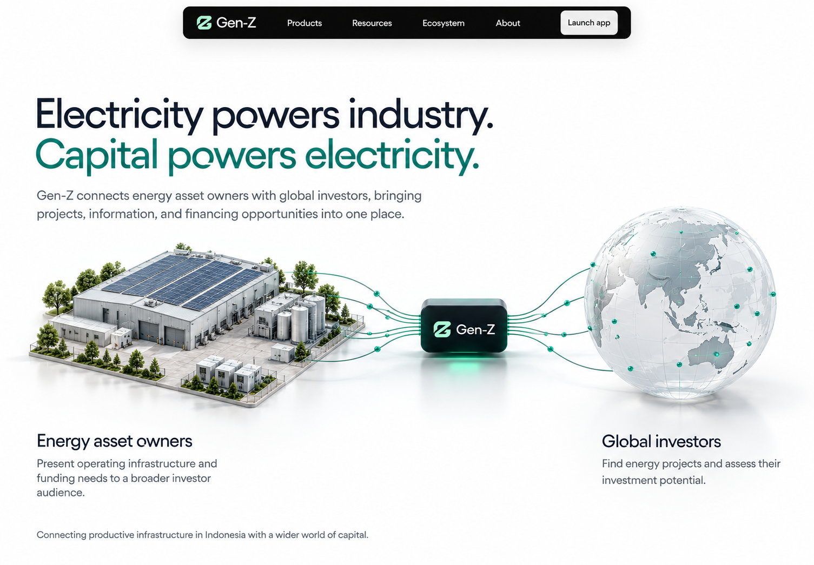
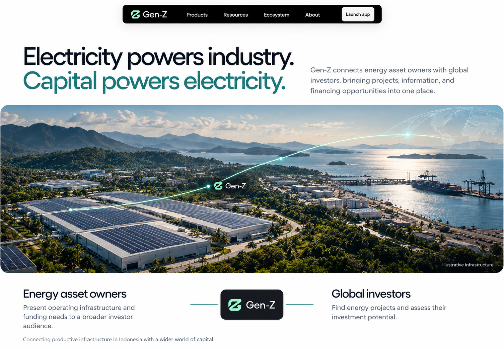
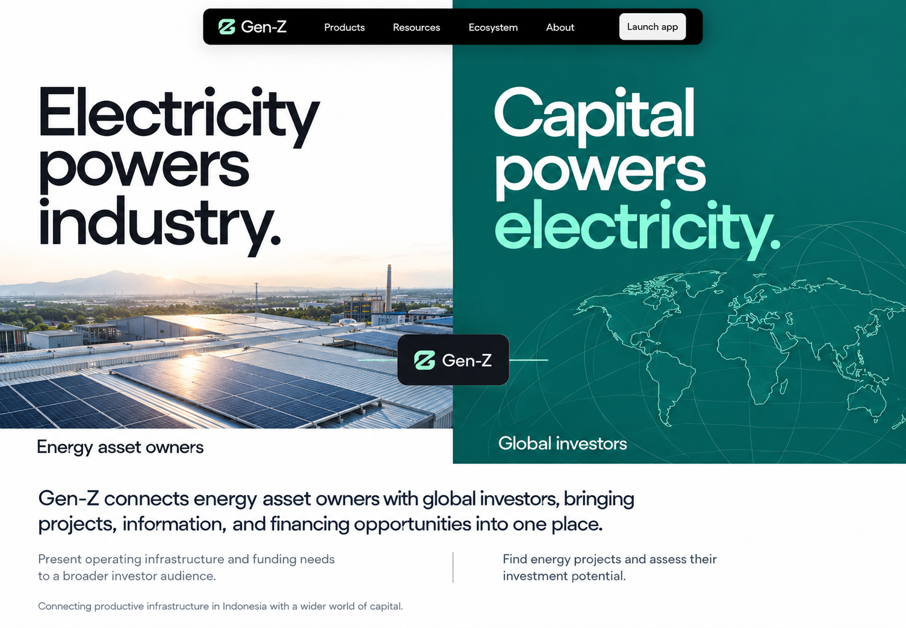

# Tiga arah visual section Electricity powers industry

Tanggal riset: 15 Oktober 2026. Status: rencana dan gambar konsep; belum ada perubahan implementasi landing pada tahap ini.

## Brief dan batasan

Audiens investor dan pemilik/operator aset energi. Pengguna sudah menyetujui informasi pada section; pekerjaan ini mengubah penyajian, hierarki, imagery, dan motion. Pertahankan dua kalimat Electricity powers industry. Capital powers electricity., seluruh penjelas kedua audiens, konteks Indonesia, identitas Gen-Z, font dan warna brand. Tujuan: membuat hubungan aset energi dengan modal global lebih menarik untuk diamati dan lebih mudah dipahami, lalu mengantar pembaca ke section berikutnya.

Tidak ada bukti bahwa satu desain pasti menambah waktu perhatian atau leads. Rekomendasi di bawah adalah hipotesis desain berdasarkan kecocokan pesan dan pengamatan referensi, bukan hasil uji konversi.

## Temuan pada tampilan sekarang

- Hierarki judul dan pembacaan sudah jelas, tetapi hampir semua makna dibebankan pada teks.
- Kedua audiens belum memiliki representasi visual yang kuat. Pengunjung melihat dua paragraf dan logo.
- Garis penghubung terlalu kecil untuk menjelaskan fungsi Gen-Z pada pandangan pertama.
- Ruang kosong belum membingkai sebuah objek atau adegan yang cukup kuat untuk menjadi alasan berhenti.
- Header, diagram, dan penjelas memiliki ritme visual yang mirip. Section membutuhkan satu fokus dominan.

## Riset dan bukti

Referensi live diperiksa lewat browser dan screenshot, bukan hanya hasil pencarian.

1. [Stripe](https://stripe.com/): panel skala global menggunakan visual jaringan besar. Pelajaran: konsep finansial abstrak bisa memiliki representasi spasial yang dominan. Ambil prinsip koneksi dan skala; jangan menyalin palette, angka, atau klaim jaringan mereka.
2. [Watershed](https://watershed.com/): panel misi menyejajarkan narasi dengan imagery solar dan turbin. Pelajaran: imagery yang konkret memberi konteks fisik pada pesan ekonomi iklim. Gambar konsep Gen-Z tetap ilustrasi, tidak menunjukkan kepemilikan proyek.
3. [Apple MacBook Pro](https://www.apple.com/macbook-pro/): komposisi judul pendek dan objek besar memusatkan perhatian. Pelajaran: satu fokus yang kuat lebih berguna daripada menambah banyak dekorasi.
4. [NN/g: The Role of Animation and Motion in UX](https://www.nngroup.com/articles/animation-purpose-ux/): motion dapat menarik perhatian, tetapi perlu singkat dan berfungsi menjelaskan hubungan atau perubahan. Animasi tanpa tujuan dapat mengganggu pembacaan.
5. [W3C: Animation from Interactions](https://www.w3.org/WAI/WCAG22/Understanding/animation-from-interactions.html): dukung preferensi reduced motion dan hilangkan gerakan yang tidak perlu. Ini penjelasan kriteria AAA, bukan klaim bahwa semua animasi melanggar aksesibilitas.

Screenshot bukti: `landing-research/purpose-2026-10-15/`. Gambar konsep adalah eksplorasi AI, belum prototype interaktif dan belum hasil QA responsive.

## Opsi 1 — Capital Bridge

**Komposisi:** judul dan deskripsi di atas. Di bawahnya satu adegan: miniatur bangunan industri dengan rooftop solar di kiri, Gen-Z di tengah, globe ringan di kanan. Label dan penjelasan tetap berupa HTML terbaca di bawah objek. Visual melukiskan hubungan, bukan peta transaksi atau investor aktif.

**Urutan scroll:** adegan lengkap sudah terlihat ketika masuk. Ketika section mendekati tengah viewport, satu jalur koneksi ditelusuri melewati Gen-Z, lalu aksen kecil pada sisi investor muncul. Gerak sekali sekitar 0,9–1,2 detik, tanpa loop terus menerus dan tanpa mengunci scroll. Pengunjung yang langsung melewati section tetap melihat seluruh informasi.

**Mobile:** komposisi vertikal aset → Gen-Z → investor; teks HTML tetap terbaca dan tidak ikut diperkecil menjadi gambar. Gunakan crop atau asset khusus mobile. Section boleh lebih tinggi dari satu layar agar tidak memotong isi.

**Teknis:** mulai dari render aset yang dioptimalkan dan jalur overlay yang dianimasikan dengan GSAP yang sudah terpasang. WebGL bukan prasyarat; evaluasi hanya jika kedalaman interaktif benar-benar menambah pemahaman. Hindari menambah beban renderer pada halaman yang sudah memiliki turbin 3D.

**Kelebihan:** hubungan bisnis paling cepat terbaca; visual memiliki urutan pengamatan yang jelas. **Risiko:** globe dan node bisa terasa seperti template fintech jika bentuk, warna dan motion terlalu generik. Batasi elemen dan gunakan detail aset energi yang spesifik. **Usaha relatif:** menengah–tinggi, terutama produksi aset dan adaptasi mobile.

## Opsi 2 — Energy Landscape

**Komposisi:** judul dan penjelas di area putih, satu panorama infrastruktur energi yang besar di tengah, label kedua audiens di bawahnya. Hubungan modal digambarkan satu jalur menuju horizon. Gambar berfungsi sebagai ilustrasi, tanpa klaim proyek milik Gen-Z.

**Urutan scroll:** panorama terungkap melalui mask pendek saat masuk. Jalur koneksi muncul sekali melewati adegan. Hindari zoom kamera berlebihan. Tidak perlu video baru atau pinning panjang. Gunakan hanya satu titik Gen-Z pada adegan final; mockup awal masih menggandakan logo di gambar dan baseline, dan pengulangan itu perlu dirapikan pada implementasi.

**Mobile:** crop portrait yang mempertahankan aset utama, gunakan gambar sumber khusus jika crop desktop membuang konteks. Penjelas berada di luar foto. Semua informasi tersedia tanpa hover.

**Teknis:** gambar responsif AVIF/WebP, HTML dan CSS mask, motion ringan dengan GSAP. Tidak perlu WebGL. Gambar dimuat mendekati viewport dan memiliki ukuran eksplisit agar layout tidak bergeser.

**Kelebihan:** konteks energi terasa nyata, hangat dan mudah dikenali. **Risiko:** hero landing sudah memakai film lanskap; section kedua dapat terasa mengulang jika imagery, framing dan geraknya terlalu mirip. Hubungan dengan investor juga tidak sejelas opsi pertama. **Usaha relatif:** menengah.

## Opsi 3 — Two Worlds, One Connection

**Komposisi:** headline dipecah menjadi dua dunia berdampingan. Kiri putih dengan industri dan gambar rooftop solar; kanan deep teal dengan capital dan atlas dunia. Gen-Z berada pada pertemuan keduanya. Ini mengubah ritme halaman secara kuat tanpa mengganti identitas brand.

**Urutan scroll:** komposisi dua sisi langsung terbaca. Penekanan singkat bergerak dari kata industry ke capital dan garis pertemuan muncul sekali. Tidak perlu teks tersembunyi atau animasi huruf satu per satu. Setelah koneksi terbentuk, halaman terus bergulir normal.

**Mobile:** kedua sisi menjadi dua blok vertikal yang terhubung secara visual. Urutan judul dan paragraf mengikuti urutan pembacaan semantik. Jangan mempertahankan dua kolom kecil atau memaksa satu viewport pada layar sempit.

**Teknis:** CSS Grid, font existing, satu gambar aset energi, asset atlas yang benar, dan GSAP ringan. Headline tetap teks HTML, bukan bagian dari bitmap. Tidak perlu globe 3D atau panorama video.

**Kelebihan:** perubahan visual paling berani, tipografi paling memorable, beban runtime relatif ringan. **Risiko:** dua headline besar berpotensi bersaing dan komposisi bisa terasa terbelah; logo dan garis harus menyatukannya. Adaptasi mobile kehilangan efek berdampingan sehingga perlu disusun sengaja. **Usaha relatif:** menengah.

## Rekomendasi dan rencana implementasi setelah dipilih

Rekomendasi utama: **opsi 1**, karena daya tarik visual langsung memperkuat proposisi Gen-Z sebagai penghubung. Opsi 3 paling tepat jika pengguna lebih mengutamakan perubahan tampilan yang tegas dan karakter editorial. Opsi 2 paling tepat untuk suasana fisik dan emosional energi.

1. Tetapkan opsi pilihan sebagai target visual, lalu rapikan detail aset, ukuran, posisi logo dan keterbacaan.
2. Bangun versi statis terlebih dahulu dalam section `#why` dengan copy existing. Pertahankan navigasi dan urutan section.
3. Tambahkan motion satu kali yang bermakna; jangan wajib menunggu animasi untuk membaca, jangan hijack wheel/scroll, jangan pin viewport panjang.
4. Desktop minimal satu viewport dengan ruang navbar; mobile tumbuh mengikuti isi. Periksa 1440×900, 1280×800, 768×1024 dan 390×844.
5. Hormati prefers-reduced-motion: tampilkan final state statis tanpa menghilangkan informasi. Aset dekoratif tidak membuat keyboard tab berhenti; jika ada kontrol nyata, beri focus dan nama aksesibel.
6. Verifikasi build, overflow, urutan baca, kontras teks, state reduced-motion, loading gambar, scroll ke section berikutnya, serta frame saat motion selesai. Lakukan pre-flight taste dan Delivery Gate antislop setelah implementasi. Belum ada klaim lulus QA pada tahap gambar konsep ini.
7. Uji pemahaman singkat: pengunjung dapat menyebut siapa dua audiens dan apa peran Gen-Z setelah melihat section. Waktu perhatian dan kelanjutan scroll boleh diamati, tetapi waktu lama saja bukan bukti keberhasilan; pembaca dapat berhenti karena bingung.

Tidak ada backend, auth, form, FAQ, footer atau section lain yang perlu diubah untuk eksplorasi ini.
