# Riset referensi landing page Gen-Z

Tanggal: 13 Oktober 2026, Asia/Jakarta. Scope: struktur landing, copy, komponen, visual dan beberapa interaksi scroll/selection. Seluruh screenshot berasal dari kunjungan browser pada sesi ini.

Ini analisis referensi untuk [plan landing](landing-plan.md), bukan audit menyeluruh atas aplikasi atau validasi klaim bisnis referensi. Halaman publik ketujuh situs berhasil dibuka lewat browser. Pengambil teks web gagal untuk beberapa situs dinamis; temuan visual memakai screenshot dan DOM browser langsung.

## 1. ReFi Hub

Sumber: [ReFi Hub](https://www.refihub.io/). Kondisi pengamatan: hero dan bagian dokumen tampil; alur investasi di aplikasi tidak diuji.

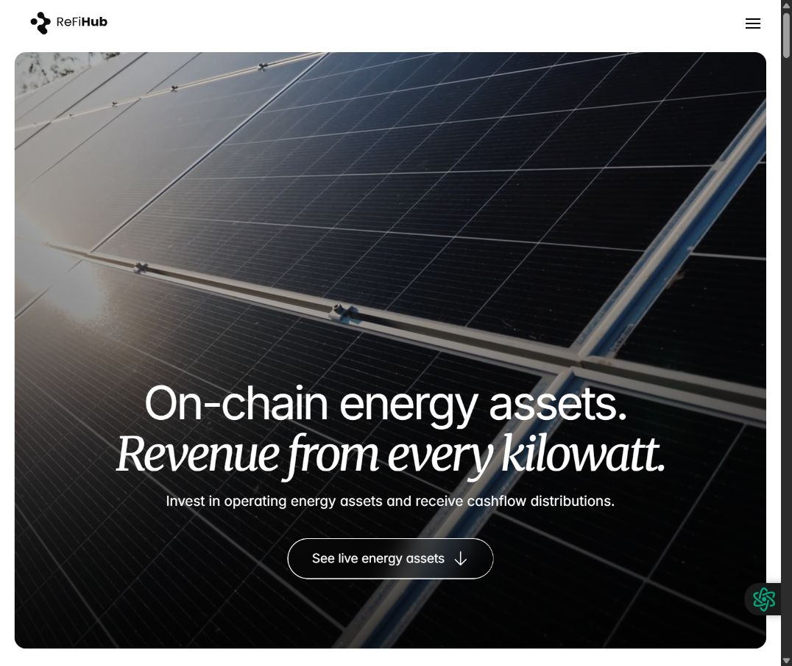

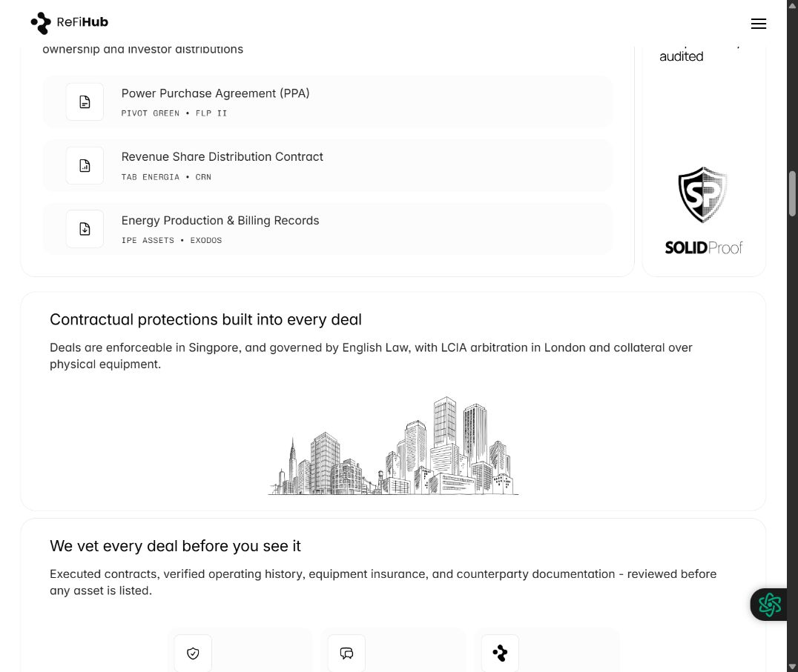

- Struktur: hero berbasis aset, penjelasan platform, investasi, kontrak/due diligence, proses investor, operator, konteks permintaan energi, perbandingan, artikel dan CTA.
- Kekuatan: manfaat investasi dikaitkan dengan operasi aset; dokumen mendukung narasi kepercayaan. Penawaran dan pelaporan berada dekat dengan cerita produk.
- Copy: judul menerangkan underlying dan hasil ekonomi; detail kontrak memberi alasan untuk percaya. Hierarki cukup mudah dipindai.
- UI/motion: video panel surya, reveal konten ketika masuk viewport, daftar kontrak dan panel trust. Pada viewport tangkapan, navigasi memakai menu ringkas.
- Untuk Gen-Z: adopsi urutan aset, hak, bukti, pembayaran. Pisahkan metering, invoice dan kas.
- Batas adaptasi: angka IRR, ticket, proyek, audit dan perlindungan kontrak ReFi bukan fakta Gen-Z. Status live tidak ikut dipindahkan.
- Aksesibilitas: teks hero di atas footage perlu diuji pada seluruh frame. Keadaan transparan saat reveal tidak menjadi bukti kontras akhir yang gagal; screenshot trust diambil ulang setelah stabil.

## 2. GEN / ge.network

Sumber: [GEN](https://www.ge.network/). Kondisi pengamatan: hero, DOM landing dan arsitektur tiga lapis tampil; integrasi meter tidak diuji.

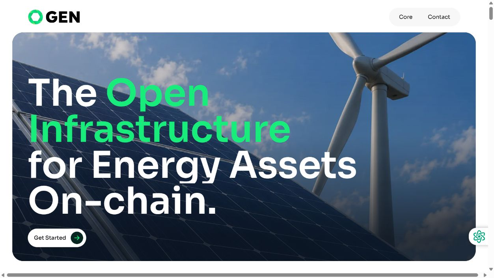

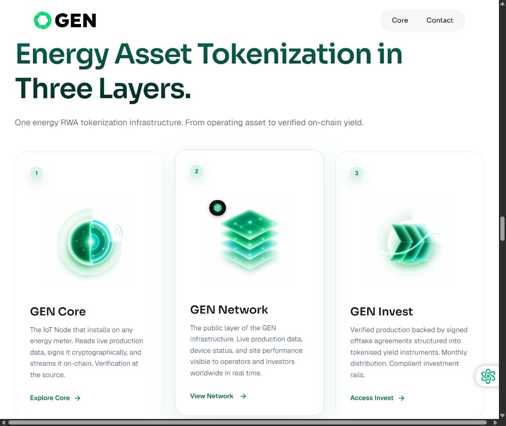

- Struktur: hero, bukti sosial, ringkasan, masalah pendanaan, dua audiens, proses asset-to-yield, arsitektur, preview platform, perbandingan, artikel dan kontak.
- Kekuatan: operator dan investor mendapat proposisi berbeda. Hubungan aset fisik, data dan instrumen keuangan mudah dipahami.
- Copy: headline mengutamakan kategori infrastruktur; isi berikutnya menjelaskan siapa yang dilayani dan fungsi tiap lapisan.
- UI/motion: hero energi, navigasi sederhana, reveal scroll dan tiga visual lapisan. Tangkapan awal lapisan masih berada dalam reveal; versi stabil digunakan sebagai bukti.
- Untuk Gen-Z: kategorisasi aset dan penjelasan peran. Tetap bedakan network koordinasi Gen-Z dari chain Base.
- Batas adaptasi: telemetry real-time, pipeline, yield dan cakupan investor merupakan klaim referensi, bukan kemampuan Gen-Z yang sudah tersedia.
- Aksesibilitas: satu tangkapan hero memperlihatkan scrollbar horizontal. Penyebab dan cakupan breakpoint belum diuji; Gen-Z memerlukan pemeriksaan overflow sendiri.

## 3. Nemesis Protocol

Sumber: [landing Nemesis](https://nemesis-protocol.vercel.app/) dan [source stack](https://github.com/RioSudrajat/Nemesis-Protocol/blob/main/frontend/src/components/landing/NemesisStackSection.tsx). Kondisi pengamatan: stack dapat dipilih dan detail layer fisik berubah sesuai pilihan.

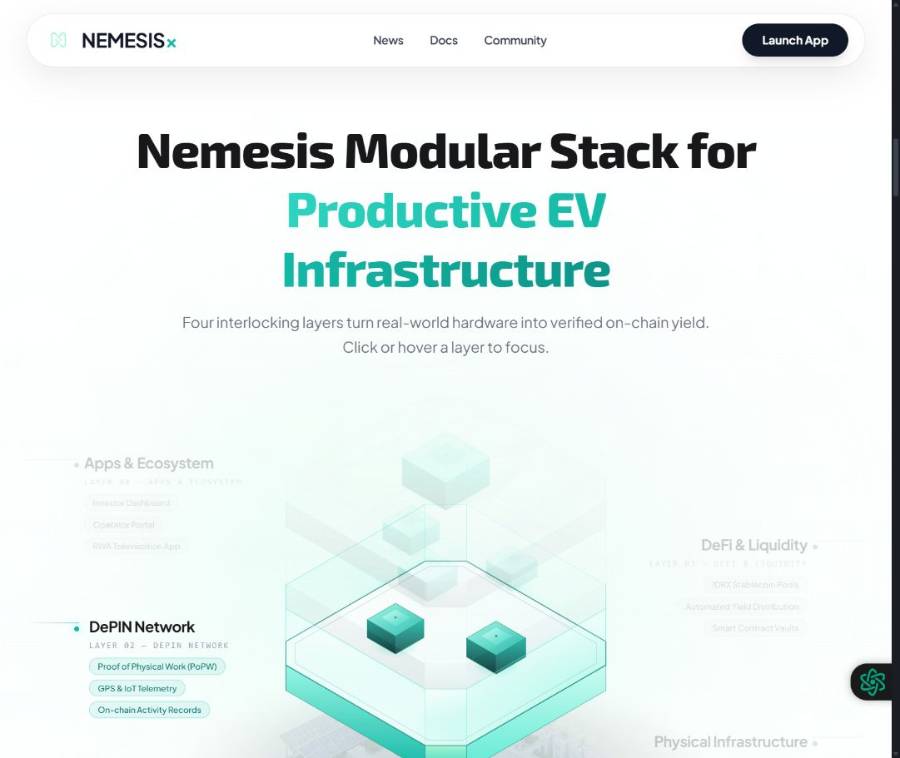

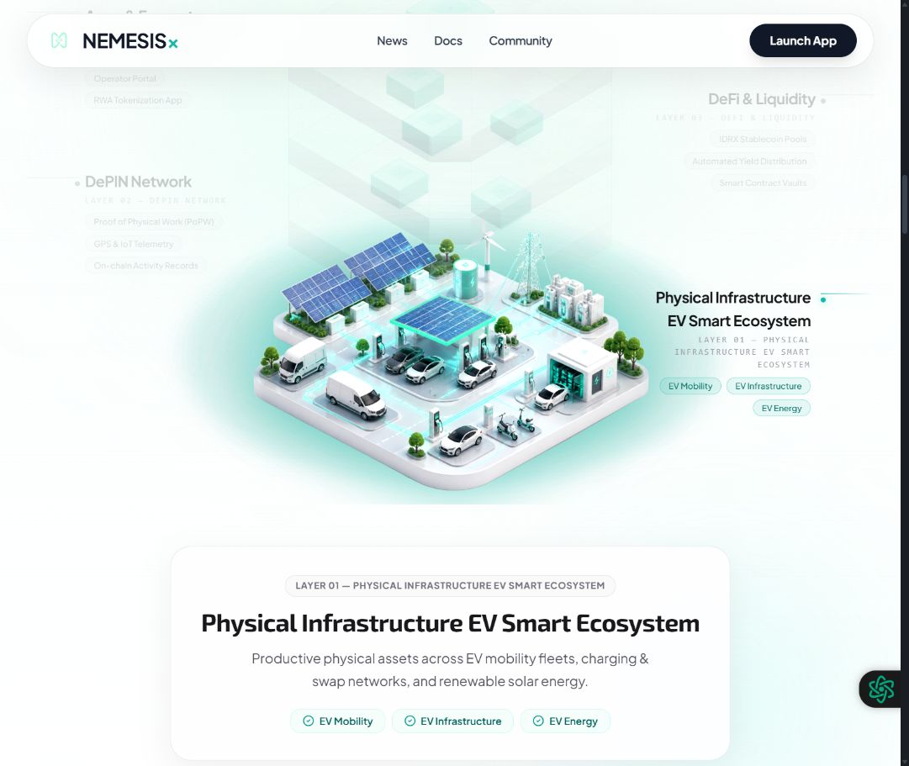

- Struktur: hero EV, partners/metrics, masalah, stack, lifecycle operasi, campaign, dashboard, ecosystem dan CTA.
- Kekuatan: stack adalah visual yang menjelaskan ketergantungan antarlapisan. Foundation fisik mengikat diagram pada benda yang relevan.
- Mekanik: isometric SVG, empat lapisan, fokus lewat mouse/click dan penggantian detail. Layer fisik memakai gambar raster; ini bukan scene GLB pada implementasi aslinya.
- Copy: judul menjelaskan fungsi stack; deskripsi dan chips menjelaskan isi layer. Gen-Z perlu memperbarui kategori, hak dan chain.
- Risiko UI yang teramati: layer yang tidak aktif sangat redup, panel detail ada di bawah diagram, dan diagram tinggi. Source tidak memberi kontrol keyboard semantik pada grup SVG yang dipilih.
- Untuk Gen-Z: pertahankan perspektif, lapisan, anotasi kiri/kanan, foundation dan selection. Tambahkan tombol HTML, pilihan yang bertahan, panel detail mudah terlihat dan layout mobile.
- Batas adaptasi: klaim PoPW, Solana, APY dan real-time yield tidak diwarisi.

Catatan source lebih rinci berada di bagian reverse engineering pada plan. File referensi lokal tidak dimasukkan ke kode produk.

## 4. Mesta Logistics

Sumber: [Logistics](https://logistic.mesta.click/). Kondisi pengamatan: hero/scroll dan pilihan Shipment diuji; CTA request access tidak dikirim.

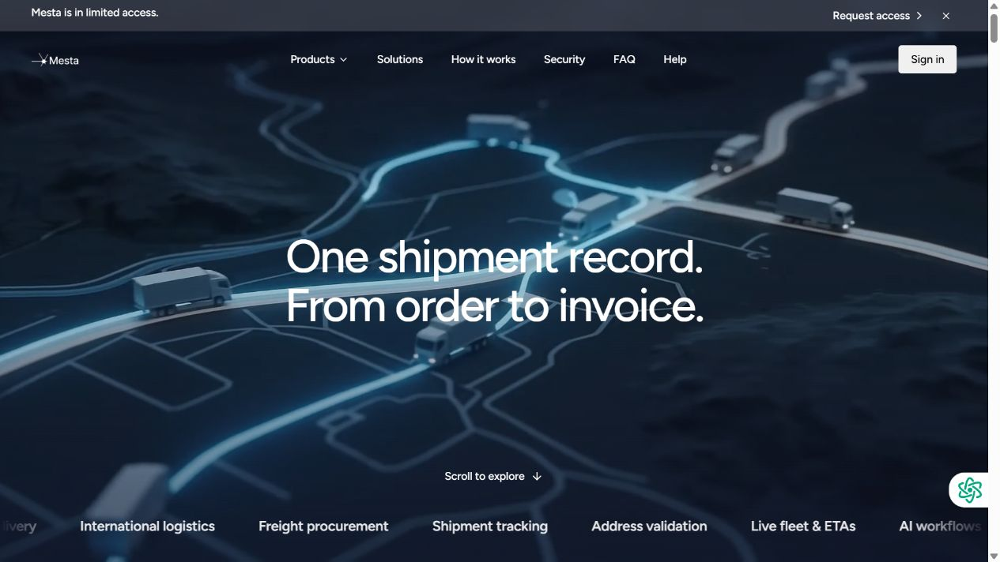

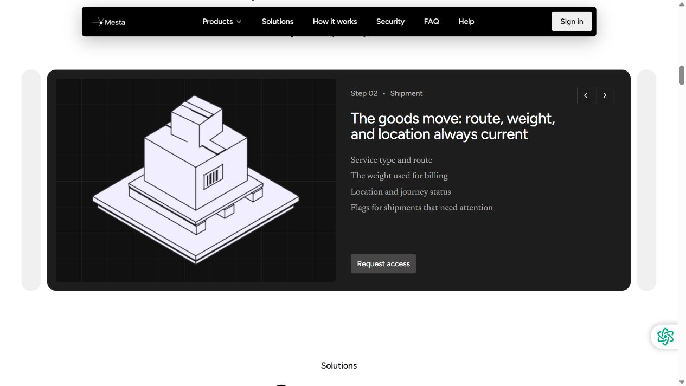

- Struktur: hero, perjalanan satu shipment, solusi per tim, angka struktur produk, pertanyaan, prinsip, kontrol, integrasi dan request access.
- Kekuatan: satu objek menjadi benang merah seluruh cerita. Tahap yang dipilih memperbarui visual dan penjelasan, mengurangi panjang teks yang tampil sekaligus.
- Copy: manfaat diterangkan lewat pekerjaan konkret, bukan daftar teknologi. Headline dan setiap tahap punya objek dan hasil yang jelas.
- UI/motion: video jaringan/logistik; hero mengecil ketika scroll; story cards dapat dipilih melalui langkah atau panah. Pemilihan Shipment terverifikasi mengubah judul dan daftar detail.
- Untuk Gen-Z: satu proyek dari aset, subscription, bukti, sampai repayment. Kontrol chapter harus dapat dipilih langsung dan lewat keyboard.
- Batas adaptasi: efek mengecil tidak dipakai untuk hero Gen-Z. Marquee kemampuan tidak diperlukan hanya untuk menambah suasana.
- Aksesibilitas: operasi tombol terbukti dengan pointer; keyboard, reduced motion dan semua slide belum diaudit.

## 5. Mesta Foundry

Sumber: [Foundry](https://foundry.mesta.click/). Kondisi pengamatan: hero, bagian ontology dan DOM landing tampil; workflow ERP tidak diuji.

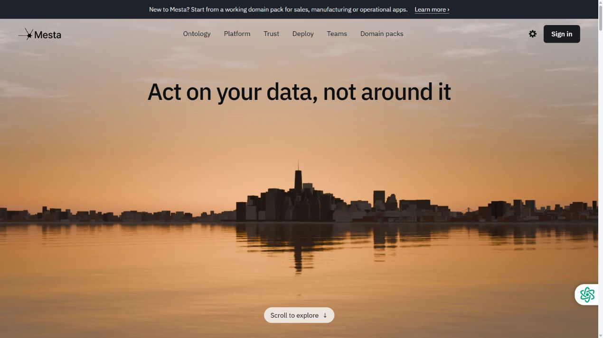

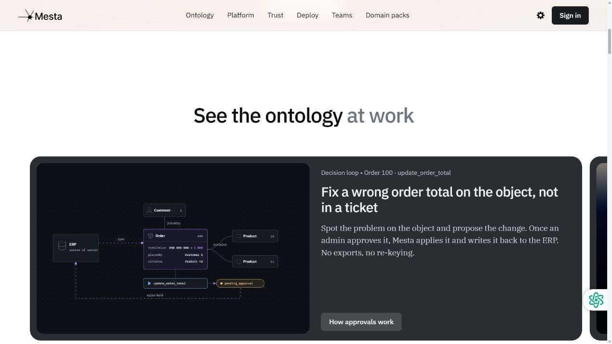

- Struktur: hero, contoh ontology, area platform, prinsip, kontrol, deployment, tim, domain packs dan sign-in.
- Kekuatan: sistem abstrak diterangkan lewat sebuah kejadian konkret dengan objek dan perubahan yang dapat diikuti.
- Copy: penjelasan menjawab apa yang pengguna lakukan dan apa yang berubah. Klaim AI dibatasi oleh alur persetujuan manusia.
- UI/motion: footage kota sebagai pembuka, story cards, accordion area produk, diagram hubungan dan tab.
- Untuk Gen-Z: jelaskan bagaimana dokumen operator, tagihan dan receipt terkait dengan satu proyek; gunakan demonstrasi yang benar-benar bereaksi terhadap pilihan pengguna.
- Batas adaptasi: visual kota generik tidak menjadi underlying Gen-Z. Detail deployment dan arsitektur internal tidak perlu masuk copy marketing energi.
- Aksesibilitas: skip link dan kontrol semantik tampak di DOM; itu belum membuktikan seluruh pengalaman keyboard lulus.

## 6. Mesta Octo

Sumber: [Octo](https://octo.mesta.click/). Kondisi pengamatan: hero, ontology dan DOM landing tampil; formulir kontak tidak dikirim.

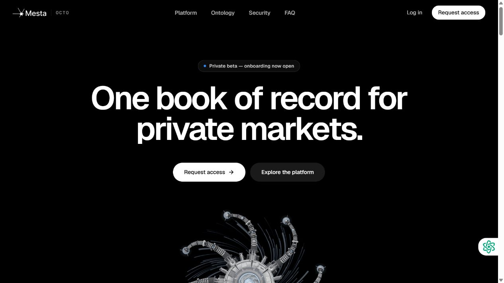

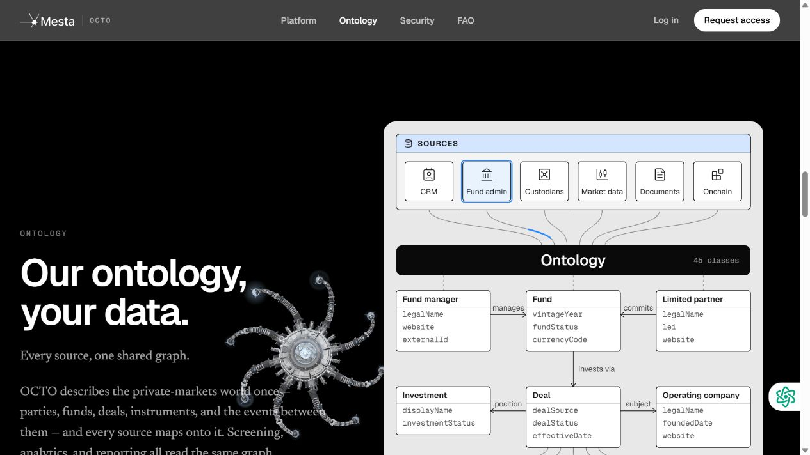

- Struktur: proposisi tunggal, angka struktur, kapabilitas, ontology, kontrol, pertanyaan dan kontak.
- Kekuatan: objek visual punya hubungan dengan nama produk dan fungsi pengumpulan data. Kontrol menekankan asal-usul angka dan jejak koreksi.
- Copy: headline menyatakan tugas produk; paragraf berikutnya menjelaskan perilaku ledger dan siapa yang dilayani.
- UI/motion: objek mekanis dan jalur pada diagram mengarahkan perhatian pada hubungan sumber, record dan hasil.
- Untuk Gen-Z: motif aliran energi/data/kas yang konsisten serta pelaporan pokok dan income terpisah. Diagram harus menjelaskan hubungan, bukan sekadar dekorasi.
- Batas adaptasi: bentuk gurita, klaim ledger, ukuran ontology dan angka referensi tidak diambil.
- Aksesibilitas: deskripsi diagram tersedia di DOM. Target tab/focus pada kontrol trust dan FAQ masih perlu diuji.

## 7. Ondo Finance

Sumber: [Ondo](https://ondo.finance/). Kondisi pengamatan: hero dan transisi scroll tampil. Cookie banner ditutup menggunakan pilihan necessary only.

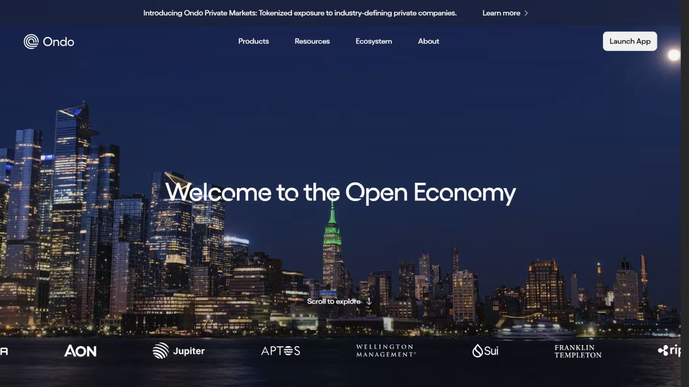

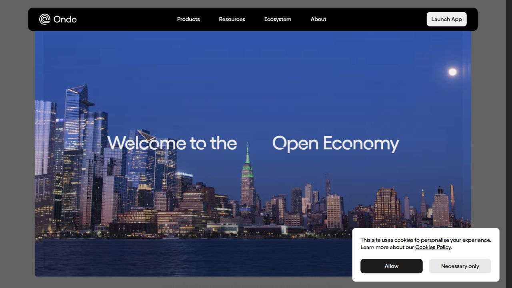

- Struktur: hero/brand, update, produk, bukti penggunaan, manifesto, trust, issuer technology, ecosystem, artikel dan newsletter.
- Kekuatan: pembuka sinematik memberi rasa skala sebelum produk diperkenalkan. Detail trust terpisah dari janji visual pembuka.
- Copy: vision-led di awal, lalu konkret pada produk. Angka, institusi dan audit menjadi penguat pada bagian berikutnya.
- UI/motion: footage kota full bleed, perubahan menjadi panel berbingkai ketika scroll, teks yang bergeser, nav yang berubah menjadi bar gelap serta logo marquee.
- Untuk Gen-Z: kualitas framing, pacing dan kesatuan adegan. Saat scroll, Gen-Z akan membawa aliran cerita menuju bukti aset, dengan ukuran framing media tetap.
- Batas adaptasi: TVL, APY, custodians, audit dan instant redemption milik produk referensi tidak menjadi proposisi Gen-Z.
- Aksesibilitas: footage, motion berkelanjutan dan scroll choreography membutuhkan alternatif reduced motion dan kontrol pause pada Gen-Z.

## Hasil lintas referensi

Keputusan yang diusulkan: kualitas adegan Ondo, ketepatan cerita aset ReFi, pemisahan audiens GEN, stack Nemesis, perjalanan satu objek Logistics, penjelasan hubungan Foundry dan jejak record Octo. Identitas Gen-Z memakai logo sendiri, palette sendiri yang telah dipilih, kategori dan batas produk pada PRD.

Kondisi keseluruhan pengamatan:

1. ReFi: konten aset/trust dapat ditinjau; transaksi belum diuji.
2. GEN: konten dan tiga layer dapat ditinjau; ada indikasi overflow pada satu tangkapan.
3. Nemesis: selection layer terverifikasi; keyboard canvas/SVG memerlukan perbaikan pada adaptasi.
4. Logistics: perubahan tahap terverifikasi; hero shrink sengaja tidak diadopsi.
5. Foundry: diagram/stories dapat ditinjau; operasi produk tidak diuji.
6. Octo: hubungan source-to-record dapat ditinjau; form tidak disubmit.
7. Ondo: hero/scroll terverifikasi; flow aplikasi investasi tidak diuji.

## Batas bukti

Tidak ada klaim seluruh situs memenuhi atau gagal WCAG. Pengujian referensi belum mencakup mobile, zoom, screen reader, reduced motion, seluruh menu, autentikasi atau transaksi. Screenshot menggunakan viewport browser saat sesi, bukan komparasi pixel dengan viewport yang diseragamkan. Widget ekstensi browser yang tampak pada sebagian tangkapan bukan bagian desain referensi.

Screenshot 08 dan 15 serta tangkapan reveal awal tidak dijadikan bukti final untuk kontras atau state selection. State stabil 14, 17 dan 18 dipakai menggantikannya. Screenshot 12 dipakai hanya untuk perubahan framing; banner cookie masih tampak pada state itu.

Data produk/screenshot belum tersedia untuk Gen-Z. Semua rancangan pada plan adalah usulan, bukan tampilan aplikasi live yang telah diuji.
