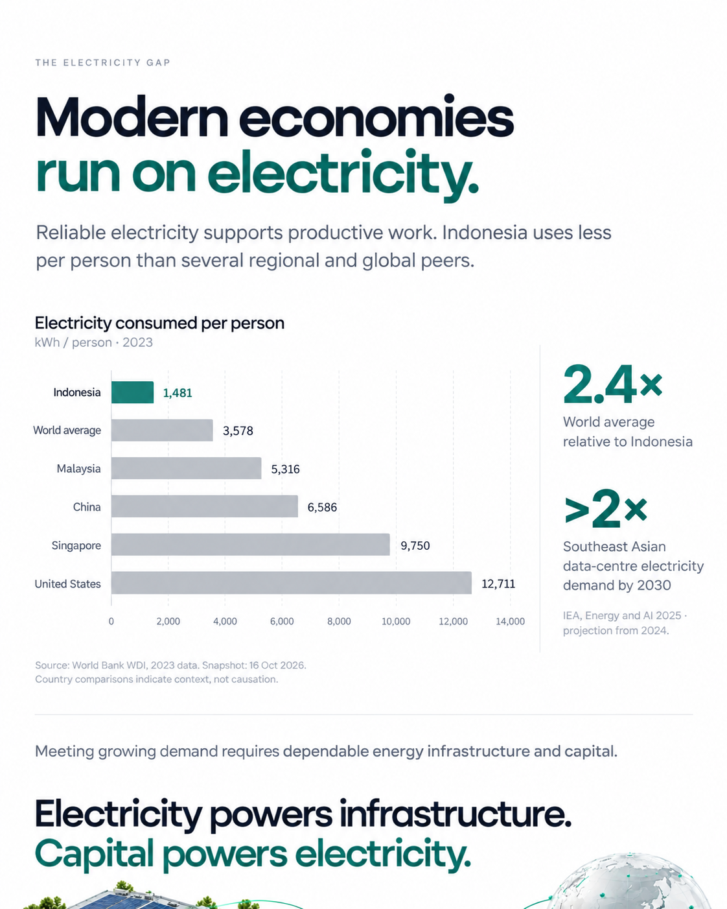
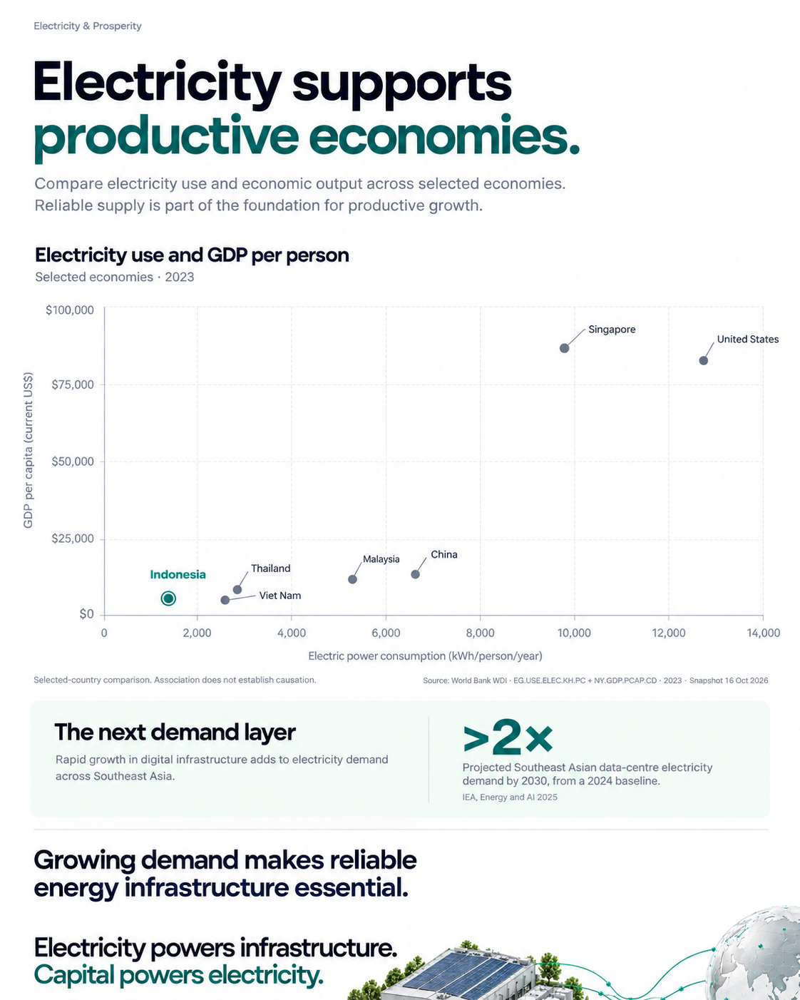
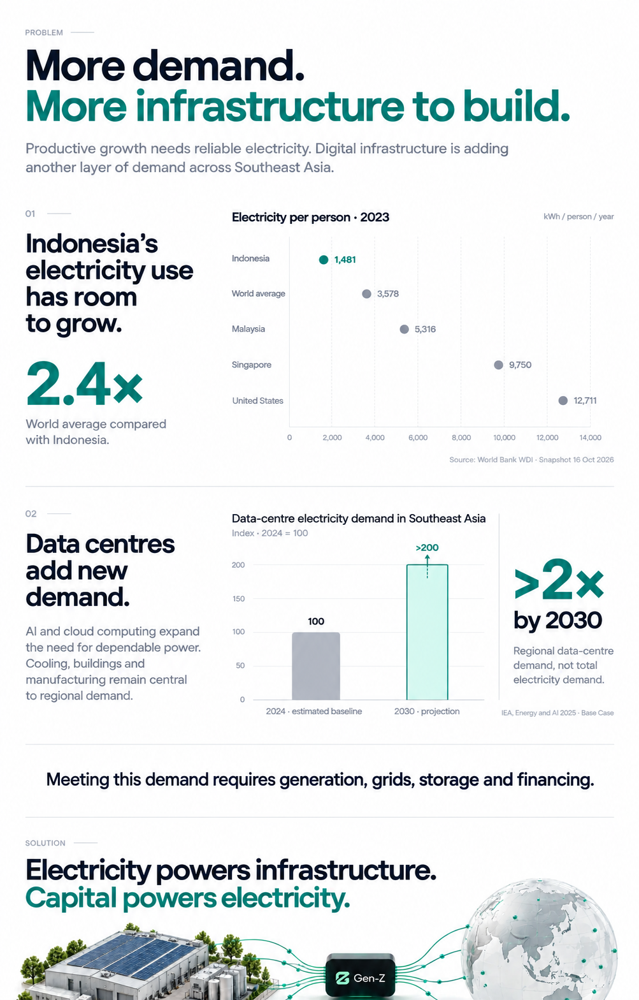

# Riset dan tiga opsi section thesis Gen-Z

Tanggal: 16 Oktober 2026 (Asia/Jakarta). Status: riset, rencana dan tiga mockup statis. Belum mengubah implementasi landing. Pilihan gambar mengikuti urutan tampil di chat: 1, 2, 3.

Antislop: **during**, pilihan eksplisit pengguna pada sesi ini. Skill pendamping: design-taste-frontend, Product Design get-context/ideate, imagegen, serta panduan DesainPakeAI design-quality dan variant-exploration. Panduan varian diterapkan pada eksplorasi; picker/prototype belum dibuat karena permintaan saat ini adalah riset dan rencana sebelum memilih desain.

## Pemahaman brief

Tambahkan konteks masalah segera sesudah hero, sebelum section solusi `#why`. Jelaskan hubungan listrik dengan aktivitas ekonomi modern, posisi Indonesia terhadap pembanding, lalu tambahan demand Asia Tenggara. Antarkan pembaca ke kebutuhan infrastruktur dan modal yang menjadi konteks solusi Gen-Z.

**Design Read:** landing infrastruktur energi untuk investor global dan operator aset; editorial berbasis data, menggunakan identitas Gen-Z yang sudah ada. Ini penambahan terarah, bukan perombakan brand.

Dial antislop: **ENERGY 2 / RHYTHM 2 / MOTION 1** untuk mockup statis. Dial design-taste: **DESIGN_VARIANCE 5 / MOTION_INTENSITY 2 / VISUAL_DENSITY 4**. Data perlu menonjol, sementara pembaca tetap bisa memahami pesan tanpa animasi. Angka dial adalah keputusan eksplorasi, bukan preferensi global baru.

## Temuan dari halaman dan referensi

Kode `landing/index.html` saat diperiksa langsung menghubungkan hero dengan `#why`, judul “Electricity powers industry. Capital powers electricity.” Belum ada section demand atau grafik negara. Section ini sudah berfungsi sebagai jawaban: menjelaskan penghubung antara pemilik aset dan investor. Menambahkan bukti kebutuhan di depannya membuat urutan argumen lebih lengkap.

Sumber visual: dua screenshot pengguna, inspeksi live [GE Network](https://www.ge.network/#market) dan [ReFi Hub](https://www.refihub.io/), screenshot lokal section lama, serta ilustrasi capital bridge yang digunakan implementasi saat ini. Screenshot lokal lama tidak dianggap bukti bahwa ilustrasi implementasi sekarang masih sama dengan versi lamanya; kode dan aset aktif menjadi acuan.

- **GE Network:** menjembatani konteks infrastruktur dengan modal, lalu memberi grafik demand. Angka +60% diberi konteks proyeksi menuju 2035; endpoint grafiknya 1.840 TWh.
- **ReFi Hub:** menekankan AI, elektrifikasi dan urbanisasi; +60% dijelaskan sebagai pertumbuhan selama dekade sebelumnya. Endpoint grafiknya 2.000+ TWh pada 2035.
- **Implikasi:** dua +60% itu tidak boleh dipertukarkan. Baseline, periode, skenario dan cakupan perlu ditulis langsung, bukan hanya menaruh nama IEA di footer.

Brand yang dipertahankan: permukaan putih, ink `#111827`, teal `#0F766E`, mint sebagai aksen terbatas; GenZ Display/Ondo Sans untuk judul, GenZ UI/Gellix untuk isi. Container mengacu halaman yang ada, kira-kira 1.180 px pada desktop. Hero, navigasi, ilustrasi penghubung modal, dan urutan section lain tetap menjadi konteks desain.

## Thesis yang aman untuk dipakai

[PRD §2.1–2.3](../archive/prd-2026-10-18.md) sudah membedakan tesis founder dan rumusan yang lebih defensible. Listrik yang andal, terjangkau dan cukup mendukung aktivitas produktif. Konsumsi per kapita memberi konteks, tetapi bukan ukuran modernitas yang lengkap atau hubungan proporsional universal dengan PDB.

Jangan menulis “negara pasti makin kaya jika konsumsi listriknya naik” atau “tidak ada negara kaya dengan konsumsi rendah”. Efisiensi, struktur ekonomi, iklim, kualitas pasokan, dan outsourcing produksi memengaruhi perbandingan. Konsumsi per kapita juga bukan rasio akses listrik: akses luas tidak otomatis berarti daya produktif, keandalan atau keterjangkauan memadai.

Usulan headline: **“Modern economies run on electricity.”** Dukungan: **“Reliable electricity supports productive work. Indonesia uses less per person than several regional and global peers.”** Ini konteks kebutuhan, bukan janji Gen-Z menaikkan kemakmuran nasional.

## Dataset yang sudah diperiksa

Dua indikator World Bank diambil langsung dari API publik, dengan tahun yang sama, **2023**, dan snapshot **16 Oktober 2026**. Tahun tersebut dipilih sebagai baseline konsisten untuk eksplorasi, bukan klaim tahun terbaru yang tersedia. Nilai lengkap disimpan di [data.json](references/thesis-2026-10-16/data.json).

| Ekonomi | Listrik, kWh/orang/tahun | PDB per orang, current US$ |
| --- | ---: | ---: |
| Indonesia | 1.481 | 4.876 |
| Vietnam | 2.550 | 4.323 |
| Thailand | 2.966 | 7.211 |
| Malaysia | 5.316 | 11.386 |
| China | 6.586 | 12.951 |
| Singapura | 9.750 | 86.383 |
| Amerika Serikat | 12.711 | 82.587 |
| Rata-rata dunia | 3.578 | tidak dipakai dalam scatter |

Sumber: [indikator listrik World Bank](https://data.worldbank.org/indicator/EG.USE.ELEC.KH.PC), [indikator PDB World Bank](https://data.worldbank.org/indicator/NY.GDP.PCAP.CD), [definisi konsumsi listrik](https://data360.worldbank.org/en/indicator/WB_WDI_EG_USE_ELEC_KH_PC). URL API untuk kedua seri ada di JSON.

Angka dibulatkan hanya saat ditampilkan. Beberapa nilai berbeda dari riset PRD sebelumnya karena snapshot seri berbeda. Jangan mencampurkan seri ini dengan konsumsi nasional versi ESDM untuk menghitung pertumbuhan tahunan.

Perhitungan konteks: `3.577,5292559598 / 1.480,78843766555 = 2,415962`, dibulatkan **2,4×**. Artinya rata-rata dunia sekitar 2,4 kali konsumsi per kapita Indonesia dalam seri/tahun tersebut. Ini bukan target pembangunan atau perkiraan demand yang otomatis akan terjadi. Malaysia/Indonesia sekitar 3,59×; angka ini tidak perlu ditumpuk sebagai KPI tambahan.

Negara dipilih dari konteks PRD dan pembanding kawasan; **bukan sampel dunia yang representatif**. Scatter tidak memakai garis regresi atau klaim koefisien korelasi. PDB nominal belum disesuaikan PPP. Vietnam memiliki listrik per kapita lebih tinggi tetapi PDB per kapita lebih rendah dari Indonesia, sehingga chart juga memperlihatkan bahwa hubungannya tidak universal.

### Demand Asia Tenggara dan kebutuhan modal

1. [IEA Energy and AI 2025](https://www.iea.org/reports/energy-and-ai/energy-demand-from-ai) memproyeksikan listrik untuk **data center Asia Tenggara lebih dari dua kali pada 2030** dalam Base Case, relatif 2024. Tulis data center secara eksplisit; ini bukan proyeksi seluruh listrik regional atau AI saja.
2. [IEA Southeast Asia Energy Outlook 2026](https://www.iea.org/reports/southeast-asia-energy-outlook-2026/energy-outlook-to-2050-based-on-today-s-policy-settings) menempatkan bangunan dan industri sebagai pendorong utama pertumbuhan listrik, dengan data center sebagai tambahan demand yang terkonsentrasi secara geografis. AI relevan, tetapi narasi tidak boleh menghilangkan cooling, elektrifikasi dan penggunaan produktif lainnya.
3. [Ringkasan Outlook 2026](https://www.iea.org/reports/southeast-asia-energy-outlook-2026/executive-summary) menjelaskan kebutuhan investasi pembangkit, jaringan dan fleksibilitas. Kawasan menerima sekitar 3% investasi energi global dibanding 9% populasi; biaya modal di banyak bagian kawasan bisa sekitar dua kali advanced economies dan China. Ini bukti konteks pembiayaan, bukan bukti bahwa tokenisasi sendiri mengatasi hambatan proyek.
4. [ASEAN Energy Security Review](https://www.iea.org/reports/asean-energy-security-review/energy-security-context-framework-and-overview) menyebut demand listrik meningkat lebih dari 60% sejak 2015. Bila dipakai, gunakan konteks historis itu, bukan menamakannya proyeksi 2035.

**Keputusan grafik demand:** jangan menyalin line chart referensi. [Ringkasan IEA 2024](https://www.iea.org/reports/southeast-asia-energy-outlook-2024/executive-summary) menyebut lebih dari 1.300 TWh menjadi lebih dari 2.000 TWh pada 2035 dalam STEPS; itu tidak selaras dengan endpoint 1.840 TWh di GE Network. Ada outlook lebih baru. [Chart demand IEA 2026](https://www.iea.org/data-and-statistics/charts/electricity-demand-by-end-use-sector-in-southeast-asia-in-the-stated-policies-scenario-and-the-current-policies-scenario-2015-2050) menyatakan unduhan datanya tidak tersedia pada halaman yang diperiksa. Deret historis/proyeksi tahunan yang tepat belum diekstrak; jangan mengisi titik-titiknya dengan interpolasi yang terlihat seperti data resmi.

Alternatif terverifikasi untuk eksplorasi: tampilkan `>2×` data center, atau grafik dua batang indeks `2024 = 100` dan `2030 > 200`, proyeksi dibedakan dengan outline/hatch dan panah kelanjutan. Tidak mengarang besaran tepat 2030 atau titik tahunan di antaranya.

Skenario PRD 30 GW/tahun dan USD30–40 miliar/tahun adalah asumsi founder, bukan fakta pasar yang siap menjadi headline. Jangan mengonversi konsumsi kWh/orang menjadi kebutuhan GW tanpa asumsi populasi, load profile, capacity factor dan keandalan.

## Alur konten bersama

**Hero → kebutuhan listrik untuk ekonomi produktif → bukti komparasi Indonesia → tambahan demand regional → kebutuhan infrastruktur dan pembiayaan → solusi Gen-Z.**

Kalimat transisi: **“Meeting growing demand requires dependable energy infrastructure and capital.”**

Pada section solusi, ganti hanya kata yang diminta sehingga menjadi:

**“Electricity powers infrastructure.”**  
**“Capital powers electricity.”**

Kode sekarang memakai “Electricity powers”, jadi rencana mempertahankan wording itu sambil mengganti “industry” menjadi ejaan Inggris **“infrastructure”**. Tidak mengubahnya diam-diam menjadi headline baru yang berbeda. Implementasi perubahan judul ikut setelah arah dipilih.

## Opsi 1: The Electricity Gap

**Struktur:** headline dan intro bertumpuk, lalu satu bar chart horizontal dominan. Indonesia teal; pembanding netral. Enam baris: Indonesia, benchmark dunia, Malaysia, China, Singapura, AS. Rasio dunia 2,4× dan proyeksi data center >2× menjadi catatan samping, bukan kartu KPI yang berebut perhatian.

**Apa yang terjadi pada grafik demand:** digantikan sebagai visual utama oleh grafik komparasi; demand tetap hadir sebagai satu statistik bersumber.

**UX:** pembaca memahami posisi relatif dengan cepat. Nilai ditulis langsung sehingga hover bukan syarat memahami chart. Sumber dan definisi dapat dibuka lewat disclosure “View data and sources”. Jangan memasukkan PDB ke sumbu kedua pada bar chart.

**Mobile:** judul → bar chart lebar penuh → dua catatan ringkas → sumber → transisi. Catatan samping pindah ke bawah. Label boleh membungkus; angka tetap terbaca. Pertahankan sumbu nol dan rasio batang, bukan menyamakan panjang visual agar bar Indonesia terlihat besar.

**Kekuatan:** paling ringkas dan mudah dipahami setelah hero. **Trade-off:** kaitan dengan kemakmuran disampaikan lewat copy; grafik utamanya sendiri hanya membandingkan konsumsi. Data ekonomi dan scatter bisa tersedia dalam disclosure, bukan menumpuk dua grafik utama. **Usaha:** rendah–menengah.

## Opsi 2: Electricity & Prosperity

**Struktur:** headline dan intro, satu scatter plot lebar, catatan demand regional pendek, kemudian transisi. X = kWh per orang; Y = PDB per orang nominal; tujuh marker berukuran sama. Indonesia disorot dengan warna, ring dan label, bukan warna saja.

**Apa yang terjadi pada grafik demand:** scatter menjadi visual utama; proyeksi data center tetap catatan pendukung. Grafik demand tahunan tidak dibutuhkan untuk menjelaskan hubungan dua indikator.

**UX:** paling dekat ke tesis PRD. Dua sumbu linear diberi satuan; tidak ada panah “menuju negara maju”, garis regresi, bubble populasi atau jaminan kausalitas. Tooltip lewat hover/focus opsional; caption dan tabel memuat data lengkap. Di versi detail, tambahkan pilihan melihat tabel dengan country, year, electricity dan GDP.

**Mobile:** jangan sekadar mengecilkan screenshot desktop. Gunakan area plot yang lebih tinggi dengan label singkat; label negara terpilih melalui tombol bernama dan detail di bawah chart. Tabel alternatif selalu tersedia. Bila label tetap bertabrakan, kurangi label permanen, bukan jumlah data yang tersedia.

**Kekuatan:** paling eksplisit menyajikan listrik dan kapasitas ekonomi bersamaan. **Trade-off:** perlu usaha baca lebih tinggi; cluster negara dengan PDB rendah sulit dilabeli. Sampel terpilih tidak mendukung kesimpulan universal. **Usaha:** menengah, terutama pelabelan dan akses mobile.

## Opsi 3: Two Pressures, One Need

**Struktur:** narasi vertikal dua bagian. Bagian pertama dot plot konsumsi listrik Indonesia dan pembanding. Bagian kedua grafik dua batang indeks demand data center 2024 dan 2030. Penutup menghubungkan keduanya ke pembangkit, jaringan, penyimpanan dan pendanaan.

**Apa yang terjadi pada grafik demand:** ditambahkan sebagai grafik kedua yang lebih spesifik. Dua pertanyaan dijawab terpisah: bagaimana posisi konsumsi Indonesia, dan bagaimana demand digital regional diproyeksikan berkembang. Jangan menyiratkan semua selisih konsumsi nasional adalah kebutuhan data center.

**UX:** panjang section memberi ruang untuk menjelaskan persoalan sebelum solusi. Sumber masing-masing chart terpisah; unit kWh/orang dan indeks tidak digabung. Outlook total regional 2026 menjadi konteks narasi, sementara proyeksi data center tetap jelas ber-vintage 2025.

**Mobile:** baca linear teks → dot plot → teks → grafik proyeksi → transisi. Hilangkan sticky/pinning. Tidak ada swipe wajib atau carousel yang menyembunyikan bab kedua. Pada desktop, kedua bab tetap bisa dibaca dengan scroll normal.

**Kekuatan:** konteks masalah paling lengkap dan paling jelas menjelaskan alasan demand baru membutuhkan infrastruktur. **Trade-off:** paling panjang setelah hero yang sudah memiliki sequence scroll; dua rasio 2,4× dan >2× harus dibedakan konteksnya agar tidak membingungkan. **Usaha:** menengah–tinggi.

Label “Problem”, “Solution”, dan nomor bab yang ditambahkan generator pada konsep ketiga adalah anotasi mockup yang tidak diperlukan dalam copy implementasi. Hilangkan label tersebut pada implementasi agar judul dan grafik memimpin hierarki.

## Perbandingan untuk memilih

| Prioritas | Opsi yang paling cocok | Konsekuensi |
| --- | --- | --- |
| Pesan cepat dipahami setelah hero | 1 | Hubungan dengan PDB ada pada penjelasan/detail |
| Menampilkan thesis listrik dan ekonomi secara langsung | 2 | Lebih analitis dan membutuhkan penanganan mobile |
| Menjelaskan komparasi sekaligus demand baru | 3 | Menambah panjang halaman |

Ini hipotesis desain, belum hasil uji pemahaman atau konversi. Pilih berdasarkan fokus komunikasi yang ingin diberi ruang, bukan klaim pasti menaikkan leads.

## Rencana implementasi setelah pilihan

1. Tambahkan section `#energy-context` setelah penutup hero dan sebelum `#why` di `landing/index.html`. Pertahankan anchor `#why`, navigasi, hero dan section lain.
2. Ubah “industry” menjadi “infrastructure” pada judul `#why`. Pertahankan capital bridge dan fungsinya sebagai jawaban atas konteks sebelumnya.
3. Buat komponen chart sesuai opsi, menggunakan React dan CSS proyek. Data dari snapshot lokal dengan provenance; tidak perlu fetch World Bank saat pengunjung membuka halaman. Tidak perlu library grafik baru untuk dataset sekecil ini. Plot adalah visualisasi data, bukan ilustrasi dekoratif yang harus dimasukkan sebagai bitmap.
4. Sediakan caption, unit, tahun, definisi dan tabel data. Disclosure native `details/summary` untuk “View data and sources”; keyboard Enter/Space, focus terlihat dan urutan DOM mengikuti pembacaan. Jika ada tooltip, tetap dapat diakses melalui focus dan tidak memuat informasi eksklusif.
5. Tinggi section mengikuti konten. Hindari mewarisi `min-height: 100svh` bila membuat ruang kosong atau memotong chart; khususnya jangan menambah scroll pin sesudah hero yang sudah 200dvh.
6. Utamakan tampilan final statis. Bila kelak ada reveal, pendek dan sekali saja untuk mengarahkan perhatian, tanpa animasi count-up angka. `prefers-reduced-motion` langsung menampilkan seluruh konten.
7. Jika JavaScript/chart gagal, judul, kesimpulan dan tabel data HTML tetap terbaca. Jika dataset tidak valid saat build, blok publikasi chart, tampilkan penjelasan tanpa angka, dan perbaiki sumber. Loading remote/empty/error bukan state rutin karena data disertakan saat build.
8. Verifikasi 320, 390, 768 dan 1440 px; zoom 200%; label tidak terpotong; fokus dan disclosure; reduced motion; fallback tanpa JS; console; build Vite. Jangan mengklaim lolos sebelum dikerjakan.

## Alasan keputusan visual

| Keputusan | Alasan |
| --- | --- |
| Putih dan teal lama | Mempertahankan brand dan menyambung dengan solusi yang ada |
| Teal hanya untuk Indonesia/fokus proyeksi | Mengarahkan perhatian, bukan memberi semua negara arti positif/negatif |
| Sans proyek | Menjaga suara visual dan keterbacaan data |
| Satu grafik dominan pada opsi 1/2 | Memperjelas pertanyaan utama, menghindari section menyerupai dashboard |
| Dua grafik terpisah pada opsi 3 | Membandingkan posisi saat ini dan tambahan demand dengan unit yang berbeda |
| Sumbu nol pada bar/dot plot | Menghindari pembesaran selisih secara visual |
| Marker sama besar pada scatter | Hanya dua variabel yang dikomunikasikan |
| Label nilai dan sumber langsung | Bukti dapat dibaca tanpa interaksi tersembunyi |
| Tidak ada foto baru | Hero dan solusi sudah punya imagery; section ini bertugas memberi bukti |
| Tidak ada CTA investasi di section konteks | Pembaca sedang memahami masalah; CTA utama tetap pada alur produk |

## Grafik akurat untuk acuan implementasi

Gambar UI dibuat dengan **built-in Image Gen** sebagai eksplorasi komposisi. Posisi dan ukuran chart pada gambar generatif merupakan pendekatan visual. Grafik di bawah dirender secara deterministik dengan Matplotlib dari snapshot data, dan menjadi acuan angka/geometri implementasi:

- [Konsumsi listrik per orang, PNG](references/thesis-2026-10-16/chart-electricity-per-person.png) dan [SVG](references/thesis-2026-10-16/chart-electricity-per-person.svg).
- [Listrik dan PDB per orang, PNG](references/thesis-2026-10-16/chart-electricity-gdp.png) dan [SVG](references/thesis-2026-10-16/chart-electricity-gdp.svg).
- [Proyeksi demand data center, PNG](references/thesis-2026-10-16/chart-data-centre-demand.png) dan [SVG](references/thesis-2026-10-16/chart-data-centre-demand.svg).
- [Script reproduksi](references/thesis-2026-10-16/render_charts.py): `python docs/design/references/thesis-2026-10-16/render_charts.py` dari root proyek.

## Pre-flight dan Delivery Gate

Laporan ini untuk **riset dan konsep statis**, bukan persetujuan kualitas aplikasi yang belum dibangun.

- **PASS, grounding dan klaim (R-17/18/36/38, C-5):** dua referensi diperiksa live, PRD §2 dibaca, dua seri API World Bank diambil, periode/skenario IEA ditelusuri. Tidak ada testimoni, proyek atau angka return buatan.
- **PASS, direction dan purpose (R-31/37):** brand/tipografi berasal dari DESIGN.md dan CSS aktif; design read, dial dan alasan keputusan tertulis di atas. Tiga opsi berbeda pada struktur/hierarki, bukan warna saja.
- **PASS, pemeriksaan data:** tujuh ekonomi memiliki nilai positif; ratio 2,415962 dihitung dari nilai penuh; scatter memakai tahun sama; proyeksi >200 ditampilkan sebagai lower bound. Semua grafik berhasil dirender oleh script.
- **PASS, kontras token grafik:** hasil script: ink/putih 17,74:1; teal/putih 5,47:1; muted/putih 7,56:1; gray/putih 4,97:1; teal/mint 4,86:1. Semuanya memenuhi 4,5:1. Ini pengujian token pada grafik deterministik, bukan sertifikasi seluruh pixel mockup generatif.
- **PASS, tinjauan visual statis:** tiga konsep dan grafik diperiksa untuk judul, urutan argumen, satuan, label, forecast, pemisahan data center dari total demand dan transisi solusi. Anotasi generator serta teks sumber kecil pada mockup harus mengikuti spesifikasi implementasi, bukan disalin sebagai pixel final.
- **NOT VERIFIED, runtime (R-03/25/26/27/32/34/35, C-2/C-4):** responsivitas live, keyboard/focus, interaksi, reduced motion, fallback, console, build dan kontras seluruh UI. Belum ada prototype yang bisa diklik. Tidak ada klaim klik/lulus gate implementasi.
- **Tidak berlaku pada scope ini:** perubahan hero/nav/CTA/form/footer, tema baru, marquee, logo wall, GSAP pinning dan library baru. Pre-flight tidak dipakai sebagai alasan mengubah bagian di luar permintaan.

Gate implementasi tetap harus dijalankan sesudah opsi dipilih. File landing tidak diedit selama eksplorasi ini.
