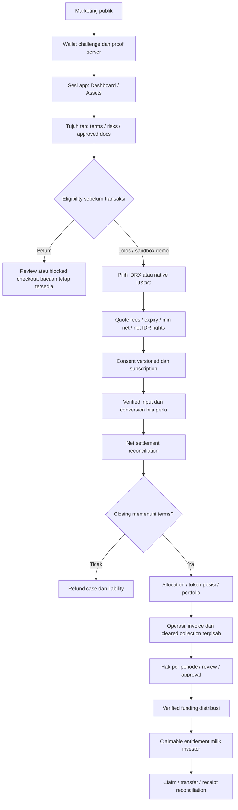

# Alur dan transisi status

**Status: rancangan [R].** Proof/sesi wallet sudah ada; inquiry, investment lifecycle, reporting dan claim di bawah belum diimplementasikan. Diagram menggambarkan target.

Sumber pemisahan: [dokumen asal](../archive/schema-flows-2026-10-18.md). Dipisahkan 18 Oktober 2026; label [F]/[R]/[A]/[O]/[V] mengikuti [panduan](../CONTRIBUTING.md).

## Flows end-to-end

### Inquiry operator dan assisted intake

```text
Marketing → Discuss your asset → validasi profil/kontak/kategori/lokasi/status/kebutuhan dana
→ simpan Inquiry + reference + notification outbox dalam transaksi server
→ tampilkan penerimaan dengan reference → worker notifikasi ke satu inbox
→ founder/admin screening → status penerimaan/screening/kekurangan bukti
→ minta evidence sensitif via kanal privat → tautkan ke project/asset/period yang tepat
```

Gagal notifikasi tidak menghapus inquiry atau meminta submit duplikat. Idempotency/retry tidak menghasilkan record ganda. Akses hanya founder/admin berwenang; tidak otomatis masuk marketing. Inquiry tidak berlanjut dihapus 90 hari sejak interaksi terakhir; inquiry aktif ditinjau tiap 90 hari. Retensi inbox/provider/backup diselesaikan saat konfigurasi; kebijakan ini tidak menghapus bukti investasi atau ledger.

### Investor, subscription dan claim



Eligibility tidak menjadi syarat membaca approved investor copies setelah login. Original sensitif dibatasi dengan alasan redaksi/pembatasan, versi/sumber/status dan permission tersendiri. Semua API/download/cache mengikuti server authorization.

IDRX dan native USDC adalah dua input ke satu denominasi hak IDR untuk kas IDR. Quote berisi biaya/kurs/basis/expiry/min_net; allocation mengikuti net settled amount, bukan gross transfer atau angka dari browser. Provider/executable capacity dan payout/refund currency aktual [O]. Claim bukan janji principal redemption, profit tetap atau exit instan.

### Laporan dan publikasi

Submission facts/evidence/report → draft revision → review versi tertentu → approval → published investor copy/read model. Koreksi membuat versi baru beserta alasan/histori; consent posisi lama tetap terikat versi terms/model yang disetujui.

Fallback laporan bulanan reviewed; API/IoT hanya bila feasible. Raw telemetry terpisah dari laporan reviewed dan ledger. Provisional data berlabel dapat ditampilkan setelah permission/validasi yang sesuai; tidak menciptakan saldo claimable. Missing/overdue/stale dan koneksi putus bukan pengukuran nol. Hash anchoring opsional bukan bukti invoice sudah dibayar atau sensor akurat.

## State machines dan failure paths

| Object | Normal states [R] | Failure / review |
|---|---|---|
| Inquiry | received → screening → awaiting_evidence → active → progressed/closed | rejected/not_proceeding; notification_pending/failed terpisah; active retention review; inactive deletion due |
| AuthChallenge | issued → verified_and_consumed → session_created | rejected, expired, replayed; grant tidak ditambah oleh transisi ini |
| Project/Offering | draft → evidence_review → approved → demo_open/open → closed → servicing → resolved | incomplete/rejected/paused/default/workout; open live hanya setelah gates |
| Content / Terms / Report | draft → submitted → reviewed → approved → published → superseded | rejected/changes_requested; correction new version+reason, tidak overwrite |
| Subscription | draft → eligibility_passed → quoted → consented → payment_pending → input_confirmed → conversion_pending bila perlu → net_settled → allocated | quote_expired/unmatched/underpaid/overpaid/conversion_failed/closing_failed/refund_pending/refunded |
| DistributionBatch | calculated → reviewed → approved → funding_pending → funded → claimable → partially_claimed → completed | rejected/shortfall/paused/reconciliation_break; approved bukan uang tersedia |
| Claim | requested → reserved → submitted → confirmed → reconciled/claimed | denied/failed/retry_pending/unknown; reserve dilepas hanya setelah aman tidak terjadi pembayaran |
| Chain observation | submitted → included → safe → finalized → reconciled | reverted/dropped/replaced/orphaned/RPC_unavailable; finalized chain bukan FX/bank settlement |
| Source/reporting | expected → received/provisional → validated → reviewed_aggregate | missing/overdue/stale/disconnected/corrected; bukan measurement zero |

Actor/mandate menentukan transisi; callback browser tidak mengesahkan pembayaran/eligibility/funding. Effect sekali dicapai melalui unique refs/idempotency, atomic reservation dan reconciliation, tanpa asumsi webhook datang sekali atau berurutan. Unknown transfer tidak dikirim ulang buta. Expiry subscription/quote tidak menghapus dana yang sudah datang; masuk exception/refund sesuai terms.
