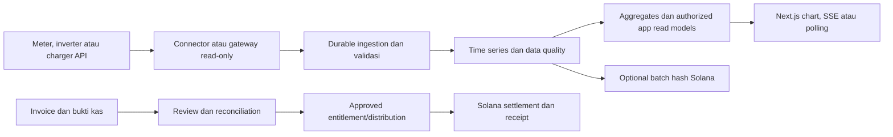

# Gen-Z: analisis ReFi Hub, GE Network, dokumen dan rancangan platform investor

> **Catatan 18 Oktober 2026:** keputusan chain Gen-Z di memo ini adalah riwayat 17 Oktober; founder kini memilih Base/EVM. Ikuti [spec v1.1-base](../../archive/mvp-spec-2026-10-18.md) dan [riset Base/EVM](../base-evm-2026-10-18.md) untuk implementasi. Observasi penggunaan Solana oleh GEN/sumber benchmark tetap merupakan isi riset asal, bukan chain Gen-Z yang aktif. Tidak ada perubahan runtime melalui pembaruan catatan ini.

**Tanggal:** 17 Oktober 2026, Asia/Jakarta. **Status:** riset dan rekomendasi, diperbarui dengan jawaban founder Q13–Q23; keputusan tambahan tetap terbuka dan belum implementasi.

## 1. Lingkup dan bukti yang diperiksa

Permintaan founder dibaca sebagai lanjutan PRD, dengan perubahan arah yang eksplisit. Seluruh 34 screenshot dan enam PDF yang diberikan tercakup. Riset dibagi ke tiga agent Codex: situs/dokumentasi ReFi Hub, dokumen FLP II, dan GEN/arsitektur. Root memeriksa screenshot, browser publik, model konten dan sintesis. Orca tidak berhasil menjadi koordinator karena CLI/runtime tidak tersedia; tidak ada klaim run Orca berhasil.

| Bahan | Coverage nyata | Laporan pendamping |
|---|---|---|
| Screenshot pengguna | 34/34 dibaca, diarsipkan tanpa modifikasi, diberi nomor dan SHA-256 | [Review tiap layar](SCREENSHOT-REVIEW-34.md), [manifest](screenshot-manifest.json) |
| Enam PDF FLP II | 114 halaman: 2+38+29+26+9+10; ekstraksi seluruh halaman dan OCR lokal PPA scan | [Review dokumen](FLP-II-DOCUMENT-REVIEW.md) |
| ReFi Hub | Landing, 22 artikel pada index blog yang tersedia, 21 halaman isi GitBook; klausul pilihan tiga kontrak tambahan | [Memo ReFi Hub dan seluruh URL](REFIHUB-RESEARCH.md) |
| GE Network | Home, Core, Network, Invest, Contact, lima artikel blog, pemeriksaan link legal; sumber partner/regulator terbatas | [Memo GEN/arsitektur](GEN-AND-ARCHITECTURE.md) |
| Browser publik | Entry app, katalog, detail FLP II, tab Documents dan link enam PDF; perbandingan tab Surya | [Bukti live](live-captures) |
| Dokumen proyek Gen-Z | PRD lama, draft yang sedang diwawancarai, glossary dan architecture | [PRD diperbarui](../../archive/landing-alignment-2026-10-17.md) |

Ini bukan klaim seluruh internet, histori publikasi yang sudah dihapus, backend, admin CMS, deployment perangkat, atau transaksi pembanding sudah diaudit. Wallet connect, KYC, signing, pembelian, claim dan P2P tidak dijalankan. Screenshot dashboard/portfolio adalah bukti dari pengguna, bukan akun yang dioperasikan agent.

## 2. Perubahan yang sudah diputuskan founder

| Area | Arah yang berlaku sekarang |
|---|---|
| Akses | Platform terbuka untuk individu dan institusi global; marketing publik, seluruh workspace/list/detail/dokumen setelah wallet authentication (Q15/Q16) |
| Transparansi | Q20: dokumen inti yang disetujui dibaca setelah login sebelum eligibility transaksi; salinan sensitif disunting, original dibatasi dengan alasan |
| Investor experience | Mengambil referensi fungsi ReFi Hub, kemudian membentuk UI/UX Gen-Z sendiri |
| Landing | Migrasi ke Astro sebagai arah arsitektur |
| App | Next.js untuk auth dan seluruh aplikasi |
| Chain | Solana menggantikan Base |
| Data | Monthly reviewed reports boleh saat feed belum tersedia; API/IoT bila feasible dengan source/freshness/coverage (Q17) |
| Navigasi roadmap | Rewards, Points dan Native Token tetap ada sebagai informasi/Coming soon; functional reward ditunda, MVP investasi RWA/DeFi + transparansi (Q18) |
| Detail dan konten | Tujuh tab tetap + structured facts/editor blok disetujui (Q13); CMS vendor tetap kandidat |
| Hak investor | Hybrid/revenue participation dibuka, model eksplisit per offering; demo solar hybrid sintetis dipilih Q22 |
| DeFi MVP | Subscription → allocation/token posisi → portfolio → distribusi/claim atas hak dan dana tersedia; swap/lending/staking/secondary ditunda (Q19) |
| Review | Laporan/terms direview sebelum terbit; koreksi berversi dan telemetry provisional tidak memicu pembayaran (Q21) |
| Inquiry | Akses founder/admin, satu inbox, inactive 90 hari sejak interaksi terakhir, active review 90 hari, tanpa marketing otomatis (Q23) |
| Pekerjaan saat ini | Analisis lengkap, rekomendasi dan pertanyaan setelah riset; source belum dimigrasikan |

Pertanyaan lama Q8–Q10 diteruskan/diganti oleh keputusan Q16/Q20/Q21/Q23. Urutan rilis dan anchor checkpoint lama Q11/Q12 tidak disetujui dan bukan requirement aktif. Keputusan ekonomi lama yang tidak diubah secara eksplisit tetap baseline; membaca FLP II tidak otomatis berarti founder memilih hak FLP II.

## 3. Mekanisme tokenisasi ReFi Hub

### Hak yang dibeli dan aliran kas

Materi sekarang menjelaskan token sebagai hak pembayaran kontraktual terkait offering tertentu. FAQ FLP II membedakannya dari ownership/equity/voting aset atau perusahaan. Bahasa partial ownership pada materi DeCharge lama tidak bisa digeneralisasi sebagai makna semua token proyek. Hak harus mengikuti issuer, agreement, schedule dan versi offering. [FAQ FLP II](https://www.refihub.io/blog/investor-faq-flp-ii-solar-installation), [Terminology](https://refihub.gitbook.io/refi-hub/additional/terminology).

Alur ekonominya: pengguna listrik/charging membayar offtaker/operator melalui rail bisnis nyata; operator menerima kas; kewajiban dan fee dihitung berdasarkan kontrak; dana USDC dimasukkan ke program distribusi; entitlement holder dialokasikan; pengguna dapat melakukan claim melalui portfolio. Kode membantu pencatatan dan distribusi setelah dana tersedia. Ia tidak mengubah invoice menjadi kas atau menghilangkan risiko operator/offtaker. [Revenue mechanics](https://www.refihub.io/blog/how-solar-assets-generate-revenue-for-investors), [Technology and settlement](https://refihub.gitbook.io/refi-hub/how-refi-hub-works/technology-and-settlement).

Funding round mempunyai harga/supply, cap, periode dan refund rules sendiri. Ticket Size pada marketing tidak boleh langsung ditafsirkan minimum per investor. Fee3% dari raise dan servicing fee per deal dijelaskan dalam dokumentasi; kata tanpa fee langsung ke holder tidak berarti cashflow bebas potongan. [Fees](https://refihub.gitbook.io/refi-hub/how-refi-hub-works/fees-on-refi-hub), [Contracts and distributions](https://refihub.gitbook.io/refi-hub/how-refi-hub-works/contracts-and-distribution-mechanics).

### Mengapa tiga contoh tidak sama

| Aspek | FLP II | Surya/DeCharge | CRN/Tab Energia |
|---|---|---|---|
| Infrastruktur | Rooftop solar Singapore; offering atas bagian pembiayaan plant | EV charging India | Solar Brazil |
| Dasar ringkas | Fixed component+share atas gross yang didefinisikan kontrak; fee dan support di schedule | Net-profit share setelah biaya yang ditetapkan | Net-profit share dengan OPEX/management arrangement |
| Investor share | Net35% dan fixed net810,18/bulan menurut schedule; tidak cukup diringkas sebagai satu APR | Kontrak pembanding60% investor,30%operator,10%platform | Kontrak pembanding33,33% net profits pada full subscription |
| Data | PPA, billing, REC, agreements dan history/backtest | Sessions, kWh dispensed, costs, revenue, availability | Progress, generation, billing/recognition, collection, incidents |
| Batas penting | Tenor offering berbeda dari masa PPA; maturity bukan otomatis return principal | Template lama dan report terbaru berbeda basis forecast/actual | Interim payout bukan bukti operating revenue; timeline payment dapat tertunda |
| Tab terlihat | Deal Terms, Performance, Risks, Asset&Operator, Documents | Reports, Overview, Details, Impact, Calculate Your Returns | Sama keluarga tab Surya |

Tiga kontrak pembanding di memo ReFi Hub ditelaah selektif, bukan seluruh klausul diaudit. Model ekonomi per offering berbeda; platform Gen-Z perlu configuration dan calculation engine per model, bukan satu field APY untuk semua proyek.

### Akses publik dan eligibility

Root berhasil membuka katalog dan keenam link dokumen FLP II tanpa login. Arah transparansi upfront founder didukung contoh nyata ini. Namun T&C ReFi Hub tetap memuat KYC dan batas yurisdiksi. Jadi public access, account/wallet, dan transaction eligibility adalah tiga lapisan berbeda. Daftar negara pembanding tidak otomatis menjadi kebijakan Gen-Z. [T&C](https://refihub.gitbook.io/refi-hub/legal/terms-and-conditions).

Untuk Gen-Z, founder memilih wallet authentication sebelum discovery, detail dan dokumen pada Q16. Dokumen upfront berarti setelah login dan sebelum investasi; eligibility transaksi tetap lapisan terpisah. Rekomendasi anonim sebelum wallet connect tidak berlaku bagi Gen-Z. Ini tidak mengembalikan produk menjadi private invitation-only. Negara awal, segmen investor dan issuer route perlu dirinci untuk peluncuran transaksi nyata.

## 4. GE Network: apa yang bisa dipakai sebagai referensi

GEN menjelaskan Core→Network→Invest: data meter dibaca dan ditandatangani perangkat; data/status dapat dilihat melalui layer network; instrumen mengaitkan produksi dan offtake dengan hak partisipasi. Halaman Core menyebut CT clamp/Modbus, paket bertimestamp, device key dan hash Solana. Ini lebih spesifik daripada sekadar animasi chart. [GEN Core](https://www.ge.network/core).

Tetapi Network dan Invest yang ditinjau masih WIP. Lima artikel blog memberikan arah produk; tidak ditemukan penjelasan publik yang cukup untuk merekonstruksi seluruh rights, waterfall, API, program address dan audit aktual. Pengumuman kerja sama custody mendapat corroboration terbatas dari [Gambit](https://gambitcustody.com/news/gen-impact-2025-green-digital-asset/); itu tidak membuktikan seluruh penawaran GEN bebas diakses investor semua negara.

Kartu marketing GEN memberi lokasi/angka berbeda untuk nama FLP II/Surya dibanding ReFi Hub. Jangan menyatukannya menjadi data aset yang sudah terverifikasi atau menyimpulkan hubungan perusahaan. Pembeda Gen-Z sebaiknya keterlacakan bukti dan kualitas data yang bisa diperiksa, bukan meniru klaim semua sudah live atau tidak perlu audit.

ReFi Hub juga sudah membahas monitoring/API dan preview feed. Maka pernyataan bahwa benchmark sama sekali belum memiliki IoT tidak didukung bukti. [Report Surya Februari](https://www.refihub.io/blog/project-surya-second-month-operating-distribution-report) dan screenshot report Juli menunjukkan readiness yang bertahap. Opportunity Gen-Z adalah coverage, freshness, provenance, rekonsiliasi dan status integrasi yang lebih jelas.

## 5. Enam PDF FLP II: fungsi dan pelajaran framework

| Dokumen | Halaman | Apa yang diatur/dibuktikan | Yang tidak otomatis dibuktikan |
|---|---:|---|---|
| Insurance Side Letter | 2 | Undertaking transisi insurance dan kewajiban pihak yang menandatangani | Polis insurer aktif, cakupan aktual, kemampuan memenuhi undertaking |
| Invoicing History&Billing Structure | 38 | Billing/usage/savings serta term sheet dan transfer structure | Semua invoice sudah dibayar; title/security telah sempurna |
| Token Sale Agreement | 29 | Pihak, hak token, settlement/reporting/default/expiry dan acknowledgments investor | Kepemilikan panel atau pengembalian principal 100% di maturity |
| Power Purchase Agreement | 26 | Kontrak energi, parties, tariff/measurement/environmental attributes | Investor memiliki PPA atau hak langsung atas offtaker tanpa assignment/mandate |
| Commercial Terms Schedule1 | 9 | Waterfall aktual: gross/net, fee, fixed, support, REC basis dan repayment rules | Angka ringkas pada UI selalu lengkap atau sama dengan kas yang telah diterima |
| REC Issuance | 10 | Ringkasan, bukti registry/invoice dan scope environmental records | Seluruh nilai summary milik FLP, seluruhnya collected cash, investor memiliki environmental claims |

Seluruh114 halaman diekstrak; PPA scan di-OCR lokal. Tanda tangan yang tampak tidak sama dengan validasi cryptographic signature, authority atau enforceability. Laporan pendamping memuat halaman/klausul dan batas pembacaan.

Temuan yang paling berpengaruh:

1. **Nilai savings dipresentasikan sebagai energi.** Pada screenshot Deal Terms,41.196,10 diberi unitkWh. Pada invoice detailDes 2025 nilai yang sama berada di Savings(SGD), sementara usage kumulatif345.025,97kWh. Ini indikasi kuat salah mapping kolom/unit, kecuali ada sumber lain yang menjelaskan angka UI. Sistem Gen-Z perlu menyimpan source cell/record, metric dan unit.
2. **Scope REC perlu direkonsiliasi.** Summary mengaitkan433REC/SGD28.145 dengan FLP, sedangkan tabel bukti memisahkan FLP90REC/SGD5.850 dan RECLAIM343REC/SGD22.295. Jangan memindahkan total multi-asset menjadi revenue satu proyek.
3. **REC deemed bukan otomatis hasil penjualan yang masuk rekening.** Schedule memakai nilai asumsi/deemed dan mekanisme top-up/support. Pada dashboard, generation, entitlement, issued, sold, invoiced dan collected harus dibedakan.
4. **Net investor dan gross recipient berbeda.** Recipient gross 40% dan fixed925,92, servicing12,5%, menghasilkan net 35% dan fixed810,18; revenue support memberi lapisan lain. Gunakan signed economic terms, bukan hanya angka headline.
5. **Cash yield berbeda dari profit/principal.** Fixed810,18×108≈87.499,44. TSA tidak memberikan hak residual otomatis pada expiry. Jangan menganggap total cashflow seluruhnya profit atau menjanjikan principal balloon yang tidak ada.
6. **Insurance letter bukan policy certificate.** Surat bertanggalMaret 2026 menargetkan transisi hinggaMei 2026. Tidak ada konfirmasi polis aktual hanya dari target tersebut.
7. **267,85 versus265,96kWp bukan kontradiksi pasti.** PPA memperbolehkan±10%; angka as-built masih berada dalam rentang. Tetap perlu basis dan scope capacity per series.
8. **Reporting obligation bukan integrasi live.** Kontrak menerima API atau verifiableCSV pada kondisi tertentu; ini belum membuktikan semua site/device sudah mengirim data stream.

Artinya enam PDF berguna sebagai referensi **jenis dokumen dan relasi bukti**, tetapi perlu pemeriksaan silang sebelum menjadi template terms Gen-Z. Menyalin kontrak tanpa menyesuaikan instrumen, counterparties dan struktur lokal akan membawa ketidakjelasan yang sama.

## 6. Review UI yang perlu diterjemahkan ke requirement

Kekuatan benchmark: katalog yang mudah dibandingkan; sidebar terms dan payout history; separation proyek/operator; timeline yang bisa membawa gambar/PDF; document downloads upfront; serta calculator yang menjelaskan economics.

Bagian yang perlu diperbaiki untuk Gen-Z:

- Nama metrik tidak boleh menyamakan APY, annualised cash yield, profit, total distributions dan IRR. Masing-masing memerlukan formula, basis, periode dan actual/forecast status.
- Backtest2025 pada FLP II perlu dibedakan tegas dari payout aktual 2026. Tidak semua tabel Performance adalah operating history deal tersebut.
- CRN calculator menyebut Exodos1; project label harus berasal dari entity, bukan paragraf copy-paste.
- Surya forecast mempunyai sel revenue216.500 tetapi net108.113 konsisten dengan model gross218.708, bukan sel tersebut. Calculation service dan reconciliation checks menghindari angka beda di tabel/gambar.
- Timeline dan overview jangan berselisih lifecycle tanpa penjelasan; alat yang sedang maintenance dapat tetap berproduksi, dan plant yang berproduksi dapat memiliki payment pending.
- kW, kWp, kWh dan MWh harus bertipe. EV charging grid usage bukan otomatis renewable generation; BESS bukan generator energi baru.
- Payout terjadwal, received by platform, claimable dan claimed adalah state berbeda; tx link bukan bukti semua holder sudah menerima.
- Metric portfolio untuk akun kosong bisa unavailable, bukan selalu0%. Missing data tidak dianggapzero measurement.
- Foto tim dan generic verified badge bukan pengganti entity/evidence/status yang dapat diperiksa.

Seluruh34 layar beserta anotasinya ada pada review screenshot. Kontras/keyboard/mobile hanya risiko yang teridentifikasi; bukan audit WCAG yang sudah lulus.

## 7. Tujuh tab tetap untuk Gen-Z — disetujui Q13

Gunakan satu navigation shell untuk seluruh proyek. Variasi asset class dan instrument terjadi di isi/subview, bukan mengganti nama semua tab per proyek.

| Urutan | Tab | Isi wajib | Variasi yang diperbolehkan |
|---:|---|---|---|
| 1 | Overview | Apa asetnya, lokasi/jenis, status berdimensi, kebutuhan dana, offering/series, highlight hak/risiko dan readiness data | Foto, ringkasan, gallery, highlights |
| 2 | Asset&Operator | Legal entities dan peran, total/funded capacity, owner/operator/issuer/offtaker, equipment/site, track record bertanggal | Solar technical profile, EV charger/site list, BESS profile, team profiles |
| 3 | Deal Terms | Hak investor, use of proceeds, currency, tenor, fee, cashflow waterfall, principal/maturity, eligibility dan transfer/exit | Instrument-specific sections dan scenario calculator |
| 4 | Performance&Data | Produksi/usage, billing, collection, distribution, sumber/freshness dan data quality | Subview Energy/Usage, Financial, Impact, Live Data bila tersedia |
| 5 | Reports&Updates | Timeline operasional/material changes, laporan periode, incidents, corrections | Narasi, gambar, chart terkait dataset, attachment PDF |
| 6 | Risks | Risiko proyek/counterparty, operational, liquidity, currency, technology, data/insurance dan mitigasi berbukti | Risk item per aset/instrument dengan owner dan asof |
| 7 | Documents | Register versi dan source: contracts, finance, asset/operator, insurance/security, impact/REC, technical/telemetry | Investor full/redacted setelah auth; original sensitif restricted dengan alasan (Q20) |

**Impact** masuk subview Performance&Data, dengan ringkasan di Overview; jangan hilang. **Calculator** masuk Deal Terms karena harus menjelaskan model hak yang dipilih; actual performance tetap terpisah. Reports dan Documents berbeda: report adalah event/narasi temporal; document adalah file/record resmi yang berversi dan bisa ditautkan dari banyak tab.

Documents tetap mempunyai shortcut terlihat di ringkasan agar upfront tidak berarti pengguna harus membaca enam tab dahulu. Sidebar/header offering berisi identitas series, status funding, minimum investment yang berbeda dari target raise, pembayaran berikutnya dengan label estimated, pemisahan principal/income bila relevan, serta CTA sesuai state dan eligibility.

Di mobile, sediakan navigation section yang dapat di-scroll atau selector yang jelas, deep link tab dan focus. Jangan tujuh label dipaksa sangat sempit. Jangan membungkus seluruh isi panjang pada nested scroll yang menyulitkan pembaca.

Tab inti tidak boleh ditutupi Coming soon jika offering nyata sedang ditawarkan. Jika data belum ada, jelaskan missing/notapplicable/notconnected, periode dan alasannya. Kekurangan evidence minimum menahan publication/invest action sesuai tahap produk; demo tetap boleh memakai dokumen sintetis yang diberi label.

## 8. Cara admin mengisi konten yang fleksibel

**Tidak perlu memilih antara form kaku dan satu fileMarkdown bebas.** Gunakan empat jenis sumber yang berbeda.

| Jenis | Contoh | Cara pengisian | Cara ditampilkan |
|---|---|---|---|
| Structured facts | Asset/operator ID, unit, capacity, terms, dates, fees, rights | Form bertipe dan validasi server | Listing, sidebar, tables, calculator |
| Editorial blocks | Uraian, heading, foto, diagram, risk explanation | Editor visual dengan Add Block dan urutan yang bisa diubah | Renderer komponen yang telah disediakan |
| Evidence files | PPA, agreement, invoice, insurance, technicalPDF | Upload+metadata+relasi+review+visibility | Document card, viewer/download dan source link |
| Operational/financial records | Meter readings, invoice periods, collection, payout | API/CSV terkontrol, worker atau transaksi domain yang direview | Charts, tables, reports, portfolio, telemetry |

Contoh pekerjaan admin untuk proyek solar:

1. Buat asset; isi operator, owner/issuer, lokasi, capacity dan status.
2. Buat offering/series terpisah; pilih economic model yang diizinkan dan isi field terms. Model penting yang belum supported perlu pengembangan/review, bukan formula JavaScript yang ditempel admin.
3. Unggah dokumen, pilih tipe, entity/series, tanggal, versi, investor redaction/access tier, source dan status review.
4. Pada Overview, tambahkan Rich Text→Gallery→Milestone.
5. Pada Deal Terms, tambahkan cashflow diagram yang terhubung ke terms configuration, use-of-funds table dan calculator.
6. Pada Reports, buat update bertanggal dengan paragraf→chart dari approved dataset→foto→technicalPDF.
7. Preview seluruh tab dan mobile; reviewer memeriksa sumber/angka/required sections, lalu publish snapshot berversi.

Proyek EV dapat memakai urutan paragraph → site list→charger table→donut allocation→photo→PDF, sementara solar memakai gambar→PPA explanation→energy chart. **Bentuk blok fleksibel, tipe data dan izin tetap terkendali.**

Block library awal yang disarankan: RichText, Image/Gallery, KeyValue, ApprovedDataTable, Chart, CashflowDiagram, UseOfFunds, Team, Milestone, RiskAccordion, DocumentReference, SourceCallout, TelemetryPanel dan Calculator. Chart/calculator tidak menjadi gambar manual bila isinya data yang harus konsisten. Diagram khusus boleh berupa image dengan caption/source, tetapi nilai finansial utama tetap dari model terstruktur.

### Pilihan implementasi

- **Rekomendasi awal:** Payload CMS pada lingkungan Next.js, dengan Blocks dan Lexical, untuk records editorial/media/documents serta admin experience. Ini kandidat, bukan stack CMS yang sudah dikunci founder.
- Alternatif: admin khusus dengan Tiptap dan schema JSON. Fleksibel tetapi lebih banyak workflow, media, roles dan versioning yang harus dibangun sendiri.
- Markdown boleh menjadi import/export atau input penulis teknis. Jangan satu Markdown menjadi satu-satunya database financial terms, source chart, permissions dan eligibility.
- Arbitrary MDX/JavaScript dari editor tidak diperlukan. JSON sendiri tidak otomatis aman: validate schema, field constraints, references dan URLs di server; rendering memakai allowlist components, bukan eval.
- Financial ledger, settlement, approvals dan telemetry tidak didelegasikan menjadi generic CMS content. Domain commands memakai otorisasi dan validation sendiri.
- Drafts, review, publish, superseded, correction reason dan audit trail terpisah dari sekadar saved. Mengedit angka material membuat snapshot baru untuk ditinjau.
- Cache publik hanya untuk marketing yang memang disetujui publik. App read models dan file memerlukan authorization server sesuai Q16; respons privat tidak boleh bocor melalui shared cache. Menyembunyikan tombol download tidak melindungi storage URL publik.
- Local API CMS yang bertindak atas nama user wajib menjalankan access controls; jangan bypass privileges melalui default internal service.

Mekanisme editor ini didukung fitur yang didokumentasikan, tetapi bukan bukti ReFi Hub memakai vendor yang sama. Sumber teknis: [Payload Blocks](https://payloadcms.com/docs/fields/blocks), [Lexical blocks](https://payloadcms.com/docs/rich-text/blocks), [Tiptap JSON/HTML](https://tiptap.dev/docs/guides/output-json-html).

## 9. Framework dokumen untuk Gen-Z

Mulai dari register evidence, lalu template dokumen yang mengikuti instrument dan asset class. Untuk setiap file simpan: document ID/type, asset/operator/offering scope, parties, version, effective/asof/expiry dates, language, source, signed/unsigned/redacted status, checksum, reviewer, review basis, supersededBy dan access tier. Reviewerinternal tidak sama dengan regulator approval.

| Bundle | Minimum yang perlu diminta | Conditional additions |
|---|---|---|
| Asset&operator | Legal identity/authority, ownership atau hak operasi, lokasi/spec, operating history | Lease/site rights, liens, registrations, permits |
| Revenue contract | PPA/offtake/service contract, customer, tarif, tenor, termination, metering/billing basis | Revenue participation dan actual assignment/novation bila ada |
| Investor instrument | Issuer, rights, priority, fees, principal/return definitions, payment/default/expiry/transfer terms | Security/collateral, guarantees, trustee/SPV dan country-specific documents |
| Operating&finance | Period readings, invoices, payment evidence/collection register, O&M costs dan reconciliation | Forecast model, use-of-proceeds, support/advance/recovery schedules |
| Insurance&security | Policy/schedule/certificate, insurer, insured entity/assets, coverage/limits/exclusions/expiry | Assignment/loss-payee, undertaking yang jelas dibedakan |
| Environmental/REC | Registry/device/vintage, issuance/ownership, sales/retirement records, calculation method | Attribute split, retention of rights, emissions factor and audit |
| Technical&data | Device/site mapping, commissioning, data access rights, source/cadence/coverage | Meter calibration, gateway key lifecycle, IoT incident logs |
| On-chain | Network/program/mint identity, authority/control disclosure, payment explorer references | Audit report, upgrades, recovery and transfer policy evidence |

Keputusan Q16/Q20: pengguna wallet-authenticated dapat membaca operator/issuer profile, offering terms, material risks, histori operasi yang disetujui, investor full/redacted core contracts dan evidence register sebelum investasi. Akses anonim sebelum wallet connect tidak menjadi rancangan Gen-Z. Redaksi hanya untuk hal sensitif/rahasia yang nyata; tetap tunjukkan apa yang disunting dan alasannya. Original unredacted dengan signature/identity/bank details dapat restricted bila memang diperlukan. Policy akses disetujui Q20; kewenangan menggunakan dokumen pihak lain tetap harus tersedia.

Jangan menyebut tersedia jika yang ada hanya draft, hilang, expired atau belum direview. Ringkasan evidence memakai link ke file/periode/scope yang benar. REC multi-asset harus dialokasikan sebelum masuk metric proyek; security wajib punya dokumen yang relevan, tidak hanya deskripsi collateral.

## 10. IoT dan serving data

Arsitektur yang direkomendasikan:

Jalur termurah belum tentu hardware sendiri: integrasi read-only API inverter/charger yang diizinkan dapat mendahului gateway fisik. Jika akses belum ada, gunakan laporan monthly dengan source label. Asset tidak boleh diberi badge Live hanya karena UI chart bergerak.

Tampilkan event time, received time, last update, coverage, unit, source dan quality. Status sumber dapat Not connected, Manual reports, API connected, IoT connected, Delayed atau Offline. Pisahkan raw/provisional telemetry dari laporan bulanan yang telah direview; jangan menunggu manusia menyetujui tiap sensor packet sebelum live view, tetapi jangan memakai packet provisional sebagai dana claimable.

Failure cases: duplicate/replay, missing packets, out-of-order/backfill, clock drift, counter reset, unit mismatch, wrong meter mapping, key compromise dan disconnected gateway. Setiap correction punya lineage; missing bukan zero. Blockchain anchor membuat catatan tamper-evident, bukan menjamin sensor akurat, kontrak sah, invoice lunas atau investor memiliki environmental attributes.

Data mentah tidak perlu semuanya ditulis ke chain. Simpan time series, lalu anchor batch/hash jika berguna. Pembayaran tetap mengikuti approved entitlement, kas yang sudah tersedia dan aturan kontrak. Periode produksi, billing, collection dan payout dapat berbeda.

## 11. Astro, Next.js dan Solana

| Lapisan | Tanggung jawab yang direkomendasikan |
|---|---|
| Astro | Landing/marketing, editorial/blog, SEO, penjelasan dan informasi publik yang relatif statis |
| Next.js | Auth dan seluruh workspace setelah sesi wallet: asset discovery/detail, dashboard, portfolio, documents, operator/admin, rewards/points/native pages dan API |
| Shared domain | Entity types, currency/units, economic models, validation, design tokens dan authorized investor read models |
| PostgreSQL | Asset/offering/register, permissions, approved financial records, ledger dan workflow |
| Object storage | PDF/media, versions, visibility, restricted originals dan published redactions |
| Persistent worker | Ingestion/API connectors, notification, reconciliation, aggregation dan chain indexing |
| Solana | Token/participation representation, permission/transfer policy sesuai rancangan, approved distributions dan receipts |

Satu repo dengan dua app deployable adalah rekomendasi praktis. Subdomain marketing/app memisahkan runtime dan sesi dengan jelas; single hostname juga bisa bila routing direncanakan. Ini belum memilih domain/hosting. React islands lama yang kompatibel dapat dipindah bertahap ke Astro; perubahan framework bukan alasan membangun ulang brand tanpa kebutuhan. [Astro islands](https://docs.astro.build/en/concepts/islands/), [framework components](https://docs.astro.build/en/guides/framework-components/), [Next.js auth](https://nextjs.org/docs/app/guides/authentication).

Solana memerlukan peninjauan ulang ERC-20, Solidity toolchain, SIWE, EVM addresses dan recovery assumptions. Pertimbangkan mint/representation per offering series jika haknya berbeda. TokenProgram/Token-2022 dan transfer hooks adalah opsi teknis, bukan bukti legal compliance. Proof of wallet control tetap terpisah dari identity/eligibility/admin role. [Solana tokens](https://solana.com/docs/tokens), [extensions](https://solana.com/docs/tokens/extensions).

Arah IDRX+native USDC tidak perlu dibatalkan hanya karena berpindah chain: issuer IDRX telah mempublikasikan mint Solana dan Circle mempublikasikan USDC Solana. Tetapi provider business access, likuiditas, executable quote, conversion, country support, fees dan refund tetap harus dibuktikan. Token symbol tidak cukup; validate mint/network/decimals. [IDRX supported chains](https://docs.idrx.co/introduction/supported-chain-and-contract-address), [Circle USDC](https://developers.circle.com/stablecoins/usdc-contract-addresses).

## 12. Navigasi investor dan halaman Coming soon

Rekomendasi sidebar: **Dashboard, Assets, Portfolio, Rewards, Points, Gen-Z Token**. Documents/payments/notifications/account dapat menjadi utility atau bagian portfolio sesuai scope layar, sementara Documents per proyek selalu ada pada detail.

Rewards, Points dan Gen-Z Token tetap clickable. Halaman Coming soon menjelaskan tujuan fitur, status development, apa yang belum dapat dilakukan dan jalur kembali ke Assets/Portfolio. Jangan menampilkan saldo/reward rate, redeem, staking, token price, conversion points→token, countdown atau tanggal TGE yang belum diputuskan. Ini bukan dead link atau buttondisabled tanpa penjelasan.

Q18 menetapkan simulated reward flow penuh ditunda; ketiga halaman informational/Coming soon pada MVP investasi dan transparansi. Struktur domain tetap membedakan service reward points dari income proyek dan nativeutility/governance.

## 13. Rekomendasi urutan tanpa mengunci tanggal

1. Sepakati navigation/detail schema, economic model awal, evidence/access policy dan target investor. Buat synthetic fixture dengan hak/angka yang dapat direkonsiliasi.
2. Bangun Astro marketing/contact yang menerima inquiry, lalu Next.js wallet authentication dan sesi server sebelum workspace, discovery, detail7tab serta dokumen. Jangan memakai preview sessionStorage sebagai auth nyata.
3. Lengkapi simulated subscription→allocation→portfolio→report→distribution serta scenario exception; Rewards/Points/Token hanya informasi/Coming soon sesuai Q18.
4. Tambahkan read-only data connector bila partner menyediakan akses; telemetry demo harus berlabel synthetic.
5. Verifikasi program dan transaksi di testnet dan seluruh control/financial test seams sebelum menyiapkan transaksi live.

Ini usulan urutan pengerjaan, bukan jawaban otomatis Q11 sebelumnya atau deadline founder. Kesiapan data IoT tidak sama dengan kesiapan instrumen investasi.

## 14. Status wawancara setelah jawaban Q13–Q23

Q13 tab/editor, Q15 individu/institusi global, Q17 monthly fallback/API/IoT dan Q18 penundaan functional rewards disetujui. Q14 membuka hybrid/revenue participation dengan model eksplisit per offering. Q16 mengoreksi rekomendasi akses anonim: seluruh app/list/detail/documents memerlukan wallet authentication. Temuan bahwa ReFi Hub dapat dibaca anonim tetap fakta benchmark, bukan kebijakan Gen-Z.

Q19–Q23 seluruhnya dijawab ya: batas DeFi MVP sampai claim yang didanai; dokumen inti setelah login tanpa eligibility baca; laporan/terms reviewed dan koreksi berversi; contoh solar hybrid sintetis; inquiry founder/admin dengan retention 90 hari serta tanpa marketing otomatis. Detail tercatat di PRD dan spec MVP konsolidasi. Shared understanding atas scope MVP telah dikonfirmasi founder pada 17 Oktober 2026 dengan jawaban "ya broo" atas rangkuman penutup; wawancara produk MVP selesai. Spec konsolidasi versi 1.0-scope-confirmed menjadi acuan produk. Belum ada implementasi dalam sesi ini. Negara/provider/terms aktual tetap dependensi fase live.

## 15. Batas yang masih perlu bukti saat build/pilot

Belum tersedia counterparties Gen-Z, data/aset nyata, izin akses meter/API, issuer terms, negara/segmen transaksi, KYC/custody/provider nyata, executable FX, mandat reviewer/payout dan audit program. Source pembanding tidak menggantikan bukti ini.

Pemeriksaan saat build mengikuti test seam Q7 yang sudah disepakati: inquiry sampai tercatat, simulated investment sampai portfolio/report/payment, serta wallet authentication/resource authorization dan navigasi Coming soon; functional reward ditunda Q18. Tambahkan validations atas units, source scope, gross/net, fees, forecast/actual, correction lineage dan duplicate protection. Tidak ada runtime app Gen-Z yang dinyatakan lulus dari penelitian dokumen ini.
