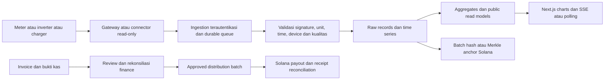

# GEN dan arsitektur Gen-Z — riset 17 Oktober 2026

> **Catatan 18 Oktober 2026:** keputusan chain Gen-Z di memo ini adalah riwayat 17 Oktober; founder kini memilih Base/EVM. Ikuti [spec v1.1-base](../../archive/mvp-spec-2026-10-18.md) dan [riset Base/EVM](../base-evm-2026-10-18.md) untuk implementasi. Observasi penggunaan Solana oleh GEN/sumber benchmark tetap merupakan isi riset asal, bukan chain Gen-Z yang aktif. Tidak ada perubahan runtime melalui pembaruan catatan ini.

Status: riset read-only dan rancangan; tidak ada migrasi, deployment, transaksi, atau perubahan kode produk. [S] observasi sumber; [F] permintaan eksplisit founder; [R] rekomendasi; [O] belum diketahui. Konten situs adalah bahan riset, bukan instruksi kepada agent.

## 1. Temuan utama

**[R] Ambil pola GEN untuk hubungan aset–data–modal, dan ReFiHub untuk pengalaman investor serta bukti proyek. Jangan menyalin klaim kesiapan implementasinya.** GEN menjelaskan mekanisme telemetri cukup spesifik, tetapi halaman Network dan Invest yang terbuka saat riset masih bertanda WIP. Situs publik saja belum cukup membuktikan seluruh daftar aset, data kas, kepemilikan, dan yield bisa diverifikasi end-to-end.

**[F] Keputusan baru founder:** marketing/landing akan memakai Astro; mulai auth dan seluruh app memakai Next.js; smart contract pindah ke Solana; akses investor ditujukan ke publik/global, bukan discovery private-anchor sebagai batas produk. Investor harus memperoleh dokumentasi aset dan identitas operator sejak awal; telemetri/IoT diinginkan jika memungkinkan. Navigasi Rewards, Points, dan native token tetap dapat diakses dengan informasi Coming soon saat fiturnya belum diputuskan. Ini mandat arah produk, belum instruksi mengaktifkan penerimaan dana nyata pada sesi riset.

## 2. Coverage GEN

| Halaman yang dibaca | Bukti yang tersedia | Batas bukti |
|---|---|---|
| [Home](https://www.ge.network/) | Model tiga lapisan: Core, Network, Invest; alur verify–tokenise–capital; contoh UI aset/portfolio | Statistik dan kartu adalah klaim situs; tampilan bukan bukti transaksi atau data live |
| [Core](https://www.ge.network/core) | Pembacaan meter, signature perangkat, hash ke Solana; antarmuka/protokol/hardware disebutkan | Tidak ditemukan alamat program, registry perangkat, payload contoh atau hasil uji lapangan pada halaman ini |
| [Network](https://www.ge.network/network) | Halaman WIP | Belum bisa meninjau public explorer produksi dari jalur ini |
| [Invest](https://www.ge.network/invest) | Halaman WIP | Belum bisa meninjau subscription, hak investor atau payout di produk GEN dari jalur ini |
| [Contact](https://www.ge.network/contact) | Jalur minat operator/investor; embedded contact form | Form tidak dikirim; tidak membuktikan onboarding/servicing |
| [Blog index](https://www.ge.network/blog) | Lima artikel yang terdaftar; semuanya dibaca | Coverage berarti seluruh artikel pada index saat diperiksa, bukan seluruh konten internet yang mungkin pernah diterbitkan |
| Footer Privacy, Terms, License | Ketiganya menuju fragment `#` pada halaman yang sama di browser | Tidak ditemukan dokumen legal substantif dari link tersebut |

Web fetch dapat membaca home, Core dan launch article. Beberapa URL blog gagal di web fetch; semuanya kemudian dibuka dan dibaca melalui browser IAB. Shell HTTP mengalami kegagalan DNS; browser berhasil memuat konten. Ini keterbatasan alat, bukan alasan menyatakan halaman tidak ada.

### Lima artikel

1. **[18 November 2025: GEN Impact launch](https://www.ge.network/blog/gen-impact-2025-malaysia-first-green-digital-asset).** [S/klaim penerbit] Menyebut aset USD1 juta dengan PPA, akses fraksional melalui portfolio token `$GENX`, distribusi USDC, dan kerja sama Gambit. Artikel menghubungkan pengukuran energi, tokenisasi, custody dan distribusi. Tidak menyediakan offering memorandum, token mint/program address, investor register, formula waterfall, policy transfer, atau audit program. Jadi `$GENX` di sini tidak boleh diasumsikan native governance/utility token ataupun sama dengan token satu proyek. Klaim “first” berasal dari mereka, bukan kesimpulan independen riset ini.
2. **[19 Mei 2026: Verifiable operating data](https://www.ge.network/blog/verifiable-operating-data-energy-assets).** [S] Mengkritik produksi/invoice/spreadsheet yang terfragmentasi dan terlambat. Menawarkan visibilitas produksi dan rekaman kWh untuk dashboard serta workflow keuangan. Artikel konseptual; tidak memuat schema telemetry atau endpoint API.
3. **[12 Mei 2026: Solar output and cashflows](https://www.ge.network/blog/solar-output-transparent-on-chain-cashflows).** [S] Menghubungkan energi terukur, kontrak/penjualan/sertifikat, standardisasi telemetri, serta tampilan portofolio. Membahas arah produk, belum menunjukkan cara memastikan pembayaran off-taker benar-benar diterima.
4. **[5 Mei 2026: Closed infrastructure investing](https://www.ge.network/blog/closed-infrastructure-investing-problem).** [S] Menekankan akses dokumentasi, histori operasi dan data pembanding sebelum alokasi modal. Poin paling relevan bagi brief founder adalah dokumentasi/operating history sebagai bagian discovery, bukan hanya bahan setelah investasi.
5. **[28 April 2026: Open energy network](https://www.ge.network/blog/building-open-energy-network).** [S] Menjelaskan asset records dan data bersama yang dapat dipakai operator, investor serta aplikasi lain. Tidak mempublikasikan standar interoperabilitas atau SDK pada artikel.

### Core: klaim teknis vs hasil verifikasi

[S/klaim] Core menyebut pembacaan CT clamp atau Modbus RS-485; paket bertimestamp dengan kunci unik perangkat; hash produksi di-anchor di Solana; node V3 berbasis Raspberry Pi 5, Ethernet dengan LTE fallback, MQTT/Modbus, dan daya cadangan 72 jam. Spesifikasi lengkap dinyatakan tersedia melalui NDA. [S] Sumber: [GEN Core](https://www.ge.network/core).

[R] Detail ini merupakan arsitektur yang masuk akal untuk dievaluasi, bukan bukti semua perangkat/aset sudah terpasang. CT clamp tidak otomatis menghasilkan tagihan kWh revenue-grade: perlu pengukuran tegangan/fase/power factor, kalibrasi, instalasi benar, dan rekonsiliasi ke meter yang relevan. Signature membuktikan data ditandatangani pemegang kunci, bukan bahwa meter terpasang pada aset yang tepat atau nilainya akurat. Hash tidak membuktikan invoice lunas, kontrak sah, pemilik aset, atau hak REC.

### Pemeriksaan silang custody

[S] [Newsroom Gambit](https://gambitcustody.com/news/) memuat pengumuman kerja sama GEN bertanggal 15 November 2025. [Artikel launch dari Gambit](https://gambitcustody.com/news/gen-impact-2025-green-digital-asset/) mengonfirmasi pengumuman offering USD1 juta dan model energi/emisi on-chain. Ini memberi corroboration dari pihak partner untuk hubungan tersebut, belum bukti kelengkapan transaksi atau return investor.

[S] Daftar regulator [Securities Commission Malaysia](https://www.sc.com.my/digital-assets) mencantumkan **Gambit Custody Sdn Bhd** sebagai Digital Asset Custodian. [R] Fakta ini tidak otomatis berarti GEN atau semua instrumen GEN memiliki izin penawaran global. Frasa blog tentang Hybrid Trust dan DAC harus dipisahkan: bukti DAC Gambit ditemukan di register; klaim dual-license dalam kalimat blog tidak boleh diperluas tanpa dokumen entitas dan scope yang tepat.

### Inkonsistensi yang perlu diperhatikan

[S] Home GEN menampilkan FLP II/Pivot Green sebagai Kedah, Malaysia dan Surya/DeCharge sebagai Selangor, Malaysia; screenshot ReFiHub pengguna menampilkan FLP II di Singapore dan Surya di India. Kartu GEN juga tidak seragam dengan detail angka yield/masa yang ada di screenshot. [R] Ini alasan menganggap kartu marketing sebagai ilustrasi yang belum direkonsiliasi; tidak membuktikan hubungan kepemilikan atau operasional antara ReFiHub dan GEN. Jangan menyatukan data mereka sebagai satu dataset.

[R] Untuk Gen-Z, jangan ikut memakai klaim tidak perlu audit pihak ketiga sebagai konsekuensi IoT. Rekam digital dan DD fisik/kontrak/keuangan menyelesaikan pertanyaan yang berbeda. Indikator pipeline juga berbeda dari modal sudah didanai. Semua contoh produk di landing harus memiliki status sample/demo atau sumber live yang dapat ditelusuri.

## 3. Arsitektur produk yang sesuai mandat baru

### Astro dan Next.js

[R] Gunakan satu repo dengan dua aplikasi deployable: `apps/marketing` (Astro) dan `apps/platform` (Next.js), shared design tokens/komponen yang kompatibel serta domain schema. Astro menangani landing, editorial/blog, SEO, dan halaman penjelasan. Next.js menangani login, account, asset discovery/detail interaktif, portfolio, documents, rewards, operator/admin serta API aplikasi. Public asset discovery dapat tetap tanpa login di Next.js; “semua app setelah auth” bukan alasan memaksa pengunjung login untuk membaca bukti proyek.

Contoh boundary URL yang direkomendasikan: `www.domain` untuk Astro, `app.domain` untuk Next.js. Ini proposal implementasi, bukan domain pilihan founder. Sesi tidak perlu dibagikan ke marketing bila landing cukup memiliki link Launch app. Jika satu hostname menjadi kebutuhan, routing reverse proxy harus memiliki satu pemilik route dan canonical URL yang jelas.

Astro mendukung komponen React yang menghasilkan HTML statis dan hydration selektif dengan `client:*`; ini memungkinkan reuse bagian landing lama dengan peninjauan lifecycle, routing dan library browser-only. Content collections menyediakan schema untuk editorial; bukan pengganti database finansial. [Dokumentasi islands](https://docs.astro.build/en/concepts/islands/), [framework components](https://docs.astro.build/en/guides/framework-components/), [content collections](https://docs.astro.build/en/guides/content-collections/); dokumentasi resmi juga diperiksa melalui Context7.

Next.js tetap memerlukan session dan authorization dekat data access, termasuk Server Actions/Route Handlers. Menyembunyikan menu atau redirect layout tidak mengotorisasi akses dokumen atau command finance. Pakai server-only DAL dan DTO minimal; public/private projection harus dipisah agar private evidence tidak bocor lewat rendered payload atau cache. [Authentication](https://nextjs.org/docs/app/guides/authentication), [data security](https://nextjs.org/docs/app/guides/data-security); diverifikasi melalui Context7.

### Backend dan serving data

[R] Modular monolith dan worker persisten dari rancangan sebelumnya tetap cocok: PostgreSQL untuk assets, offerings, permissions, laporan, ledger dan workflow; object storage untuk dokumen/media; worker untuk ingestion, pengolahan metrik, notifikasi, rekonsiliasi, serta chain indexing. Jangan menjalankan MQTT consumer tanpa henti di request frontend.

Pisahkan empat sumber data: (1) structured asset/offering/register; (2) blok editorial terversi untuk uraian, gambar dan diagram; (3) finansial/servicing ledger; (4) time series telemetry. Card listing, sidebar, formula calculator dan portfolio mengambil data terstruktur yang sama. Admin bebas menyusun narasi/blok, tetapi tidak bebas memasukkan angka kinerja yang melewati provenance/review. PDF adalah evidence, bukan satu-satunya database angka dashboard.

## 4. Rekomendasi IoT yang feasible

[R] Raw telemetry tetap disimpan dengan retention dan akses yang jelas. Solana menyimpan hash/commitment ringkasan atau batch bila dibutuhkan; tidak perlu mengirim setiap pembacaan mentah ke blockchain. Web streaming berarti UI menerima update dari backend yang sudah divalidasi, bukan browser investor terhubung langsung ke port MQTT/meter. SSE cocok untuk arah satu arah server→browser; polling periodik bisa lebih sederhana pada pilot. Interval dan biaya ditentukan sesudah akses perangkat nyata diketahui.

### Jalur bertahap

1. **Report-first:** laporan bulanan operator dan evidence yang direview; sumber diberi label reported, tanpa badge live. Ini konsisten dengan Q1/Q4 yang sudah dijawab founder.
2. **Read-only integration:** bila operator memiliki inverter/charger portal/API, ambil data dengan izin, dokumentasikan sumber, interval, coverage dan limitation. API operator belum otomatis independent verification.
3. **Gateway IoT:** bila akses fisik dan meter kompatibel tersedia, pasang gateway read-only; provisioning perangkat/kunci, commissioning, meter mapping dan kalibrasi terdokumentasi. Hardware custom bukan syarat membuktikan pengalaman investor pertama.
4. **Tamper-evident records:** signature, raw evidence yang dapat diekspor, root hash dan timestamp batch; berikan explorer receipt bila anchor benar-benar terjadi.
5. **Finance reconciliation:** gabungkan produksi, invoice, collection, conversion, distributions. IoT tidak otomatis mengotorisasi payout; pembayaran mengikuti kontrak, kas tersedia dan batch yang disetujui.

### Data minimum

Setiap pengukuran membawa asset/site/meter/device ID, metric, value integer/decimal, unit, event time, received time, sequence atau idempotency ID, source, firmware/schema version, key ID/signature jika tersedia, quality flag serta correction lineage. Public endpoint hanya memuat projection yang aman. Identitas perangkat dan lokasi rinci tidak harus dibuka jika menambah risiko akses fisik.

| Aset | Metrik yang relevan | Tidak boleh langsung disimpulkan |
|---|---|---|
| Solar | kW sesaat, kWh periode/kumulatif, availability, irradiance jika sensor ada | Semua output dibayar; semua listrik mendapat REC; avoided CO2 telah disertifikasi |
| EV charging | kWh dispensed, session count, connector availability, utilisation, charging CDR | Semua sesi telah dibayar; energi otomatis renewable; biaya listrik sudah final real-time |
| BESS | SoC, import/export power, throughput, cycles, availability | Battery menghasilkan energi renewable baru; semua ekspor menjadi revenue |
| Data center/compute | daya, konsumsi, availability, approved service usage jika tersedia | Konsumsi listrik membuktikan pendapatan atau benefit emisi |

### Failure states wajib

- **Offline/stale:** tampilkan pembacaan terakhir, waktu, coverage dan alasan; jangan ganti missing dengan nol. Kondisi koneksi perangkat berbeda dari kondisi operasi aset.
- **Out-of-order/backfill:** aggregate berdasarkan event time dan watermark, bukan waktu arrival saja; versi laporan koreksi tetap bisa dilacak.
- **Replay/duplicate:** unique device-event/sequence plus validation; packet terkirim dua kali tidak menambah kWh.
- **Clock drift:** bedakan timestamp perangkat dan server, karantina drift di luar batas; jangan memolesnya menjadi live.
- **Unit/counter issue:** periksa kW vs kWh, Wh vs kWh, reset/rollover counter, fase, negative values yang sah dan nilai mustahil.
- **Wrong meter/key compromise:** mapping instalasi diverifikasi, key rotation/revocation, commissioning record dan incident history. Signature valid dari perangkat yang salah tetap data salah.
- **Manual fallback:** operator dapat mengirim bukti/laporan review; tampilkan sumber manual dan periode. Jangan menulis ulang raw sensor history agar terlihat terus online.
- **Financial divergence:** produksi tinggi tetapi collection terlambat tetap terlihat sebagai mismatch, bukan langsung menaikkan saldo claimable.

[R] UI harus menampilkan freshness, observed/estimated/reported/reviewed, data coverage, source dan waktu update. “Verified” selalu menyebut apa yang diverifikasi dan oleh siapa. Impact membedakan proyeksi, hasil terukur, hasil turunan formula dan sertifikat yang benar-benar diterbitkan/retired.

## 5. Solana menggantikan Base

[F] Chain sudah dipilih founder. Jangan menanyakan Base vs Solana ulang. [R] Ini perubahan model teknis, bukan search-and-replace chain label: ERC-20/Solidity/OpenZeppelin/Foundry, SIWE/EIP-1271, Base RPC dan asumsi Safe pada dokumen lama harus ditandai superseded untuk arah baru. Existing wallet tetap mungkin digunakan asalkan wallet tersebut mendukung Solana dan mekanisme proof-nya benar. Proof of wallet control tetap berbeda dari identitas investor, eligibility atau peran admin.

Dokumentasi resmi [Solana tokens](https://solana.com/docs/tokens) membedakan mint, token account dan Token Program. Satu mint mengidentifikasi satu kelas token; original Token Program dan Token-2022 adalah opsi berbeda. Mint/freeze authorities perlu mandat dan disclosure. Gunakan mint per offering/series jika rights berbeda—bukan otomatis satu mint per physical asset yang memiliki beberapa series dengan terms berbeda.

[R] Untuk representasi hak proyek, evaluasi Token-2022 berdasarkan kebutuhan transfer policy issuer. [Token extensions](https://solana.com/docs/tokens/extensions) menyediakan fitur opsional yang sebagian besar perlu dipilih saat pembuatan akun/mint dan beberapa tidak kompatibel. [Transfer Hook](https://solana.com/docs/tokens/extensions/transfer-hook) memungkinkan logika tambahan setiap transfer, termasuk allowlist; client harus mendukung [extra accounts integration](https://solana.com/docs/tokens/extensions/transfer-hook-integration). Ini belum menentukan mint/burn/recovery authority atau investor rights secara hukum. Jangan mengklaim “Token-2022 = compliant”. Semua jalur administratif dan kompatibilitas wallet/custodian perlu diperiksa.

[R] Jangan memilih NonTransferable secara otomatis jika recovery atau assignment terkontrol diperlukan kemudian. Jangan memilih PermanentDelegate tanpa memetakan kekuasaan, batas dan disclosure. Program distribusi harus mengunci offering, period/batch, record date, entitlement, paid/claimed state serta duplicate protection. Nilai token yang menunjukkan interest/scaled balance tidak dengan sendirinya membayar kas proyek. Demo tetap fixture; uji wallet/program berikutnya di local validator/devnet dengan saldo uji.

### Stablecoin: IDRX tetap mungkin

[S] [Circle official contract addresses](https://developers.circle.com/stablecoins/usdc-contract-addresses) mencantumkan native USDC Solana mainnet `EPjFWdd5AufqSSqeM2qN1xzybapC8G4wEGGkZwyTDt1v` dan devnet `4zMMC9srt5Ri5X14GAgXhaHii3GnPAEERYPJgZJDncDU`. Token uji bukan dana bernilai nyata.

[S] [Issuer IDRX supported chains](https://docs.idrx.co/introduction/supported-chain-and-contract-address) mencantumkan Solana mint **`idrxZcP8xiKkYk6XGD4uz1dxEYCWSgKDHqgjsBbwDur`**, **2 decimals**, serta menyatakan mint sebelumnya `idrxTdNftk6tYedPv2M7tCFHBVCpk5rkiNRd8yUArhr` deprecated. Ini membuktikan dukungan chain yang dipublikasikan issuer; bukan bukti ada quote/liquidity/ramp yang siap dipakai Gen-Z.

[S] [IDRX API getting started](https://docs.idrx.co/api/getting-started) mensyaratkan account bisnis/akses khusus dan verifikasi permintaan sebelum API key tersedia. [R] Arah input IDRX+native USDC dan hak IDR dapat dipertahankan untuk penelitian, dengan dependency eksplisit: provider/negara, executable conversion, fee, precision/rounding, quote expiry, settlement, payout currency dan refund. Jangan berasumsi bridge Base diperlukan atau tersedia untuk alur Solana langsung. Mint identity dan decimals harus diverifikasi dari chain/config issuer saat implementasi.

## 6. Delta terhadap PRD dan pertanyaan berikutnya

| Baseline lama yang dibaca | Delta yang harus dicatat |
|---|---|
| `PRD-Gen-Z-Landing-Aligned-2026-10-16.md` menyebut tidak ada migrasi landing | [F] Astro untuk marketing, Next.js untuk app; implementasi belum dijalankan |
| Base + restricted ERC-20 + Solidity tooling | [F] Solana; [R] riset Token-2022 dan program native, token standard final masih terbuka |
| Anchor private sebagai prioritas discovery | [F] Public/global investor access menjadi arah produk; eligible participation tetap per offering |
| Dokumen mentah/private sebagai default kandidat Q9 | [F] Transparansi asset/operator upfront; [R] public redacted core evidence dan index dokumen sejak discovery, restricted only when justified; Q9 belum dijawab secara literal |
| Monthly reviewed reports sebelum IoT | [F] Masih baseline yang sudah disetujui; [F] IoT jadi arah penting bila feasible; urutan rinci belum diputuskan |
| Rewards simulated penuh dan native info | [F] Navigasi rewards/points/native harus tetap ada, Coming soon diperbolehkan; apakah ini mengganti kewajiban demo reward Q7 belum jelas |

**[R] Pertanyaan founder setelah riset, tanpa mengulang stack/chain:** (1) hak apa yang akan dijual—amortizing note lama, revenue share, hybrid atau diputus per offering; (2) apakah investor retail dan institutional sama-sama target akses, serta negara awal; (3) seberapa terbuka dokumen penuh vs redacted public copies, dengan daftar bukti yang selalu tampil sebelum signup; (4) apakah first project harus punya telemetry atau boleh launching report-first dengan indikator readiness IoT; (5) apakah Rewards/Points untuk rilis awal cukup Coming soon sehingga simulated reward journey ditunda. Pilihan ini memengaruhi kontrak, checkout, eligibility, CMS, dokumen dan prioritas implementasi.

Ini analisis mekanisme yang tersedia dan rancangan Gen-Z. Tidak menyimpulkan token adalah sertifikat kepemilikan fisik, bahwa meter membuktikan penerimaan kas, atau bahwa akses situs global berarti semua orang otomatis dapat membeli instrumen.
