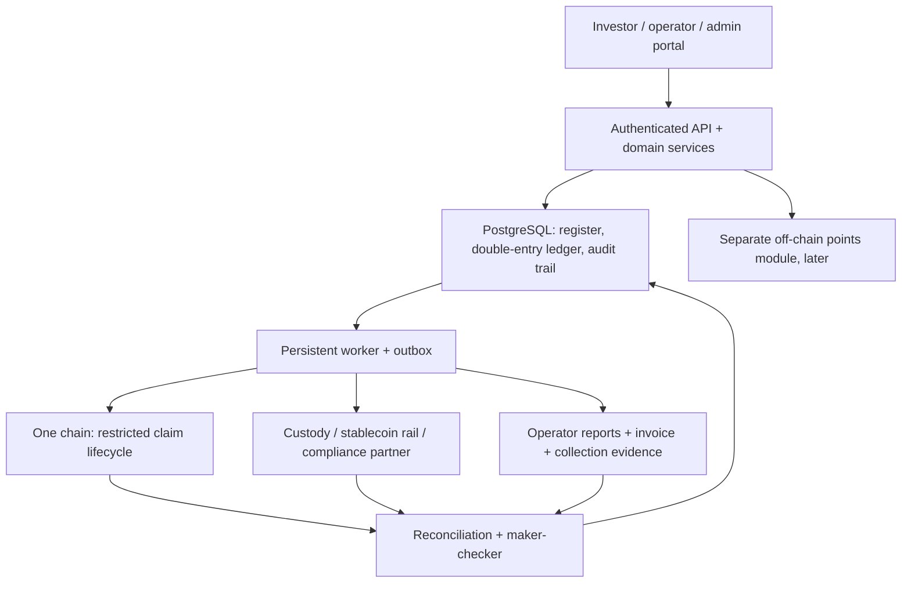

# Gen-Z — riset chain, stack, model bisnis dan akselerasi

> **Status arsip, diperjelas 18 Oktober 2026:** isi berikut menyimpan riset/jawaban pada tanggal asal. Acuan implementasi aktif ialah [spec v1.1-base](../archive/mvp-spec-2026-10-18.md), [PRD v2.1](../archive/prd-2026-10-18.md) dan [riset Base/EVM 18 Oktober](base-evm-2026-10-18.md). Founder memilih Base kembali pada 18 Oktober; pilihan itu tidak memulihkan mock wallet D0, katalog privat tanpa login, note wajib atau simulated rewards. Scope aktif: proof wallet sejak demo pertama, model per offering/solar hybrid, tujuh tab, funded claim dan rewards informational. Angka/vendor/standar/terms historis di bawah bukan keputusan produksi baru.

**Koreksi founder sesudah snapshot ini:** Base/stack tetap; investasi mempunyai dua input stablecoin lokal + USD (Indonesia IDRX + native USDC kandidat [R]), bukan IDRX-only. Hak IDR tetap untuk kas IDR; quoted conversion/launch scope sedang di-stress-test. Detail terbaru [market/fitur/wallet memo](market-features-2026-10-12.md); tabel lama mempertahankan riwayat trade-off.

**Tanggal akses:** 12 Oktober 2026, WIB. **Status:** bahan keputusan founder, bukan keputusan implementasi atau izin menerima dana. Pendamping [PRD](../archive/prd-2026-10-18.md) dan [stress-test founder](../archive/founder-interview-2026-10-17.md).

**[F] Dasar yang sudah dipilih:** energy infrastructure operasional milik mitra, kontrak monetisasi dan histori collection; anchor pilot; project note/private credit beramortisasi sebagai kandidat utama; subscription stablecoin; closed-end; native Gen-Z ditunda; poin usage-first, partner-funded; reward subscription AI opsi ekspansi.

**Pembaruan setelah jawaban GUI:** **[F] Base + Next.js/TypeScript/PostgreSQL/worker dipilih sebagai arah pilot**, dengan contract direction Solidity/OpenZeppelin/Foundry. **[F] Hak IDR + IDRX Base dipilih bila kas kontraktual proyek IDR**; actual collection currency dan production gates tetap terbuka. **[F] Founder memandatkan model bisnis paling fit; [R] PM memilih origination + servicing untuk mitra penerbit sebagai model kerja**, dengan fee transparan dan minimum servicing yang menutup pekerjaan nyata. Pricing/vendor/tim tetap belum final. Riset perbandingan mempertahankan konteks trade-off; Solana/Arbitrum bukan chain kedua yang otomatis dibangun. Akselerasi dimulai dari demo dan bukti partner, lalu aplikasi program yang sesuai [R].

## 1. Apa yang dimaksud “uang berputar”?

Jangan menyamakan empat metrik berikut:

| Metrik | Pertanyaan yang dijawab | Batas interpretasi |
|---|---|---|
| Distributed RWA value | Berapa nilai aset tokenized yang dicatat dalam kategori transferable menurut penyedia data? | Stock aset, bukan uang investor yang tersedia untuk Gen-Z |
| Represented RWA value | Berapa nilai aset yang blockchain-nya berfungsi terutama sebagai pencatatan? | Tidak otomatis bisa ditransfer keluar platform |
| RWA 30D transfer volume | Berapa nilai perpindahan token selama 30 hari menurut dashboard? | Bukan volume jual-beli, subscription baru, net inflow atau jaminan exit |
| Stablecoin market cap | Berapa nilai supply stablecoin yang dicatat di chain itu? | Tidak semuanya tersedia untuk investasi; cakupan vendor bisa berbeda |

RWA.xyz membedakan distributed dan represented berdasarkan kemampuan pindah ke wallet luar dan transfer antar-wallet; allowlist tetap mungkin pada distributed. Closed-end tidak otomatis berarti represented. Transfer yang dikunci seluruhnya juga tidak otomatis distributed hanya karena token ada on-chain. [Metodologi RWA.xyz](https://app.rwa.xyz/blog/a-new-framework-for-tokenized-assets-distributed-and-represented)

## 2. Snapshot pasar per chain

**[V] Angka yang ditampilkan dashboard canonical RWA.xyz saat akses**, bukan audit independen kualitas underlying asset. B = miliar USD; M = juta USD. Tanggal mengikuti panel masing-masing jaringan, sehingga tabel bukan snapshot serentak. RWA dan stablecoin ditampilkan terpisah; jangan dijumlahkan sembarang atau memakai market cap coin chain sebagai ukuran RWA.

| Chain / sumber | Distributed RWA | Represented RWA | Transfer RWA 30D | Stablecoin market cap | Panel as of |
|---|---:|---:|---:|---:|---|
| [Ethereum](https://app.rwa.xyz/networks/ethereum) | $16,98B | $63,90M | $5,51B | $147,79B | 12 Okt 2026 |
| [BNB Chain](https://app.rwa.xyz/networks/bnb-chain) | $5,84B | $0 | $10,56B | $12,81B | 11 Okt 2026 |
| [Solana](https://app.rwa.xyz/networks/solana) | $4,39B | $125,86M | $8,57B | $14,99B | 12 Okt 2026 |
| [Stellar](https://app.rwa.xyz/networks/stellar) | $3,54B | $78,19M | $580,99M | $433,69M | 12 Okt 2026 |
| [Avalanche — All Chains](https://app.rwa.xyz/networks/avalanche) | $1,73B | $11,40B | $90,13M | $890,42M | 11 Okt 2026 |
| [Arbitrum](https://app.rwa.xyz/networks/arbitrum) | $949,12M | $25,85M | $1,41B | $4,38B | 11 Okt 2026 |
| [Polygon](https://app.rwa.xyz/networks/polygon) | $508,41M | $717,52M | $48,95M | $2,89B | 11 Okt 2026 |
| [Base](https://app.rwa.xyz/networks/base) | $358,54M | $24,12M | $1,13B | $4,73B | 11 Okt 2026 |

Avalanche di halaman tersebut mengagregasi **All Chains**; jangan mengklaim seluruh nilai berada di C-Chain. Stablecoin market cap bukan ukuran kedalaman liquidity IDRX ataupun supply native USDC saja. Tidak ada bukti bahwa pemilik RWA existing pada chain ini berminat pada project note energi Indonesia.

**Cross-check metodologi:** tabel live [DefiLlama](https://defillama.com/stablecoins/chains) saat akses menunjukkan Ethereum $145,36B, Solana $16,112B, Base $5,286B, Arbitrum $3,77B, Polygon $2,921B. Nilainya berbeda dari RWA.xyz. Coverage juga menampilkan instrumen seperti BUIDL/USDY pada beberapa jaringan; jangan mengambil rata-rata atau menyebut seluruh angka sebagai kas payment stablecoin. Gunakan satu sumber konsisten untuk tabel utama.

## 3. Stablecoin, security dan shortlist

**[V] IDRX resmi:** dokumentasi mencantumkan Base, Solana, Polygon, BNB, Celo, Lisk, Etherlink, Kaia, World Chain dan Gnosis. Ethereum, Arbitrum, Stellar dan Avalanche belum tercantum dalam daftar yang dibaca. Base/Solana memakai 2 decimals, Polygon 0; mint Solana lama ditandai deprecated. Alamat dan precision wajib dikonfirmasi lagi sebelum live. Dukungan chain bukan bukti kapasitas redemption/custody ataupun izin fund flow Gen-Z. [IDRX](https://docs.idrx.co/introduction/supported-chain-and-contract-address)

**[V] Native USDC:** daftar Circle mencakup Ethereum, Base, Arbitrum, Polygon PoS, Solana, Stellar dan Avalanche C-Chain. BNB belum listed; bridged USDC tidak otomatis sama dengan native issuance Circle. [Circle contracts](https://developers.circle.com/stablecoins/usdc-contract-addresses)

| Kandidat | Fit Gen-Z | Kekurangan / alasan bukan otomatis pemenang |
|---|---|---|
| **Base — utama [R]** | IDRX dan native USDC; EVM; satu chain untuk kandidat rail rupiah/global; rollup Ethereum; thesis ekosistem mendukung productive assets/private credit | Nilai RWA lebih kecil; sequencer/upgrade trust; custody dan liquidity IDRX belum dibuktikan |
| **Solana — alternatif [R]** | Nilai distributed RWA dan stablecoin lebih besar; IDRX terbaru + native USDC; opsi perluasan consumer/partner | Rust/Anchor dan account model berbeda; restricted token/transfer-hook harus diterima wallet/custodian; kompetensi tim belum diketahui |
| **Polygon PoS — alternatif [R]** | EVM + IDRX + native USDC; existing tokenization ecosystem | PoS sidechain, bukan rollup Ethereum; IDRX 0 decimals menuntut penanganan pecahan distribusi |
| Ethereum | Basis RWA terbesar dalam sampel; dapat cocok jika anchor/custodian mensyaratkan L1 | IDRX belum listed; gas/UX harus diukur. Pilot transaksi sedikit tetap mungkin layak |
| Arbitrum | EVM rollup + native USDC; program subsidi keamanan relevan | IDRX belum listed; jangan menambah bridge hanya untuk memaksakannya |
| Stellar | RWA cukup besar + native USDC; funding development menarik | IDRX belum listed; stack berbeda; issuer/custody dan desain claim belum dievaluasi |
| Avalanche | Institutional RWA presence + native USDC | Market aggregate bukan C-Chain-only; IDRX belum listed; custom L1 menambah beban tim kecil |
| BNB | RWA besar + IDRX + EVM | Native USDC belum listed Circle; issuer/bridging exposure perlu evaluasi tersendiri |

Base dipilih sebagai **rekomendasi fit**, bukan klaim chain paling aman, paling besar atau paling murah. Reward off-chain membuat kebutuhan throughput AI/EV belum menjadi penentu chain investasi.

**Security:** penilaian [L2BEAT Base](https://l2beat.com/layer2s/projects/base) saat akses adalah Stage 1, dengan risiko upgrade tanpa exit window. [Arbitrum](https://l2beat.com/layer2s/projects/arbitrum) Stage 1, regular upgrade exit window 10 hari tetapi emergency tanpa window. Stage bukan sertifikasi keamanan. [Polygon architecture](https://docs.polygon.technology/pos/architecture/overview) memakai validator PoS, Bor dan checkpoint Ethereum; checkpointing bukan model validasi rollup. Risiko smart contract, issuer dan aset tetap terpisah dari keamanan chain.

**Hard gates belum lulus:** acceptance anchor/custodian atas chain dan restricted instrument; direct mint/redeem dan SLA stablecoin; legal wrapper/fund flow; transfer/freeze/recovery yang enforceable; tim/auditor; actual transaction cost, outage dan reconciliation drill. Pemilihan sekarang adalah arah pilot yang dapat ditinjau ulang bila hard gate gagal. Satu settlement token per pool; dukungan dua token di chain tidak berarti pool harus menerima keduanya.

## 4. Stack conditional untuk tim kecil

**[R] Bila EVM dipilih:** Solidity + OpenZeppelin Contracts + Foundry; aplikasi Next.js/TypeScript; PostgreSQL; satu worker persisten dan transactional outbox/durable jobs. Satu repo, modular monolith. Jika tim inti lebih kuat di Solana, Rust + Anchor + Token-2022 patut diuji. Versi dependency, hosting, vendor wallet dan custody belum dipilih.

Dokumentasi OpenZeppelin, Anchor dan Next.js telah diperiksa lewat Context7; sumber pendamping adalah dokumentasi resmi. OpenZeppelin v5 menyediakan customization ERC20 melalui `_update`, role/access control dan pause; custom financial logic tetap perlu audit. Foundry mendukung fuzz/invariant testing. Solana transfer hook bisa menegakkan eligibility tetapi integrator harus mendukung extra accounts-nya. [OZ ERC20](https://docs.openzeppelin.com/contracts/5.x/api/token/ERC20), [access control](https://docs.openzeppelin.com/contracts/5.x/access-control), [Foundry](https://getfoundry.sh/forge/index.html), [Solana transfer hook](https://solana.com/docs/tokens/extensions/transfer-hook), [integration](https://solana.com/id/docs/tokens/extensions/transfer-hook-integration)



Next.js API/webhook handlers harus memeriksa auth/role server-side. Pekerjaan payout/ingestion tidak boleh hanya bergantung pada durasi HTTP request. Data KYC, kontrak, invoice dan bank statement privat; on-chain hanya identifiers non-PII, hak yang disetujui dan hashes/events yang diperlukan. [Route Handlers](https://github.com/vercel/next.js/blob/canary/docs/01-app/03-api-reference/03-file-conventions/route.mdx), [authentication](https://github.com/vercel/next.js/blob/canary/docs/01-app/02-guides/authentication.mdx)

**Scope kontrak:** restricted project-note register; subscription lifecycle sesuai legal rail; distribution dari funded cash yang direkonsiliasi. Income, principal repayment, fees dan recovery terpisah. Amortisasi mengurangi outstanding principal pada servicing ledger; pembayaran income tidak otomatis membakar claim token. Token units tidak selalu sama dengan outstanding principal. Untuk sedikit anchor, batch payout melalui custody dapat lebih sederhana daripada membangun Merkle claim.

Jangan memaksakan ERC4626 redeem-on-demand pada pembangkit illiquid. Tidak ada bridge, AMM, instant exit, native sale atau reinvestment ke DeFi di MVP. Meter membuktikan produksi; invoice/collection records membuktikan kas. Oracle kWh tidak otomatis mengotorisasi yield.

Wallet existing anchor bisa mengurangi scope embedded-wallet recovery. Privy merupakan kandidat teknis, bukan pilihan custody legal; auth mendukung EVM/Solana, tetapi shortcut `connectOrCreate` yang ditinjau EVM-only. Kontrol delegated signer harus cocok dengan klaim custody. [Privy authentication](https://docs.privy.io/authentication), [connect/create](https://docs.privy.io/wallets/connectors/usage/connect-or-create), [delegated signer](https://docs.privy.io/wallets/using-wallets/signers/delegate-wallet)

**Demo 10–12 minggu [A]:** test funds, satu proyek, KYC/mock operator jelas dilabeli. Bukan jadwal memperoleh izin atau menyelesaikan audit. **Live gate [R]:** independent audit/review, role/recovery exercise, cash reconciliation, meaningful financial invariants, legal/custody sign-off. Quote biaya/timing belum ada. Pilihan fixed pilot contract vs proxy dibahas setelah lifecycle dan recovery disepakati.

## 5. Model bisnis: apa yang layak ditiru?

Benchmark membantu menemukan **pola**, bukan membuktikan economics Gen-Z sudah profitable. AUM, origination volume dan platform revenue berbeda dari profit. Mature treasury funds, institutional lending dan satu proyek solar juga berbeda biaya serta risikonya.

| Benchmark primer | Pola terverifikasi | Pelajaran untuk Gen-Z |
|---|---|---|
| [Maple fees](https://docs.maple.finance/technical-resources/protocol-overview/fees) | Fixed-term loan origination dibayar borrower saat funding/refinance; service fee pada pembayaran; management fee bagian gross interest; platform dan delegate mempunyai fee tersendiri | Pisahkan pekerjaan origination dan servicing; ungkap payer, basis, timing dan dampak net funds. Jangan menyalin seluruh lapisan fee |
| [Ondo OUSG](https://ondo.finance/ousg) | Management fee capped 0,15%, waived sampai 1 Jan 2027; fund expenses terpisah capped 0,15% | Fee rendah liquid treasury fund bukan pricing template DD proyek energi; waiver bukan recurring business model Gen-Z |
| [Centrifuge manager guide](https://docs.centrifuge.io/user/manager/) | Manager menyusun offering; platform mendukung issuance, investor access, pricing, distributions, reporting | Pisahkan issuer/manager dari software. SaaS/tokenization servicing mungkin cocok jika operator membawa investor; harga komersial belum diverifikasi |
| [ReFi FLP II FAQ](https://www.refihub.io/blog/investor-faq-flp-ii-solar-installation) | Proyek spesifik membagi revenue dengan servicing fee; bukan satu fee universal semua aset | Energy underwriting dan kontrak pembagian kas penting; angka suatu listing tidak boleh dijadikan default Gen-Z |

Perbandingan Habitat, GEN dan rights/yield lainnya berada di [memo product fit](rwa-product-fit-2026-10-12.md); klaim pemasaran tidak dianggap bukti profitability.

| Opsi komersial | Customer/payer utama | Kekuatan | Beban / trade-off |
|---|---|---|---|
| **A. Managed marketplace: origination + servicing [R]** | Mitra penerbit/operator; investor memakai akses/proses yang eligible | Selaras peran middleman dan pembiayaan per proyek; recurring servicing + closing revenue | DD, fundraising, compliance, collections dan default handling mahal; conflict fee sponsor harus dikelola |
| **B. Operator SaaS / bring-your-own-anchor** | Operator/issuer yang sudah punya jaringan investor | Lebih sedikit acquisition investor; setup + recurring software/reporting dapat diuji | Value proposition lebih sempit, willingness-to-pay belum terbukti; label SaaS tidak membebaskan aktivitas regulated |
| **C. Mulai A, produk B menjadi ekspansi** | Payer A dahulu, B ketika workflow repeatable | Tidak membangun dua produk sekaligus; opsi scale tanpa memperbesar acquisition secara proporsional | B belum dijadikan proyeksi revenue sebelum demand terbukti; sales cycle tetap perlu diuji |

**Rekomendasi frontier:** A sebagai bisnis inti pilot, dengan kemungkinan B kelak. Gen-Z tidak otomatis menjadi lender dari balance sheet, pemilik aset atau asset manager seluruh portfolio. Klaim investor tetap terhadap mitra penerbit. Harga, minimum deal size, fee payer dan peran regulated partner perlu validasi; tidak ada tarif final dari riset ini.

**Hipotesis struktur fee [R]:** origination/arrangement dibayar saat successful closing; servicing minimum transparan ditambah basis scalable yang disepakati. Operator/penerbit kandidat payer utama. Due-diligence cost deposit sebelum closing boleh dieksplorasi untuk menutup biaya vendor, dengan refundable/non-refundable terms dan conflict control jelas. Investor harus melihat net deployable capital, gross cash obligations dan net expected distributions. Tidak ada hidden spread; performance fee, native sale dan reward affiliate bukan dasar revenue MVP.

### Unit economics yang harus diuji

Pisahkan biaya platform sekali (legal product design, security, software), per deal (engineer/DD/legal/KYC/closing), dan selama tenor (reporting, custody, reconciliation, covenant/default monitoring). Grant bukan collected customer revenue. Pokok repayment bukan platform revenue atau investor profit. Fee dari proceeds mengurangi dana produktif dan tetap memengaruhi debt service capacity.

**Ilustrasi [A], bukan fee quote:** jika collected annual servicing cost Rp50 juta dan fee 1% atas average outstanding principal, break-even servicing membutuhkan Rp5 miliar average outstanding sebelum overhead/profit. Pool yang mulai Rp5 miliar lalu beramortisasi ke rata-rata Rp3 miliar hanya menghasilkan Rp30 juta pada basis itu. Fixed minimum membantu biaya, tetapi harus terjangkau oleh proyek dan dimasukkan downside cash model. Tidak boleh menaikkan yield marketing untuk menutupi biaya platform.

```text
Deal contribution selama tenor
= collected closing fees + collected recurring fees
  − DD/closing costs − servicing/vendor/support costs
  − attributable acquisition/incentive costs
  − actual remediation costs yang ditanggung platform

Minimum viable deal size
= hasil model biaya + cash capacity proyek + willingness-to-pay
  (bukan target TVL arbitrer)
```

Pricing interview perlu memisahkan operator sebagai customer, anchor sebagai pengguna/investor dan regulated partner sebagai dependency. Jalankan sedikitnya beberapa quotation nyata dan willingness-to-pay conversations sebelum mengunci nominal. Sales incentive tidak boleh mengalahkan investment committee atau mendorong recurring refinancing demi fee.

## 6. Akselerasi yang benar-benar relevan sekarang

Status berikut **[V] berdasarkan halaman resmi saat akses 12 Oktober**, dapat berubah. Nominal total program/prize pool tidak sama dengan dana yang Gen-Z akan menerima. Eligibility Indonesia, entity, sanctions/KYC, IP, exclusivity dan investment/token terms harus ditinjau sebelum aplikasi. Tidak ada aplikasi atau pesan eksternal dikirim dalam riset ini.

| Program / sumber | Status dan bantuan | Fit / langkah yang masuk akal |
|---|---|---|
| [Base Ecosystem Fund](https://www.base.org/ecosystem-fund), [apply](https://www.base.org/ecosystem-fund/apply) | Live application; pre-seed/seed investment, ecosystem support/credits; **bukan gratis grant** | Thesis dekat; butuh demo, tim dan bukti operator. Nominal/terms belum dijamin |
| [Arbitrum Security Program](https://blog.arbitrum.foundation/introducing-the-arbitrum-security-program-apply-to-secure-your-smart-contracts/) | Open sejak 28 Sep; partial audit subsidy; sekitar $7,8 juta total program pada harga announcement | Setelah audit-ready code; agreement/commitments diseleksi. Bukan runway membangun dari nol |
| [ArbiFuel](https://blog.arbitrum.foundation/arbifuel-is-live-arbitrum-builders-claim-your-gas-fee-sponsorship/), [directory](https://arbitrum.foundation/grants) | Active; hingga 1 juta transaksi tahun pertama, capped $10k credits/team | Gas sponsorship jika Arbitrum dipilih dan eligible; credits bukan tunai |
| [Stellar SCF Build](https://stellar.gitbook.io/scf-handbook/scf-awards/build-award), [rules](https://stellar.gitbook.io/scf-handbook/scf-awards/official-rules-for-submissions) | Rolling interest; sampai $150k equivalent XLM, milestone tranches; full-round deadline via invitation | Development funding jelas; hanya jika Stellar juga cocok dengan rail/tim. Bukan guaranteed award |
| [Chainlink Build](https://chain.link/build-program), [economics](https://chain.link/economics/build-program) | Rolling global; technical/GTM support, economic alignment melibatkan bagian token supply; cash award tetap tidak diverifikasi | Lebih cocok saat oracle punya kebutuhan nyata; jangan mempercepat native TGE demi program |
| [Founder House Singapore](https://blog.arbitrum.foundation/founder-house-singapore-apply-now-to-launch-products-on-arbitrum-one-robinhood-chain/), [screening](https://luma.com/openhouse-singapore) | 23–25 Okt; existing product/prototype/business diperlukan; $300k USDG total pool, banyak milestone-based | Belum cocok bila Gen-Z belum punya prototype; travel funding belum terverifikasi |
| [Colosseum World's Fair](https://colosseum.com/worldsfair), [rules](https://colosseum.com/legal/Crypto%20World's%20Fair%20Hackathon%20Rules.pdf) | Deadline **13 Okt 2026 13:59 WIB**; $840k total prizes dan $2,5m total seed funding merupakan dua kategori | Tidak realistis membangun dari nol sebelum deadline. Watchlist siklus berikutnya; event saat ini menerima semua chain |

Base [Request for Builders](https://blog.base.org/request-for-builders-1) secara eksplisit memuat productive yield assets, private credit dan local stablecoins. Itu thesis fit, **bukan komitmen menyediakan anchor investor Indonesia, custody atau izin Gen-Z**.

**Dikeluarkan dari daftar aktif:** [Base Batches004](https://www.base.org/batches/apply) closed; [Colosseum Eternal](https://colosseum.com/eternal) new sprints paused; [Retro9000](https://retro9000.avax.network/) new applications closed; broad Arbitrum Foundation/DAO grants pada [directory](https://arbitrum.foundation/grants) inactive. Builder Grants Base 1–5 ETH dari artikel lama belum terbukti status application current **[perlu verifikasi]**. Jangan memakai search snippet/aggregator untuk mengklaim “masih buka”.

HackQuest connector ditemukan, tetapi mandatory recommendation-policy resource tidak dapat dibaca dengan tool yang tersedia; riset memakai sumber resmi program sebagai fallback. Tidak ada eligibility/program score buatan atau submission otomatis.

**[R] Urutan akselerasi:** minggu 1–2 diligence rail/tim/partner; minggu 3–6 testnet project lifecycle + evidence/reconciliation demo; minggu 6–8 operator LOI/data access, cost model dan pitch; selanjutnya rolling application sesuai chain serta readiness. Audit/subsidy review dapat melewati window demo 10–12 minggu. Grant/prize tidak masuk yield proyek atau proyeksi recurring revenue platform.

## 7. Frontier keputusan dan hal yang menyusul

**Q1 — chain arah pilot [selesai]:** founder memilih Base. Target testnet dan kandidat production; hard gates belum selesai. Alasan soal kompetitor dan event tidak dianggap evidence pasar kosong.

**Q2 — bisnis inti pilot [mandat diterima]:** founder meminta best-fit; PM memilih managed marketplace origination + servicing sebagai model kerja. Operator SaaS/bring-your-own-anchor opsi ekspansi. Fee payer/pricing nominal tidak dikunci oleh mandat tersebut.

Setelah Q1: framework/stack dan kemampuan tim, denominasi/stablecoin, wallet/custody, contract lifecycle dan recovery. Setelah Q2: quotation biaya, minimum ticket, fee schedule, partner obligations dan downside profitability. Akselerasi mengikuti readiness dan kesediaan terms, bukan menggantikan dua keputusan utama tersebut.

**Stress-test yang belum terjawab:** apakah mitra/operator benar-benar mau membayar pekerjaan DD dan servicing; apakah anchor menerima restricted token/rail; apakah kas PPA rupiah dapat melayani note denominasi yang dipilih tanpa FX mismatch; apakah custody mendukung instrument; dan apakah ada budget run-off servicing bila origination baru berhenti. Semua tetap **[O]**.

## 8. Setelah Base dipilih: kompetisi, commercial fit dan frontier baru

### 8.1 Koreksi premis kompetisi

Founder memilih Base setelah mempertimbangkan Base/Solana/Arbitrum, kompetitor dan komunitas hackathon. Pilihan arah ini dicatat **[F]**. Klaim bahwa pasar energy-RWA Ethereum/L2 lebih kosong, atau Habitat/ReFi terbukti lebih mature secara bisnis, belum cukup bukti. Existence, deployed contracts, repayment dan profitability merupakan tingkatan evidence berbeda.

| Proyek / sumber primer | Bukti yang ditemukan | Implikasi |
|---|---|---|
| [Glow](https://glow.org/blog/glow-guarded-launch), [contracts](https://github.com/glowlabs-org/glow-contracts) | Launch Ethereum mainnet dan kontrak GLOW/GCC; solar/carbon incentive protocol | Energy protocol EVM sudah ada; bukan amortizing PPA debt marketplace seperti kandidat Gen-Z |
| [SunContract](https://suncontract.org/en/), [NFT guide](https://suncontract.org/si/kako-uporabljati-naso-nft-trznico/) | SNC Ethereum dan solar-linked NFTs/production benefits; deployment NFT spesifik belum dikonfirmasi | Renewable marketplace adjacent; bukan bukti note/saham panel atau direct peer identik |
| [Energy Web](https://docs.energyweb.org/core-concepts/energy-web-chain) | EVM energy infrastructure dengan permissioned validators | Infrastruktur adjacent, bukan investor marketplace yield proyek |
| [Habitat roadmap](https://docs.habitatprotocol.com/roadmap) | Deployment Solana disebut roadmap | Compute credits/vouchers berbeda dari kewajiban principal/interest; roadmap tidak membuktikan profit |
| [ReFi staking](https://app.refihub.io/stake) | SOL/refiSOL membuktikan staking Solana | Belum membuktikan deployment chain seluruh pool energi; **[perlu verifikasi pool contracts]** |

**[R] Differentiation Gen-Z:** origination aset operasional Indonesia, kontrak/offtake dan underwriting, legal investor rights, stablecoin rail yang feasible, cash evidence dan servicing. Tidak ada klaim first mover Base. Token yang tersedia di suatu chain juga tidak otomatis berarti seluruh produk/protocol berjalan di sana.

[ETHJKT RWA hackathon](https://www.hackquest.io/hackathons/Ethereum-Jakarta-Hackathon-2026) resmi sekarang berstatus **Ended**; [organizer](https://luma.com/mdpk1c0u) mencatat workshops 5–7 Oktober. Ini mendukung konteks komunitas founder, bukan upcoming application. Startup Village Indonesia **2027 belum terverifikasi**; bukti [Demo Day Bogor 2026](https://luma.com/ntp6lzcn) dan [Bali 2025](https://lu.ma/pwtjf547) tidak mengonfirmasi jadwal tahun depan. Masuk watchlist, bukan dependency roadmap.

### 8.2 Pilihan kerja untuk mandat “best deal”

**[F] Mandat:** pilih rancangan bisnis terbaik bagi Gen-Z. **[R] Rancangan PM:** managed marketplace origination + servicing dahulu; operator SaaS saat workflow repeatable. Best-fit di sini berarti biaya pekerjaan tertutup, cash capacity proyek tetap sehat dan investor memahami biaya. Profitability belum terbukti tanpa quotation, proyek dan pelanggan nyata.

| Tahap | Rancangan komersial [R] | Batas / trade-off |
|---|---|---|
| Prescreen | Desk screening singkat dengan batas jam kerja | Hindari DD penuh gratis sebelum mitra siap data dan terms |
| DD | Mitra menyetujui budget vendor tertulis; biaya pihak ketiga dapat dibayar mitra/deposit sesuai kontrak | Pisahkan dari investment principal; jelaskan penggunaan, cancellation/refund dan sisa dana; pembayaran tidak menjamin proyek lolos |
| Closing | Arrangement/origination fee hanya pada successful close; gross funds, fee dan net deployable funds ditampilkan | Nominal/persentase dan cap mengikuti quotation/negosiasi; tidak memilih angka sebelum cost model |
| Selama tenor | Minimum servicing yang eksplisit, dengan basis scalable yang disepakati | Jika memakai `max(minimum, rate × basis)`, itu satu formula yang disclosed, bukan dua fee diam-diam. Basis outstanding akan turun saat amortisasi |
| Run-off / default | Pendanaan continuity servicing dan biaya remediasi dipetakan sebelum closing | Jangan mengasumsikan platform wajib menalangi pokok; fee priority/reserve memerlukan kontrak dan debt-capacity review |
| Ekspansi | Operator SaaS/bring-your-own-anchor jika ada demand | Tidak dibangun sebagai produk kedua MVP; regulatory activities tetap dianalisis |

Operator/penerbit kandidat payer utama; semua beban ekonomi tetap terlihat kepada investor, termasuk jika dibayar dari proceeds atau collection. Fee investor, performance fee dan hidden FX spread bukan default. Pendapatan platform bukan principal repayments, grant atau hasil penjualan native.

**Go/no-go commercial [R]:** quotation DD/legal/custody/security; cost selama tenor termasuk run-off; willingness-to-pay operator; net deployable funds; downside ability to service debt setelah fees; dan siapa menanggung shortfall servicing. Minimum deal size dihitung dari hal-hal ini. Contoh fee dalam PRD adalah ilustrasi [A], bukan penawaran atau tarif final.

### 8.3 Pilihan stack aplikasi setelah Base

Contract direction **[R]: Solidity/OpenZeppelin/Foundry** untuk restricted project-note lifecycle. Pilihan aplikasi tidak otomatis menentukan custody atau currency.

| Opsi | Fit | Trade-off |
|---|---|---|
| **A. Next.js/TypeScript + PostgreSQL + worker persisten [R]** | Tim kecil, demo satu proyek; domain services berbagi kode antara API dan worker | Sedikit komponen; business logic, auth, jobs dan financial transactions harus disiplin |
| B. Next.js + NestJS API/worker + PostgreSQL | Tim sudah kuat NestJS atau integrations/backend clients banyak | Modul backend lebih eksplisit; deployment/auth/API maintenance bertambah |
| C. Next.js + backend Python yang dikuasai tim + PostgreSQL | Engineer inti lebih kuat Python atau punya backend layak pakai | Dua bahasa/integrasi menambah beban; repo ini belum punya backend tersebut |

Dokumentasi terbaru NestJS/Next.js/Supabase diperiksa lewat Context7. [NestJS queues](https://docs.nestjs.com/techniques/queues) mendukung BullMQ/Redis; itu dependency tambahan, bukan keharusan A. [Next deployment](https://github.com/vercel/next.js/blob/canary/docs/01-app/01-getting-started/17-deploying.mdx) mendukung Node/Docker. [Vercel Functions](https://vercel.com/docs/functions/configuring-functions/duration) punya batas durasi: indexer/reconciliation loop tidak ditempatkan hanya dalam HTTP request. Request menyimpan event/job durable, worker memproses dengan retry dan idempotency.

Managed PostgreSQL biasa atau Supabase keduanya kandidat, belum dipilih. Supabase dapat mempercepat auth/storage, tetapi ketergantungan produk tersebut memengaruhi migrasi. [Database docs](https://supabase.com/docs/guides/database/overview) menjelaskan database backup tidak mencakup objek Storage: restore drill harus mencakup keduanya. Schema/migrations dimiliki proyek; browser tidak diberi kewenangan mengubah ledger finansial. Hosting/vendor/versions/cost tetap **[O]**, bukan instalasi.

**[R] A sebagai arah perencanaan** kecuali kompetensi nyata tim mengarah B/C. Jawaban founder dapat menyebut belum ada tim atau pengalaman existing lewat free-text; jangan menganggap engineer TypeScript sudah tersedia.

### 8.4 Denominasi hak dan stablecoin settlement

**Mata uang collection proyek aktual belum diketahui [O].** Untuk contoh kas IDR, rekomendasi berikut conditional; simbol stablecoin tidak otomatis menentukan currency kewajiban investor.

| Pilihan | Kekuatan | Risiko / syarat |
|---|---|---|
| **Hak IDR + IDRX Base [R] untuk kas IDR** | Currency matching; satu rail per pool, tanpa conversion layer tambahan | Issuer, peg/redemption, custody, account eligibility dan kapasitas anchor perlu validasi |
| Hak IDR + USDC conversion | Investor dapat memakai USDC sementara kewajiban tetap IDR | FX quote, spread, conversion timing dan payer jelas; nilai hasil dalam USD berubah; lebih kompleks |
| Hak USD + native USDC Base | Fit untuk collection USD atau hedge layak | Proyek dengan kas IDR menanggung USD appreciation; hedge/reserve cost perlu underwriting |

**Fakta IDRX [V], bukan SLA Gen-Z:** [fee docs](https://docs.idrx.co/services/fees) menyebut QRIS mint 0,7% dengan batas Rp10 juta; VA Rp3.000–4.000 dengan batas Rp100 juta per transaksi. [Mint docs](https://docs.idrx.co/integration/processing-mint-idrx-requests) menyebut generic limit Rp1 miliar dan nominal besar via support; batas generic versus rail harus dikonfirmasi. Jangan menampilkan QRIS sebagai route anchor besar atau otomatis memecah transfer untuk melewati limit.

[Redeem docs](https://docs.idrx.co/integration/processing-redeem-idrx-requests) mensyaratkan rekening milik account holder API key, burn irreversible dan review sebelum payout release. Dokumen menyebut release dalam 24 jam setelah burn confirmation; istilah BI-FAST real-time tidak berarti payout langsung saat burn. Eligibility/segregation dan rekening SPV–investor perlu didesain, bukan asumsi Gen-Z bebas redeem ke siapa pun.

[Circle countries](https://developers.circle.com/circle-mint/references/supported-countries) mencantumkan Indonesia untuk bank-wire coverage; [Circle Mint](https://www.circle.com/circle-mint) untuk institusi. Itu bukan persetujuan akun Gen-Z, layanan retail atau izin model investasinya. Quote FX dan actual provider tetap belum ada.

**[O] Contract discharge:** note IDR tidak otomatis lunas hanya karena nominal IDRX telah dikirim saat depeg. Kontrak harus menetapkan valuation, peg deviation/freeze/redemption delay, siapa menanggung shortfall, dan kapan kewajiban dianggap dipenuhi. Pilihan arah IDRX tidak menyatakan gates tersebut telah lulus.

### 8.5 Hasil putaran GUI stack/settlement

**Q1 [dipilih]:** founder memilih A, Next.js/TypeScript + PostgreSQL + worker, satu repo/domain logic bersama. Kompetensi/tim actual belum diketahui; arah perencanaan bukan klaim resources tersedia.

**Q2 [dipilih]:** founder memilih hak IDR + IDRX Base untuk proyek berkas IDR. Actual revenue currency, partner onboarding dan legal/custody gates tetap terbuka. Untuk aset berkas USD, currency matching dievaluasi kembali berdasarkan kontraknya.

Vendor wallet/custody, standard token, recovery dan fee schedule masuk putaran setelah evidence serta dependency terkait siap. Pemilihan Base dan mandat best-fit bisnis tidak ditanyakan ulang.

**Riset putaran berikutnya selesai:** lihat [memo wallet, token proyek dan lifecycle](wallet-lifecycle-2026-10-12.md). **[F] Wallet existing dipilih; founder memandatkan prototype/policy terbaik. [R] PM memilih restricted ERC-20 prototype dan transfer rutin ditutup dengan issuer-controlled recovery/exception.** Stack dan arah IDRX conditional di atas sudah [F]; production/custody/mandates tetap [O].
