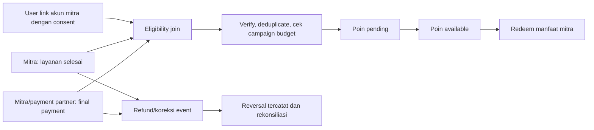

# Gen-Z — Riset instrumen, native token, dan reward

> **Status arsip, diperjelas 18 Oktober 2026:** isi berikut menyimpan riset/jawaban pada tanggal asal. Acuan implementasi aktif ialah [spec v1.1-base](../archive/mvp-spec-2026-10-18.md), [PRD v2.1](../archive/prd-2026-10-18.md) dan [riset Base/EVM 18 Oktober](base-evm-2026-10-18.md). Founder memilih Base kembali pada 18 Oktober; pilihan itu tidak memulihkan mock wallet D0, katalog privat tanpa login, note wajib atau simulated rewards. Scope aktif: proof wallet sejak demo pertama, model per offering/solar hybrid, tujuh tab, funded claim dan rewards informational. Angka/vendor/standar/terms historis di bawah bukan keputusan produksi baru.

**Tanggal:** 12 Oktober 2026. **Status:** memo rekomendasi untuk stress-test founder; bukan keputusan final atau dokumen penawaran. Mendampingi [PRD](../archive/prd-2026-10-18.md) dan [catatan founder](../archive/founder-interview-2026-10-17.md).

**Status setelah jawaban founder:** aset operasional berkontrak, native utility/governance terpisah dari saham perusahaan, dan partner-funded voucher/diskon disetujui [F]. GUI memilih project note/private credit beramortisasi sebagai kandidat utama pilot [F], bukan persetujuan terms/issuance tertentu. Subscription AI masuk opsi ekspansi [F]; first paid conversion menjadi rekomendasi campaign awal [R], bukan scope MVP. Analisis di bawah mempertahankan trade-off riset; status terbaru mengikuti catatan ini.

**[F]** keputusan founder; **[V]** fakta bersumber, dengan batas cakupan; **[R]** rekomendasi; **[A]** ilustrasi/asumsi; **[O]** belum diputuskan. Klaim laporan platform adalah self-reported, bukan hasil audit kami. Bukti yang belum tersedia ditandai **[perlu verifikasi]**.

## 1. Rekomendasi untuk kasus Gen-Z

**[R] Kandidat utama pilot: closed-end project financing melalui note/private credit beramortisasi, diterbitkan mitra proyek yang berwenang.** Dahulukan aset operasional yang mendukung renewable energy, kontrak monetisasi, dan histori collection yang bisa diperiksa. Investor memiliki klaim kontraktual terhadap penerbit; Gen-Z melakukan origination, kurasi, reporting dan servicing. Stablecoin tetap rail investasi sesuai keputusan founder. “Project note” adalah label rancangan ekonomi, belum nama instrumen hukum yang disahkan untuk Indonesia.

Alasannya: anchor investor perlu tahu siapa berutang, bagaimana modal kembali, apa prioritas pembayarannya, dan apa yang terjadi jika pembayaran macet. Pendapatan energi dapat menjadi sumber debt service; token tidak perlu memberi kepemilikan langsung pembangkit. Amortisasi mengurangi pokok bertahap, tetapi tidak menghapus default. Jangan memaksakan utang pada proyek yang kasnya tidak mampu membayar.

**[R] Alternatif kedua: partisipasi kas distribusi bersih**, bila operator tidak bersedia atau tidak layak menanggung kewajiban pembayaran debt. Ini mempertahankan arah revenue share founder, dengan pembayaran variabel dan ketentuan capital recovery yang eksplisit. Jangan melabeli seluruh distribusi sebagai profit atau menganggap modal pasti kembali saat tenor berakhir.

**[R] Native Gen-Z kelak paling fit sebagai utility/governance platform, terpisah dari hak proyek.** Fitur token harus punya kegunaan nyata sebelum TGE. Jangan menerjemahkan contoh Ondo menjadi saham perusahaan. Tokenized equity/revenue rights perusahaan merupakan alternatif berbeda yang membutuhkan desain issuer, investor eligibility dan hak ekonomi tersendiri.

**[R] Reward paling fit: partner-verified loyalty dengan ledger poin offchain.** Satu partner, satu account link, manfaat voucher/diskon yang didanai sponsor. Tidak perlu staking atau investasi. Konversi ke native tetap opsi masa depan, tanpa janji konversi atau harga sejak pilot.

Kandidat instrumen, arah native, tahap aset dan model sponsor kemudian disetujui sebagaimana status terbaru di atas. Peran penerbit/perantara dan syarat bukti reward juga telah disetujui; tidak ditanyakan ulang. Rincian economics, kontrak dan partner tetap memerlukan validasi.

## 2. Apa arti benchmark “mature dan berjalan baik”?

Untuk memo ini, maturity dinilai dari produk operasional, mekanisme hak yang dapat ditelusuri, pelaporan transaksi/collection, ukuran bisnis bertanggal, dan penanganan kerugian. Popularitas token bukan bukti product-market fit. AUM/TVL adalah stock pada suatu waktu; originations adalah volume penerbitan; revenue adalah pendapatan platform; profit memerlukan biaya. Keempatnya tidak boleh dipertukarkan.

| Benchmark | Bukti yang berguna | Batas maturity yang bisa disimpulkan | Pelajaran untuk Gen-Z |
|---|---|---|---|
| ReFi Hub | FAQ kontrak FLP II dan laporan distribusi Surya/CRN | Bukti penawaran dan laporan proyek lebih konkret; belum membuktikan audited profitability atau repayment sepanjang umur aset | Pembanding energi terdekat; baca terms tiap proyek, jangan menyalin headline yield |
| GEN / ge.network | Kategori solar, charging, storage, data center; telemetry dan instrumen offtake | Situs menampilkan pipeline dan status distribusi; bukti kontrak, payout dan laporan audit belum diverifikasi | Hubungkan produksi dengan finance; telemetry tetap perlu dipasangkan dengan collection |
| Habitat | Utility compute, Energy Vouchers dan marketplace dalam litepaper | Bukan bukti produk pembagian yield proyek energi yang mature | Berguna untuk monetisasi surplus energi melalui compute, bukan template klaim investor pilot |
| Ondo | Pemisahan ONDO governance dan USDY note dengan issuer khusus | Dokumen produk kuat; underlying Treasury tidak setara risiko aset energi | Pisahkan legal claim, produk yield dan token platform |
| Maple | Pelaporan AUM, originations, revenue dan buyback bertanggal | Bukti operasi bisnis paling kuat dalam sampel ini; bukan audit laba bersih atau bukti kredit tanpa loss | Servicing kredit dan fee nyata lebih relevan daripada emisi token |
| Centrifuge | Infrastruktur tokenisasi beberapa generasi, waterfall legacy, docs token/governance terbaru | Arsitektur mature; tidak semua pool berisiko sama atau merupakan energi | Hak per pool, penerbit dan segregasi; jangan langsung membangun multi-tranche |
| Goldfinch | Docs kredit v1 dan disclosure masalah Stratos | Pembanding historis dengan downside nyata; bukan rekomendasi semua model lamanya | Offchain underwriting dan recovery tetap menentukan hasil onchain |

Sumber utama: [ReFi FLP II](https://www.refihub.io/blog/investor-faq-flp-ii-solar-installation), [GEN](https://www.ge.network/), [Habitat litepaper](https://www.habitatprotocol.com/litepaper), [USDY](https://ondo.finance/blog/introducing-ondo-usd-yield-usdy), [Maple Agustus 2026](https://maple.finance/insights/maple-memo-august-2026), [Centrifuge legacy](https://docs.centrifuge.io/getting-started/legacy/), [Goldfinch Stratos](https://gov.goldfinch.finance/t/update-on-stratos-pool/1865).

### 2.1 ReFi Hub: satu platform, struktur proyek berbeda

**[V] FLP II:** FAQ menyebut solar rooftop, PPA 25 tahun, pendapatan listrik dan REC. Investor menerima komponen pembayaran tetap serta bagian gross revenue; ada kewajiban operator menambah pembayaran ketika gabungannya di bawah tingkat kontraktual. Token memberi hak pembayaran, bukan equity/voting aset. Target average annual cash yield 21,5% berbeda dari projected IRR 15,9%; sekitar sembilan tahun pembayaran lalu token berakhir. Angka ini proyeksi mereka, bukan realized return. [FAQ FLP II](https://www.refihub.io/blog/investor-faq-flp-ii-solar-installation)

**Inferensi:** model ini hybrid contractual payments/revenue participation. Adanya top-up memindahkan sebagian risiko kepada operator, bukan menghilangkannya. Gen-Z perlu mengevaluasi balance sheet pihak top-up sebelum menganggap pembayaran stabil. Persentase yield mereka bukan target yang layak ditiru tanpa model kas dan capital recovery.

**[V] Surya:** laporan 20 Januari–20 Februari 2026 mencatat gross USD5.440, biaya USD2.315, net USD3.125, lalu investor USD1.875, operator USD937, platform USD313. Ini mendekati pembagian net 60/30/10 dengan pembulatan, pada modal USD150.000. Laporan tersebut baru satu siklus operasi 30 hari yang dinormalisasi. [Laporan Surya](https://www.refihub.io/blog/project-surya-second-month-operating-distribution-report)

**[perlu verifikasi] Rekonsiliasi Surya:** biaya USD2.315 / 20.245 kWh ≈ USD0,114/kWh, berbeda dari angka biaya unit USD0,172 pada halaman. Angka selling USD0,269 dikurangi USD0,172 juga tidak sama dengan net USD0,154 yang ditulis. Bisa ada beda definisi/cakupan; minta penjelasan sebelum menggunakan unit economics itu. Ini ketidaksesuaian data, bukan kesimpulan fraud. Jangan annualize satu bulan sebagai yield jangka panjang.

**[V] CRN:** laporan 29 Januari 2026 menyatakan enam interim payments selama development dan belum ada produksi energi. Karena itu, pembayaran tersebut belum membuktikan operating yield pembangkit. [Laporan CRN](https://www.refihub.io/blog/crn-build-and-cashflow-update)

### 2.2 GEN dan Habitat: dekat secara tema, berbeda bukti

**[V] GEN** mencantumkan Solar Farm, Solar PV, EV Charging, Energy Storage dan Data Center; GEN Core untuk meter, Network untuk data, Invest untuk instrumen/distribusi. Klaim USD60M+ adalah asset pipeline, bukan otomatis dana terinvestasi. Halaman memuat status proyek, tetapi belum cukup untuk menilai realized yield. Nama listing mirip ReFi tidak membuktikan identitas legal proyek yang sama; lokasi FLP II pada sumber yang ditinjau berbeda dan perlu rekonsiliasi langsung. [GEN](https://www.ge.network/)

**[R]** Ambil pola data room dan monitoring; jangan menyalin klaim bahwa meter/oracle menggantikan audit. Produksi tidak membuktikan pelanggan membayar, pemilik piutang, atau seniority investor. EV+AI juga bukan diferensiasi unik jika kompetitor menyebut kategori tersebut.

**[V] Habitat** merancang $HABITAT → Green Credits → Energy Vouchers, yang backing/manfaatnya compute seperti inference/storage/mining. Litepaper menyebut transaction fee model. Ini utility service, bukan bukti hak dividen pembangkit atau investor yield seperti Gen-Z. [Habitat litepaper](https://www.habitatprotocol.com/litepaper)

**[R]** Monetisasi surplus compute dapat menjadi ekspansi setelah operator, demand, SLA dan economics terbukti. Surplus solar intermiten tidak otomatis cocok untuk semua workload AI yang membutuhkan uptime stabil.

### 2.3 Bukti bisnis dan downside dari pembanding yang lebih mapan

**[V] Maple:** memo 20 Agustus 2026 melaporkan AUM USD4,55B, H1 originations USD6,4B dan H1 revenue USD12,2M. Memo itu juga melaporkan buyback aktual SYRUP dengan 136.768 USDT, dinyatakan 10% monthly net revenue. Ini mendukung adanya aktivitas bisnis dan revenue, tetapi tidak membuktikan audited net profit. Lending dengan collateral kripto/liquidation mereka tidak dapat langsung diterapkan pada pembangkit yang illiquid. [Maple memo](https://maple.finance/insights/maple-memo-august-2026)

**[V] Centrifuge Tinlake legacy** memisahkan TIN junior/first-loss dan DROP senior, dengan pencatatan principal/interest dan waterfall. Docs sekarang menyebut V3 sebagai generasi terbaru. Jangan mendeskripsikan semua produk Centrifuge saat ini sebagai TIN/DROP. [Centrifuge legacy](https://docs.centrifuge.io/getting-started/legacy/)

**[V] Goldfinch** mempublikasikan masalah underlying pada Stratos dalam forum resmi. Ini bukti bahwa pool tokenized credit dapat memerlukan restrukturisasi dan recovery offchain; tidak dipakai sebagai estimasi loss rate seluruh platform saat ini. [Disclosure Stratos](https://gov.goldfinch.finance/t/update-on-stratos-pool/1865)

**[R] Kesimpulan benchmark:** pilih struktur dari karakter kas dan enforceability proyek. Platform mature tidak menghapus credit risk dengan token, dan platform yang berkembang belum tentu semua proyeknya menguntungkan.

## 3. Instrumen yang paling fit

| Opsi ekonomi | Hak investor dan sumber pembayaran | Trade-off | Fit Gen-Z |
|---|---|---|---|
| Amortizing project note/private credit | Kewajiban pokok dan imbal hasil oleh penerbit; kas kontrak energi untuk membayar | Hak modal/jadwal lebih jelas; default, collateral dan refinancing risk tetap ada | **[R] Kandidat utama**, jika debt capacity dan legal route lolos |
| Partisipasi kas distribusi bersih | Persentase kas tertagih setelah biaya/reserve yang diizinkan | Selaras dengan cash performance; potongan biaya dan capital recovery lebih sulit; payout bisa nol | **[R] Alternatif kedua**, dengan finite term dan hak akhir yang jelas |
| Revenue-linked note | Kewajiban note dengan formula pembayaran variabel menurut kontrak | Dapat lebih lentur, tetapi definisi maturity/minimum/deferred payment kompleks | Pertimbangkan jika ada kebutuhan nyata; bukan default MVP hybrid |
| Equity SPV | Kepemilikan dan residual cash/dividend, jika sah diterbitkan | Upside/residual, tetapi minority rights, valuasi, dilution dan exit sulit | Cocok bila tujuan akuisisi ownership; bukan rekomendasi pilot perantara |
| Invoice/receivable financing | Pembiayaan piutang listrik yang sudah timbul dan dapat dialihkan | Tenor pendek; bergantung invoice validity, debtor dan prior assignment | Kandidat produk berikutnya; bukan pembiayaan seluruh capex aset |

Ini klasifikasi ekonomi, bukan konfirmasi bahwa seluruhnya dapat ditawarkan melalui SCF Indonesia. Revenue-linked debt berbeda dari partisipasi kas tanpa kewajiban repayment. Instrumen juga berbeda dari chain atau stablecoin: mengganti USDC menjadi IDRX tidak mengubah sifat klaim tersebut.

### 3.1 Syarat agar kandidat debt diterima

**[R]** Pilih satu aset operasional dengan histori produksi, invoice dan collection yang memadai; sasaran DD awal 6–12 bulan data jika tersedia, bukan hukum universal. Offtake tersisa harus sesuai tenor, dengan ruang untuk keterlambatan/termination. Untuk BESS, kontrak capacity/tolling/availability lebih relevan daripada mengasumsikan arbitrage spread selalu positif. Charging tanpa minimum contracted demand lebih sensitif pada utilization.

Sebelum term sheet, validasi:

- Siapa issuer/obligor dan siapa berwenang mengalihkan piutang/mengagunkan aset. Operator belum tentu pemilik aset atau pemilik PPA.
- Existing lender, prior liens, negative pledge, izin/consent off-taker dan penggunaan dana: expansion, refinancing atau working capital.
- Collection account yang dapat direkonsiliasi; pembayaran tidak sekadar data meter atau invoice.
- Base/downside cash flow setelah biaya nyata, pajak, maintenance/replacement dan reserve. Ukuran utang serta jadwal diturunkan dari kas, bukan APY marketing.
- Security/assignment jika legal dan executable, security agent, sponsor exposure yang benar-benar didanai, covenants dan step-in/workout. Jangan menyebut secured/senior sebelum bukti tersedia.
- Hak investor saat telat/default/maturity; limited recourse atau kewajiban penuh dinyatakan tegas. Cash shortage tidak otomatis menghapus utang.

**[R] No-go:** operator menolak data/collection controls, aset telah diagunkan tanpa consent, dasar hukum penawaran tidak tersedia, atau biaya total membuat pembiayaan kalah dari bank/leasing. Tanpa legal rail stablecoin yang bisa dijalankan, demo tetap testnet; keputusan founder stablecoin tidak diganti diam-diam.

### 3.2 Pisahkan modal kembali dan keuntungan

**[A] Ilustrasi aritmetika, tanpa fee/pajak/default:** modal 100, tenor lima tahun, pokok dibayar 20 per tahun, bunga hipotetis 8% dari pokok awal tahun. Bunga 8 + 6,4 + 4,8 + 3,2 + 1,6 = 24; total distribusi 124 terdiri dari **100 pokok + 24 bunga**. Angka 8% bukan rekomendasi pricing.

Partisipasi kas yang membayar 10 per tahun selama lima tahun hanya mengembalikan total 50 jika tidak ada residual/repayment lain. Menyebutnya “10% yield” tanpa menjelaskan hilangnya hak akhir/modal dapat menyesatkan. Untuk participation, term sheet harus memilih apakah payout mencakup capital recovery, residual sale proceeds, buyout obligation, atau hak berakhir tanpa pembayaran pokok terpisah.

**[F] Preferensi kas distribusi bersih** tetap relevan untuk participation. Pada debt, kas bersih adalah input debt capacity dan cash waterfall; pembayaran tidak otomatis menjadi share dari net cash. Urutan kontraktual dan prioritas kepailitan harus dibedakan.

### 3.3 Waterfall dan pendapatan Gen-Z

**[R] Contoh debt waterfall yang masih perlu legal/credit review:** collected revenue → potongan operasi/pajak wajib yang disepakati → reserve yang ditetapkan → bunga dan amortisasi menurut seniority → catch-up/reserve replenishment → residual sponsor. Prioritas reserve versus debt service mengikuti dokumen, bukan aturan universal.

Gen-Z memperoleh fee jasa yang disclosed: origination untuk pekerjaan sourcing/DD, servicing/reporting berulang, dan biaya pihak ketiga yang jelas. Hindari spread tersembunyi, fee yang dipungut dua kali, atau insentif hanya mengejar issuance volume. Masukkan fee dan siapa pembayarnya dalam model kas investor maupun operator. Penempatan fee dalam waterfall harus disepakati, bukan otomatis mendahului investor.

**[R] Uji economics platform per deal:** recurring fee tertagih − servicing/compliance/reporting/reconciliation cost − expected remediation cost. Origination fee harus dibandingkan biaya DD/legal/audit aktual. Minimum ukuran deal dan fee belum bisa ditetapkan tanpa quotation dan pipeline; TVL besar tidak cukup bila biaya per proyek lebih besar dari pendapatan.

## 4. Native token: apa yang benar-benar dilakukan pembanding?

| Native | Mekanisme yang terverifikasi | Apa yang tidak otomatis didapat holder | Implikasi Gen-Z |
|---|---|---|---|
| ONDO | Governance Ondo DAO/Flux Finance; token produk USDY/OUSG terpisah | Saham, dividen, hak atas revenue perusahaan atau yield semua produk | Nama platform dapat sama; hak ekonomi tidak mengikuti nama |
| CFG | Token Ethereum ERC20; docs Juni 2026 menyebut inflasi tahunan 3% ke treasury; active DAO governance paused sejak keputusan November 2025 | Kepemilikan seluruh underlying pool atau pembagian fee kontraktual yang otomatis | Governance harus dijelaskan sesuai operasi nyata, bukan label DAO |
| SYRUP | Governance; Maple telah melaporkan buyback dari revenue; kebijakan berubah menurut proposal/periode | Dividen, jaminan harga, atau posisi lender syrupUSDC/USDT | Buyback berbasis bisnis nyata boleh dievaluasi kelak, bukan janji pilot |
| GFI | Docs **v1/legacy**: governance, incentives/grants; beberapa peran whitepaper belum live | Klaim otomatis atas seluruh pinjaman atau fitur yang baru direncanakan | Pisahkan fitur live, proposal dan roadmap; jangan meluncurkan utility semu |

Sumber: [ONDO token](https://docs.ondo.foundation/ondo-token), [ONDO risk factors](https://docs.ondo.foundation/coinlist/coinlist-risk-factors), [CFG token](https://docs.centrifuge.io/getting-started/token-summary/), [CFG governance](https://docs.centrifuge.io/getting-started/cfg-governance/), [Maple MIP-021](https://community.maple.finance/t/mip-021-a-rules-based-buyback-that-scales-with-revenue/1153), [Maple realisasi](https://maple.finance/insights/maple-memo-august-2026), [GFI v1](https://docs.goldfinch.finance/goldfinch/goldfinch-v1/protocol-mechanics/gfi-token).

**[V] ONDO** secara eksplisit tidak memberi hak shareholder, ownership, dividend atau perusahaan revenue/profit dalam risk factors. Docs menyebut initial supply 10 miliar dan tidak ada planned/scheduled inflation; risk factors membuka kemungkinan supply berubah lewat vote. Karena itu, jangan menyebut hard cap immutable atau menyalin jumlah supply. Unlock existing allocation juga bisa menambah circulating supply. [Risk factors](https://docs.ondo.foundation/coinlist/coinlist-risk-factors)

**[V] USDY**, pada dokumen peluncuran 2023, justru merupakan secured note oleh Ondo USDY LLC, dengan underlying Treasury/deposits dan yield dari underlying setelah spread. Ini contoh pemisahan issuer/claim, bukan template collateral, tingkat bunga atau redemption energi. Terms produk mutakhir perlu diperiksa bila dipakai lebih lanjut. [USDY launch](https://ondo.finance/blog/introducing-ondo-usd-yield-usdy)

**[V] Maple MIP-021** mengusulkan tiers buyback 10/20/30% monthly revenue dengan periode enam bulan; memo Agustus melaporkan pelaksanaan 10% monthly net revenue. Jangan memakai narasi lama “25% revenue untuk staking” sebagai kebijakan terkini, atau mengasumsikan buyback berarti token dibakar. [Proposal](https://community.maple.finance/t/mip-021-a-rules-based-buyback-that-scales-with-revenue/1153), [realisasi](https://maple.finance/insights/maple-memo-august-2026)

### 4.1 Tiga opsi Gen-Z

| Opsi | Pros | Cons | Rekomendasi |
|---|---|---|---|
| Native utility/governance | Memisahkan community participation dari risiko proyek; sesuai pola ONDO | Value accrual tidak otomatis; token tidak dibutuhkan bila utility belum nyata | **[R] Arah utama, ditunda** sampai kegunaan dan legal route nyata |
| Native dengan hak ekonomi platform | Hubungan revenue/equity lebih eksplisit jika hak sah | Lebih berat: issuer, disclosure, eligibility, pajak, corporate rights dan konflik voting | Eksplorasi terpisah; tidak digabung otomatis dengan loyalty |
| Poin saja, native tetap opsional | MVP lebih ringan; tidak menciptakan janji ekonomi token | Belum ada tradable community instrument | **[R] Implementasi pilot**, sesuai keputusan poin dahulu |

**[R] Bentuk target:** Token RWA Proyek untuk hak investasi; native bernama Gen-Z untuk kegunaan/governance yang diizinkan; Poin Gen-Z untuk loyalty nontransferable. Pemegang native tidak otomatis menerima yield proyek. Bila founder kelak memilih equity perusahaan, hak itu dirancang eksplisit sebagai instrumen perusahaan; pembagian lewat poin bukan shortcut.

Possible utility yang perlu diuji: voting budget komunitas tertentu, akses layanan platform yang memang tersedia, atau diskon fee dengan cost yang dapat dihitung. Governance tidak boleh mengubah hak proyek/collateral, memaksa distribusi, atau menggantikan investment committee/compliance. Jangan mewajibkan native untuk menggunakan layanan inti demi menciptakan demand buatan.

Buyback optional mengikuti fee platform yang benar-benar tertagih setelah kewajiban, operasi, pajak dan reserve. Jika nanti dipilih, tentukan authority, budget cap, treatment token hasil buyback dan pelaporan. Ini tidak menjamin return holder dan tetap perlu evaluasi legal. Jangan mengambil principal/yield proyek atau mengandalkan penjualan token baru untuk membayar buyback/reward.

Supply, allocation dan vesting **[O]**. Stress-test circulating unlock, treasury runway, reward liabilities dan konsentrasi voting sebelum TGE. Tidak ada conversion promise points→native/share di MVP.

## 5. Reward: pola yang paling fit dan bisa dioperasikan

**[F] Bukti wajib:** layanan eligible selesai + pembayaran final dikonfirmasi mitra + transaksi terhubung ke akun Gen-Z. Pilot satu partner, satu account linking method. QRIS, wallet terdaftar atau screenshot saja bukan entitlement.

**[V] Square Loyalty** memberi pembanding program account/order-based, redemption manfaat pembelian, event ledger dan penyesuaian poin karena refund. Daftar negara support pada docs tidak mencakup Indonesia: dipakai sebagai pola produk, bukan rekomendasi vendor Indonesia. [Square Loyalty](https://developer.squareup.com/docs/loyalty-api/overview)

**[V] Midtrans** mendokumentasikan verifikasi signature/status, idempotency, notifikasi yang bisa datang tidak berurutan dan status reconciliation. **[V] Stripe** juga mendokumentasikan duplicate deliveries dan event ordering. Ini dasar kontrol integrasi, bukan bukti layanan charging selesai atau kemitraan dengan Gen-Z. [Midtrans](https://docs.midtrans.com/docs/https-notification-webhooks), [Stripe](https://docs.stripe.com/webhooks)

Alur bisa berawal dari aplikasi partner atau Gen-Z. Payment notification saja tidak cukup; order/session ID harus cocok dengan service record dan pengguna. Account linking memakai autentikasi partner jika tersedia atau mekanisme one-time link dari akun partner yang sudah authenticated. Pilih satu setelah memeriksa kemampuan partner; jangan mengasumsikan OAuth/API yang belum ada. Guest retroactive claims dikeluarkan dari pilot **[R]**.

### 5.1 Kontrak data minimum dan acceptance criteria

**[R] Data minimum:** partner ID, event ID/type/version, service transaction ID, pseudonymous account reference, asset/service type, completion status/time, payment reference/status/amount/currency, refund reference/amount, dan campaign/rule version. Unit kWh/swap bila relevan, bukan wajib untuk semua layanan. Data personal hanya yang diperlukan dengan consent dan retention policy.

| Skenario | Perilaku yang disarankan |
|---|---|
| Service selesai, payment pending | Belum ada poin available |
| Payment sukses, service gagal/batal | Tidak ada reward walau uang sempat dibayar |
| Event ganda dari dua kanal | Satu entitlement untuk partner + service transaction; event dedupe saja belum cukup |
| Event datang tidak berurutan | Simpan evidence, cocokkan tiga syarat; timestamp kedatangan tidak menentukan status final |
| Event hilang atau selisih status | Reconcile ke sumber partner; tahan entitlement yang belum bisa diverifikasi |
| Refund penuh/sebagian | Batalkan/kurangi poin berdasarkan eligible net paid amount dan policy; simpan reversal, jangan hapus histori |
| Poin sudah digunakan sebelum refund | Catat deficit/dispute dan pihak penanggung biaya menurut terms; saldo negatif sendiri tidak mengembalikan voucher yang sudah dikonsumsi |
| Account link lepas/ganti/shared | Gunakan mapping yang valid saat transaksi; jangan pindahkan histori otomatis. [R] Pilot akun individu; fleet/shared accounts menunggu policy penerima benefit |
| Budget habis/event terlambat | Eligibility mengikuti waktu transaksi/campaign yang disepakati, bukan waktu webhook datang; reserve pending dan buffer reconciliation. Reserved entitlement valid serta voucher available tetap dipenuhi menurut terms |

**[R] Basis awal:** nilai layanan eligible yang selesai dan benar-benar dibayar setelah discount/refund dan komponen yang dikecualikan; dengan cap per user/transaksi/periode. Top-up saldo/deposit tidak langsung menghasilkan poin. Perlakuan pajak, admin fee, mixed services dan pembayaran campuran harus ditentukan. Hindari reward atas bagian yang dibayar voucher yang sama jika memicu loop. Rate/rupiah per poin belum dipilih. Program tidak boleh memberi lebih banyak manfaat daripada biaya transaksi untuk pola self-dealing/farming. Paid spend membuktikan penggunaan, bukan otomatis dampak emisi hijau.

**[R] Funding utama:** marketing budget partner yang sudah tersedia atau benefit inventory berkontrak, dengan budget campaign tercatat. Gen-Z boleh co-fund sebagai eksperimen CAC yang dibatasi runway. Jangan otomatis memotong waterfall investor. Manfaat paling awal voucher/diskon layanan partner; poin bukan saldo tunai, transferable token atau janji future equity.

KPI: attribution completeness, reconciliation exceptions, time-to-award, duplicate/fraud/reversal rate, funded outstanding reward liability, redemption, repeat use incremental dan contribution setelah reward. Bandingkan cohort/holdout bila feasible; pengguna loyal yang lebih aktif tidak membuktikan reward menyebabkan retention.

**Batas scope:** tidak semua aset energi punya layanan konsumen eligible. Pembayaran PPA oleh data center tidak otomatis program loyalty publik. Reward dapat menjadi pilot integrasi terpisah/P1 setelah energy investment berjalan; jangan memaksa MVP menyediakan charging/QRIS hanya agar poin ada.

## 6. Apa yang masuk MVP dan apa yang ditunda?

| Scope | Rekomendasi |
|---|---|
| Pilot investasi | Satu partner, satu aset, anchor eligible, satu instrumen setelah dipilih, satu stablecoin/chain setelah feasibility; data room, register/ledger dan reconciliation |
| Reporting | Pisahkan generation, invoiced revenue, collected cash, biaya, reserve, income dan principal recovery |
| Software demo 10–12 minggu | KYC/payment/telemetry dapat di-mock dengan label eksplisit; simulate delay/default/refund; testnet |
| Dana nyata | Memerlukan legal/partner/asset/security readiness; timeline software bukan janji licensing |
| Reward P1 | Satu partner/account link, verified events, funded campaign dan satu manfaat; boleh demo mocked, jangan klaim integrasi live |
| Ditunda | Public retail scale/SCF activation, native TGE, points conversion, multi-chain, secondary market, instant exit dan multi-tranche |

No-go nyata boleh menghasilkan keputusan tidak menerbitkan pool. Membangun smart contract tidak menyelesaikan kekurangan rights atau project economics.

## 7. Status regulasi dan stablecoin

**[F]** Stablecoin tetap pilihan investasi founder; IDRX kandidat. **[R]** Untuk kas dan hak denominasi rupiah, evaluasi IDRX lebih dahulu guna mengurangi currency mismatch terhadap USD; issuer/reserve/redemption, liquidity, supported chain, custody, on/off-ramp dan legal applicability masih harus diverifikasi. Untuk USD investor/offtake, USDC/USDT menjadi alternatif, dengan risiko FX eksplisit. Tidak ada final issuer/chain selection di memo ini.

Kabar “DPR mengesahkan aturan blockchain” mempunyai temuan relevan: berita resmi DPR tanggal 6 Oktober 2026 melaporkan persetujuan RUU Satu Data Indonesia dan secara eksplisit menyebut pemanfaatan blockchain/AI dalam tata kelola data. Ini kandidat yang cocok dengan kabar founder. Nomor/tanggal pengundangan dan pasal final belum dipastikan **[perlu verifikasi]**, termasuk setelah pencarian JDIH pada 12 Oktober. Berita legislasi tersebut tidak membuktikan izin umum penerbitan RWA yield atau subscription stablecoin. [DPR, pengesahan dan cakupan blockchain](https://emedia.dpr.go.id/news/2026/10/06/dpr-sahkan-uu-satu-data-indonesia-atur-ai-hingga-pembentukan-lembaga-sdi)

Counsel perlu menilai issuer/instrumen, distribusi anchor versus SCF, eligibility, fund flow stablecoin, custody/AKD, BI/PJP untuk pembayaran layanan, consumer protection dan tax. Gen-Z sebagai perantara masih dapat mempunyai kewajiban regulasi. Lihat analisis dan launch gates pada bagian 14 [PRD](../archive/prd-2026-10-18.md); memo ini bukan legal opinion.

## 8. Arsip frontier setelah riset dan status jawaban

Ketiga pertanyaan berikut telah dijawab “ya”. Detail pricing, tenor, collateral dan points rate menunggu data serta keputusan turunannya.

1. **Aset pilot:** setuju mendahulukan aset energi yang sudah beroperasi, berkontrak dan memiliki histori collection untuk DD, sementara greenfield ditunda? **Rekomendasi: ya.**
2. **Native Gen-Z:** setuju arah utility/governance terpisah dari saham/revenue rights perusahaan, tetap ditunda sampai ada utility dan kelayakan legal? **Rekomendasi: ya.**
3. **Reward economics:** setuju partner-funded points yang dapat ditukar voucher/diskon layanan sebagai manfaat pilot, dengan Gen-Z co-fund terbatas sebagai eksperimen dan tanpa automatic native conversion? **Rekomendasi: ya.**

Setelah jawaban, GUI dipakai untuk memilih kandidat project note/private credit beramortisasi. Cabang berikutnya mencakup underwriting/terms/legal wrapper, shortlist partner/proyek, investor/currency, founder budget/runway, sponsor/benefit contract dan kewenangan governance. Konfirmasi pemahaman bersama mendahului implementasi dana nyata.

## 9. Addendum reward AI/compute dan pilihan GUI

**[F] Scope:** founder menambahkan subscription AI sebagai opsi ekspansi. Gemini Pro/Ultra, Claude dan ChatGPT adalah contoh; belum ada partner/program Gen-Z yang disepakati. MVP tetap pembiayaan energi operasional. Loyalty AI tidak berarti subscription/vendor AI menjadi underlying pool RWA.

| Jalur | Fakta/batas bukti | Implikasi produk |
|---|---|---|
| Google Workspace affiliate/referral | Program resmi mempunyai tracking; referral FAQ menyebut review setelah pelanggan membayar setidaknya 90 hari | Pola conversion nyata, tetapi Workspace business berbeda dari Google AI Pro/Ultra individu; izin reward sharing dan per-user attribution perlu diperiksa |
| Claude guest pass | Halaman resmi menjelaskan trial Pro melalui guest pass | Trial redemption bukan bukti paid purchase atau affiliate komersial |
| Claude Partner Network | Program resmi membantu adopsi enterprise | Kandidat partnership B2B, bukan bukti retail affiliate terbuka |
| Subscription Gemini/Claude/ChatGPT melalui Gen-Z | Belum ada kontrak, authorized reseller agreement atau conversion/refund feed yang disepakati | [perlu verifikasi partner]; jangan memberi poin dari klik/screenshot atau mengiklankan integrasi sebagai live |

Sumber: [Workspace Affiliate](https://workspace.google.com/affiliate-program/), [Workspace Referral FAQ Indonesia](https://workspace.google.com/intl/en_id/landing/partners/referral/faqs/), [Claude guest passes](https://support.claude.com/en/articles/12875061-claude-code-guest-passes), [Claude Partner Network](https://www.anthropic.com/news/claude-partner-network). Program berbeda menurut produk, wilayah dan terms. Halaman partner tidak membuktikan Gen-Z diterima atau incentivized traffic diizinkan.

**[R] Mekanisme ekspansi:** partner/program mengizinkan insentif → user link akun/attribution ID dengan consent → pembelian eligible → aktivasi/fulfillment + payment final terkonfirmasi partner → approved conversion cocok dengan akun Gen-Z → reserve budget → poin pending/available sesuai terms. Jika affiliate commission belum final, availability menunggu approval/funding atau sponsor menanggung liability dengan budget yang sudah tersedia. Laporan agregat tanpa mapping akun tidak cukup.

**[R] Campaign awal:** satu reward pada first paid conversion eligible, dengan cap; klik/signup/trial tidak dihitung sebagai pembelian. Renewal diuji kemudian jika ada recurring evidence dan budget. Kontrak menentukan attribution window, refund/chargeback, self-referral, duplicate, cookie/account mismatch, promo stacking, existing customer exclusion dan biaya reward setelah rejection. Jangan menjanjikan reward bulanan dari komisi one-time.

Commission/funded marketing budget partner dapat mendanai poin setelah biaya/pajak dan reserve yang diperlukan. Principal/yield proyek energi tidak membiayai loyalty AI. Tidak perlu mengakses chat/prompt user atau meminta password vendor. Subscription tidak membuktikan energi berasal dari aset Gen-Z; klaim green compute memerlukan hubungan energi/compute dan bukti terpisah.

**GUI keputusan:** dua pertanyaan dikirim melalui form bawaan Codex dengan rekomendasi dan jawaban sendiri. Founder memilih kandidat debt pada Q1 dan opsi ekspansi AI pada Q2. Preferensi menggunakan form ini untuk pertanyaan selanjutnya dicatat dalam sesi; tidak ada perubahan setting global.
**Pembaruan koreksi founder:** persona loyalty adalah pengguna layanan mitra dengan akun/wallet verified dan evidence transaksi; chain Base tetap. Arah investasi dua input lokal + USD, Indonesia IDRX + native USDC [R], dengan hak IDR untuk kas IDR. TAM/SAM/SOM, public app benchmark dan schema/MVP options diperbarui di [memo terbaru](market-features-2026-10-12.md) dan [spec MVP](../archive/schema-flows-2026-10-18.md). Detail memo lama adalah snapshot riset sebelumnya.
